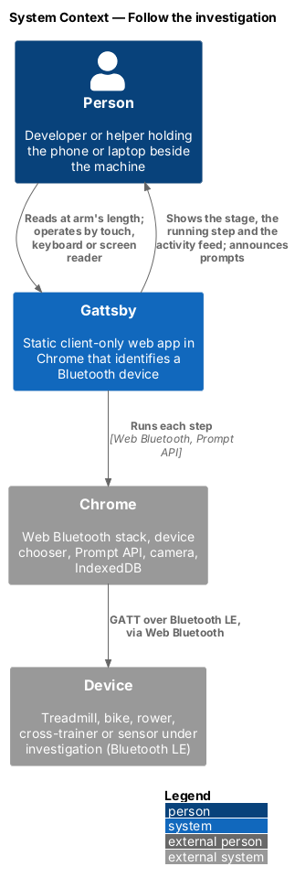
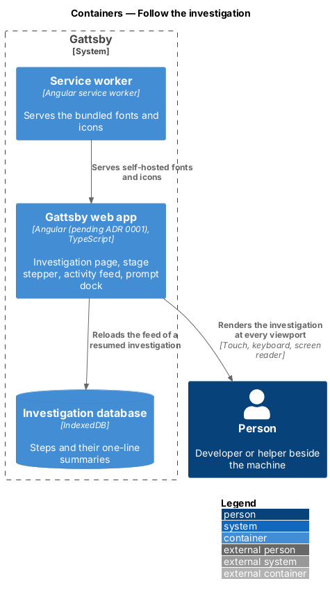
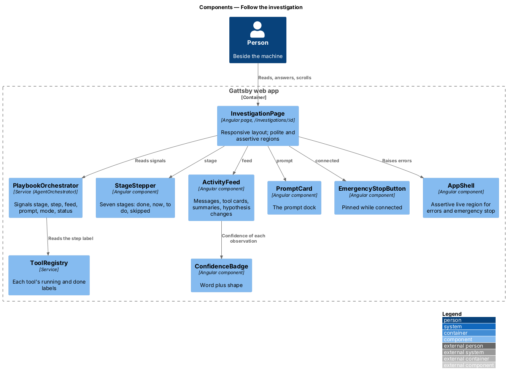
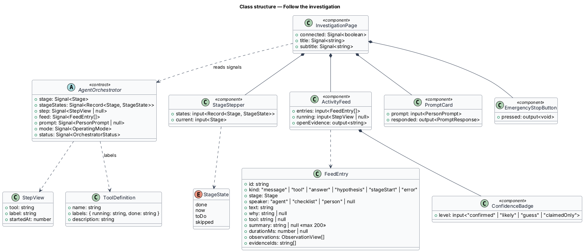
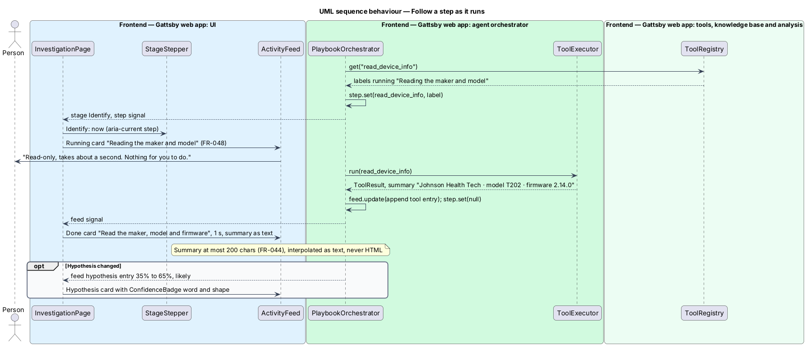
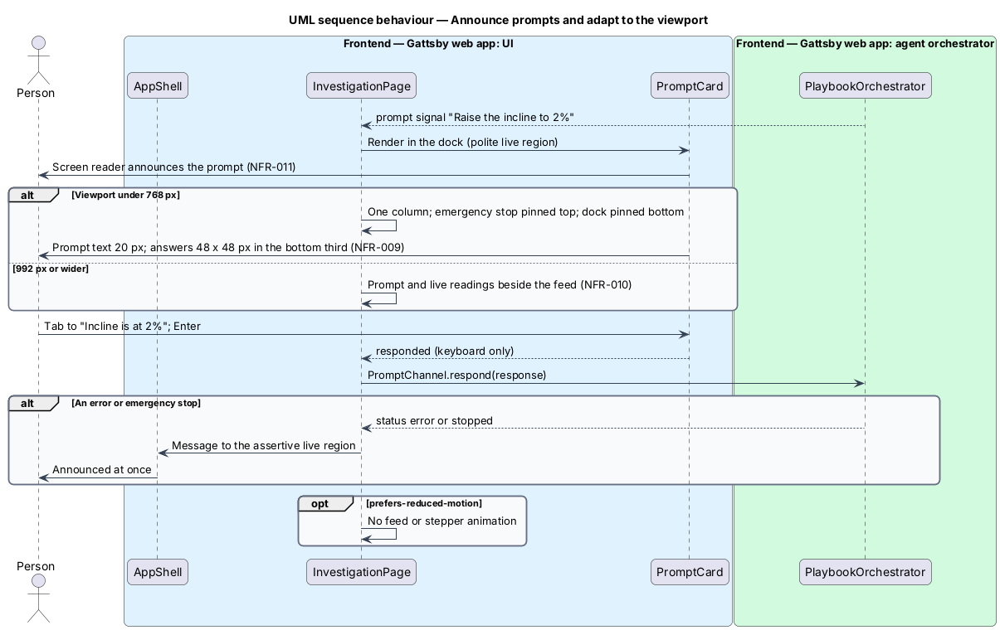

# Follow the investigation

## Overview

While the agent works, the person stands beside the machine with a phone in one hand. They look for,
at a glance and from arm's length, which stage the investigation has reached, what is running
now and why they are being asked something. This feature is the Investigation page's frame around
every step: the stage stepper, the running step in plain language, the activity feed of one-line
summaries, the prompt dock, and the layout and accessibility rules that keep all of it usable on a
phone, a laptop and a screen reader. It belongs to the investigation subsystem and spans all seven
playbook stages.

**stage stepper** — row of the seven playbook stages, each marked done, now, to do or skipped, in
words as well as shape

**running step** — tool call in progress, named by its plain-language label, for example "Reading the
maker and model"

**activity feed** — ordered list of what has happened in the investigation: the agent's or
checklist's messages with their reason, each tool call with its one-line summary, the person's
answers and each hypothesis change

**dock** — region at the bottom of the Investigation page on narrow screens, and beside the feed on
wide ones, that holds the one current prompt

The Investigation page shows the title (device name, or "New investigation"), a subtitle with the
mode and stage ("Agent · Identify"), the stage stepper, the feed and the dock
(`docs/mocks/pages/investigation/identify.html`, where the step reads "Reading the maker and model").
The same frame appears in every state: `prepare`, `find`, `find-candidates`, `find-cancelled`,
`identify`, `proprietary`, `control`, `checklist`, `held-by-other`, `loading` and `error`
(`docs/mocks/pages/investigation/`).

The feature exists because the person follows prompts from an agent they cannot question, in a store
with bright light and noise. Seeing what the agent does, and why, is what makes its requests
trustworthy.

## Description

The design introduces these building blocks in the Angular (pending ADR 0001) workspace under
`frontend/src/app/`:

- **`AgentOrchestrator`** / **`PlaybookOrchestrator`** (`agent/agent-orchestrator.ts`,
  `agent/playbook-orchestrator.ts`) — exposes the read-only signals the page renders: `stage`,
  `stageStates`, `step` (the running step or `null`), `feed`, `prompt`, `mode` and `status`. It sets
  `step` before a tool runs and appends a `FeedEntry` when it ends.
- **`ToolDefinition.labels`** (`tools/tool-definition.ts`) — each tool's plain-language labels:
  `running` ("Reading the maker and model") and `done` ("Read the maker, model and firmware"). The
  feed shows the tool's registry name beside them (`read_device_info`). Adding a tool adds its
  labels with its registry entry, with no change to the page (NFR-022).
- **`FeedEntry`** (`agent/feed-entry.ts`) — one feed item: `id`, `kind` (`message`, `tool`,
  `answer`, `hypothesis`, `stageStart`, `error`), `stage`, `speaker` (`agent`, `checklist` or
  `person`), `text`, `why`, `tool`, `summary` (at most 200 characters, FR-044), `durationMs`,
  `observations` and `evidenceIds`. On resume the feed is rebuilt from the stored steps.
- **`InvestigationPage`** (`pages/investigation/investigation.page.ts`) — lazy route
  `/investigations/:id`. Composes the app bar, stepper, feed, dock, live readings and banners, and
  owns the responsive grid. It shows `EmergencyStopButton` whenever a device is connected (see the
  emergency-stop design).
- **`StageStepper`** (`ui/stage-stepper/stage-stepper.component.ts`) — presentation component. An
  ordered list labelled "Playbook, stage 3 of 7: Identify"; the current stage carries
  `aria-current="step"`, and each stage's state is in text ("Identify: now"), not only colour.
- **`ActivityFeed`** (`ui/activity-feed/activity-feed.component.ts`) — presentation component. An
  ordered list of `FeedEntry`s grouped by stage, with the running step as its last item. Each tool
  card shows the label, the tool name, the duration, the summary, the observations with their
  `ConfidenceBadge`, and an "Evidence" link. Output: `openEvidence(id)`.
- **`ConfidenceBadge`** (`ui/confidence-badge/confidence-badge.component.ts`) — the word
  ("confirmed", "likely", "guess", "claimed only") with its shape (filled, half, ring, dashed).
- **`PromptCard`** (`ui/prompt-card/prompt-card.component.ts`) — renders the current prompt in the
  dock (see the ask-the-person design).
- **`AppShell`** (`app-shell.ts`) — holds the assertive live region used for errors and the emergency
  stop, so that announcement survives a route change.
- **`ModeBanner`** and **`ConnectionBanner`** (`notifications/…`) — appear above the feed; their rules
  are in the choose-operating-mode and recover-a-dropped-connection designs.

### What the person sees

| Element | Source | Example |
|---|---|---|
| Subtitle | `mode`, `stage` | "Agent · Identify" |
| Stage stepper | `stageStates` | "Prepare: done", "Identify: now", "Proprietary path: skipped" |
| Running step | `step.label` | "Reading the maker and model" with "Read-only, takes about a second. Nothing for you to do." |
| Message | `FeedEntry` `message`, with `why` | "Why: Chrome only lets a page see a device you choose yourself." |
| Tool card | `FeedEntry` `tool` | `enumerate_gatt` · "Connect and list everything it exposes" · 3 s · "Connected. 4 services, 3 of them standard." |
| Hypothesis change | `FeedEntry` `hypothesis` | "Standard fitness machine (FTMS)" 0% → 35%, guess |

Every string in the feed, including model text, device names and summaries, is bound with Angular
interpolation and shown as text, never as HTML (FR-048; see the render-untrusted-text design).

### Layout rules

| Viewport width | Layout |
|---|---|
| Under 576 px, 576 px and up | One column; the app bar with the emergency stop is pinned at the top; the dock is pinned at the bottom |
| 768 px and up | One wider column; the same pinned app bar and dock |
| 992 px and up | The prompt dock and the live readings sit beside the feed |
| 1200 px and up | The same two columns, with a wider feed |

- No screen scrolls horizontally at any width, in portrait or landscape (NFR-010). Long UUIDs, hex
  and device names wrap inside their own box.
- Under 768 px, prompt text is at least 20 px and live metric values at least 32 px; touch targets are
  at least 48 × 48 px with 8 px between them; the primary answer lies in the bottom third
  (NFR-009).
- One question or instruction per screen: the dock holds one prompt.

### Accessibility rules

- Every control is reachable and operable by keyboard with a visible focus; a keyboard alone reaches
  the verdict of a simulated FTMS investigation (NFR-011).
- The dock is a polite live region, so each new prompt is announced. Errors and the emergency stop
  go to the assertive region in `AppShell`. A new prompt does not move focus; a dialog does.
- Colour never carries a state alone: stages, confidence and verdicts all have a word.
- Prompt text and the emergency stop reach at least 7:1 contrast for bright store light; all other
  text meets WCAG 2.2 AA. Signal orange as the current-stage segment reaches 2.76:1 and is kept
  because the stage name is always in text beside it; confirming this is `<TO SUPPLY>` (mocks
  README, open question 3).
- Under `prefers-reduced-motion: reduce`, the feed and stepper do not animate.
- Fonts (Geist, Geist Mono) and icons are bundled and self-hosted.

### Tests that prove it

The Investigation page object exposes the stage, the step and the feed. One behaviour spec checks
that the stage reads "Identify" and the step reads "Reading the maker and model" while the fake
device delays its Device Information read. One runs a simulated FTMS investigation by keyboard only.
The responsive and accessibility sweeps (every state at 360, 576, 768, 992 and 1280 px, and an axe
scan) are written and kept current but run only when a person asks.

### Built in journey 2

`PlaybookOrchestrator` exposes the stage, stage states, running step, feed, prompt and mode; `buildFeed` (`agent/feed-builder.ts`) rebuilds the feed from the committed steps, so a reopened investigation shows what it showed while running. A tool card lists the step's observations with their badges (every service for `enumerate_gatt`, otherwise those tagged *likely* or *guess*) instead of the mock's row table. Not built yet: the agent composer (journey 6), the mode and connection banners (journeys 6, 7 and 10), the "Evidence" links (journey 14), Pause and the options sheet (journey 11). Before a step that waits for the person, the step's message and the question are shown in the feed at once, so the feed reads as the mocks do.

## Requirements

The feature realizes the following level-2 (L2) requirements; each refines the level-1 (L1)
requirement cited beside it.

| L2 ID | Refines (L1) | Requirement |
|-------|--------------|-------------|
| [`FR-048`](../../../specs/L2.md#fr-048-show-what-the-agent-is-doing) | `L1-010` | Gattsby must show the current playbook stage, the step that is running in plain language, and an activity feed of the one-line summaries, so that the person always knows what is happening and why they are being asked something. Model text is shown as text, never as HTML. |
| [`NFR-009`](../../../specs/L2.md#nfr-009-usable-one-handed-at-arms-length) | `L1-021` | Every prompt must be readable at arm's length and usable one-handed: prompt text at least 20 px and live metric values at least 32 px on viewports under 768 px wide; touch targets at least 48 × 48 px with at least 8 px between them; the primary action within the bottom third of the screen on viewports under 768 px wide; one question or instruction per screen. |
| [`NFR-010`](../../../specs/L2.md#nfr-010-responsive-across-all-viewports) | `L1-021` | Every screen must work at extra small (<576 px), small (≥576 px), medium (≥768 px), large (≥992 px) and extra large (≥1200 px) widths, in portrait and landscape, with no horizontal scroll. Under 768 px: one column, the emergency stop pinned at the top, the primary action pinned at the bottom. From 992 px: the prompt and live metrics beside the activity feed. |
| [`NFR-011`](../../../specs/L2.md#nfr-011-accessible-to-wcag-22-aa) | `L1-021` | Every screen must meet WCAG 2.2 AA: keyboard operable with a visible focus, labelled controls, prompts announced to screen readers through a polite live region (emergency stop and errors through an assertive one), colour never the only carrier of a state, and motion respecting `prefers-reduced-motion`. Prompt text and the emergency stop must reach a contrast of at least 7:1 for reading in bright store light. |

## Diagrams

### System context

Gattsby shows the person what it is doing on the device while Chrome carries each step to the
machine; the person follows by sight, touch, keyboard or screen reader.

### Containers

The web app renders the investigation from its live signals and, on resume, from the stored steps;
the service worker serves the self-hosted fonts and icons.

### Components

`InvestigationPage` reads the orchestrator's signals and passes them to `StageStepper`,
`ActivityFeed` and `PromptCard`; `AppShell` holds the assertive live region.

### Class structure

The orchestrator contract exposes signals of `StepView` and `FeedEntry`; the page composes the
presentation components, which take inputs and emit outputs only.

### Behaviour — follow a step as it runs

The orchestrator names the running step from the tool's label, then replaces it with a done card and
its summary, rendered as text; a hypothesis change adds its own card.

### Behaviour — announce prompts and adapt to the viewport

A new prompt is announced through the dock's polite live region and laid out for the viewport; the
person answers by keyboard; errors and the emergency stop are announced assertively.

