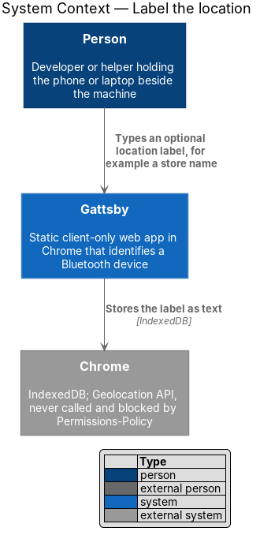
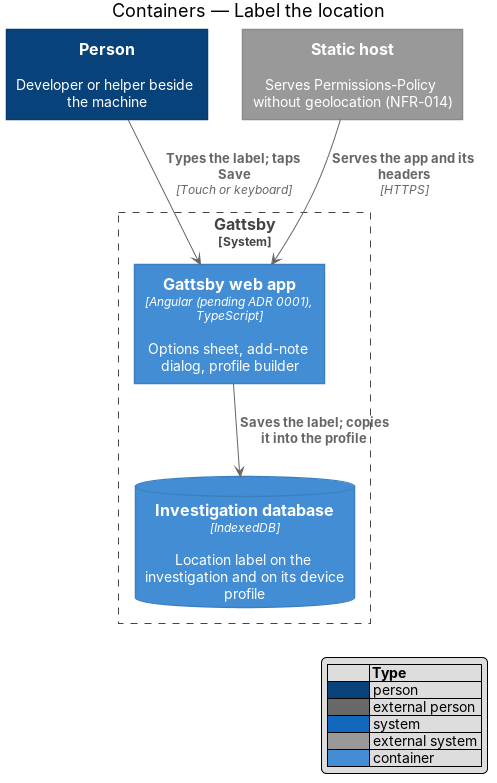
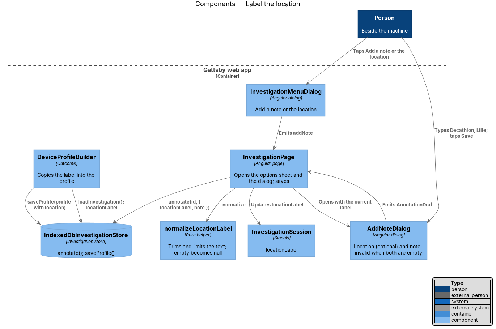
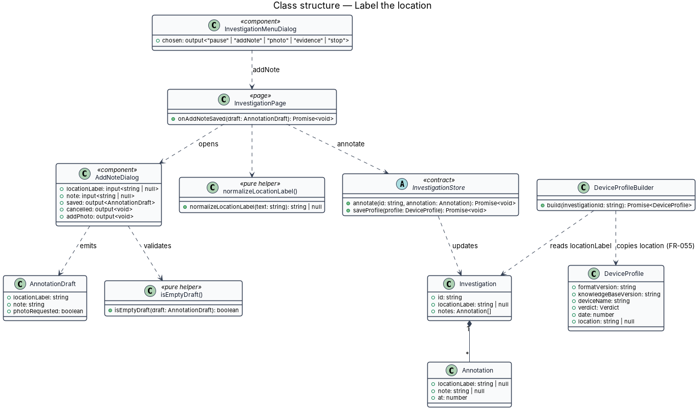
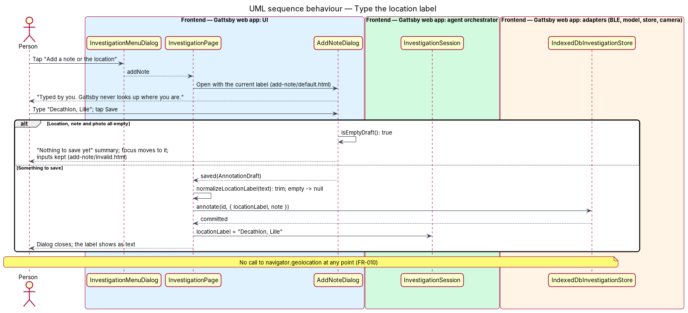
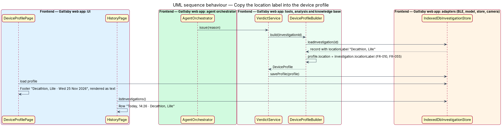

# Label the location

## Overview

A developer who identifies machines in more than one store or gym needs to tell later which
investigation was which: the same treadmill model can behave differently at Decathlon, Lille and at
Fitness Park Lille. This feature lets the person type an optional location label for an
investigation, keeps it with the investigation, and copies it into the device profile. It also states
the reverse: Gattsby never works out where the person is on its own. It belongs to the investigation
subsystem and is reached from the investigation page at any stage.

**location label** — free text the person types to name where the investigation took place, such as a
store name; optional, never derived by Gattsby

**annotation** — what the person adds to a running investigation by hand: a location label, a note or
both, each stored as text

The person opens the investigation options sheet and chooses "Add a note or the location"
(`docs/mocks/dialogs/investigation-menu/default.html`). The dialog "Add to this investigation" holds a
"Location (optional)" field whose hint says the label is typed by the person and that Gattsby never
looks up the location, a "Note" field and "Add photo" (`docs/mocks/dialogs/add-note/default.html`).
Saving with every field empty shows "Nothing to save yet" with the inputs kept
(`dialogs/add-note/invalid.html`). The label then appears wherever the investigation is named: the
home screen's resume card ("Resume: spin bike, Basic-Fit Roubaix"), the history row ("Today, 14:26 ·
Decathlon, Lille", `pages/history/default.html`), the verdict's header, and the device profile's
footer ("Decathlon, Lille · Wed 25 Nov 2026", `pages/device-profile/default.html`).

## Description

The design introduces these building blocks in the Angular (pending ADR 0001) workspace under
`frontend/src/app/`:

- **`InvestigationMenuDialog`** (`dialogs/investigation-menu/investigation-menu.dialog.ts`) —
  presentation component. It emits the chosen item; "Add a note or the location" emits `addNote`.
- **`AddNoteDialog`** (`dialogs/add-note/add-note.dialog.ts`) — presentation component. Inputs: the
  current label and note. Outputs: `saved` with an `AnnotationDraft`, `cancelled`, and `addPhoto`,
  which hands over to the photo flow (see
  [read-a-photo](../../identification/read-a-photo/README.md)). It uses `isEmptyDraft()` to show the
  invalid state: the error summary takes focus, and the inputs are never cleared.
- **`normalizeLocationLabel`** (`agent/location-label.ts`) — pure helper with unit tests. It
  trims the text, collapses runs of white space, and returns `null` for an empty label. The maximum
  length is `<TO SUPPLY>`; FR-010 sets none.
- **`InvestigationPage`** (`pages/investigation/investigation.page.ts`) — opens the dialogs, normalises
  the draft, calls `InvestigationStore.annotate()`, and updates `InvestigationSession.locationLabel`
  once the write commits.
- **`InvestigationStore.annotate(id, annotation)`** (`store/indexed-db-investigation-store.ts`) — sets
  the investigation's `locationLabel` and appends the note, in one transaction.
- **`DeviceProfileBuilder`** (`outcome/device-profile-builder.ts`) — copies the investigation's
  `locationLabel` into `DeviceProfile.location` when it builds the profile (FR-055; see
  [build-the-device-profile](../../outcome/build-the-device-profile/README.md)).

### Rules the label follows

1. The label is optional. An investigation without one is complete, and its profile's `location` is
   `null`.
2. The label is typed by the person and nothing else. No code in Gattsby calls
   `navigator.geolocation`, derives a place from the network, or reads location from a photo. The
   hosting's `Permissions-Policy` allows only `bluetooth` and `camera` (NFR-014), so Chrome would
   refuse a geolocation call; Gattsby never asks for the location permission (NFR-016).
3. The label is stored and shown as text, never as HTML (NFR-013).
4. The label can be set or changed while the investigation runs or is paused. The device profile
   takes the label the investigation holds when the profile is built; the mocks offer no way to edit
   it afterwards.
5. The label leaves the device only inside an export the person starts (NFR-012).

### Data shapes

| Type | Fields |
|---|---|
| `AnnotationDraft` | `locationLabel`, `note`, `photoRequested` |
| `Annotation` | `locationLabel`, `note`, `at` |
| `Investigation` (fields this feature uses) | `locationLabel`, `notes` |
| `DeviceProfile` (field this feature sets) | `location` |

### Errors

| Code | Raised by | Meaning to the person |
|---|---|---|
| (invalid draft) | `AddNoteDialog` | "Nothing to save yet": add a location, a note or a photo before saving. |
| `STORAGE_FULL` | `InvestigationStore.annotate` | The label is not saved; the person is told to export and delete old investigations (NFR-008). |

### Tests that prove it

The acceptance specs use the fake `navigator.bluetooth` (`e2e/fixtures/fake-bluetooth.ts`) playing the
FTMS treadmill and the fake `LanguageModel`, with the `InvestigationPage`, `AddNoteDialog`,
`VerdictPage` and `DeviceProfilePage` page objects:

- Typing "Decathlon, Lille" and saving, then finishing the investigation, shows the label on the
  device profile, and the exported profile JSON holds it in `location`.
- A fixture replaces `navigator.geolocation`'s methods with recorders before the page loads; every
  behaviour spec fails if any of them is called.
- Saving with every field empty shows "Nothing to save yet" and keeps focus on the summary.
- A label of `` is shown literally in the history and the profile, and no
  script runs.

Unit tests cover `normalizeLocationLabel` for white space, an empty label and the length limit once it
is supplied.

## Requirements

The feature realizes the following level-2 (L2) requirements; each refines the level-1 (L1)
requirement cited beside it.

| L2 ID | Refines (L1) | Requirement |
|-------|--------------|-------------|
| [`FR-010`](../../../specs/L2.md#fr-010-label-the-location) | `L1-003` | The person may type an optional location label (for example, a store name). Gattsby must never determine location on its own. |

## Diagrams

### System context

The person types the label into Gattsby, which stores it as text in Chrome's IndexedDB; the Geolocation
API is never used.

### Containers

The web app saves the label on the investigation and copies it into the device profile; the static
host's Permissions-Policy leaves geolocation disabled.

### Components

`InvestigationPage` opens `AddNoteDialog` from the options sheet, normalises the label and saves it
through the store; `DeviceProfileBuilder` later reads it from the store into the profile.

### Class structure

`AddNoteDialog` emits an `AnnotationDraft`; the investigation keeps its `locationLabel` and its
`Annotation`s, and `DeviceProfileBuilder` copies the label into `DeviceProfile.location`.

### Behaviour — type the location label

An empty draft is refused in place with the inputs kept; otherwise the normalised label is committed
and shown, with no geolocation call at any point.

### Behaviour — copy the label into the device profile

When the verdict is issued, `DeviceProfileBuilder` copies the investigation's label into the profile,
and the profile and the history show it as text.

