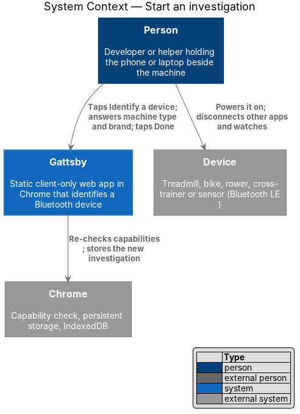
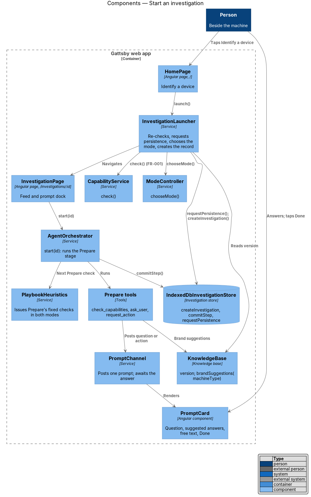
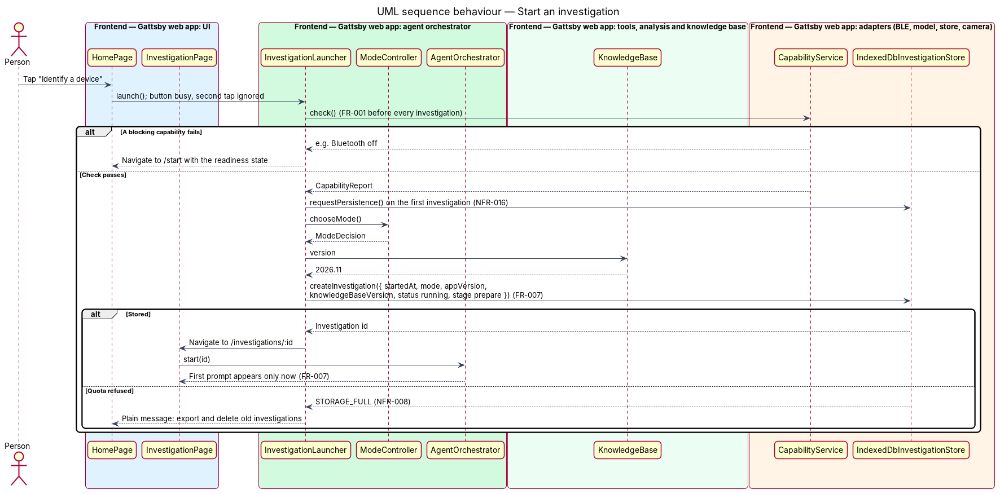
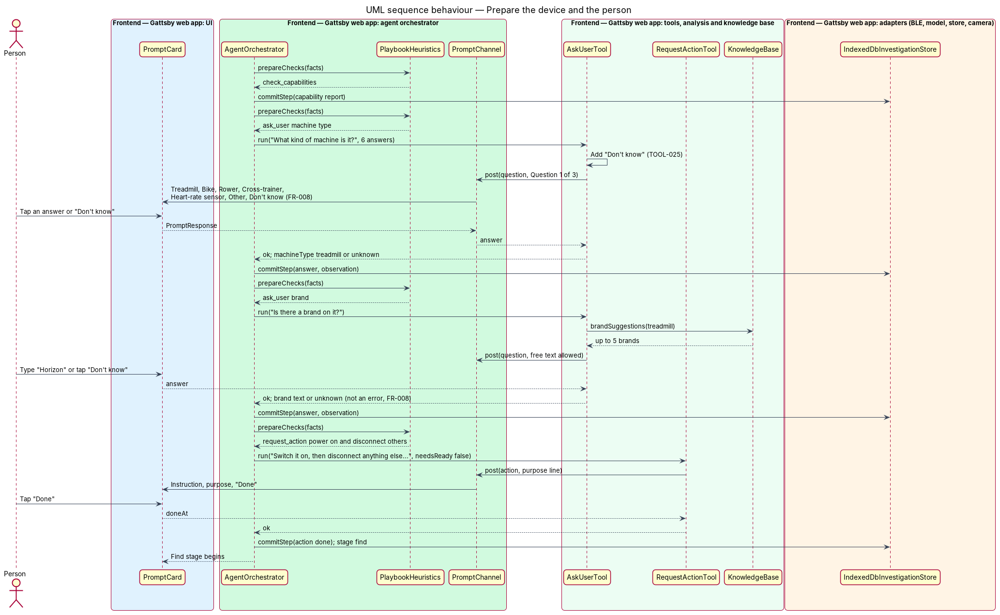

# Start an investigation

## Overview

An investigation is one attempt to identify one device, from the person's first tap to the verdict
(`A-03`). This feature covers its first moments: the one tap on the home screen that creates the
investigation record, and the Prepare stage that learns what kind of machine it is and gets the
device ready to be found. It belongs to the investigation subsystem and runs before any Bluetooth
scan, so no device is connected yet and no emergency stop is shown.

**investigation record** — stored history of one investigation: its start facts, every step, raw
traffic, the person's answers and the hypotheses over time

**Prepare stage** — first of the playbook's seven stages: check capabilities, ask the machine type and
the brand, then ask the person to power the device on and free it from other connections

**prepare facts** — what Prepare learned: machine type, brand, and whether the person said the device
is on and free; each may be `unknown`

The home screen offers "Identify a device" as its primary action, on the empty home screen and beside
saved devices (`docs/mocks/pages/home/default.html`, `home/empty.html`, `home/checklist.html`). The
tap opens the investigation page in its Prepare state (`docs/mocks/pages/investigation/prepare.html`):
the app bar reads "New investigation" and "Agent · Prepare", the stage track marks Prepare as current,
and the prompt dock asks "What kind of machine is it?" as "Question 1 of 3", with seven 48 px answers
including "Don't know". The brand question and the "switch it on, then disconnect anything else"
action follow, each with its purpose line, as the feed in `investigation/checklist.html` shows.

## Description

The design introduces these building blocks in the Angular (pending ADR 0001) workspace under
`frontend/src/app/`:

- **`HomePage`** (`pages/home/home.page.ts`) — renders "Identify a device" and calls
  `InvestigationLauncher.launch()`. The button shows a busy state while the launch runs, and a second
  tap during that time is ignored, so one tap makes one investigation.
- **`InvestigationLauncher`** (`agent/investigation-launcher.ts`) — creates the investigation:
  1. runs `CapabilityService.check()` (FR-001, see
     [check-capabilities](../../environment/check-capabilities/README.md)); a blocking failure sends
     the person to `/start` and creates nothing;
  2. on the first investigation, asks `InvestigationStore.requestPersistence()`, which calls
     `navigator.storage.persist()` (NFR-016, NFR-008);
  3. asks `ModeController.chooseMode()` for the mode (see
     [choose-the-operating-mode](../../environment/choose-the-operating-mode/README.md));
  4. reads `KnowledgeBase.version` and the build's `APP_VERSION`;
  5. awaits `InvestigationStore.createInvestigation()` and only then navigates to
     `/investigations/:id`.
- **`APP_VERSION`** (`core/app-version.ts`) — injection token holding the version the build stamps
  from `package.json`, for example `0.1.0`.
- **`InvestigationStore.createInvestigation`** (`store/indexed-db-investigation-store.ts`) — writes
  the new `Investigation` in one transaction and resolves when it commits.
- **`AgentOrchestrator.start(id)`** (`agent/agent-orchestrator.ts`) — loads the investigation into
  `InvestigationSession` and runs the Prepare stage. The first prompt is posted only after
  `createInvestigation` has resolved (FR-007).
- **`PlaybookHeuristics.prepareChecks(facts)`** (`agent/playbook-heuristics.ts`) — returns Prepare's
  next fixed check: `check_capabilities`, then `ask_user` for the machine type, then `ask_user` for
  the brand, then `request_action` to power on and disconnect others. Prepare's checks are the same
  in both modes and need no model call (FR-046).
- **`AskUserTool`** (`tools/person/ask-user.tool.ts`) and **`RequestActionTool`**
  (`tools/person/request-action.tool.ts`) — post the prompts through `PromptChannel` and return the
  answer (see [ask-a-question](../../person-interaction/ask-a-question/README.md) and
  [request-a-physical-action](../../person-interaction/request-a-physical-action/README.md)).
- **`KnowledgeBase.brandSuggestions(machineType)`** (`knowledge-base/knowledge-base.ts`) — returns
  brands from the vendor files (`knowledge-base/data/vendors/<vendor-id>.json`) that make that type of machine, most specific first.
- **`PromptCard`** (`ui/prompt-card/prompt-card.ts`) — presentation component that renders the
  question, suggested answers, the free-text field and "Done", and emits the `PromptResponse`.

### Rules Prepare follows

1. The machine-type question offers six answers, Treadmill, Bike, Rower, Cross-trainer, Heart-rate
   sensor and Other, and `ask_user` adds "Don't know" (TOOL-025), giving the seven answers in the
   mock.
2. The brand question allows free text and offers up to 5 brands from the knowledge base for the
   chosen machine type, plus "Don't know"; TOOL-025's limit of 6 answers sets the 5.
3. The power-on and disconnect action names the console's own app, phones and watches, gives the
   purpose ("Most machines talk to one device at a time"), and waits for "Done"
   (`request_action` with `needsReady` false).
4. "Don't know" and a skip (FR-052) are recorded as an observation with the value `unknown`. They are
   not errors, and Prepare continues to Find (FR-008).
5. Each answer is committed as a step with the question, the answer and any free text as text, at most
   500 characters (FR-050). Answers are rendered as text, never as HTML (NFR-013).
6. The Prepare facts are observations that later stages and the decision state read (FR-041). They
   are what the person said, so neither is trusted over what the device itself reports.

### Data shapes

| Type | Fields |
|---|---|
| `Investigation` | `id`, `startedAt`, `mode`, `appVersion`, `knowledgeBaseVersion`, `status`, `stage`, `lastCompletedStep`, `locationLabel`, `verdict` |
| `PrepareFacts` | `machineType`, `brand`, `poweredOnAndFreed` |
| `PersonAnswer` | `promptId`, `question`, `answer`, `freeText`, `skipped`, `answeredAt` |
| `MachineType` | `treadmill`, `bike`, `rower`, `crossTrainer`, `heartRateSensor`, `other`, `unknown` |

`InvestigationStatus` (`running`, `paused`, `finished`) is set to `running` here and changed by
[stop-pause-and-resume](../stop-pause-and-resume/README.md).

### Errors

| Code | Raised by | Meaning to the person |
|---|---|---|
| `STORAGE_FULL` | `InvestigationStore.createInvestigation` | No investigation is created; the person is told to export and delete old investigations (NFR-008). Wording `<TO SUPPLY>`. |
| `INVALID_INPUT` | `AskUserTool` | Never expected for Prepare's fixed questions; recorded with tool and stage (NFR-025). |
| `TIMEOUT` | `AskUserTool`, `RequestActionTool` | After 2 minutes without an answer the "Still there?" dialog opens (FR-051). |

### Tests that prove it

The acceptance specs use the fake `navigator.bluetooth` (`e2e/fixtures/fake-bluetooth.ts`) and the
fake `LanguageModel` (`e2e/fixtures/fake-language-model.ts`) with the `HomePage` and
`InvestigationPage` page objects (`e2e/pages/home.page.ts`, `e2e/pages/investigation.page.ts`):

- After "Identify a device", the spec reads the store through a test hook and finds the new
  investigation with its start time, mode, app version and knowledge-base version before the first
  question is visible.
- Prepare asks the machine type and then the brand, each with "Don't know"; then asks the person to
  switch the device on and disconnect other apps and watches, and waits for "Done".
- Answering "Don't know" twice and tapping "Done" moves the stage track to Find with no error shown.
- The fake `LanguageModel` records no `prompt()` call during Prepare in full agent mode.

Unit tests cover `PlaybookHeuristics.prepareChecks` for each combination of known and unknown facts,
and `KnowledgeBase.brandSuggestions` for a machine type with more than 5 brands.

## Requirements

The feature realizes the following level-2 (L2) requirements; each refines the level-1 (L1)
requirement cited beside it.

| L2 ID | Refines (L1) | Requirement |
|-------|--------------|-------------|
| [`FR-007`](../../../specs/L2.md#fr-007-start-an-investigation) | `L1-003` | The person must be able to start a new investigation in one tap from the home screen. Gattsby must create the investigation record at once, with a start time, the mode, the app version and the knowledge-base version. |
| [`FR-008`](../../../specs/L2.md#fr-008-prepare-the-device-and-the-person) | `L1-003` | The Prepare stage must ask the machine type (treadmill, bike, rower, cross-trainer, heart-rate sensor, other, don't know) and the brand (free text with suggestions from the knowledge base, or "don't know"); ask the person to power the device on; and ask them to disconnect the console's own app, watches, phones and any other app that may hold a Bluetooth connection to the device. |

## Diagrams

### System context

The person starts the investigation in Gattsby and, following its prompts, powers the device on and
frees it from other connections; Gattsby re-checks Chrome's capabilities and stores the record.

### Containers

The web app reads the knowledge-base version and brand suggestions and writes the new investigation
and each Prepare step to the investigation database.

### Components

`InvestigationLauncher` re-checks capabilities, chooses the mode and creates the record before
navigating; `AgentOrchestrator` then runs Prepare's fixed checks from `PlaybookHeuristics` through the
person tools and `PromptChannel`.

### Class structure

`InvestigationLauncher` creates one `Investigation`; `PlaybookHeuristics` plans Prepare's tool calls
from the `PrepareFacts`, and each answer is kept as a `PersonAnswer`.

### Behaviour — start an investigation

A failed capability check returns the person to the readiness page; otherwise the record is created
and committed before the investigation page asks its first question.

### Behaviour — prepare the device and the person

Prepare records the capability report, asks the machine type and the brand (each may be "Don't
know"), asks the person to power on and disconnect other apps, and moves to Find on "Done".

