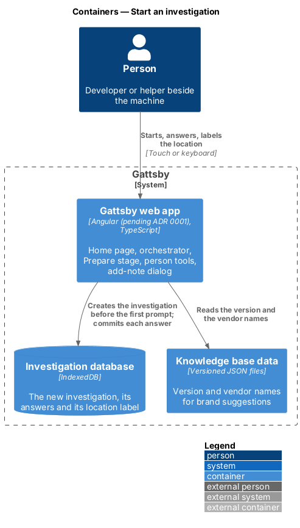
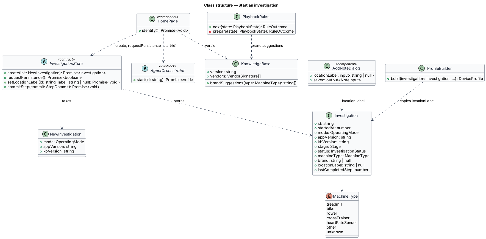
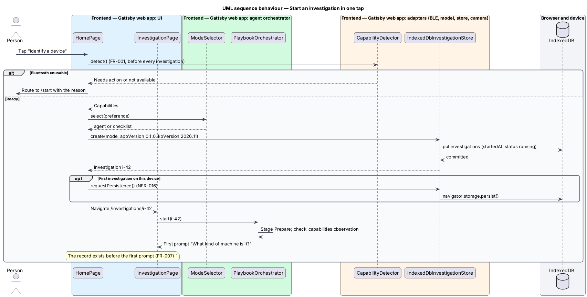
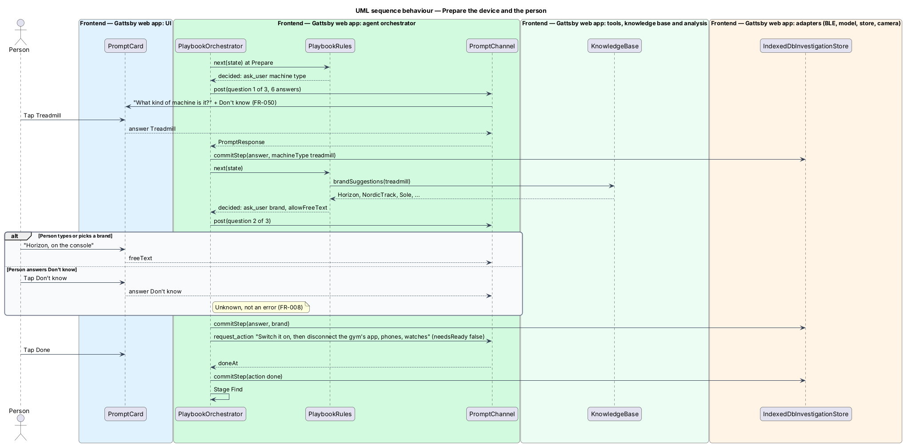
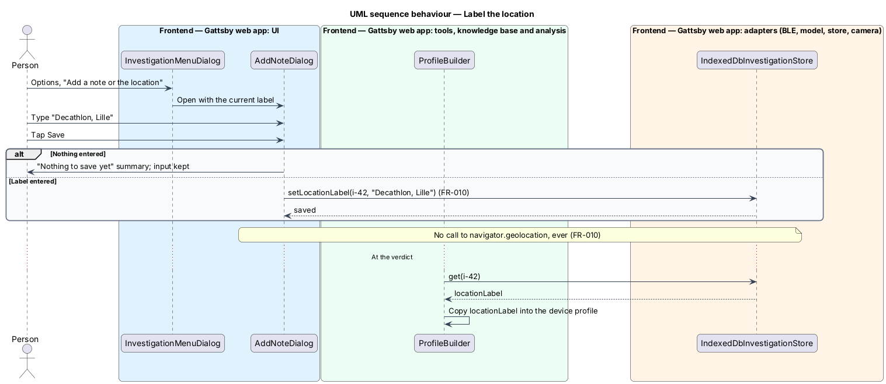

# Start an investigation

## Overview

An investigation is one attempt to identify one device, from the tap that starts it to the verdict
(A-03). This feature covers the first moments: the person taps "Identify a device" on the Home page,
Gattsby creates and stores the investigation record at once, and the Prepare stage asks what the
machine is, which brand it carries, and for the device to be switched on and freed from other
connections. It also lets the person attach an optional location label at any time. It belongs to the
investigation subsystem and covers the Prepare stage, the first of the playbook's seven stages.

**investigation record** — stored history of one investigation: its steps, raw traffic, answers,
hypotheses and missing-tool requests, plus the start time, mode, app version and knowledge-base
version it was created with

**Prepare stage** — first playbook stage, in which Gattsby checks capabilities and the person gives
the machine type and brand, switches the device on and disconnects the console's own app, watches
and phones

**location label** — optional free text the person types to say where the device is, for example a
store name; never determined by Gattsby

The person starts from the Home page (`docs/mocks/pages/home/default.html`, or `empty.html` on a
first visit). The Investigation page then opens at the Prepare stage with "Question 1 of 3: What
kind of machine is it?" and seven answers, "Don't know" among them
(`docs/mocks/pages/investigation/prepare.html`). The location label is typed in the "Add to this
investigation" dialog (`docs/mocks/dialogs/add-note/default.html`; `invalid.html` when nothing is
entered), opened from the Investigation options sheet
(`docs/mocks/dialogs/investigation-menu/default.html`).

The record is created before the first prompt so that every later step, answer and raw-log entry
has an investigation to belong to, and so that a tab closed during Prepare still leaves a resumable
investigation (see the stop-pause-and-resume design).

## Description

The design introduces these building blocks in the Angular (pending ADR 0001) workspace under
`frontend/src/app/`:

- **`HomePage`** (`pages/home/home.page.ts`) — lazy route `/`. On "Identify a device" it re-runs
  `CapabilityDetector.detect()` (FR-001 asks for a check before every investigation), routes to
  `/start` with the reason when Bluetooth is unusable, asks `ModeSelector.select()` for the mode,
  calls `InvestigationStore.create()`, asks for persistent storage on the first investigation, and
  navigates to `/investigations/:id`. The page orchestrates these four calls and holds no rule of its
  own.
- **`InvestigationStore.create(init)`** (`store/investigation-store.ts`,
  `store/indexed-db-investigation-store.ts`) — writes one `Investigation` in one transaction and
  resolves only after the transaction completes. The record holds `id` (`crypto.randomUUID()`),
  `startedAt`, `mode`, `appVersion`, `kbVersion`, `stage` `prepare`, `status` `running` and
  `lastCompletedStep` 0 (FR-007).
- **`InvestigationStore.requestPersistence()`** — calls `navigator.storage.persist()` once, when the
  first investigation starts (NFR-016). A refusal is recorded and does not block the investigation;
  the storage limits are handled by the save-as-the-investigation-runs design.
- **`APP_VERSION`** (`app-version.ts`) — injection token holding the app version from
  `package.json`, set at build time ("0.1.0" in the mocks). `KnowledgeBase.version` gives the
  knowledge-base version ("2026.11").
- **`PlaybookOrchestrator.start(id)`** (`agent/playbook-orchestrator.ts`) — loads the investigation
  and runs the loop from the Prepare stage.
- **`PlaybookRules`** (`agent/playbook-rules.ts`) — the Prepare stage is fully deterministic in both
  modes (FR-046): `check_capabilities`, then `ask_user` for the machine type, `ask_user` for the
  brand, and `request_action` to power on and disconnect other apps, then the Find stage. The model
  is not consulted at Prepare.
- **`KnowledgeBase.brandSuggestions(type)`** (`knowledge-base/knowledge-base.ts`) — vendor names from
  the knowledge base's vendor signatures for the given machine type, at most 6 (TOOL-025's answer
  limit). Which vendors appear for each type, and in what order, is `<TO SUPPLY>`.
- **`askUserTool`** and **`requestActionTool`** (`tools/person/ask-user.tool.ts`,
  `tools/person/request-action.tool.ts`) — post the prompts through `PromptChannel`; their rules are
  in the ask-the-person design.
- **`InvestigationMenuDialog`** (`dialogs/investigation-menu/investigation-menu.dialog.ts`) — offers
  "Add a note or the location".
- **`AddNoteDialog`** (`dialogs/add-note/add-note.dialog.ts`) — presentation dialog with an optional
  location field ("Typed by you. Gattsby never looks up where you are."), a note field and "Add
  photo". Output: `NoteInput`. With every field empty, "Save" shows the "Nothing to save yet"
  summary, moves focus to it and keeps what was typed.
- **`InvestigationStore.setLocationLabel(id, label)`** — stores the label as text on the
  investigation (FR-010). `ProfileBuilder` (`outcome/profile-builder.ts`) copies it into the device
  profile.

### The Prepare stage

| Order | Action | Prompt | Answers |
|---|---|---|---|
| 1 | `check_capabilities` | none (read-only) | Committed as an observation |
| 2 | `ask_user` | "What kind of machine is it?" (Question 1 of 3) | Treadmill, Bike, Rower, Cross-trainer, Heart-rate sensor, Other, plus "Don't know" |
| 3 | `ask_user`, `allowFreeText` | "Is there a brand on it?" (Question 2 of 3) | Up to 6 knowledge-base suggestions, free text, plus "Don't know" |
| 4 | `request_action`, `needsReady` false | "Switch it on, then disconnect anything else that might be connected to it — the gym's app, a phone, a watch." (Question 3 of 3) | "Done" |

Each answer is committed with its question as one step (FR-050). "Don't know" sets the machine type
to `unknown` or the brand to `null`; neither counts as an error, and the stage ends at Find
(FR-008). A skipped question is recorded as an observation (FR-052). The type and brand feed
`ProfileMatcher` and the decision state later on.

### Location label

- The label is optional and may be added, changed or cleared at any stage until the verdict. Its
  maximum length is `<TO SUPPLY>`; the import schema limits it like every string (NFR-015).
- The label is rendered as text (see the render-untrusted-text design).
- No code calls `navigator.geolocation`, and the `Permissions-Policy` header does not allow it (see
  the serve-offline-and-private design). The fake browser in the acceptance specs replaces
  `navigator.geolocation` with a stub that fails the spec when called (FR-010).

### Errors

| Code | Raised by | Person sees |
|---|---|---|
| `STORAGE_FULL` | `InvestigationStore.create` | The storage message from the save-as-the-investigation-runs design; no investigation starts |
| `BLE_UNAVAILABLE` | `CapabilityDetector` result | The Readiness page with the reason (see the check-capabilities design) |

### Tests that prove it

The acceptance specs use the Home and Investigation page objects with the fake `navigator.bluetooth`
and fake `LanguageModel`. One spec reads the store through the page before the first prompt is
visible and finds the investigation with its start time, mode, app version and knowledge-base
version. One answers "Don't know" twice and reaches Find. One types a location label and finds it in
the exported profile, with no geolocation call recorded.

## Requirements

The feature realizes the following level-2 (L2) requirements; each refines the level-1 (L1)
requirement cited beside it.

| L2 ID | Refines (L1) | Requirement |
|-------|--------------|-------------|
| [`FR-007`](../../../specs/L2.md#fr-007-start-an-investigation) | `L1-003` | The person must be able to start a new investigation in one tap from the home screen. Gattsby must create the investigation record at once, with a start time, the mode, the app version and the knowledge-base version. |
| [`FR-008`](../../../specs/L2.md#fr-008-prepare-the-device-and-the-person) | `L1-003` | The Prepare stage must ask the machine type (treadmill, bike, rower, cross-trainer, heart-rate sensor, other, don't know) and the brand (free text with suggestions from the knowledge base, or "don't know"); ask the person to power the device on; and ask them to disconnect the console's own app, watches, phones and any other app that may hold a Bluetooth connection to the device. |
| [`FR-010`](../../../specs/L2.md#fr-010-label-the-location) | `L1-003` | The person may type an optional location label (for example, a store name). Gattsby must never determine location on its own. |

## Diagrams

### System context

The person starts the investigation in Gattsby and prepares the device by hand; Gattsby stores the
record through Chrome's IndexedDB and asks Chrome for persistent storage once.

### Containers

The web app reads the knowledge-base version and vendor names, and creates the investigation in the
investigation database before the first prompt.

### Components

`HomePage` re-checks capabilities, picks the mode and creates the record; the orchestrator runs the
Prepare stage from `PlaybookRules` through `PromptChannel`; `AddNoteDialog` stores the location
label.

### Class structure

`InvestigationStore` creates an `Investigation` from a `NewInvestigation`; the investigation holds
the machine type, the brand and the location label that `ProfileBuilder` later copies.

### Behaviour — start an investigation in one tap

The tap re-checks capabilities, picks the mode, creates and commits the record, asks for persistent
storage on the first investigation, and only then shows the first prompt.

### Behaviour — prepare the device and the person

The rules ask the machine type and the brand, accept "Don't know" without error, and wait for "Done"
after asking for the device to be switched on and freed.

### Behaviour — label the location

The person types a label in the add-note dialog; the store keeps it as text and the profile builder
copies it into the device profile; Gattsby never asks for the location itself.

