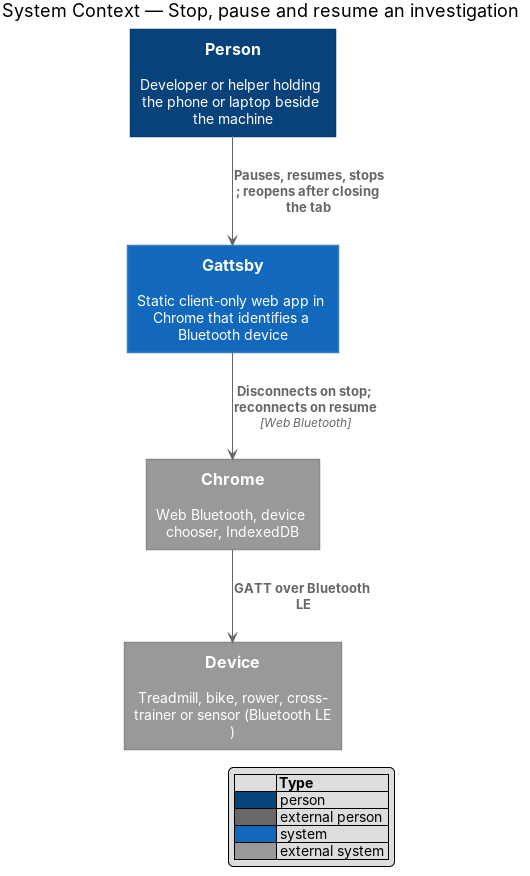
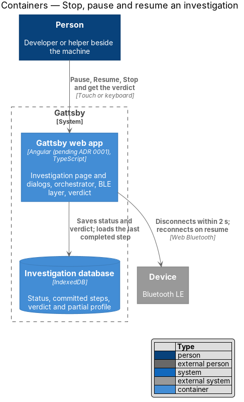
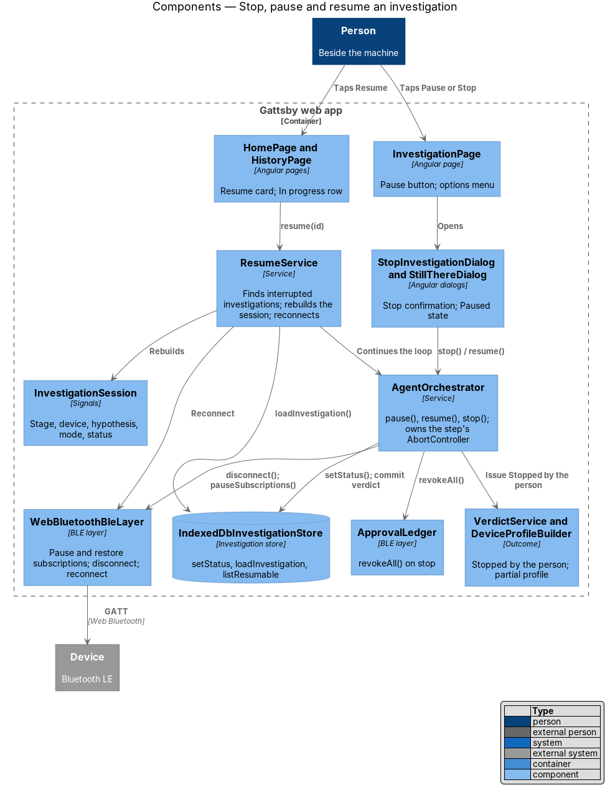
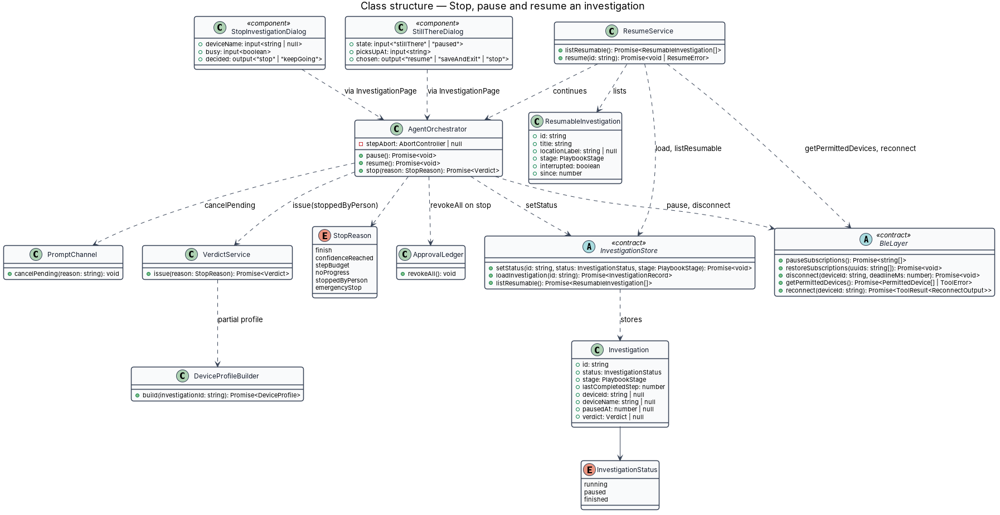
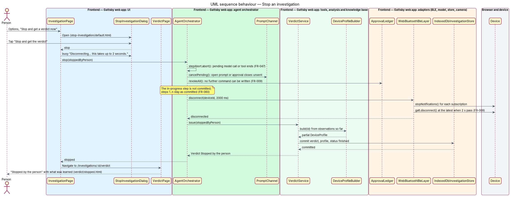

# Stop, pause and resume an investigation

## Overview

A person beside a machine in a store gets interrupted: a member of staff walks up, the phone rings,
the tab is closed by mistake, the laptop sleeps. This feature lets the person stop an investigation at
any moment and still get a verdict from what was learned, pause it and carry on, and pick up an
investigation that a closed tab or a crash cut short from its last completed step. It belongs to the
investigation subsystem and acts on the agent loop, the connection and the investigation record
together.

**stop** — the person's decision to end the investigation now: the loop halts, nothing more is sent,
the device is disconnected, and the verdict is *Stopped by the person*

**pause** — temporary hold in which the loop runs no step and nothing is sent or recorded, while the
connection is kept

**interrupted investigation** — investigation that has no verdict and whose page went away while it
was running, through a closed tab, a reload or a crash

**resume** — continuing a paused or interrupted investigation from its last completed step, starting
with a reconnect to the device

Stop is reached from the investigation options sheet, "Stop and get a verdict now"
(`docs/mocks/dialogs/investigation-menu/default.html`), and from the paused dialog. It asks for
confirmation first (`dialogs/stop-investigation/default.html`), shows "Disconnecting… this takes up to
2 seconds." while it releases the device (`stop-investigation/busy.html`), and opens the verdict page
in its stopped state (`docs/mocks/pages/verdict/stopped.html`). Pause is the app bar's Pause button,
or "Pause" in the options sheet; it opens the Paused dialog with "Resume", "Save and exit" and "Stop
and get a verdict" (`dialogs/still-there/paused.html`). An investigation that was paused and left, or
interrupted, appears on the home screen as "Resume: spin bike, Basic-Fit Roubaix · Paused at Standard
path" (`pages/home/default.html`) and in the history as "In progress · paused at Standard path"
(`pages/history/default.html`). Resuming opens the investigation with "Reconnecting to SB-7731"
(`pages/investigation/loading.html`).

Stop is not the emergency stop. Stop sends no command to the device; the emergency stop sends the
device's stop or reset command (see [emergency stop](../../device-control/emergency-stop/README.md)).
While a device is connected, every dialog of this feature keeps "Emergency stop" one tap away.

## Description

The design introduces these building blocks in the Angular (pending ADR 0001) workspace under
`frontend/src/app/`:

- **`AgentOrchestrator`** (`agent/agent-orchestrator.ts`) — owns the `AbortController` of the step in
  progress and the loop's lifecycle:
  - `stop('stoppedByPerson')` aborts the step in progress, cancels any open prompt, revokes every
    approval token, disconnects, and asks `VerdictService` for the verdict. It returns once the
    verdict is committed.
  - `pause()` aborts the step in progress, pauses notification subscriptions through the BLE layer,
    and sets the status to `paused`. `resume()` restores the subscriptions and decides the next step
    afresh.
  - `continueFrom(step)` restarts the loop on a rebuilt `InvestigationSession`.
- **`ResumeService`** (`agent/resume.service.ts`) — lists resumable investigations for the home
  screen and the history, and resumes one: it loads the record, rebuilds `InvestigationSession`,
  re-chooses the mode, reconnects and hands over to `AgentOrchestrator.continueFrom()`.
- **`InvestigationStore`** (`store/investigation-store.ts`) — `setStatus(id, status, stage)`,
  `loadInvestigation(id)` (committed steps only; a partly written step is discarded, NFR-007) and
  `listResumable()` (investigations with no verdict, newest first).
- **`WebBluetoothBleLayer`** (`ble/web-bluetooth-ble-layer.ts`) — `pauseSubscriptions()` stops every
  notification and returns their UUIDs; `restoreSubscriptions(uuids)` starts them again;
  `disconnect(deviceId, deadlineMs)` stops notifications and calls `gatt.disconnect()` no later than
  the deadline; `getPermittedDevices()` and `reconnect(deviceId)` serve the resume (TOOL-032,
  TOOL-007).
- **`ApprovalLedger.revokeAll()`** (`ble/approval-ledger.ts`) — empties the ledger on stop, so no
  approved command can still be written (see
  [approve-a-command](../../device-control/approve-a-command/README.md)).
- **`PromptChannel.cancelPending()`** (`agent/prompt-channel.ts`) — closes an open question, action
  or approval prompt with nothing sent.
- **`VerdictService`** and **`DeviceProfileBuilder`** (`outcome/`) — build the verdict *Stopped by the
  person* and a partial profile from the observations and hypothesis so far (see
  [issue-the-verdict](../../outcome/issue-the-verdict/README.md)).
- **`StopInvestigationDialog`** (`dialogs/stop-investigation/stop-investigation.dialog.ts`) and
  **`StillThereDialog`** (`dialogs/still-there/still-there.dialog.ts`, `paused` state) — presentation
  components. They take the device name and the stage the investigation picks up at, and emit the
  person's choice. `InvestigationPage` calls the orchestrator.

### Rules for stopping

1. Stop is available at any time during the investigation, including while a model call, a tool or an
   approval prompt is pending.
2. Stop aborts the step in progress through its `AbortController` (FR-047). That step is not
   committed; steps already committed stay intact (FR-060).
3. Stop sends no command. It revokes every approval token and closes any open approval prompt unsent,
   so no `write` or `control` call can run afterwards (FR-009).
4. Stop disconnects within 2 seconds: notifications are stopped, and `gatt.disconnect()` runs at the
   latest when 2 seconds have passed, even if a `stopNotifications()` call has not answered.
5. Stop ends the loop with `StopReason` `stoppedByPerson` (FR-045). `VerdictService` records the
   verdict *Stopped by the person*, and `DeviceProfileBuilder` builds the partial profile; both are
   committed with the status `finished`.
6. A stopped investigation opens from the history on its verdict page, with its observations,
   hypothesis and partial profile (FR-009).

### Rules for pausing and resuming

1. While paused, no step runs, nothing is written to the device and nothing is recorded: notification
   subscriptions are paused, so the raw traffic log receives nothing.
2. Pause keeps the connection. "Save and exit" leaves the investigation, which disconnects (FR-018),
   and keeps the status `paused`.
3. On every app load, `listResumable()` returns each investigation without a verdict. One with status
   `running` that no page owns is an interrupted investigation; it is offered for resume exactly like
   a paused one.
4. Resume loads the committed steps, discards a partly written step (NFR-007), and rebuilds the
   stage, observations, hypothesis and device facts from them.
5. Resume re-chooses the mode with the recorded mode as the ceiling: an investigation that ran as a
   checklist stays a checklist; one that ran in full agent mode falls back to checklist mode, with a
   mode change recorded, when no model session can be created (see
   [choose-the-operating-mode](../../environment/choose-the-operating-mode/README.md)).
6. Resume starts with a reconnect whenever the investigation had a device (FR-009). Where
   `getDevices()` is available (`PD-GETDEVICES`), the BLE layer finds the permitted device and runs
   `reconnect` (TOOL-007). Otherwise the person is asked to tap "Find the device", and Chrome's
   chooser opens with a filter on the recorded name (TOOL-032). An investigation interrupted during
   Prepare has no device and resumes with Prepare's next prompt.
7. The next step after a resume is decided afresh, by the model or the checklist. A step that was in
   progress when the investigation was interrupted is never replayed, and a `write` or `control` call
   always needs a new approval.

### Data shapes

| Type | Fields |
|---|---|
| `Investigation` (fields this feature uses) | `status`, `stage`, `lastCompletedStep`, `deviceId`, `deviceName`, `pausedAt`, `verdict` |
| `ResumableInvestigation` | `id`, `title`, `locationLabel`, `stage`, `interrupted`, `since` |
| `InvestigationStatus` | `running`, `paused`, `finished` |

### Errors

| Code | Raised by | Meaning to the person |
|---|---|---|
| `ABORTED` | The step in progress | Recorded only in memory; the step is not committed. |
| `CONNECTION_FAILED` | `reconnect` on resume | The connection banner and FR-016's recovery apply: check the device, "Try again" or "Stop". |
| `UNSUPPORTED` | `getPermittedDevices` | No message; the person is asked to tap "Find the device". |
| `USER_CANCELLED` | The chooser on resume | The investigation stays paused; "Find the device" is offered again. |
| `STORAGE_FULL` | `setStatus`, the verdict commit | Recording stops and the person is told to export and delete old investigations (NFR-008). |

A device chosen on resume whose ID differs from the recorded one is reported and the person may
choose again; its wording is `<TO SUPPLY>` (OQ-06).

### Tests that prove it

The acceptance specs use the fake `navigator.bluetooth` (`e2e/fixtures/fake-bluetooth.ts`) playing the
FTMS treadmill and the FTMS bike, and the fake `LanguageModel`, with the `InvestigationPage`,
`StopInvestigationDialog`, `StillThereDialog`, `HomePage` and `VerdictPage` page objects:

- During the Standard path, "Stop and get the verdict" leaves the fake with no connection and no
  notification listener within 2 seconds, records no further write, and opens the verdict "Stopped by
  the person".
- With an approval prompt open, Stop closes it and the fake records no write.
- Closing the page during Identify and opening the app again shows the resume card; resuming opens
  "Reconnecting to …", the fake records a new connection before any other Bluetooth call, and the
  steps before the reload are intact.
- Pause records no raw-log entry while the fake keeps notifying; "Resume" restores the notifications.
- A stopped investigation opened from the history shows its observations, hypothesis and partial
  profile.

Unit tests cover `ResumeService` for an interrupted, a paused and a Prepare-only investigation, and
the 2-second disconnect deadline with a fake clock.

## Requirements

The feature realizes the following level-2 (L2) requirements; each refines the level-1 (L1)
requirement cited beside it.

| L2 ID | Refines (L1) | Requirement |
|-------|--------------|-------------|
| [`FR-009`](../../../specs/L2.md#fr-009-stop-pause-and-resume-an-investigation) | `L1-003` | The person must be able to stop an investigation at any time. Stopping halts the agent loop, sends no further command, disconnects and records the verdict *Stopped by the person* with what was learned so far. An investigation interrupted by closing the tab or a crash must be resumable from its last completed step, with a reconnect. |

## Diagrams

### System context

The person pauses, resumes or stops the investigation in Gattsby, which disconnects from the device
on stop and reconnects to it on resume, through Chrome's Web Bluetooth.

### Containers

The web app saves the investigation's status and verdict in the investigation database and reloads
its committed steps on resume.

### Components

The dialogs call `AgentOrchestrator`, which revokes approvals, pauses or disconnects through the BLE
layer and asks the outcome components for the verdict; `ResumeService` rebuilds the session from the
store and reconnects before the loop continues.

### Class structure

`AgentOrchestrator` and `ResumeService` act on one `Investigation` through the store's status
methods and on the device through the `BleLayer` contract; `VerdictService` turns `stoppedByPerson`
into a verdict and a partial profile.

### Behaviour — stop an investigation

After confirmation the step in progress is aborted, prompts close unsent, approval tokens are
revoked, the device is disconnected within 2 seconds, and the verdict *Stopped by the person* is
committed before the verdict page opens.

### Behaviour — pause and resume while connected

Pause aborts the step in progress and pauses the subscriptions while keeping the connection; the
person then resumes, saves and exits, or stops.

### Behaviour — resume after the tab was closed

On reopening, the interrupted investigation is offered for resume; the record is reloaded without the
partly written step, and the reconnect uses `getDevices()` where Chrome offers it, or Chrome's chooser
otherwise.

