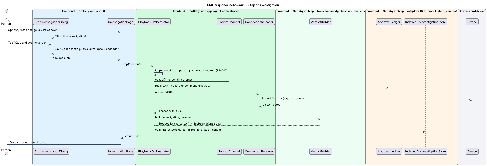
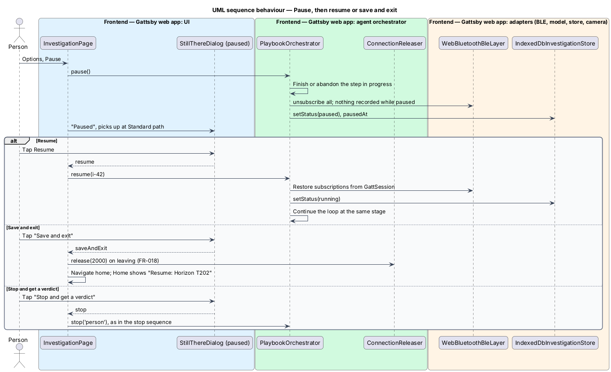
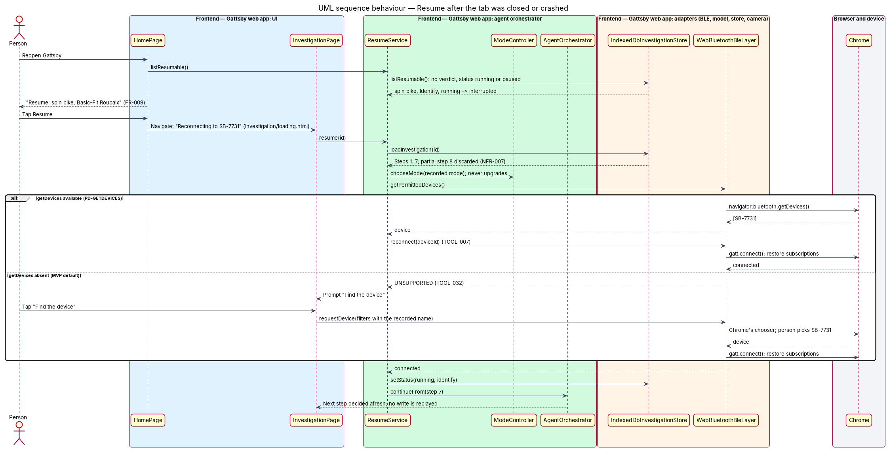

# Stop, pause and resume

## Overview

An investigation can end early or be interrupted. The person may stop it at any time, pause it for a
while beside the machine, or leave and come back later; the browser may also close the tab or crash.
This feature makes each of those safe: a stop halts the loop, sends nothing more, disconnects and
still produces a verdict; a pause holds the investigation connected and silent; and an interrupted
investigation resumes from its last completed step, starting with a reconnect. It belongs to the
investigation subsystem and applies at every playbook stage.

**stop** — person's request to end the investigation now, which yields the verdict *Stopped by the
person* with what was learned so far

**pause** — hold on an investigation during which nothing is sent or recorded, the connection is kept,
and every step so far stays saved

**interrupted investigation** — stored investigation whose status is still `running` or `paused` but
which no orchestrator is running, for example after the tab closed or the browser crashed

**last completed step** — highest step number whose commit transaction finished; the step after it,
if present, is incomplete and is decided again on resume

The person stops from the Investigation options sheet ("Stop and get a verdict now",
`docs/mocks/dialogs/investigation-menu/default.html`) and confirms in "Stop this investigation?"
(`docs/mocks/dialogs/stop-investigation/default.html`), which shows "Disconnecting… this takes up to
2 seconds." while it works (`busy.html`). The result is the Verdict page in its `stopped` state
(`docs/mocks/pages/verdict/stopped.html`). "Pause" in the same sheet opens the paused dialog with
"Stop and get a verdict", "Save and exit" and "Resume" (`docs/mocks/dialogs/still-there/paused.html`).
The Home page offers "Resume: spin bike, Basic-Fit Roubaix · Paused at Standard path · 2 h ago"
(`docs/mocks/pages/home/default.html`), and resuming opens the Investigation page in its `loading`
state, "Reconnecting to SB-7731" (`docs/mocks/pages/investigation/loading.html`).

The feature exists because a store visit is short and noisy: the person may step away, hand
the phone over, or give up on a machine, and none of that loses observations or leaves the device
connected.

## Description

The design introduces these building blocks in the Angular (pending ADR 0001) workspace under
`frontend/src/app/`:

- **`AgentOrchestrator`** / **`PlaybookOrchestrator`** (`agent/agent-orchestrator.ts`,
  `agent/playbook-orchestrator.ts`) — `stop(reason)`, `pause()` and `resume(id)`, and the `status`
  signal (`idle`, `running`, `paused`, `stopping`, `ended`). One `AbortController` per run aborts the
  pending model call, the pending tool and the pending prompt at once (FR-047).
- **`StopConditions`** (`agent/stop-conditions.ts`) — records the stop reason `person`. The other
  reasons belong to the end-the-loop and emergency-stop designs.
- **`ApprovalLedger.revokeAll()`** (`ble/approval-ledger.ts`) — empties the ledger on stop, so no
  approved command can still reach the device (FR-009; see the approve-a-command design).
- **`ConnectionReleaser`** (`agent/connection-releaser.ts`) — `release(deadlineMs)` stops every
  notification, then disconnects. The stop path passes 2,000 ms; if the GATT server has not reported
  the disconnect by then, the releaser drops its handles and records the overrun. Its other triggers
  (verdict, leaving the screen, 60 s hidden) belong to the release-the-connection design.
- **`VerdictBuilder`** and **`ProfileBuilder`** (`outcome/verdict-builder.ts`,
  `outcome/profile-builder.ts`) — on reason `person`, build the verdict *Stopped by the person* and a
  partial profile from the observations and hypothesis so far: what was observed, and what could not
  be determined.
- **`ConnectionSupervisor`** (`agent/connection-supervisor.ts`) — on resume, reconnects before any
  other step. It first asks `BleLayer.permittedDevices()` (`navigator.bluetooth.getDevices()`,
  `PD-GETDEVICES`) for the saved device ID; where the device is not permitted or the API is absent,
  it posts a "Find the device" prompt, because Chrome's chooser needs the person's tap (see the
  connect-to-the-device and recover-a-dropped-connection designs).
- **`InvestigationStore`** (`store/indexed-db-investigation-store.ts`) — `setStatus(id, status)`,
  `get(id)` and `list()`. The investigation holds `status`, `stage`, `lastCompletedStep`,
  `pausedAt`, `deviceId` and `advertisedName`.
- **`StopInvestigationDialog`** (`dialogs/stop-investigation/stop-investigation.dialog.ts`) —
  presentation dialog. Inputs: `deviceName`, `busy`. Output: `stop` or `keepGoing`.
- **`StillThereDialog`** (`dialogs/still-there/still-there.dialog.ts`) — presentation dialog with two
  variants; this feature uses `paused`. Inputs: `variant`, `picksUpAt`, `deviceName`. Output:
  `resume`, `saveAndExit` or `stop`.
- **`InvestigationMenuDialog`** (`dialogs/investigation-menu/investigation-menu.dialog.ts`) — "Pause"
  and "Stop and get a verdict now".
- **`HomePage`** (`pages/home/home.page.ts`) — lists interrupted and paused investigations as resume
  cards, newest first, with the stage and the time since the last step.
- **`HistoryPage`** (`pages/history/history.page.ts`) — opens a stopped investigation; its
  observations, hypothesis and partial profile are shown by the verdict and device-profile pages
  (FR-009).

### Stop

1. The person confirms; the dialog shows its busy state.
2. The orchestrator aborts the run: the pending model call, the running tool and the pending prompt
   end with `ABORTED`, and no further tool runs.
3. `ApprovalLedger.revokeAll()` runs, so no command is sent after the stop. Stop sends no command of
   its own; sending stop or reset to the machine is the emergency stop's job (see the emergency-stop
   design).
4. `ConnectionReleaser.release(2000)` disconnects within 2 seconds.
5. The verdict *Stopped by the person* and the partial profile are committed with status `finished`,
   and the Verdict page opens in its `stopped` state.

### Pause

- The loop halts at the step boundary. A running recording is abandoned, and its step is not
  committed.
- Notifications are unsubscribed, so nothing is recorded while paused; `GattSession` keeps the list
  to restore on resume. The connection is kept ("Still connected to HZN-T202-4F1A").
- Status `paused` and `pausedAt` are stored. A page hidden for more than 60 seconds still releases the
  connection (FR-018), and the resume then reconnects.
- "Resume" restores the subscriptions and continues at the same stage. "Save and exit" releases the
  connection and returns to Home, where the investigation shows as a resume card. Emergency stop
  stays one tap away while paused.

### Resume after an interruption

- On load, `HomePage` lists investigations whose status is `running` or `paused`. With no live
  orchestrator in this tab, a `running` investigation is interrupted.
- `resume(id)` loads the investigation. Steps up to `lastCompletedStep` are intact; a step after it
  is absent or marked incomplete (FR-060) and is decided again.
- The browser rechecks the model when resuming an investigation in full agent mode. If a session
  cannot be opened, checklist mode takes over and records the mode change. An investigation
  already in checklist mode stays in checklist mode.
- The first action is always a reconnect (FR-009). Until it succeeds, no other tool runs; if it
  fails, the reconnect rules of the recover-a-dropped-connection design apply.
- An investigation interrupted before Find has no device to reconnect to and resumes at its stage
  with no reconnect.
- In the fallback Find prompt, the person picks the same device by name. Gattsby compares the
  browser's device ID with the saved ID and asks again if a different device was selected.
- The raw log resumes after the highest saved sequence number so new traffic cannot overwrite
  earlier evidence.

### Errors

| Code | Raised by | Person sees |
|---|---|---|
| `ABORTED` | Model call, tool or prompt cut short by stop | Nothing; the verdict follows |
| `CONNECTION_FAILED` | Reconnect on resume | The connection banner and "Try again" (see the recover-a-dropped-connection design) |
| `USER_CANCELLED` | Chooser closed during the resume's "Find the device" | The prompt again, with "Stop and get a verdict" |

### Tests that prove it

The acceptance specs use the fake `navigator.bluetooth`, which records connects, disconnects and
writes with times. The stop spec checks that no tool call or write follows the tap and that the
disconnect lands within 2 seconds of Playwright's clock. The resume spec closes the page during
Identify, opens a new page in the same context, taps Resume and checks that the first recorded
Bluetooth call is a connect. Unit tests cover the selection of interrupted investigations and the
discarding of an incomplete step.

## Requirements

The feature realizes the following level-2 (L2) requirements; each refines the level-1 (L1)
requirement cited beside it.

| L2 ID | Refines (L1) | Requirement |
|-------|--------------|-------------|
| [`FR-009`](../../../specs/L2.md#fr-009-stop-pause-and-resume-an-investigation) | `L1-003` | The person must be able to stop an investigation at any time. Stopping halts the agent loop, sends no further command, disconnects and records the verdict *Stopped by the person* with what was learned so far. An investigation interrupted by closing the tab or a crash must be resumable from its last completed step, with a reconnect. |

## Diagrams

### System context

The person stops, pauses or resumes in Gattsby; Gattsby disconnects from the device through Chrome on
a stop and reconnects first on a resume.

### Containers

The web app disconnects from the device within 2 seconds of a stop and keeps the status, the last
completed step and the partial verdict in the investigation database.

### Components

The dialogs report the person's choice to the page, which calls the orchestrator; the orchestrator
revokes approvals, releases the connection, builds the verdict, and on resume reconnects through
`ConnectionSupervisor`.

### Class structure

`PlaybookOrchestrator` implements `stop`, `pause` and `resume` over `ConnectionReleaser`,
`ConnectionSupervisor`, `ApprovalLedger` and `VerdictBuilder`; the investigation's
`InvestigationStatus` tells a paused or interrupted investigation from a finished one.

### Behaviour — stop an investigation

The stop aborts every pending call, revokes approvals, disconnects within 2 seconds and stores the
verdict *Stopped by the person*.

### Behaviour — pause, then resume or save and exit

A pause unsubscribes and keeps the connection; Resume restores the subscriptions, "Save and exit"
releases the connection, and "Stop and get a verdict" follows the stop sequence.

### Behaviour — resume an interrupted investigation

The Home page offers the interrupted investigation; resuming restores the saved state, discards the
incomplete step and reconnects before anything else, through a permitted device or a tap on "Find the
device".

