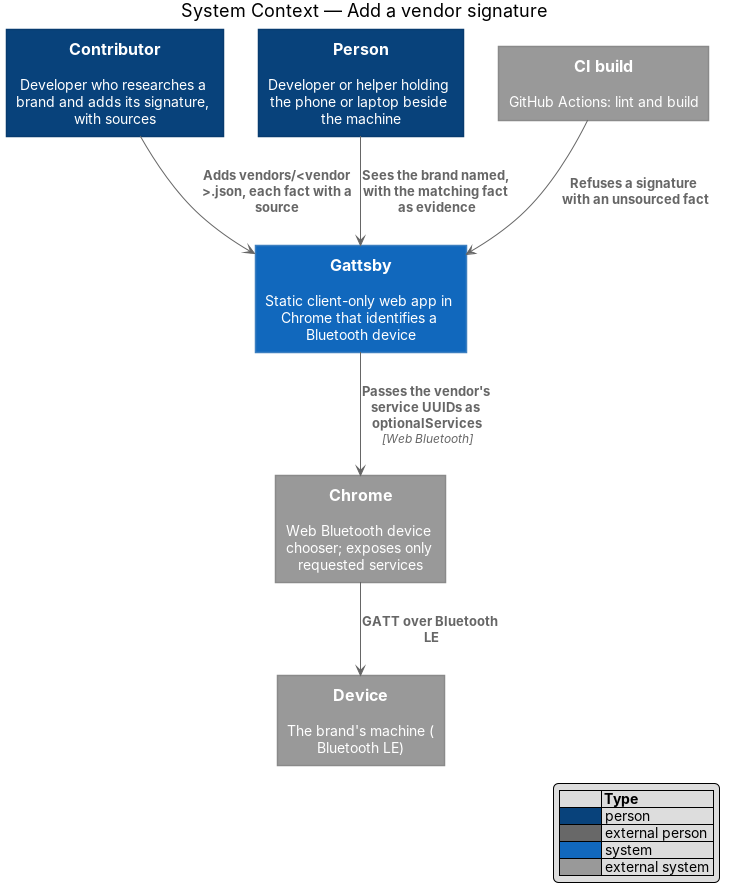
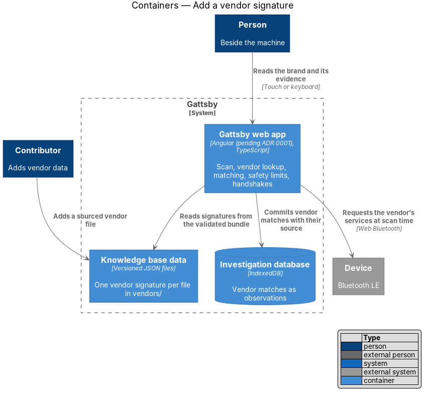
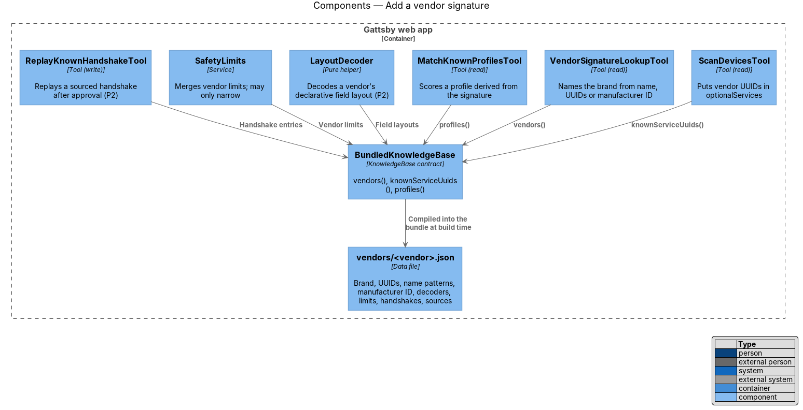
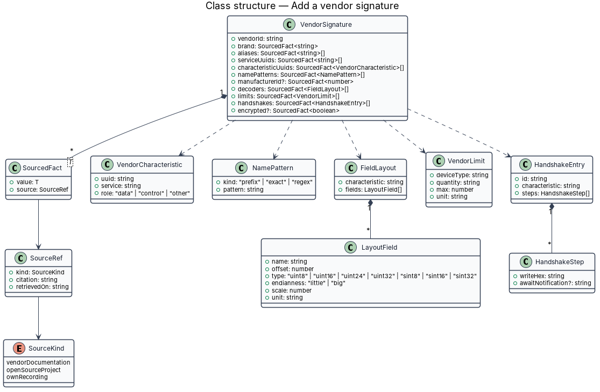
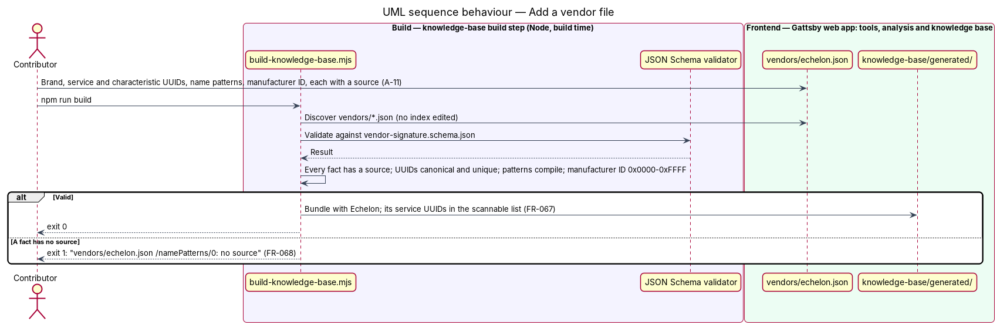
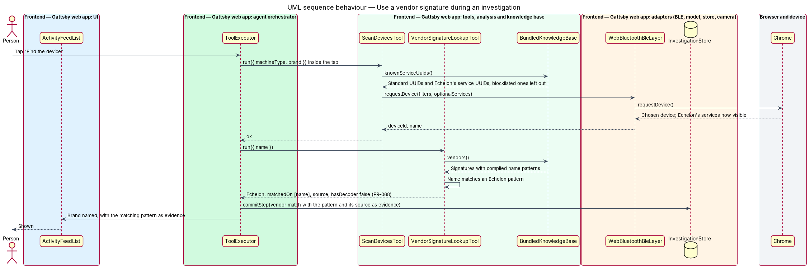

# Add a vendor signature

## Overview

Many fitness machines speak a brand's own protocol instead of, or beside, a Bluetooth SIG standard.
Gattsby cannot even see such a protocol unless it already knows the brand's service UUIDs, because the
browser exposes only the services a page names at scan time (`PD-BLE-SERVICES`). A vendor signature is
how Gattsby learns a brand. This feature defines what a signature holds, how a contributor adds one as
a single data file, how the build refuses one that lacks sources, and how the rest of the app uses it.
It belongs to the knowledge-base subsystem and extends the [load-the-knowledge-base
design](../load-the-knowledge-base/README.md).

**vendor signature** — knowledge-base entry for one brand: its service and characteristic UUIDs, name
patterns, manufacturer ID, data decoders where known, safe command limits where known and known
handshakes, each fact with a source

**known-UUID entry** — minimal vendor signature that holds the brand, its service and characteristic
UUIDs and its name patterns, enough for its services to be visible and its name to be recognized

**source** — citation for one fact: vendor documentation, a published open-source project, or the
person's own recording of their own device (A-11)

**handshake** — known initialization sequence a vendor's device needs before it sends data, replayed
only with the person's approval (see the [try-a-vendor-handshake
design](../../proprietary-analysis/try-a-vendor-handshake/README.md))

**manufacturer ID** — 16-bit company identifier assigned by the Bluetooth SIG and carried in
advertisement manufacturer data

At MVP the knowledge base holds at least Echelon's known-UUID entry, so that an Echelon bike's services
are visible (FR-068). The other brands the brief lists (Peloton, Keiser, iFit / NordicTrack / ProForm,
Schwinn / Bowflex / Nautilus, Concept2 PM5, Wahoo, Tacx, Domyos, Yesoul, Sole, Horizon) follow in P2,
in the order OQ-04 decides, together with decoders and handshakes.

The person meets a signature indirectly: in the scan, which now lists the brand's devices with their
services; and in the feed, where the match entry names the brand family and the fact that matched, as
in "The name prefix “KS-” matches the Kingsmith / WalkingPad family, which has no decoder yet."
(`docs/mocks/pages/investigation/proprietary.html`) and "Matches the Horizon / Johnson FTMS treadmill
family" (`docs/mocks/dialogs/photo-read/default.html`, behind the dialog). A brand with no signature
becomes a missing-tool request (see the [report-hidden-services
design](../../identification/report-hidden-services/README.md)); one with a signature but no decoder
becomes "Add the … specification to the knowledge base as a decoder" on the verdict page
(`docs/mocks/pages/verdict/partial.html`).

## Description

The design introduces these building blocks in the Angular (pending ADR 0001) workspace under
`frontend/src/app/`:

- **Vendor data file** (`knowledge-base/data/vendors/<vendor-id>.json`) — one signature per file. The
  MVP file is `vendors/echelon.json`. Its service UUIDs, characteristic UUIDs, name patterns and
  manufacturer ID are `<TO SUPPLY>` from sourced research (A-15); none is stated here.
- **`VendorSignature`** (`knowledge-base/model/vendor-signature.ts`) and its schema
  (`knowledge-base/schema/vendor-signature.schema.json`) — every fact is a `SourcedFact<T>`, a value with
  its `SourceRef`. The schema makes `source` required on each fact, so an unsourced fact fails
  validation by construction (FR-068, criterion 2). `decoders`, `limits` and `handshakes` may be empty.
  `encrypted` records that the brand's data is encrypted, which blocks decoding and raises a missing-tool
  request (FR-033).
- **`build-knowledge-base.mjs`** (`frontend/scripts/build-knowledge-base.mjs`) — discovers every file in
  `vendors/`, validates it, and runs the vendor checks: canonical, unique UUIDs; name patterns that
  compile; a manufacturer ID from `0x0000` to `0xFFFF`; and a field layout's offsets within its
  declared lengths.
- **`BundledKnowledgeBase`** (`knowledge-base/bundled-knowledge-base.ts`) — adds each signature's
  service UUIDs to `knownServiceUuids()` unless blocklisted (FR-067), compiles its name patterns once,
  and derives one known profile per signature for `match_known_profiles`.
- **`ScanDevicesTool`** and **`ScanAllDevicesTool`** — pass the vendor's service UUIDs in
  `optionalServices` (see the [scan-for-the-device
  design](../../discovery/scan-for-the-device/README.md)).
- **`VendorSignatureLookupTool`** and **`matchVendors`** — name the brand from a name, UUIDs or a
  manufacturer ID, with the source of the fact that matched (FR-068, criterion 1; see the
  [match-known-profiles design](../../identification/match-known-profiles/README.md)).
- **`LayoutDecoder`** (`knowledge-base/decoders/layout.decoder.ts`) — pure helper, P2. It decodes a
  vendor characteristic from a declarative `FieldLayout` (offset, integer type, byte order, scale,
  unit), so a vendor decoder is data and needs no code change.
- **`SafetyLimits`** (`knowledge-base/safety-limits.ts`) — merges a vendor's limits with the general
  limits (A-06, pending OQ-07). A vendor limit may narrow a general limit and never widens it (see the
  [keep-commands-conservative design](../../device-control/keep-commands-conservative/README.md)).
- **`ReplayKnownHandshakeTool`** — reads a signature's `handshakes`, P2. Each replay is a `write` call
  and needs the person's approval every time (FR-034; see the [approve-a-command
  design](../../device-control/approve-a-command/README.md)).

### Rules

1. One file per vendor. Adding a vendor is adding one file; no code, index or other data file changes
   (FR-069).
2. Every fact carries a source. The build fails on a fact without one and names the file and JSON
   pointer.
3. Sources are public or the person's own: vendor documentation, published open-source projects, or
   recordings of one's own device (A-11). A signature never holds keys, passwords, bonding data or
   anything learned by reverse-engineering encryption; the schema has no field for them.
4. A handshake is a known, sourced sequence of writes. It never bypasses pairing, encryption or
   authentication, and runs only with an approval per write.
5. A name pattern is `prefix`, `exact` or `regex`. A `regex` pattern is anchored at the start and
   checked to compile at build time. Patterns are tested against names truncated to 248 bytes.
6. A known-UUID entry alone is a valid signature. Decoders, limits and handshakes are added when known,
   each with its own source.
7. A blocklisted vendor UUID stays in the signature but is left out of `optionalServices` and recorded
   as unreachable (FR-067, FR-023).
8. The contributor raises the release label in `version.json` with each content change, so the
   investigations and profiles record which signatures they used (FR-069).

### Data shapes

| Type | Fields |
|---|---|
| `VendorSignature` | `vendorId`, `brand`, `aliases`, `serviceUuids`, `characteristicUuids`, `namePatterns`, `manufacturerId?`, `decoders`, `limits`, `handshakes`, `encrypted?` (each a `SourcedFact`) |
| `SourcedFact<T>` | `value`, `source` |
| `SourceRef` | `kind` (`vendorDocumentation`, `openSourceProject`, `ownRecording`), `citation`, `retrievedOn` |
| `NamePattern` | `kind` (`prefix`, `exact`, `regex`), `pattern` |
| `FieldLayout` | `characteristic`, `fields: { name, offset, type, endianness, scale, unit }[]` |
| `VendorLimit` | `deviceType`, `quantity`, `max`, `unit` |
| `HandshakeEntry` | `id`, `characteristic`, `steps: { writeHex, awaitNotification? }[]` |

### Errors

A signature error is a build error (file, JSON pointer, message); the person never meets it. At run
time a brand without a signature is not an error: it becomes a missing-tool request.

### Tests that prove it

A Node test of `build-knowledge-base.mjs` adds a fixture vendor file whose name pattern has no source
and checks that the build exits non-zero naming that fact (FR-068, criterion 2); a valid fixture file
lands in the bundle's scannable list. An acceptance spec with the fake `navigator.bluetooth` and a
scripted device whose name matches the Echelon fixture pattern checks that the feed names Echelon with
the pattern as evidence (FR-068, criterion 1), and that the `requestDevice` call's `optionalServices`
holds Echelon's service UUIDs. The specs use a test fixture signature, not the real Echelon values,
until those are sourced. Unit tests cover `matchVendors` and `LayoutDecoder`.

## Requirements

The feature realizes the following level-2 (L2) requirement; it refines the level-1 (L1) requirement
cited beside it.

| L2 ID | Refines (L1) | Requirement |
|-------|--------------|-------------|
| [`FR-068`](../../../specs/L2.md#fr-068-hold-vendor-signatures) | `L1-015` | Each vendor signature must hold the brand, service and characteristic UUIDs, name patterns, manufacturer ID, data decoders where known, safe command limits where known, known handshakes, and a source for each fact. At MVP the knowledge base must hold at least Echelon's known-UUID entry, so that its services are visible; the other listed vendors (Peloton, Keiser, iFit / NordicTrack / ProForm, Schwinn / Bowflex / Nautilus, Concept2 PM5, Wahoo, Tacx, Domyos, Yesoul, Sole, Horizon) follow in P2 in the order OQ-04 decides. |

## Diagrams

### System context

A contributor adds a sourced signature and the CI build refuses unsourced facts; during an
investigation Gattsby passes the brand's UUIDs to Chrome, so the device's vendor services are visible,
and names the brand to the person.

### Containers

The vendor file is part of the knowledge base data; the web app reads it from the validated bundle,
requests the brand's services from the device and commits each vendor match with its source.

### Components

One vendor file reaches six consumers through `BundledKnowledgeBase`: the scan tools, the vendor
lookup, profile matching, `LayoutDecoder`, `SafetyLimits` and the handshake tool.

### Class structure

A `VendorSignature` is a set of `SourcedFact`s, each tied to a `SourceRef`; the facts carry
characteristics, name patterns, field layouts, limits and handshakes.

### Behaviour — add a vendor file

The build discovers the new file, validates it against the vendor schema and the vendor checks, and
either adds it to the bundle or fails, naming the unsourced fact.

### Behaviour — use a vendor signature during an investigation

The scan passes Echelon's service UUIDs in `optionalServices`, so the device's vendor services are
visible; the vendor lookup then names Echelon from its name with the matching pattern and its source as
evidence.

