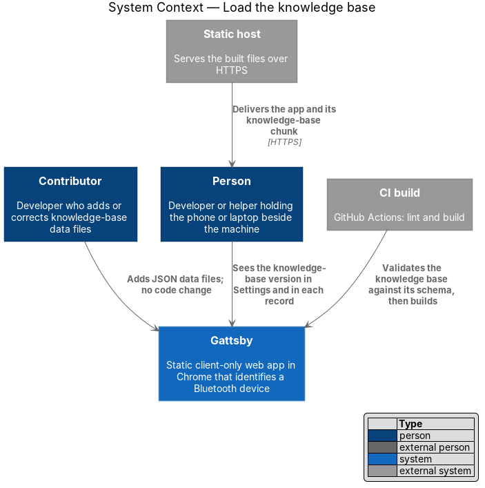
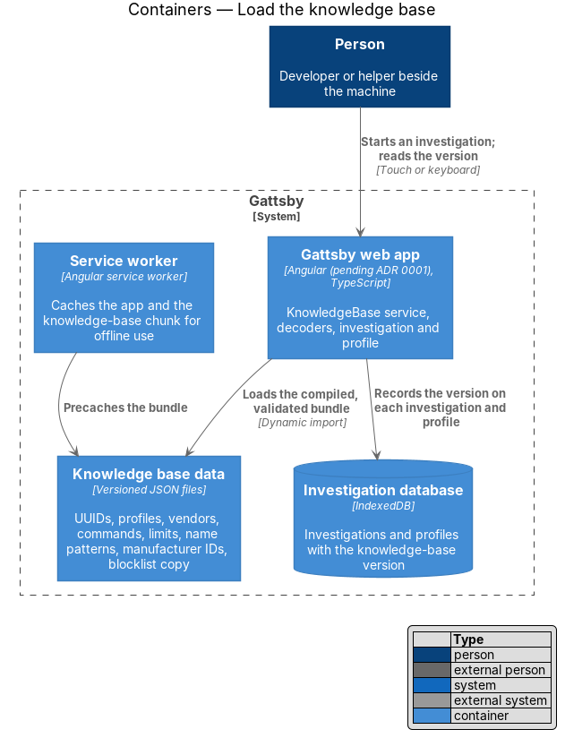
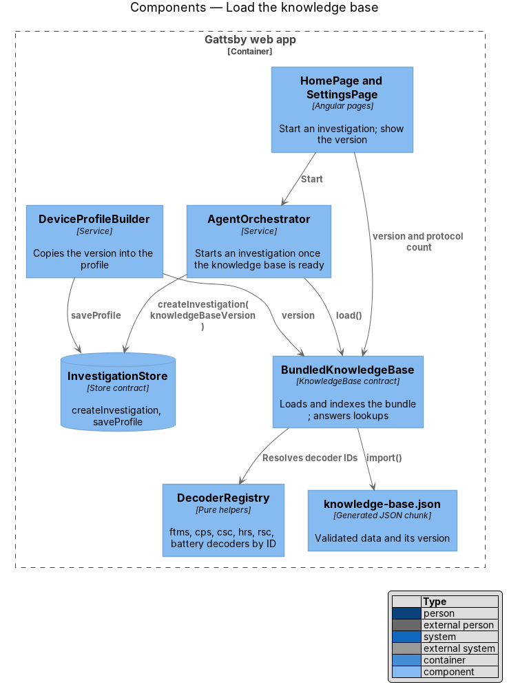
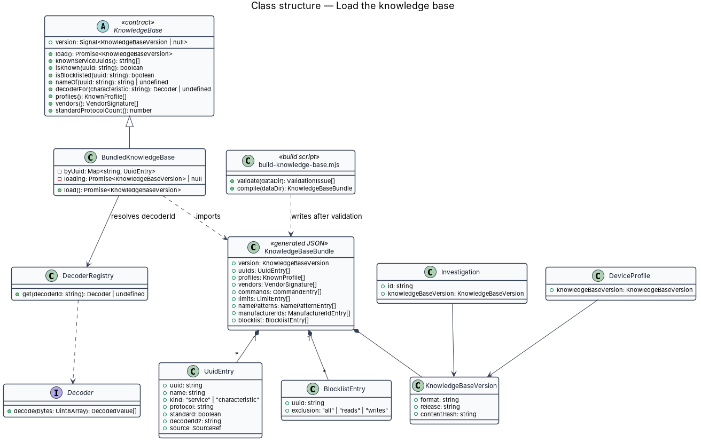
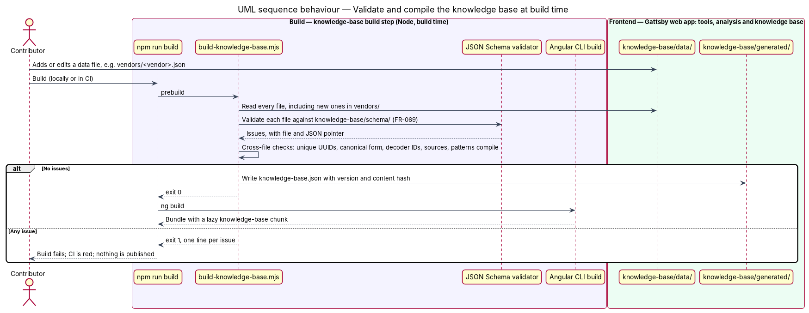
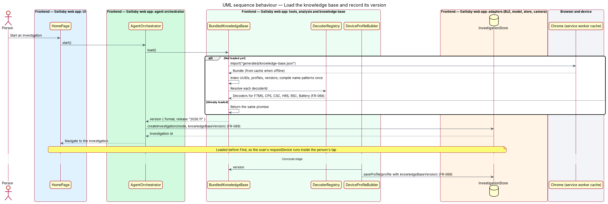

# Load the knowledge base

## Overview

Gattsby's protocol knowledge is data, not code: the UUIDs it knows, the decoders for standard
profiles, the vendor signatures, the name patterns and manufacturer IDs, and the safe command limits.
This feature defines how that data is held, checked and loaded. It belongs to the knowledge-base
subsystem, and every other subsystem reads from it: discovery passes its known-UUID list at scan time,
identification names and matches with it, the Standard path decodes with it, and device control takes
its commands and limits from it.

**knowledge base** — protocol knowledge base: known UUIDs, decoders, vendor signatures, name patterns
and manufacturer IDs, held as versioned JSON data files

**data file** — one JSON file under `knowledge-base/data/` that holds one kind of entry, or one vendor's
signature

**knowledge-base bundle** — single JSON file the build compiles from every data file after validation,
which the app loads at run time

**knowledge-base version** — pair of a format version (semantic, for the schema) and a release label
(for the content) that identifies the data an investigation used

**standard protocol** — Bluetooth SIG service profile the knowledge base covers at MVP: Fitness Machine,
Cycling Power, Cycling Speed and Cadence, Heart Rate, Running Speed and Cadence, Device Information and
Battery

The knowledge base is validated against its own JSON Schema when the app builds, so a malformed or
unsourced entry never ships (FR-069). It grows by adding data files only: a new vendor file, added with
no code change, reaches the scan list and the name-pattern matcher on the next build (FR-069,
criterion 1). Every investigation and every profile records the version it used, so a later reader
knows which knowledge produced a conclusion.

The person sees the version in two places. Settings lists "Knowledge base 2026.11 · 7 standard
protocols" under About (`docs/mocks/pages/settings/default.html`). The evidence log's first entry
reads "Investigation started · agent mode · knowledge base 2026.11"
(`docs/mocks/pages/evidence/default.html`).

## Description

The design introduces these building blocks in the Angular (pending ADR 0001) workspace under
`frontend/src/app/`:

- **Data files** (`knowledge-base/data/`) — `version.json` (the release label and format version);
  `uuids.json` (every known service and characteristic UUID with its name, protocol, whether it is a
  Bluetooth SIG standard, its decoder ID and its source); `profiles.json` (the known profiles used by
  matching; see the [match-known-profiles
  design](../../identification/match-known-profiles/README.md)); `vendors/<vendor-id>.json` (one vendor
  signature per file; see the [add-a-vendor-signature design](../add-a-vendor-signature/README.md));
  `commands.json` and `limits.json` (known commands and safe limits; see the
  [keep-commands-conservative design](../../device-control/keep-commands-conservative/README.md));
  `name-patterns.json` (patterns not tied to one vendor); `manufacturer-ids.json` (Bluetooth SIG company
  identifiers and names); `gatt-blocklist.json` (a dated copy of Chrome's GATT blocklist, with its
  source).
- **Schema** (`knowledge-base/schema/`) — one JSON Schema per kind of data file and
  `knowledge-base.schema.json` for the compiled bundle. The schemas are published with the app, as
  NFR-024 asks for every data format.
- **`build-knowledge-base.mjs`** (`frontend/scripts/build-knowledge-base.mjs`) — Node build step, run
  by the npm `prebuild` script before `ng build`, and so in CI. It reads every data file, including any
  new file in `vendors/`, validates each against its schema with a JSON Schema validator (Ajv is the
  proposed library, pending ADR 0001), runs the cross-file checks below, and writes
  `knowledge-base/generated/knowledge-base.json` with the version and a content hash. It exits non-zero
  with one line per issue (file, JSON pointer, message), which fails the build.
- **`KnowledgeBase`** (`knowledge-base/knowledge-base.ts`) — contract. `load()` returns the version once
  the bundle is indexed; the lookups are `knownServiceUuids()` (without blocklisted UUIDs, for FR-067),
  `isKnown`, `isBlocklisted`, `nameOf`, `decoderFor`, `profiles`, `vendors`, `commandFor`, `limitsFor`
  and `standardProtocolCount()`. `version` is a signal for the pages.
- **`BundledKnowledgeBase`** (`knowledge-base/bundled-knowledge-base.ts`) — implementation. It loads the
  bundle with a dynamic `import()`, so the data is a lazy chunk outside the initial bundle (NFR-004) that
  the service worker precaches for offline use (NFR-006). It indexes UUIDs in maps, compiles each name
  pattern once, and resolves each decoder ID through `DecoderRegistry`. Concurrent calls share one load.
- **`DecoderRegistry`** (`knowledge-base/decoders/decoder-registry.ts`) — maps decoder IDs to the pure
  decoders `ftms.decoder.ts`, `cps.decoder.ts`, `csc.decoder.ts`, `hrs.decoder.ts`, `rsc.decoder.ts` and
  `battery.decoder.ts`. Each decoder returns `DecodedValue`s (`field`, `value`, `unit`). Decoding itself
  is described in the [decode-standard-data
  design](../../standard-protocols/decode-standard-data/README.md).
- **`AgentOrchestrator`** (`agent/agent-orchestrator.ts`) — awaits `KnowledgeBase.load()` before it
  creates an investigation, and passes the version to `InvestigationStore.createInvestigation`. Loading
  first means the Find stage's `requestDevice()` runs directly inside the person's tap, with the full
  known-UUID list ready.
- **`DeviceProfileBuilder`** (`outcome/device-profile-builder.ts`) — copies the investigation's
  knowledge-base version into the profile (FR-055).
- **`SettingsPage`** (`pages/settings/settings.page.ts`) — shows the release label and the standard
  protocol count.

### Coverage at MVP

The knowledge base holds these services, characteristics and decoders (FR-066):

| Service | Characteristics | Decoder |
|---|---|---|
| Fitness Machine `0x1826` | Treadmill Data `0x2ACD`, Cross Trainer Data `0x2ACE`, Rower Data `0x2AD1`, Indoor Bike Data `0x2AD2`, Fitness Machine Feature `0x2ACC`, Training Status `0x2AD3`, Fitness Machine Status `0x2ADA`, Fitness Machine Control Point `0x2AD9`, Supported Speed Range `0x2AD4`, Supported Inclination Range `0x2AD5`, Supported Resistance Level Range `0x2AD6`, Supported Heart Rate Range `0x2AD7`, Supported Power Range `0x2AD8` | `ftms.decoder.ts` |
| Cycling Power `0x1818` | Cycling Power Measurement `0x2A63`, Cycling Power Feature `0x2A65`, Sensor Location `0x2A5D` | `cps.decoder.ts` |
| Cycling Speed and Cadence `0x1816` | CSC Measurement `0x2A5B`, CSC Feature `0x2A5C` | `csc.decoder.ts` |
| Heart Rate `0x180D` | Heart Rate Measurement `0x2A37`, Body Sensor Location `0x2A38` | `hrs.decoder.ts` |
| Running Speed and Cadence `0x1814` | RSC Measurement `0x2A53`, RSC Feature `0x2A54` | `rsc.decoder.ts` |
| Device Information `0x180A` | Manufacturer Name `0x2A29`, Model Number `0x2A24`, Serial Number `0x2A25`, Hardware Revision `0x2A27`, Firmware Revision `0x2A26`, Software Revision `0x2A28`, System ID `0x2A23`, PnP ID `0x2A50` | UTF-8 text; IDs as hex |
| Battery `0x180F` | Battery Level `0x2A19` | `battery.decoder.ts` |

### Rules

1. The bundle is built only from files that pass validation. A failing file fails the whole build; the
   build never ships a partial knowledge base.
2. The cross-file checks are: each UUID appears once and in canonical lowercase 128-bit form; each
   decoder ID a data file names is listed in `knowledge-base/decoders/decoder-ids.json`, the list that
   `DecoderRegistry` also imports and implements; each name pattern compiles; each
   vendor fact carries a source (FR-068); and no blocklisted UUID is marked as scannable.
3. Adding a data file needs no code change. The build discovers every file in `vendors/` by listing the
   folder; no index file is edited by hand.
4. The version is recorded on the investigation when it is created and copied into the profile; it is
   never re-read from the running app afterwards. An imported profile keeps the version it was built
   with.
5. The format version follows NFR-024: a minor version only adds optional fields; a major version ships
   a migration. The release label changes whenever the content changes.
6. The knowledge base is read-only at run time. Nothing in the app writes to it, and the person cannot
   edit it from the UI.
7. The app makes no request for the knowledge base beyond its own static files (NFR-012).

### Data shapes

| Type | Fields |
|---|---|
| `KnowledgeBaseVersion` | `format` (semantic version), `release` (label, for example "2026.11"), `contentHash` |
| `KnowledgeBaseBundle` | `version`, `uuids`, `profiles`, `vendors`, `commands`, `limits`, `namePatterns`, `manufacturerIds`, `blocklist` |
| `UuidEntry` | `uuid`, `name`, `kind` (`service`, `characteristic`), `protocol`, `standard`, `decoderId?`, `source` |
| `BlocklistEntry` | `uuid`, `exclusion` (`all`, `reads`, `writes`) |
| `Investigation`, `DeviceProfile` (field this feature adds) | `knowledgeBaseVersion` |

### Errors

| Code | Raised by | Meaning to the person |
|---|---|---|
| `KNOWLEDGE_BASE_UNAVAILABLE` | `BundledKnowledgeBase.load` | The bundle could not be loaded, for example on a first visit that went offline before it was cached. No investigation starts. The screen and wording are `<TO SUPPLY>`: no mock shows this state. |

A validation failure is a build error, not a run-time error; the person never meets it.

### Tests that prove it

A Node test of `build-knowledge-base.mjs` copies the data folder, adds a fixture vendor file, runs the
build step and checks that the vendor's UUIDs are in the bundle's scannable list and its name pattern
is present (FR-069, criterion 1); a second run with an unsourced fact exits non-zero and names the file
and pointer. An acceptance spec with the fake `navigator.bluetooth` checks that the `requestDevice` call
holds every non-blocklisted known UUID in `optionalServices`, and that the exported record and profile
carry the knowledge-base version (FR-069). Unit tests decode, for each data characteristic in the
coverage table, the example payloads from the Bluetooth SIG specifications, and check every field
(FR-066); the payloads are `<TO SUPPLY>` from those specifications.

## Requirements

The feature realizes the following level-2 (L2) requirements; each refines the level-1 (L1)
requirement cited beside it.

| L2 ID | Refines (L1) | Requirement |
|-------|--------------|-------------|
| [`FR-066`](../../../specs/L2.md#fr-066-cover-the-standard-protocols-at-mvp) | `L1-015` | The knowledge base must hold the service and characteristic UUIDs and decoders for: Fitness Machine Service (`0x1826`: Treadmill Data, Indoor Bike Data, Rower Data, Cross Trainer Data, Fitness Machine Feature, Fitness Machine Status, Training Status, Control Point and the supported ranges), Cycling Power (`0x1818`), Cycling Speed and Cadence (`0x1816`), Heart Rate (`0x180D`), Running Speed and Cadence (`0x1814`), Device Information (`0x180A`) and Battery (`0x180F`). |
| [`FR-069`](../../../specs/L2.md#fr-069-version-the-knowledge-base) | `L1-015` | The knowledge base must carry a version, be validated against its own schema when the app builds, and be extendable by adding data files only. Every investigation and profile records the version it used. |

## Diagrams

### System context

A contributor extends the knowledge base by adding data files; the CI build validates them before
anything ships; the static host delivers the app and its knowledge-base chunk to the person.

### Containers

The web app loads the compiled knowledge base data as a lazy chunk that the service worker precaches,
and records its version in the investigation database.

### Components

`AgentOrchestrator` awaits `BundledKnowledgeBase.load()` before it creates an investigation;
`BundledKnowledgeBase` imports the generated bundle and resolves decoders through `DecoderRegistry`; the
profile builder and the settings page read the version.

### Class structure

`BundledKnowledgeBase` implements the `KnowledgeBase` contract over a `KnowledgeBaseBundle` that the
build script writes; the bundle owns its version and entries, and both `Investigation` and
`DeviceProfile` hold the `KnowledgeBaseVersion` they used.

### Behaviour — validate and compile at build time

The build step reads every data file, validates it against the schema, runs the cross-file checks, and
writes the bundle; any issue fails the build and nothing is published.

### Behaviour — load the knowledge base and record its version

On "Start", the orchestrator loads the bundle once, from the service worker cache when offline, and
creates the investigation with the version; at Conclude the profile builder copies the version into the
profile.

