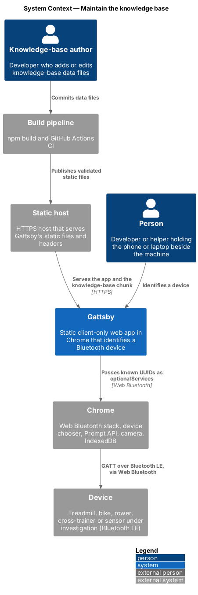
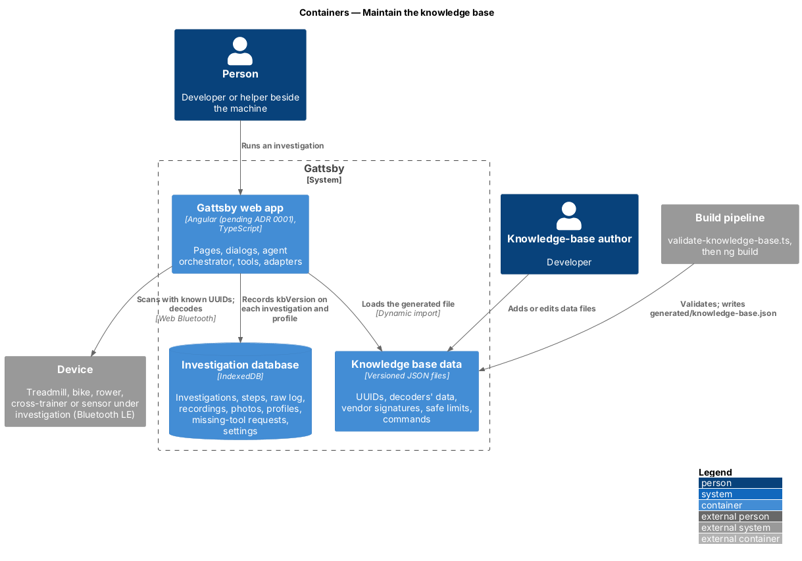
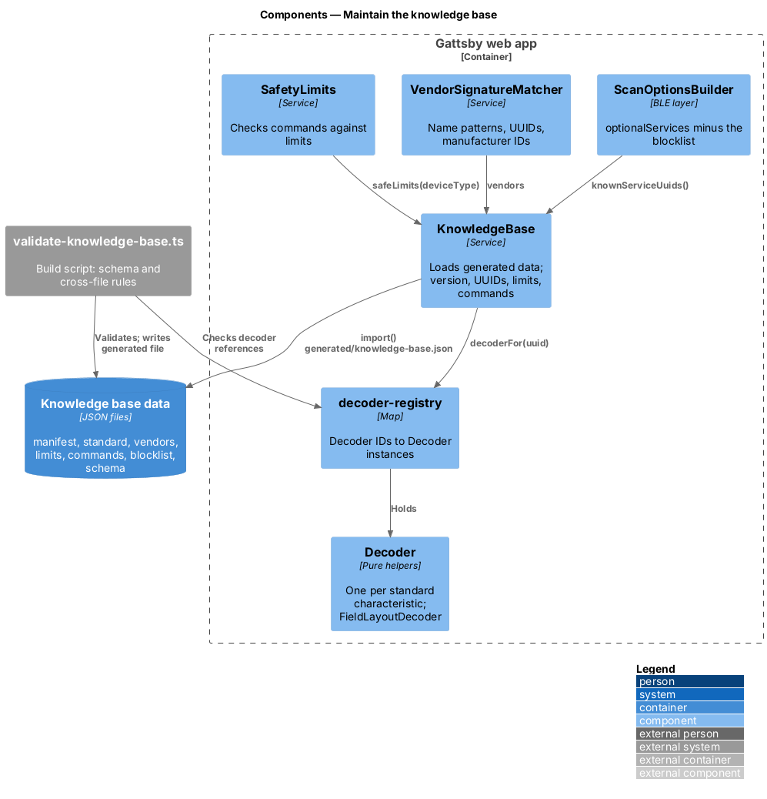
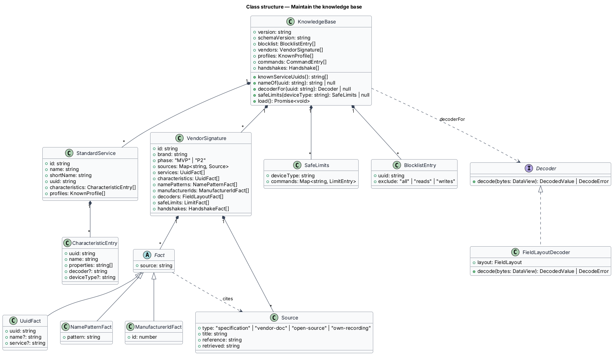
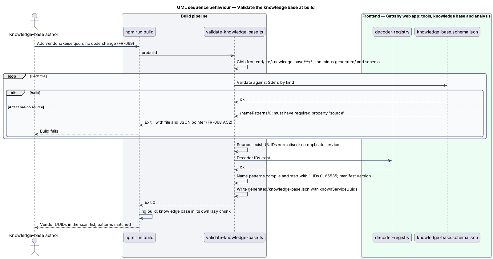
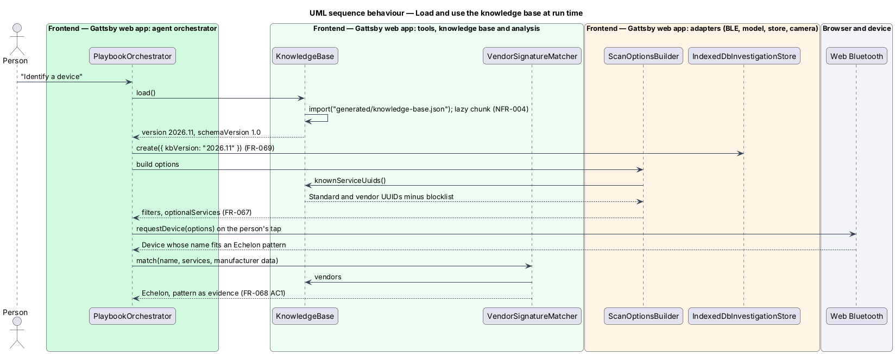

# Maintain the knowledge base

## Overview

Gattsby knows Bluetooth protocols through data, not code. The protocol knowledge base holds the
service and characteristic UUIDs, the decoders' references and data, vendor signatures, safe command
limits and command encodings that every stage of the playbook reads. This feature fixes how that
data is laid out in the repository, how each fact names its source, how the data is validated when
the app builds, how it is versioned, and how the app loads it. It belongs to the knowledge-base
subsystem; at run time it serves the Find, Identify, Standard path, Proprietary path and Control
stages.

**knowledge base** — protocol knowledge base: known UUIDs, decoders, vendor signatures, name
patterns, manufacturer IDs, safe limits and commands, as versioned JSON data files

**vendor signature** — knowledge-base entry for one brand: its service and characteristic UUIDs,
name patterns, manufacturer IDs, data decoders, safe command limits and handshakes, each with a source

**fact** — one claim in a vendor signature (a UUID, a name pattern, a manufacturer ID, a field
layout, a limit, a handshake step) together with the ID of the source that supports it

**knowledge-base version** — release label of the data, `2026.11` in the mocks, recorded by every
investigation and profile

The person meets the knowledge base indirectly: in scan results, in names such as "Fitness Machine
0x1826" in the activity feed (`docs/mocks/pages/investigation/identify.html`), in "Investigation
started · agent mode · knowledge base 2026.11" on the Evidence page
(`docs/mocks/pages/evidence/default.html`), and in Settings' About section ("Knowledge base 2026.11 ·
7 standard protocols", `docs/mocks/pages/settings/default.html`). The people who change it are
developers who add a vendor or a protocol.

Adding a vendor shall need only a new data file, and adding a standard protocol only data and a
decoder (NFR-022). The build therefore finds data files by folder, validates each against one schema
and a set of cross-file rules, and fails on the first file it cannot trust.

## Description

The design introduces these building blocks in the Angular (pending ADR 0001) workspace:

- **Data files** (`frontend/src/knowledge-base/`) — the layout below. Every file declares its
  `kind`.
- **`knowledge-base.schema.json`** (`frontend/src/knowledge-base/knowledge-base.schema.json`) — JSON
  Schema (draft 2020-12) with one `$defs` entry per file kind (`manifest`, `standard-service`,
  `vendor`, `limits`, `commands`, `blocklist`) and a shared `fact` definition whose `source` is
  required.
- **`validate-knowledge-base.ts`** (`frontend/scripts/validate-knowledge-base.ts`) — build script,
  run before every build, every `ng serve` and in CI's lint step. It validates every data file and
  writes the merged, normalised `frontend/src/knowledge-base/generated/knowledge-base.json`
  (git-ignored).
- **`KnowledgeBase`** (`frontend/src/app/knowledge-base/knowledge-base.ts`) — loads the generated
  file once through a dynamic `import()`, so it sits in its own lazy chunk outside the initial
  bundle (NFR-004), and exposes `version`, `knownServiceUuids()`, `blocklist`, `nameOf(uuid)`,
  `decoderFor(uuid)`, `vendors`, `profiles`, `safeLimits(deviceType)`, `commands` and `handshakes`.
- **`Decoder`** (`frontend/src/app/knowledge-base/decoders/decoder.ts`) — one file per standard
  characteristic (for example `decoders/treadmill-data.decoder.ts`), and
  `decoders/field-layout.decoder.ts`, which decodes any vendor field layout given as data.
  `decoders/decoder-registry.ts` maps decoder IDs to decoders; the build script reads it to check
  every data file's decoder reference.
- **`ScanOptionsBuilder`** (`frontend/src/app/ble/scan-options-builder.ts`) and
  **`VendorSignatureMatcher`** (`frontend/src/app/knowledge-base/vendor-signature-matcher.ts`) —
  read `knownServiceUuids()` and the vendors' name patterns, so a new vendor file reaches the scan
  list and the matcher with no code change (FR-069 AC1; see the scan-for-the-device and
  match-known-profiles designs).

### File layout

```
frontend/src/knowledge-base/
  manifest.json                  { "kind": "manifest", "version": "2026.11", "schemaVersion": "1.0" }
  knowledge-base.schema.json     schema for every file kind
  blocklist.json                 Chrome's GATT blocklist entries Gattsby needs to know
  standard/
    fitness-machine.json         0x1826
    cycling-power.json           0x1818
    cycling-speed-cadence.json   0x1816
    heart-rate.json              0x180D
    running-speed-cadence.json   0x1814
    device-information.json      0x180A
    battery.json                 0x180F
  vendors/
    echelon.json                 MVP: known-UUID entry (A-15)
    <brand>.json                 P2, in the order OQ-04 decides
  limits/
    treadmill.json  bike.json  rower.json  cross-trainer.json
  commands/
    ftms-control-point.json
  generated/                     build output, git-ignored
    knowledge-base.json
```

### Standard protocols at MVP

| Service | Characteristics and decoders |
|---|---|
| Fitness Machine `0x1826` | Treadmill Data `0x2ACD`, Cross Trainer Data `0x2ACE`, Rower Data `0x2AD1`, Indoor Bike Data `0x2AD2`, Fitness Machine Feature `0x2ACC`, Training Status `0x2AD3`, Supported Speed Range `0x2AD4`, Supported Inclination Range `0x2AD5`, Supported Resistance Level Range `0x2AD6`, Supported Heart Rate Range `0x2AD7`, Supported Power Range `0x2AD8`, Fitness Machine Control Point `0x2AD9`, Fitness Machine Status `0x2ADA` |
| Cycling Power `0x1818` | Cycling Power Measurement `0x2A63`, Cycling Power Feature `0x2A65` |
| Cycling Speed and Cadence `0x1816` | CSC Measurement `0x2A5B`, CSC Feature `0x2A5C` |
| Heart Rate `0x180D` | Heart Rate Measurement `0x2A37`, Body Sensor Location `0x2A38` |
| Running Speed and Cadence `0x1814` | RSC Measurement `0x2A53`, RSC Feature `0x2A54` |
| Device Information `0x180A` | Manufacturer Name `0x2A29`, Model Number `0x2A24`, Serial Number `0x2A25`, Hardware Revision `0x2A27`, Firmware Revision `0x2A26`, Software Revision `0x2A28`, System ID `0x2A23`, PnP ID `0x2A50` |
| Battery `0x180F` | Battery Level `0x2A19` |

Each data characteristic names a decoder ID; each decoder has unit tests with the payload examples of
the Bluetooth SIG specification (FR-066 AC1), kept with the test as a vector file that cites the
specification section. Where a specification gives no example for a characteristic, the vector is
`<TO SUPPLY>`.

A standard file, shortened:

```json
{
  "kind": "standard-service",
  "id": "fitness-machine",
  "name": "Fitness Machine",
  "shortName": "FTMS",
  "uuid": "0x1826",
  "source": { "title": "Bluetooth SIG Fitness Machine Service 1.0", "type": "specification" },
  "characteristics": [
    { "uuid": "0x2acd", "name": "Treadmill Data", "properties": ["notify"], "decoder": "treadmill-data", "deviceType": "treadmill" },
    { "uuid": "0x2ad9", "name": "Fitness Machine Control Point", "properties": ["write", "indicate"], "decoder": "control-point-response" }
  ],
  "profiles": [
    { "id": "ftms-treadmill", "deviceType": "treadmill", "requires": ["0x2acd"], "expects": ["0x2acc", "0x2ad9"] }
  ]
}
```

### Vendor signatures

Every fact in a vendor file is an object with a `source` that names an entry in the file's
`sources` map (FR-068). Sources are public documentation, published open-source projects, or the
person's own recordings of their own devices (A-11); a source is text in the file and is never
fetched. The Echelon entry's UUIDs and patterns are `<TO SUPPLY>` until researched (A-15).

```json
{
  "kind": "vendor",
  "id": "echelon",
  "brand": "Echelon",
  "phase": "MVP",
  "sources": {
    "s1": { "type": "open-source", "title": "<TO SUPPLY>", "reference": "<TO SUPPLY>", "retrieved": "<TO SUPPLY>" }
  },
  "services": [{ "uuid": "<TO SUPPLY>", "name": "Echelon data service", "source": "s1" }],
  "characteristics": [{ "uuid": "<TO SUPPLY>", "service": "<TO SUPPLY>", "properties": ["notify"], "source": "s1" }],
  "namePatterns": [{ "pattern": "<TO SUPPLY>", "source": "s1" }],
  "manufacturerIds": [],
  "decoders": [],
  "safeLimits": [],
  "handshakes": []
}
```

In P2 a vendor decoder is a field layout (`{ characteristic, frame, fields: [{ metric, offset, type,
endianness, scale, unit }], source }`) that `FieldLayoutDecoder` reads, and a handshake is a list of
steps (`{ characteristic, hex, awaitNotification }`) that `replay_known_handshake` sends only with
the person's approval (see the unlock-vendor-data-safely design).

### Limits and commands

`limits/*.json` hold the safe limits per device type that `SafetyLimits` enforces (A-06, pending
OQ-07): for a treadmill, a first target speed of at most 2.0 km/h or the device's minimum, whichever
is higher, and incline changes of one increment, never above 2 %; for a bike, resistance changes of
one increment and a power target of at most 100 W; one command at a time. A command with no limit
for the device type is refused with `UNSAFE_VALUE` and raises a missing-tool request (see the
keep-commands-conservative and record-missing-tool-requests designs).

`commands/ftms-control-point.json` holds the FTMS control-point operations with their parameter
encodings, motion flag and risk line: Request Control `0x00`, Reset `0x01`, Set Target Speed `0x02`
(uint16, 0.01 km/h), Set Target Inclination `0x03` (sint16, 0.1 %), Set Target Resistance Level
`0x04`, Set Target Power `0x05` (sint16, 1 W), Start or Resume `0x07`, Stop or Pause `0x08`
(parameter `0x01` stop, `0x02` pause).

`blocklist.json` lists the UUIDs on Chrome's GATT blocklist that Gattsby shall leave out of
`optionalServices` or never read, each with its exclusion (`all`, `reads` or `writes`) and the
Chromium source, for example Human Interface Device `0x1812` (`all`) and Serial Number String
`0x2A25` (`reads`) (FR-067).

### Build-time validation

`validate-knowledge-base.ts` runs these checks and fails the build with `file: JSON pointer: message`
for each failure:

1. Every `*.json` under `frontend/src/knowledge-base/`, except `generated/` and the schema, parses
   and has a known `kind`.
2. Each file is valid against its `kind`'s `$defs` entry (Ajv, strict mode). A fact without
   `source` fails here (FR-068 AC2).
3. Each `source` names an entry in its file's `sources`.
4. Each UUID is a 16-bit `0xNNNN` or a 128-bit form; all are normalised to lowercase 128-bit. Two
   files claiming the same service UUID fail unless one lists the other in `sharedWith`.
5. Each `decoder` ID exists in `decoder-registry.ts`; each vendor decoder is a valid field layout.
6. Each name pattern compiles as a `RegExp` with the `u` flag, starts with `^`, and is at most 80
   characters long.
7. Each manufacturer ID is an integer from 0 to 65,535.
8. `manifest.json`'s `version` matches `YYYY.MM` or `YYYY.MM.N`, and `schemaVersion` is
   `MAJOR.MINOR`.

The script then writes `generated/knowledge-base.json` with the version, the schema version, a
SHA-256 content hash for diagnostics, the merged entries, and `knownServiceUuids`: every standard
and vendor service UUID not excluded by the blocklist.

### Versions

The knowledge base carries two versions. `version` (`2026.11`) is the release label of the data;
every investigation records it at creation and every profile at conclusion (FR-069). `schemaVersion`
(`1.0`) is the semantic version of the data format that NFR-024 asks for: a minor version only adds
optional fields, and a major version changes `KnowledgeBase` with it. The validation cannot tell a
data change made without a new `version`; review owns that.

### Tests that prove it

An acceptance spec builds the app with an extra test vendor file in a fixture copy of the data
folder and checks that its UUID is in the scan's `optionalServices` and its name pattern is matched.
Unit tests run each decoder on the specification's examples, and run the validation script on fixture
folders with a fact missing its source, a bad decoder reference and a duplicate UUID.

## Requirements

The feature realizes the following level-2 (L2) requirements; each refines the level-1 (L1)
requirement cited beside it.

| L2 ID | Refines (L1) | Requirement |
|-------|--------------|-------------|
| [`FR-066`](../../../specs/L2.md#fr-066-cover-the-standard-protocols-at-mvp) | `L1-015` | The knowledge base must hold the service and characteristic UUIDs and decoders for: Fitness Machine Service (`0x1826`: Treadmill Data, Indoor Bike Data, Rower Data, Cross Trainer Data, Fitness Machine Feature, Fitness Machine Status, Training Status, Control Point and the supported ranges), Cycling Power (`0x1818`), Cycling Speed and Cadence (`0x1816`), Heart Rate (`0x180D`), Running Speed and Cadence (`0x1814`), Device Information (`0x180A`) and Battery (`0x180F`). |
| [`FR-068`](../../../specs/L2.md#fr-068-hold-vendor-signatures) | `L1-015` | Each vendor signature must hold the brand, service and characteristic UUIDs, name patterns, manufacturer ID, data decoders where known, safe command limits where known, known handshakes, and a source for each fact. At MVP the knowledge base must hold at least Echelon's known-UUID entry, so that its services are visible; the other listed vendors (Peloton, Keiser, iFit / NordicTrack / ProForm, Schwinn / Bowflex / Nautilus, Concept2 PM5, Wahoo, Tacx, Domyos, Yesoul, Sole, Horizon) follow in P2 in the order OQ-04 decides. |
| [`FR-069`](../../../specs/L2.md#fr-069-version-the-knowledge-base) | `L1-015` | The knowledge base must carry a version, be validated against its own schema when the app builds, and be extendable by adding data files only. Every investigation and profile records the version it used. |

## Diagrams

### System context

A knowledge-base author changes data files; the build validates them, and the person's Gattsby uses
the result to scan, identify and decode the device.



### Containers

The knowledge-base data is its own container of versioned JSON files; the web app loads the
generated file lazily and records its version in the investigation database.



### Components

The build script validates the data files against the schema and the decoder registry and writes the
generated file; `KnowledgeBase` loads it and serves `ScanOptionsBuilder`, `VendorSignatureMatcher`
and the decoders.



### Class structure

`KnowledgeBase` holds the standard services, vendor signatures, limits, commands and blocklist; every
vendor fact carries a source ID into the vendor's sources.



### Behaviour — validate at build

The author adds a vendor file; the script validates it and writes the generated file, or fails the
build on a fact without a source.



### Behaviour — load and use at run time

The app loads the generated file in a lazy chunk, records its version on the new investigation, and
passes the known UUIDs to the scan and the name patterns to the matcher.


