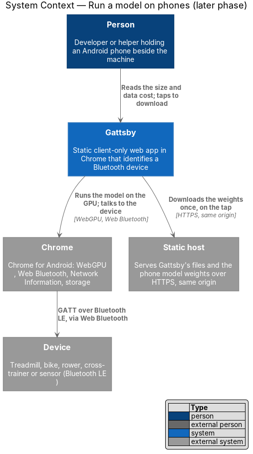
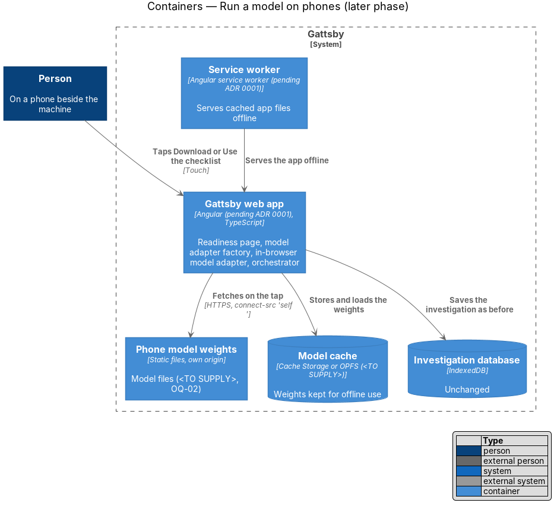
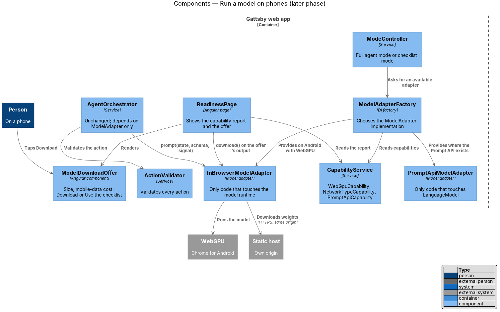
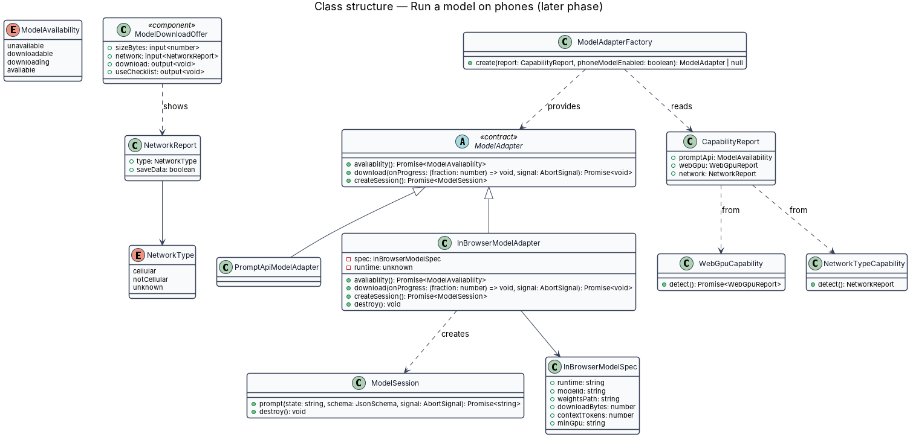
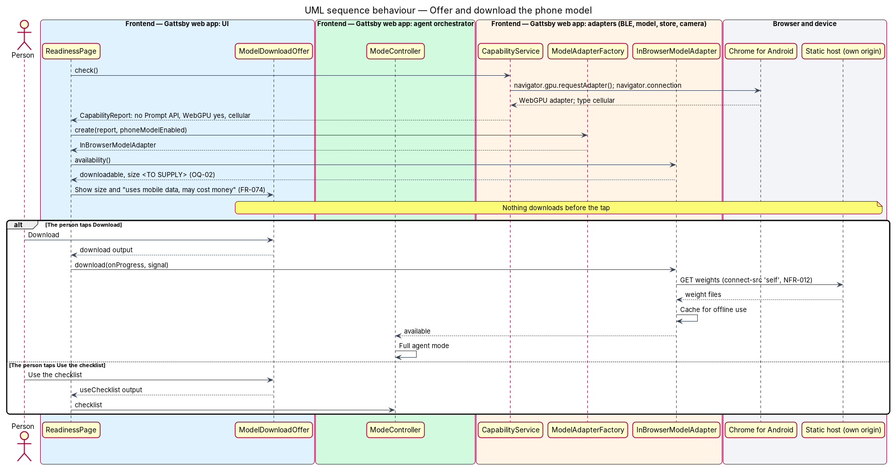
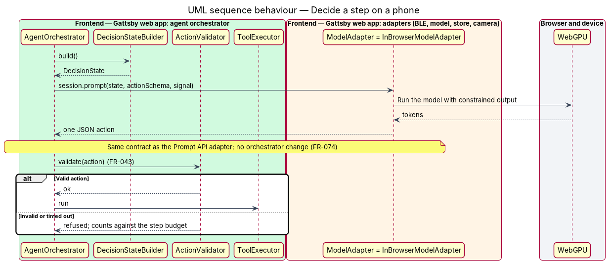

# Run a model on phones

## Overview

Gattsby's full agent mode runs Gemini Nano through Chrome's Prompt API, which Chrome ships only on
desktop. On Chrome for Android a person gets checklist mode
(`docs/mocks/pages/readiness/checklist.html`: "Chrome's on-device model isn't available on Android
yet"). Yet the in-store use case is a phone. This feature is the later-phase option of running full
agent mode on Android through a model that runs inside the page, for example on WebGPU with
Transformers.js or WebLLM, behind the same model adapter the orchestrator already uses. It belongs
to the later-phases subsystem and touches the environment and model-adapter parts of the
architecture only.

**in-browser model** — language model whose weights the page downloads and runs in the page itself,
on WebGPU, instead of a model the browser provides

**model runtime** — JavaScript library that loads and runs an in-browser model, such as
Transformers.js or WebLLM

**download offer** — prompt that states the model's download size and its cost on mobile data and
starts the download only on the person's tap

**mobile data** — cellular network connection, as far as the browser reports one

The feature is not built until two open questions are answered. `OQ-01` asks whether a laptop is
acceptable for in-store use at MVP, or whether phone mode has to ship with a real model. `OQ-02` asks
which in-browser model to use, if any, and at what size, speed and download cost on mobile data. The
MVP assumes a laptop for full agent mode and checklist mode on a phone (`A-02`). The design below
fixes the seams the feature would use, so that adding it changes no orchestrator code, and marks each
decision those questions block as `<TO SUPPLY>`.

No mock draws this feature yet. The readiness page's model download offer for Gemini Nano
(`docs/mocks/pages/readiness/downloadable.html`: "a one-time download of about 2.2 GB … stay on
Wi-Fi", with "Nothing downloads until the person taps the button") is the nearest pattern. A phone
variant of that state, with the size and mobile-data warning, would be drawn with the
`writing-html-mocks` skill before any code.

## Description

The design introduces these building blocks in the Angular (pending ADR 0001) workspace under
`frontend/src/app/`:

- **`ModelAdapter`** (`model/model-adapter.ts`) — the existing contract: availability, download with
  progress, a session that returns one action constrained to a JSON schema, and abort. It does not
  change. The orchestrator depends only on it.
- **`InBrowserModelAdapter`** (`model/in-browser-model-adapter.ts`) — a second implementation of the
  contract and the only code that touches the model runtime. It imports the runtime dynamically, so
  the runtime is not in the initial bundle (NFR-004). It reports `ModelAvailability`
  (`unavailable`, `downloadable`, `downloading`, `available`), downloads the weights with progress,
  passes the action schema to the runtime's constrained output where the runtime offers one, and
  passes the step's `AbortSignal` to each call. The runtime, the model, its size and its context
  window are `<TO SUPPLY>` (`OQ-02`).
- **`ModelAdapterFactory`** (`model/model-adapter-factory.ts`) — the DI factory for the
  `ModelAdapter` token. It returns `PromptApiModelAdapter` when the Prompt API is available,
  `InBrowserModelAdapter` when the phone model is enabled in the build and WebGPU is available, and
  no adapter otherwise, which routes to checklist mode through `ModeController`. Until `OQ-01` and
  `OQ-02` are answered, the phone model is not enabled in any build.
- **`WebGpuCapability`** (`capabilities/webgpu.capability.ts`) — reports whether `navigator.gpu`
  exists and an adapter can be requested. Its result joins the `CapabilityReport`; the minimum GPU
  limits the chosen model needs are `<TO SUPPLY>` (`OQ-02`).
- **`NetworkTypeCapability`** (`capabilities/network-type.capability.ts`) — reports whether the
  connection is cellular and whether the person asked to save data, where Chrome's Network
  Information API reports them; otherwise it reports `unknown`.
- **`ModelDownloadOffer`** (`ui/model-download-offer/model-download-offer.ts`) — presentation
  component on the readiness page. Inputs: the download size, the network type and the free storage
  estimate. Output: `download` or `useChecklist`. It always states the size, and on mobile data or an
  unknown network it also states that the download uses mobile data and may cost money.
- **`ModeController`** (`agent/mode-controller.ts`) — unchanged: full agent mode when an adapter
  reports `available`, checklist mode otherwise (see the
  [choose-the-operating-mode design](../../environment/choose-the-operating-mode/README.md)).

### Rules

1. The orchestrator, the playbook, the action validator and the tool registry do not change. The
   phone model is reached only through `ModelAdapter`; FR-074's first acceptance criterion is this
   rule.
2. Every action the phone model returns is untrusted and is validated by `ActionValidator` like any
   other (FR-043). The model never decodes bytes or scores hypotheses.
3. Nothing downloads until the person taps the offer. The size is shown before the tap, whatever the
   network type.
4. The weights are served from Gattsby's own origin as static files, never from a model hub or CDN,
   because `connect-src` is `'self'` (NFR-012; see the
   [keep-data-on-the-device design](../../platform/keep-data-on-the-device/README.md)). Their hosting
   size and cache limits are `<TO SUPPLY>`.
5. The weights are cached on the device for offline use (NFR-006). Where the runtime caches them
   (Cache Storage or the origin private file system) is `<TO SUPPLY>`; the investigation store does
   not hold them.
6. A runtime that compiles WebAssembly may need `'wasm-unsafe-eval'` in the Content Security
   Policy's `script-src`. NFR-014 forbids `unsafe-eval` but does not name `'wasm-unsafe-eval'`; the
   choice needs an ADR before the feature ships (`<TO SUPPLY>`).
7. Release what is acquired: the adapter destroys the runtime's session and GPU resources when the
   investigation ends or the mode falls back.
8. When the phone model is slow or fails, the existing fallback applies: a timed-out call counts as a
   failed step (FR-047), and `ModeController` may move the investigation to checklist mode (FR-006).
   The phone's step latency target is `<TO SUPPLY>`; NFR-002's 3 seconds is for a laptop (`A-07`).

### Data shapes

| Type | Fields |
|---|---|
| `InBrowserModelSpec` | `runtime` (`<TO SUPPLY>`), `modelId` (`<TO SUPPLY>`), `weightsPath` (own origin), `downloadBytes` (`<TO SUPPLY>`), `contextTokens` (`<TO SUPPLY>`), `minGpu` (`<TO SUPPLY>`) |
| `NetworkType` | `cellular`, `notCellular`, `unknown`, plus `saveData` |
| `DownloadOfferView` | `sizeBytes`, `networkType`, `freeBytesEstimate` |
| `WebGpuReport` | `available`, `adapterInfo?` |

### Errors

| Code | Raised by | Meaning to the person |
|---|---|---|
| `UNSUPPORTED` | `InBrowserModelAdapter` | No WebGPU, or not enough GPU: "This phone can't run the agent. Checklist mode works the same way." |
| `STORAGE_FULL` | `InBrowserModelAdapter` | Not enough space for the model; checklist mode is offered. |
| `ABORTED` | `InBrowserModelAdapter` | Stop, emergency stop or a timeout aborted the call. |
| `TIMEOUT` | `AgentOrchestrator` | The call took too long; the step counts as failed (FR-047). |

### Tests that prove it

When the feature is built, the acceptance spec (`e2e/specs/later-phases/run-a-model-on-phones.spec.ts`)
runs Chromium with a mobile viewport, no fake `LanguageModel`, and a fake model runtime that returns
scripted actions; its fixture (`e2e/fixtures/fake-in-browser-model.ts`) is `<TO SUPPLY>` with the
runtime. Scenarios: with the weights cached, an FTMS treadmill investigation from the fake
`navigator.bluetooth` runs in full agent mode; on a reported cellular connection, the offer shows the
size and the fake runtime records no download before the tap. Unit tests cover `ModelAdapterFactory`
for each capability combination. No spec downloads a real model, and no request leaves localhost.

## Requirements

The feature realizes the following level-2 (L2) requirement; it refines the level-1 (L1) requirement
cited beside it.

| L2 ID | Refines (L1) | Requirement |
|-------|--------------|-------------|
| [`FR-074`](../../../specs/L2.md#fr-074-run-a-model-on-phones) | `L1-023` | If OQ-01 and OQ-02 decide so, Gattsby must offer full agent mode on Chrome for Android through an in-browser model (for example WebGPU with Transformers.js or WebLLM) behind the same model adapter, with its download size and cost on mobile data stated before the download starts. |

## Diagrams

### System context

On a phone, Gattsby downloads the phone model from its own static host on the person's tap and runs it
on the phone's GPU through Chrome; the device is reached through Web Bluetooth as before.

### Containers

The web app fetches the weights from the static host, caches them, and runs the model in the page;
the investigation database and the knowledge base data are unchanged.

### Components

`ModelAdapterFactory` chooses between the Prompt API adapter and `InBrowserModelAdapter` from the
capability report; the orchestrator sees only the `ModelAdapter` contract.

### Class structure

`InBrowserModelAdapter` and `PromptApiModelAdapter` both implement `ModelAdapter`; the factory reads
the `CapabilityReport`, which gains `WebGpuCapability` and `NetworkTypeCapability`.

### Behaviour — offer and download the phone model

On a phone on mobile data, the readiness page states the size and the data cost; the weights download
from Gattsby's own origin only after the person taps.

### Behaviour — decide a step on a phone

The orchestrator asks the same `ModelAdapter` for one action; the in-browser model answers within the
action schema, and `ActionValidator` checks it as any other action.

