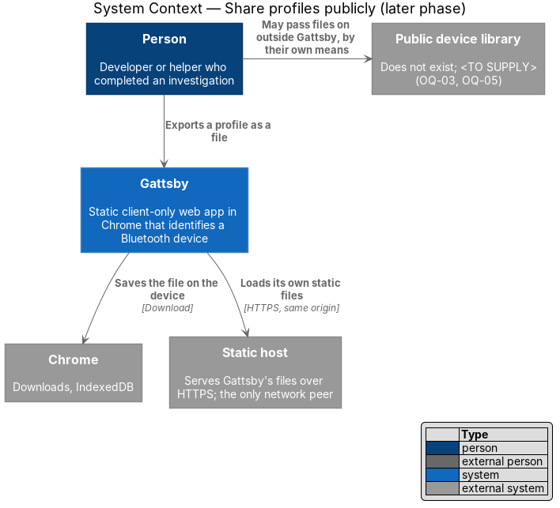
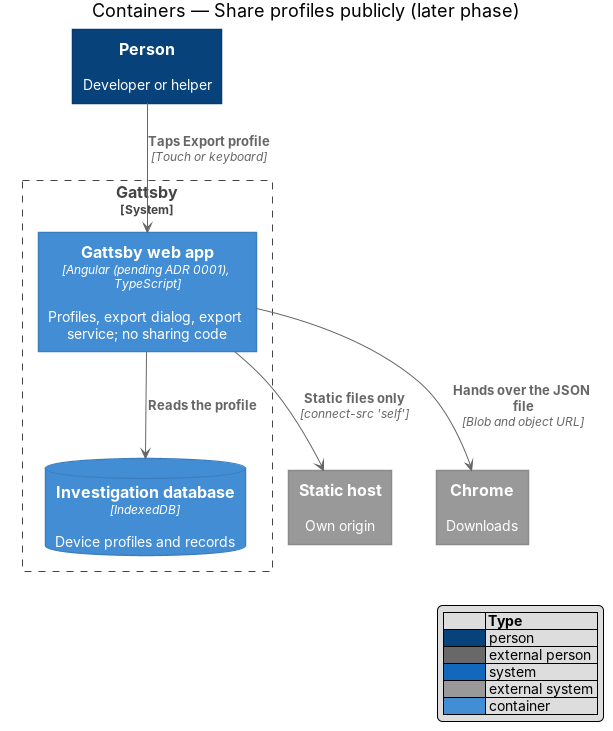
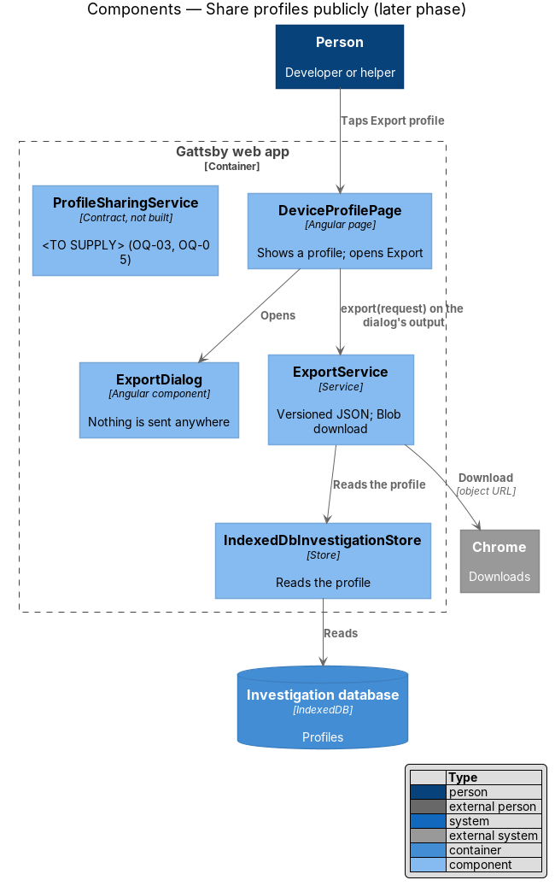
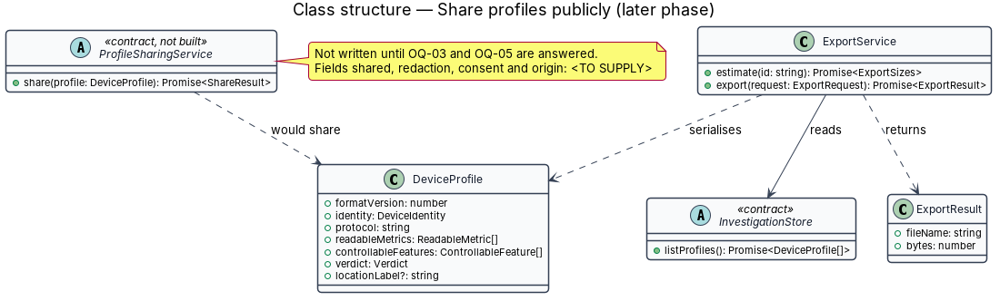
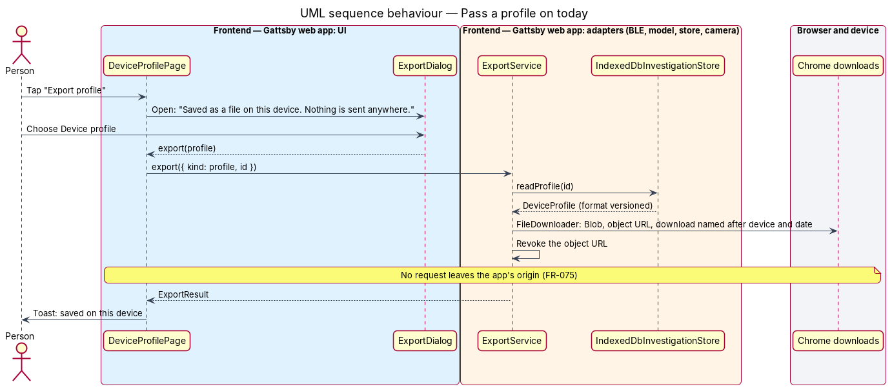
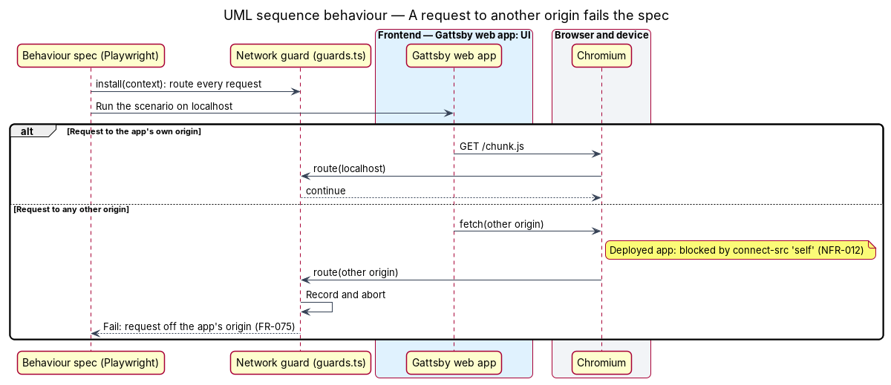

# Share profiles publicly

## Overview

A device profile written in one store could save another developer the same walk. A public device
library of profiles is therefore a natural later capability, and the brief leaves it open: `OQ-03`
asks whether profiles should be shareable publicly to build a community device library, and `OQ-05`
asks whether the app should ever connect to the owner's own backend or stay fully local. Until both
are answered, sharing is out of scope, and the one testable obligation is negative: Gattsby makes no
network request to share anything. This feature belongs to the later-phases subsystem. Today it
consists of that guarantee and of the seams a later design would use; every choice the two open
questions block is marked `<TO SUPPLY>`.

**public device library** — collection of device profiles that people other than their author can
browse; none exists today

**share** — act of sending a profile to a public device library from inside Gattsby; not built

**export** — act of saving a profile or record as a local JSON file that the person starts; the only
way data leaves Gattsby (see the
[export-a-profile-or-record design](../../persistence/export-a-profile-or-record/README.md))

What a person can do today is export. The Export dialog (`docs/mocks/dialogs/export/default.html`)
says so in its lead: "Saved as a file on this device. Nothing is sent anywhere." The Settings page
(`docs/mocks/pages/settings/default.html`) repeats it: "Nothing leaves this device: no accounts, no
analytics, no server. Exporting is the only way data leaves, and only when you start it." No mock
draws a Share control, and none is to be drawn before the open questions are answered.

## Description

The design describes what exists in the Angular (pending ADR 0001) workspace under
`frontend/src/app/` for this requirement, and what a later design would add.

What exists now:

- **No sharing code.** The app has no share button, no sharing service, no upload endpoint and no
  account. The app does not provide Angular's `HttpClient`, because nothing in the app calls an API.
- **`ExportService`** (`store/export.service.ts`) — builds the profile JSON (format versioned,
  NFR-024) and hands it to the person as a download through a `Blob` and an object URL, revoked once
  the download starts. A download is not a network request. A person may share the file by any means
  they choose, outside Gattsby.
- **`ExportDialog`** (`dialogs/export/export.dialog.ts`) — the person starts every export, and the
  dialog states that nothing is sent anywhere.
- **Content Security Policy** — `connect-src 'self'` blocks any request to another origin at run time
  (see the [keep-data-on-the-device design](../../platform/keep-data-on-the-device/README.md)). A
  share request to a library on another origin would fail even if code tried it.
- **Network guard in the behaviour specs** — the network guard in `e2e/fixtures/guards.ts` (see the
  [test-without-hardware-or-a-model design](../../platform/test-without-hardware-or-a-model/README.md))
  fails any spec that makes a request to an origin other than the app's own. It is the acceptance
  test for FR-075.

What a later design adds, if `OQ-03` and `OQ-05` decide for sharing:

| Decision | Status |
|---|---|
| Whether a public library exists, and who runs it | `<TO SUPPLY>` (`OQ-03`) |
| Whether Gattsby talks to a backend at all, or the library takes exported files by another route | `<TO SUPPLY>` (`OQ-05`) |
| Which profile fields are shared, and which are removed first (location label, notes, serial number, photos) | `<TO SUPPLY>` |
| Consent wording and where the Share control sits | `<TO SUPPLY>`; a mock comes first |
| Change to NFR-012 and to `connect-src` to allow the library's origin | `<TO SUPPLY>`; needs a requirement change and an ADR |

A `ProfileSharingService` contract (`store/profile-sharing.service.ts`) is the seam such a design
would add: one method that takes a profile the person chose and returns a share result, behind the
same refuse-with-a-code pattern as every contract. It is not written now, so that no build carries
a sharing path before the answers exist.

### Rules

1. No build before `OQ-03` and `OQ-05` are answered sends a request to any origin but its own.
2. Export stays the only way data leaves, and the person starts it.
3. Sharing, when it comes, follows a requirement change, a mock, and this design's update, in that
   order, before any code.

### Tests that prove it

The network guard (`e2e/fixtures/guards.ts`) runs in every behaviour spec. It routes every
request through Playwright, fails the spec on any request to an origin other than the app's, and
fails it on any WebSocket. The export spec of the export design checks that "Export profile" saves a
file and that the guard saw no request. No separate spec exists for a feature that is not built.

## Requirements

The feature realizes the following level-2 (L2) requirement; it refines the level-1 (L1) requirement
cited beside it.

| L2 ID | Refines (L1) | Requirement |
|-------|--------------|-------------|
| [`FR-075`](../../../specs/L2.md#fr-075-share-profiles-publicly) | `L1-023` | Sharing profiles to a public device library is out of scope until OQ-03 and OQ-05 are answered. Until then Gattsby must make no network request to share anything. |

## Diagrams

### System context

Gattsby has no connection to any device library; the person exports a profile as a file and may pass
it on outside Gattsby.

### Containers

The web app reads profiles from the investigation database and writes export files to the person's
device; its only network peer is the static host it was loaded from.

### Components

`DeviceProfilePage` opens `ExportDialog`; `ExportService` reads the profile from the
store and hands the file to the browser as a download. The later `ProfileSharingService` is shown as
not built.

### Class structure

`ExportService` produces a versioned `DeviceProfile` file; `ProfileSharingService` is the contract a
later design would add once the open questions are answered.

### Behaviour — pass a profile on today

The person exports a profile; the file is saved on the device and no request leaves the app's origin.

### Behaviour — a request to another origin fails the spec

In every behaviour spec the network guard fails the run on a request to another origin, and in the
deployed app the Content Security Policy blocks it.

