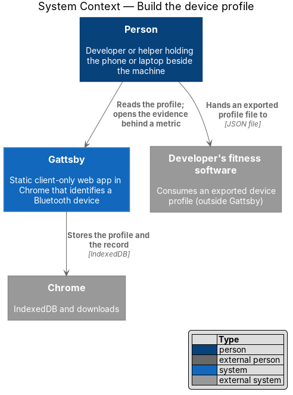
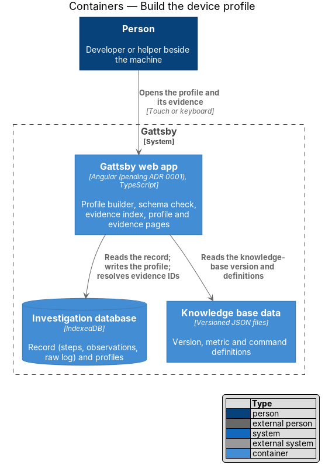
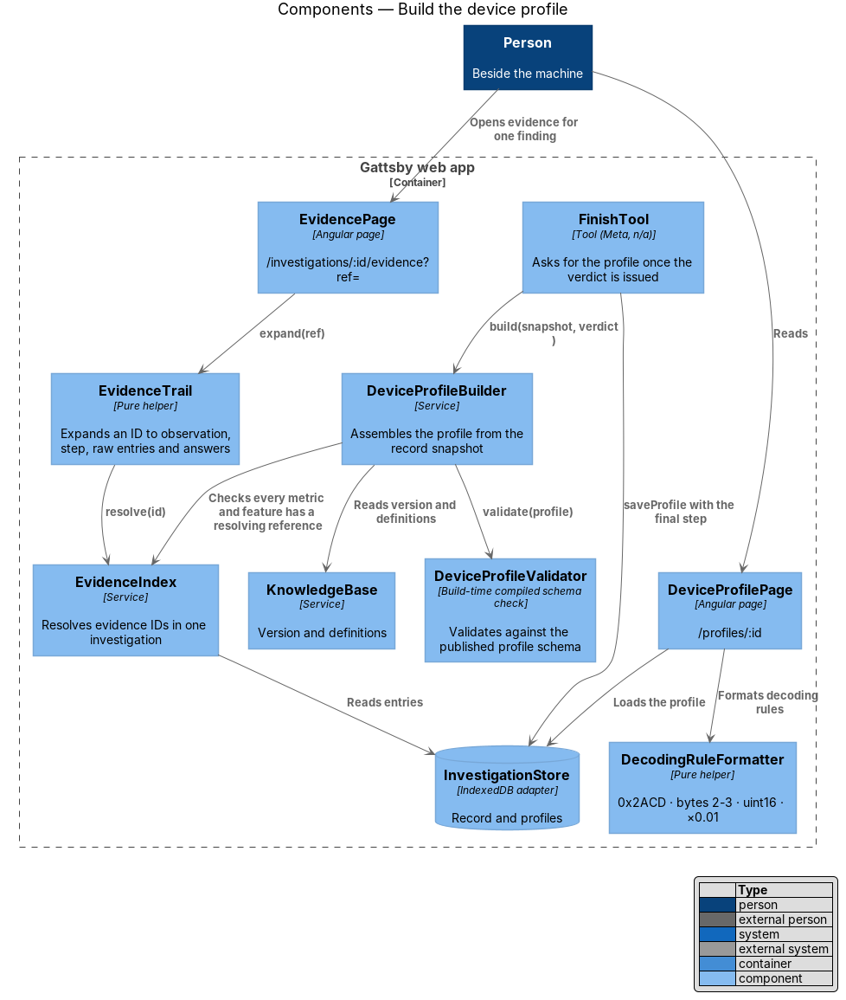
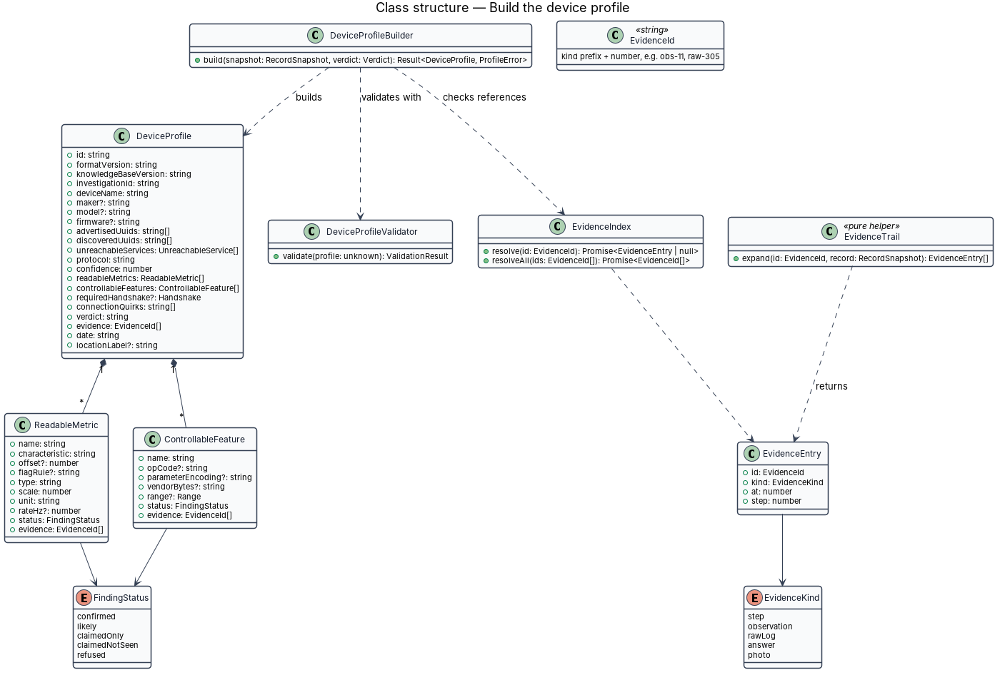
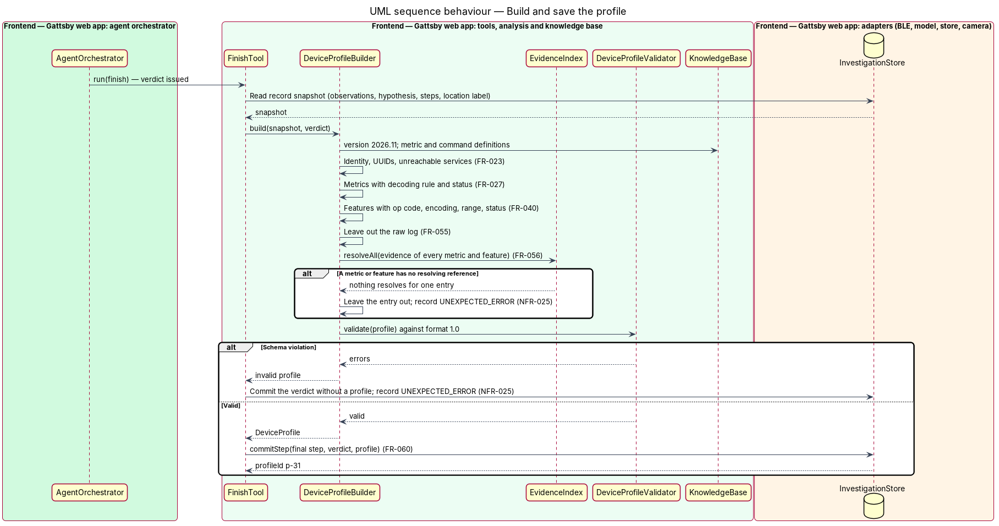
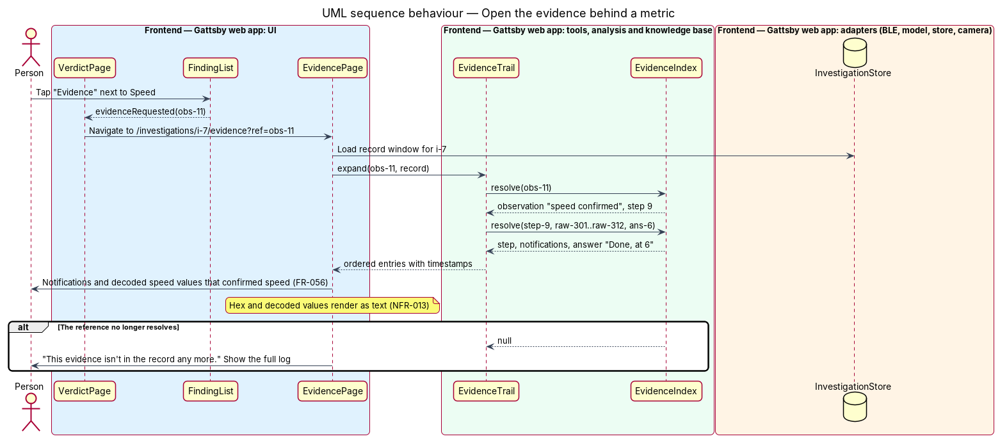
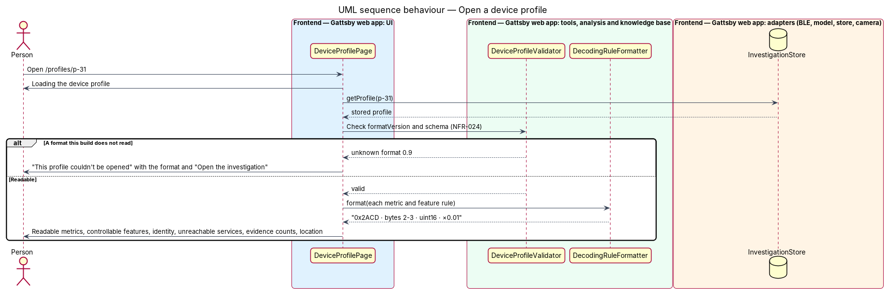

# Build the device profile

## Overview

The device profile is Gattsby's core output: a versioned JSON document that tells a developer what
the device is, what it reports, how to decode each value and how to command it. This feature builds
the profile from the investigation record when the verdict is issued, checks it against the published
profile schema, and ties every metric and feature to the evidence behind it, so the person can open
that evidence from the verdict screen. It belongs to the outcome subsystem and runs in the Conclude
stage, for every verdict.

**device profile** — exportable result of one investigation: identity, UUIDs, protocol, readable
metrics with decoding rules, controllable features with command bytes, and verdict, without the raw
log

**investigation record** — every step of one investigation with its actions, tool inputs and outputs,
raw traffic, answers, hypotheses and missing-tool requests

**decoding rule** — how to turn bytes into one metric: characteristic, byte offset or the flag rule
that sets it, type, scale and unit

**evidence ID** — identifier of one entry in an investigation record, written as a kind prefix and a
number: `step-9`, `obs-11`, `raw-305`, `ans-6`, `photo-1`

**evidence trail** — ordered entries that support one finding: the observation, the step whose tool
call produced it, the raw log entries it cites and the person's answers in that step

The device profile page (route `/profiles/:id`) shows a finished profile
(`docs/mocks/pages/device-profile/default.html`): readable metrics with their decoding rule, rate and
status ("Speed km/h · 0x2ACD · bytes 2–3 · uint16 · ×0.01 · 1 Hz · confirmed"), controllable features
with op code, encoding and range, identity (advertised name, maker, model, firmware, services), "Not
reachable" services, an evidence summary ("11 steps, 412 packets, 3 commands sent with your
approval") with "Open the log", notes, and the location label with the date. A partly decoded device
shows *likely* and *claimed, not seen* rows (`partial.html`); a profile in a format this build does
not read shows `error.html`; `success.html` shows the saved confirmation. Each confirmed item on the
verdict screen has an "Evidence" link (`docs/mocks/pages/verdict/default.html`) that opens the
evidence log (`docs/mocks/pages/evidence/default.html`).

## Description

The design introduces these building blocks in the Angular (pending ADR 0001) workspace under
`frontend/src/app/`:

- **`DeviceProfileBuilder`** (`outcome/device-profile-builder.ts`) — service with unit tests.
  `build(snapshot, verdict)` reads a `RecordSnapshot` (observations, current hypothesis, GATT layout,
  Device Information reads, metric and feature findings, location label) and returns a
  `DeviceProfile`. It never copies the raw log. It is called by `FinishTool` (see
  [issue the verdict](../issue-the-verdict/README.md)) for every verdict, so a stopped investigation
  has a partial profile (FR-009 AC3).
- **`DeviceProfileValidator`** (`outcome/device-profile-validator.ts`) — checks a profile against the
  published profile JSON Schema (`outcome/schemas/device-profile.schema.json`) and its
  `formatVersion`. The validator is compiled from the schema at build time, because the Content
  Security Policy forbids `unsafe-eval` (NFR-014) and runtime schema compilers generate functions.
  The library is `<TO SUPPLY>`. The same validator serves import (see
  [import profiles and records](../../persistence/import-profiles-and-records/README.md)).
- **`EvidenceIndex`** (`outcome/evidence-index.ts`) — resolves an `EvidenceId` to an `EvidenceEntry`
  within one investigation through `InvestigationStore`. `ActionValidator` uses it for every input
  field of format `evidence-id` (TOOL-028, TOOL-029); the builder uses it to prove each metric and
  feature has a resolving reference (FR-055 AC2).
- **`EvidenceTrail`** (`outcome/evidence-trail.ts`) — pure helper with unit tests. `expand(id,
  record)` returns the ordered entries behind one finding, with their timestamps.
- **`DecodingRuleFormatter`** (`outcome/decoding-rule-formatter.ts`) — pure helper that writes a
  decoding rule or command as one line ("0x2ACD · flag bit 3 · sint16 · ×0.1"; "op 0x02 · uint16 ·
  0.01 km/h · 0.5–16.0").
- **`DeviceProfilePage`** (`pages/device-profile/device-profile.page.ts`) — page that loads the
  profile, checks its format, and passes rows to presentation components (`MetricRuleTable`,
  `FeatureCommandTable`, `IdentityList` in `ui/`), which inject no app service.
- **`EvidencePage`** (`pages/evidence/evidence.page.ts`) — the evidence log (see
  [log raw traffic](../../tool-registry/log-raw-traffic/README.md)). With the query `?ref=<evidence
  ID>` it shows only the evidence trail for that reference, in time order, with hex and decoded
  values.
- **`InvestigationStore.commitStep`** and **`saveProfile`** (`store/investigation-store.ts`) — store the
  profile with the final step and the verdict in one transaction (FR-060).

### Rules

1. The profile holds exactly the fields FR-055 lists (see *Data shapes*). It holds no raw log entry;
   evidence IDs point into the record instead.
2. Readable metrics carry the decoding rule and status from FR-027: *confirmed*, *likely*, *claimed
   only* or *claimed, not seen*. Controllable features carry the command and status from FR-040:
   *confirmed*, *claimed only* or *refused*.
3. Every metric and every feature carries at least one evidence ID that resolves in its investigation
   record (FR-055 AC2). A claimed-only entry cites the read of the claim (for example, Fitness Machine
   Feature `0x2ACC`). An entry with no resolving reference is left out of the profile and recorded as
   a diagnostic (see [record local diagnostics](../../platform/record-local-diagnostics/README.md)).
4. Every observation, hypothesis version and profile entry references the step (tool call) and the raw
   log entries that support it (FR-056). Tools return those IDs in the envelope's `evidence` field
   (FR-072), and the orchestrator stores them on the observations it commits.
5. `unreachableServices` lists the services requested but not reachable, and states that services
   outside the known-UUID list or on Chrome's blocklist are invisible (FR-023 AC2).
6. The profile records `formatVersion` (`"1.0"`, NFR-024) and the `knowledgeBaseVersion` used
   (FR-069). The location label is copied from the investigation (FR-010).
7. The profile is validated before it is stored. A schema violation is a defect: the verdict is still
   committed without a profile, and the error is recorded with its tool and stage (NFR-025).
8. A profile in a format this build does not read opens in the error state with the format named and
   "Open the investigation" offered; the record is untouched.
9. Device names, maker strings and every byte-derived string render as text (NFR-013).
10. The profile mock shows the person's notes, but FR-055 does not list notes. The page reads them from
    the investigation record when it is present; whether notes belong in the profile format is
    `<TO SUPPLY>`. The mock's "Reconnect" and "Investigate again" buttons start a new investigation
    and are outside this feature.

### Data shapes

| Type | Fields |
|---|---|
| `DeviceProfile` (`store/model/device-profile.ts`) | `id`, `formatVersion`, `knowledgeBaseVersion`, `investigationId`, `deviceName`, `maker?`, `model?`, `firmware?`, `advertisedUuids`, `discoveredUuids`, `unreachableServices`, `protocol`, `confidence`, `readableMetrics`, `controllableFeatures`, `requiredHandshake?`, `connectionQuirks`, `verdict`, `evidence`, `date`, `locationLabel?` |
| `ReadableMetric` | `name`, `characteristic`, `offset?`, `flagRule?`, `type`, `scale`, `unit`, `rateHz?`, `status`, `evidence` |
| `ControllableFeature` | `name`, `opCode?`, `parameterEncoding?`, `vendorBytes?`, `range?`, `status`, `evidence` |
| `EvidenceId` | `step-<n>`, `obs-<n>`, `raw-<n>`, `ans-<n>`, `photo-<n>` |
| `EvidenceEntry` | `id`, `kind`, `at`, `step` |

The fields an owner's fitness app needs, and whether the format should follow an existing schema, are
open (OQ-09).

### Errors

| Code | Raised by | Meaning to the person |
|---|---|---|
| `STORAGE_FULL` | `InvestigationStore` | Shown on the verdict screen's error state (see issue the verdict). |
| `UNEXPECTED_ERROR` | `DeviceProfileBuilder` | Not expected in use. The verdict screen omits "Open the device profile"; the record keeps the error. |

### Tests that prove it

Acceptance specs use the fake `navigator.bluetooth` (`e2e/fixtures/fake-bluetooth.ts`) with the
scripted FTMS treadmill, and the `VerdictPage`, `EvidencePage` and `DeviceProfilePage` page objects.
After a finished FTMS investigation the spec exports the profile through the `ExportDialog` page
object and validates the file against the published schema (FR-055 AC1), then checks that every
metric's and feature's evidence ID resolves in the exported record (FR-055 AC2). Tapping "Evidence"
next to "speed" shows the notifications and decoded values that confirmed speed, with timestamps
(FR-056 AC1). Unit tests cover `DeviceProfileBuilder` (no raw log copied, unresolved entries left
out), `EvidenceTrail` and `DecodingRuleFormatter`.

## Requirements

The feature realizes the following level-2 (L2) requirements; each refines the level-1 (L1)
requirement cited beside it.

| L2 ID | Refines (L1) | Requirement |
|-------|--------------|-------------|
| [`FR-055`](../../../specs/L2.md#fr-055-build-the-device-profile) | `L1-012` | The device profile must hold: profile format version, knowledge-base version, device name, maker, model, firmware, advertised and discovered UUIDs, unreachable services, protocol and confidence, readable metrics with decoding rules (characteristic, offset or flag rule, type, scale, unit, confirmation), controllable features with command bytes and ranges, required handshake, connection quirks, verdict, evidence references, date, and the optional location label. It must not hold the raw log; that stays in the investigation record. |
| [`FR-056`](../../../specs/L2.md#fr-056-link-evidence-to-the-raw-record) | `L1-012` | Every observation, hypothesis and profile entry must reference the tool calls and raw log entries that support it, and the person must be able to open that evidence from the verdict screen. |

## Diagrams

### System context

The person reads the profile and its evidence in Gattsby, which keeps both in Chrome's IndexedDB; an
exported profile is handed to the developer's own fitness software outside Gattsby.

### Containers

The web app reads the knowledge-base version and definitions, reads the investigation record, and
writes the profile to the investigation database, where its evidence IDs also resolve.

### Components

`FinishTool` asks `DeviceProfileBuilder` for the profile, which checks references through
`EvidenceIndex` and the schema through `DeviceProfileValidator`; the profile page formats rules with
`DecodingRuleFormatter`, and the evidence page expands a reference with `EvidenceTrail`.

### Class structure

A `DeviceProfile` owns its `ReadableMetric`s and `ControllableFeature`s, each with a status and
evidence IDs; `EvidenceIndex` and `EvidenceTrail` turn those IDs back into `EvidenceEntry`s.

### Behaviour — build and save the profile

Once the verdict is issued, the builder assembles the profile from the record snapshot, leaves out the
raw log, proves each entry's evidence resolves, validates the schema, and the tool stores the profile
with the final step.

### Behaviour — open the evidence behind a metric

Tapping "Evidence" next to Speed opens the evidence log filtered to that reference; `EvidenceTrail`
lists the observation, its step, the notifications and the person's answer, with timestamps.

### Behaviour — open a device profile

The profile page loads the stored profile, checks its format version, and shows each metric's and
feature's rule in one line, or the error state for a format this build does not read.

