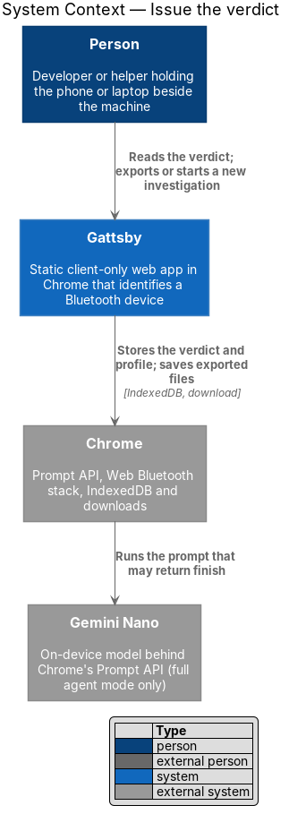
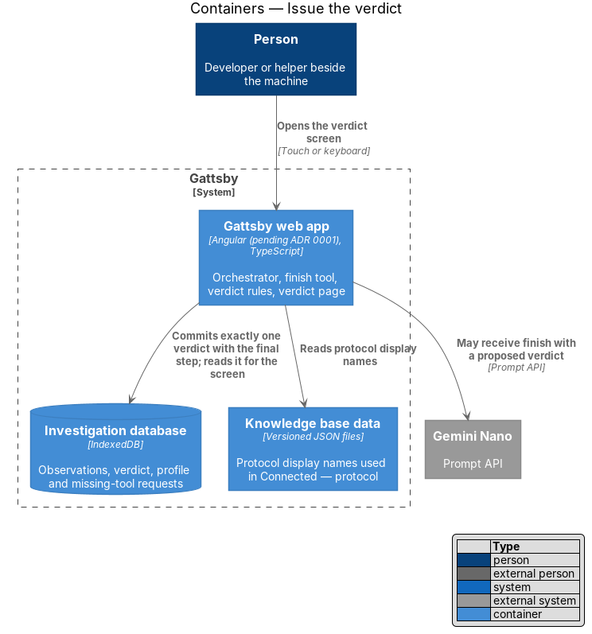
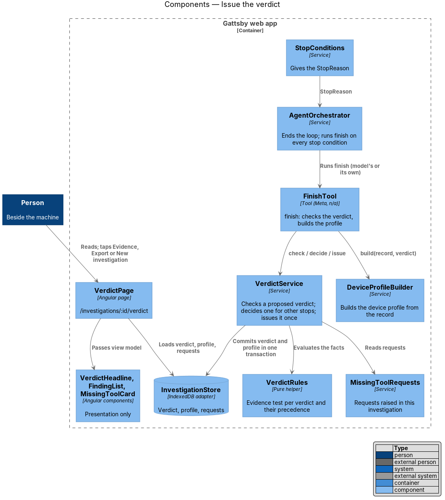
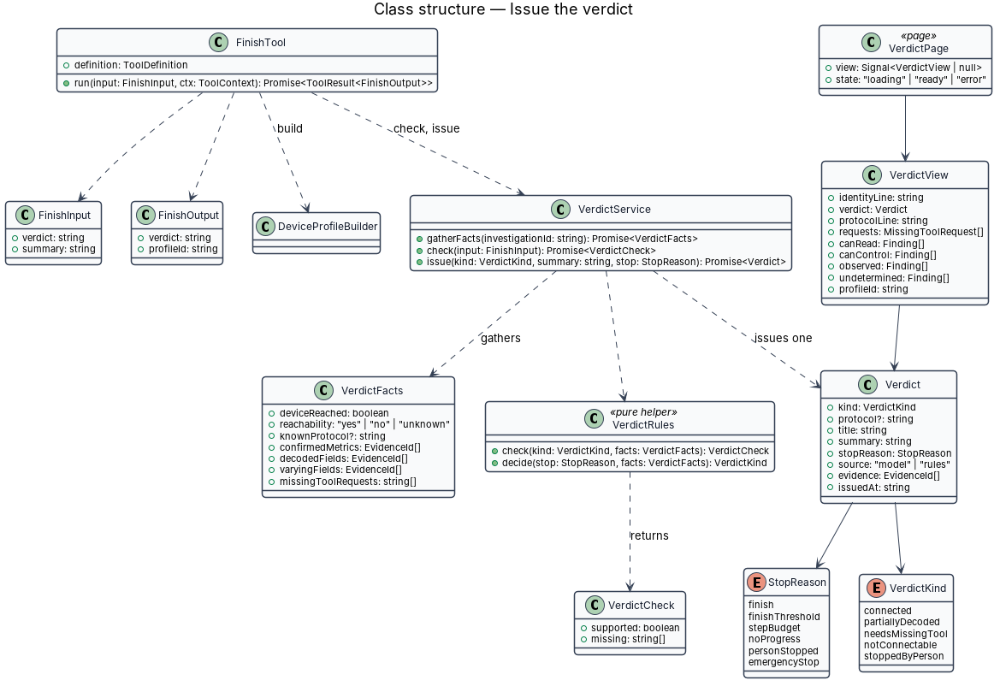
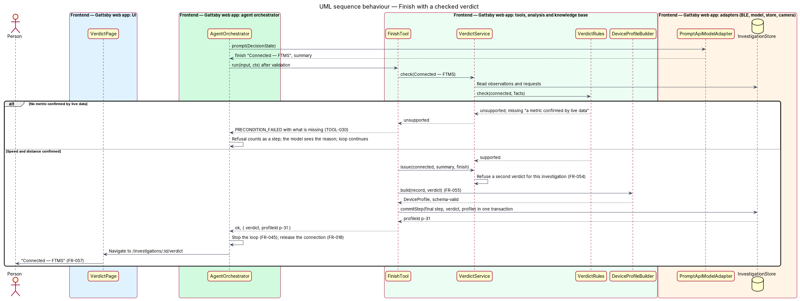
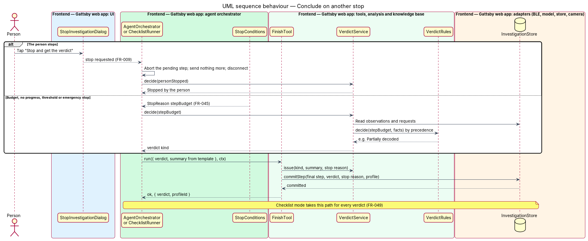
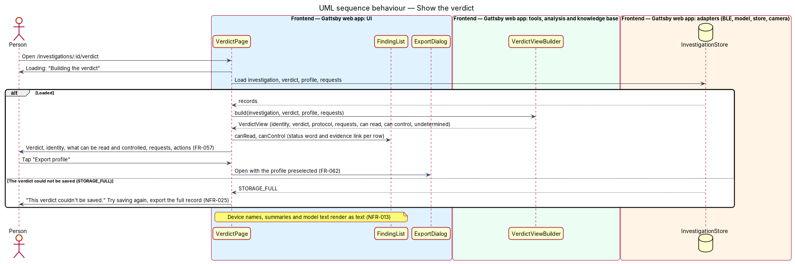

# Issue the verdict

## Overview

Every investigation ends with an answer the developer can act on: whether their software can talk to
the device, and how. This feature decides that answer, checks it against the evidence, stores exactly
one per investigation and shows it on the verdict screen. It belongs to the outcome subsystem and runs
in the Conclude stage of the playbook, whichever way the loop ends.

**verdict** — single conclusion that ends an investigation, chosen from the five kinds that FR-054
lists

**stop reason** — cause recorded when the loop ends: `finish`, the finish threshold, the step budget,
no progress, the person's stop, or emergency stop (FR-045)

**verdict facts** — deterministic summary of the investigation record that the verdict rules test:
whether a device was reached, the known protocol, the confirmed metrics, the decoded and varying
fields, and the missing-tool requests

**finding** — one row on the verdict screen: a metric, a feature or an observation, with a status
word and an "Evidence" link

The verdict arrives in one of two ways. In full agent mode the model may return the `finish` action
with a proposed verdict and a short summary; `FinishTool` (TOOL-030) runs it only if the evidence
supports that verdict. On every other stop, and always in checklist mode, the orchestrator decides the
verdict from the verdict facts by fixed precedence and runs the same tool. Either way the tool builds
the device profile (see [build the device profile](../build-the-device-profile/README.md)) and stores
verdict and profile together.

The verdict screen (route `/investigations/:id/verdict`) has one mock per verdict:
`docs/mocks/pages/verdict/default.html` (*Connected — FTMS*), `partial.html` (*Partially decoded*),
`missing-tool.html` (*Needs a missing tool*), `not-connectable.html` (*Not connectable*) and
`stopped.html` (*Stopped by the person*), plus `loading.html` ("Building the verdict") and
`error.html` (storage full). Each shows the device's identity line, the verdict, its summary, the
protocol, any missing-tool requests raised, "Can read" and "Can control" (or "Observed"), "Couldn't
determine", a note that the profile is saved, and the actions "Export profile", "Export full record"
and "New investigation". The device is already disconnected when the screen appears (FR-018).

## Description

The design introduces these building blocks in the Angular (pending ADR 0001) workspace under
`frontend/src/app/`:

- **`FinishTool`** (`tools/meta/finish.tool.ts`) — the `finish` tool (TOOL-030): group Meta, safety
  class `n/a`, no preconditions, allowed at every stage. It asks `VerdictService` to check the
  proposed verdict, returns `PRECONDITION_FAILED` naming what is missing when the evidence does not
  support it, and otherwise issues the verdict, builds the profile and returns `{ verdict, profileId }`.
- **`VerdictService`** (`outcome/verdict.service.ts`) — `gatherFacts` builds `VerdictFacts` from the
  store and `MissingToolRequests`; `check` tests a proposed verdict; `decide` picks one for a stop
  other than `finish`; `issue` creates the `Verdict` and refuses a second one for the same
  investigation.
- **`VerdictRules`** (`outcome/verdict-rules.ts`) — pure helper with unit tests: the evidence test for
  each verdict kind and the precedence used by `decide`.
- **`VerdictSummaryTemplates`** (`outcome/verdict-summary-templates.ts`) — the deterministic summary
  used when no model summary exists (checklist mode, and every stop other than `finish`). The wording
  is provisional (A-01, OQ-06).
- **`AgentOrchestrator`** and **`ChecklistRunner`** (`agent/`) — on any stop condition from
  `StopConditions` they run `finish` themselves with the decided verdict, so the loop always ends with
  a verdict (FR-045; see [end the loop](../../agent/end-the-loop/README.md)).
- **`VerdictPage`** (`pages/verdict/verdict.page.ts`) — page that loads the investigation, its verdict,
  its profile and its missing-tool requests, asks `VerdictViewBuilder` for a `VerdictView`, and passes
  it to presentation components. It owns the loading and error states.
- **`VerdictViewBuilder`** (`outcome/verdict-view-builder.ts`) — pure helper with unit tests. It maps
  the profile's metrics and features to findings in "Can read" and "Can control", the other
  observations to "Observed", and the gaps to "Couldn't determine".
- **`VerdictHeadline`**, **`FindingList`** and **`MissingToolCard`** (`ui/`) — presentation
  components. `FindingList` shows each finding's label, detail, status word and shape (*confirmed*,
  *likely*, *claimed only*, *guess*) and emits `evidenceRequested` with the finding's evidence ID.
  `MissingToolCard` is shared with the missing-tools page.

### Rules

The verdict set and its conditions come from FR-054 (wording provisional; OQ-06):

| Verdict | When | Evidence test in `VerdictRules` |
|---|---|---|
| Connected — *protocol* | A known protocol was identified and at least one metric confirmed by live data | The hypothesis names a protocol the knowledge base knows, and at least one of its metrics is *confirmed* (FR-025) |
| Partially decoded | Some fields were decoded or found varying, but not enough for a known protocol | At least one decoded field, or at least one varying field (FR-029) |
| Needs a missing tool | Progress was blocked by a capability Gattsby lacks | At least one missing-tool request in this investigation (FR-058) |
| Not connectable | No Bluetooth Low Energy device was found or reachable | No device was ever connected, or `assess_reachability` returned `"no"` (TOOL-034) |
| Stopped by the person | The person stopped before a verdict | Only the person's stop (FR-009); the model may not propose it |

1. `finish` from the model runs only when the evidence test for its verdict passes. Otherwise it is
   refused with `PRECONDITION_FAILED`, the message names what is missing ("no metric confirmed by live
   data"), the refusal counts as a step, and the loop continues (TOOL-030 AC1).
2. For every other stop, `decide` applies this precedence: the person's stop gives *Stopped by the
   person*; no device reached gives *Not connectable*; a known protocol with a confirmed metric gives
   *Connected — protocol*; a decoded field gives *Partially decoded*; a missing-tool request gives
   *Needs a missing tool*; a varying field alone gives *Partially decoded*. The mocks agree: the
   Concept2 rower with decoded fields and an open request is *Partially decoded*; the Kingsmith
   treadmill with only varying, encrypted data is *Needs a missing tool*.
3. No row fits a connected device with no decoded field, no varying field and no request (for
   example, the step budget ran out during Identify). The verdict for that case is `<TO SUPPLY>`
   (OQ-06); until it is answered `decide` returns *Partially decoded* with the stop reason in the
   summary.
4. Emergency stop ends the loop (FR-039) but is not "the person stopped before a verdict". The verdict
   is decided from the evidence and the stop reason `emergencyStop` is recorded. This reading is to be
   confirmed with the Behavior Description (OQ-06).
5. *Connected — protocol* takes the knowledge base's display name: "Connected — FTMS", "Connected —
   Heart Rate" (FR-054 AC2; wording for sensors is open, OQ-11).
6. Exactly one verdict exists per investigation. `issue` refuses a second, and the store commits the
   verdict, the stop reason and the profile with the final step in one transaction (FR-054 AC3,
   FR-060).
7. The model's summary (at most 280 characters) and every device string on the verdict screen render
   as text (NFR-013).

### Verdict screen sections

| Section | Source |
|---|---|
| Identity line | Profile: name, maker, firmware; record: duration and step count |
| Verdict and summary | `Verdict.title`, `Verdict.summary` |
| Protocol | Hypothesis protocol, device type and service (`FTMS · Treadmill (0x1826)`); "not verified" when no metric is confirmed |
| Missing-tool request raised | `MissingToolCard` per request, with "See all requests" to `/missing-tools` (FR-059) |
| Can read / Can control | Profile metrics (FR-027) and controllable features (FR-040), each with status and "Evidence" (FR-056) |
| Observed | Observations when nothing can be read (needs-missing-tool, not-connectable, stopped) |
| Couldn't determine | Claimed-not-seen metrics, unreachable services (FR-023), open questions from the record |
| Saved note and actions | "Open the device profile"; "Export profile", "Export full record" (FR-062, FR-063); "New investigation" (FR-007) |

The partial mock also shows "Suggested next steps" and the not-connectable mock "What might work
instead". No requirement names either section, and their source is `<TO SUPPLY>`.

### Data shapes

| Type | Fields |
|---|---|
| `Verdict` (`store/model/verdict.ts`) | `kind`, `protocol?`, `title`, `summary`, `stopReason`, `source`, `evidence`, `issuedAt` |
| `VerdictFacts` | `deviceReached`, `reachability`, `knownProtocol?`, `confirmedMetrics`, `decodedFields`, `varyingFields`, `missingToolRequests` |
| `VerdictCheck` | `supported`, `missing` |
| `finish` input / output | `{ verdict, summary: string (≤ 280 chars) }` / `{ verdict, profileId }` |
| `VerdictView` | `identityLine`, `verdict`, `protocolLine`, `requests`, `canRead`, `canControl`, `observed`, `undetermined`, `profileId` |

### Errors

| Code | Raised by | Meaning to the person |
|---|---|---|
| `PRECONDITION_FAILED` | `FinishTool` | Not shown as an error; the activity feed says the agent tried to conclude too early and what it still needs. |
| `STORAGE_FULL` | `InvestigationStore` | "This verdict couldn't be saved." with "Try saving again", "Export full record" first and "Open past investigations" (`verdict/error.html`; NFR-008). |

### Tests that prove it

Acceptance specs use the fake `navigator.bluetooth` (`e2e/fixtures/fake-bluetooth.ts`) and the
`VerdictPage` page object (`e2e/pages/verdict.page.ts`). The scripted FTMS treadmill, with speed and
distance confirmed, ends on "Connected — FTMS" with the maker, model, confirmed metrics and "Export
profile" shown (FR-054 AC1, FR-057 AC1), in full agent mode and in checklist mode. The heart-rate
strap ends on "Connected — Heart Rate" after live BPM was shown (FR-054 AC2). The fake
`LanguageModel` scripts an early `finish` "Connected — FTMS" before any confirmation and expects
`PRECONDITION_FAILED` (TOOL-030 AC1). Each spec checks the stored record holds exactly one verdict
(FR-054 AC3). Unit tests cover `VerdictRules` for every row and every precedence step.

## Requirements

The feature realizes the following level-2 (L2) requirements; each refines the level-1 (L1)
requirement cited beside it.

| L2 ID | Refines (L1) | Requirement |
|-------|--------------|-------------|
| [`FR-054`](../../../specs/L2.md#fr-054-issue-one-verdict) | `L1-012` | Every investigation must end with exactly one verdict from this set (wording provisional; OQ-06): |
| [`FR-057`](../../../specs/L2.md#fr-057-show-the-verdict) | `L1-012` | The verdict screen must show the verdict, the device's identity, what can be read, what can be controlled, any missing-tool requests, and actions to export the profile, export the full record and start a new investigation. |
| [`TOOL-030`](../../../specs/L2.md#tool-030-finish) | `L1-012` | Issues the verdict and builds the device profile (FR-054, FR-055). The verdict is checked against the evidence: "Connected — *protocol*" needs at least one metric confirmed by live data. |

FR-054's verdict set is a table in L2; it is reproduced under *Rules* above.

## Diagrams

### System context

The person reads the verdict in Gattsby. In full agent mode Gemini Nano may propose `finish`; Gattsby
stores the verdict and profile in Chrome's IndexedDB and saves exports through Chrome's download.

### Containers

The web app reads protocol display names from the knowledge base data, commits one verdict with the
final step to the investigation database, and reads it back for the verdict screen.

### Components

The orchestrator runs `FinishTool` for the model's `finish` or for any other stop; `VerdictService`
applies `VerdictRules`, `DeviceProfileBuilder` builds the profile, and `VerdictPage` reads the stored
result for its presentation components.

### Class structure

`FinishTool` depends on `VerdictService`, which gathers `VerdictFacts` and asks the pure
`VerdictRules` for a `VerdictCheck` or a `VerdictKind`; `VerdictPage` holds a `VerdictView` built
from the stored `Verdict`.

### Behaviour — finish with a checked verdict

The model returns `finish` "Connected — FTMS". Without a confirmed metric the tool refuses with
`PRECONDITION_FAILED` and the loop continues; with speed and distance confirmed it issues the verdict,
builds the profile, commits both, and the person sees the verdict screen.

### Behaviour — conclude on another stop

When the person stops, or the budget, no-progress, threshold or emergency-stop condition ends the
loop, the orchestrator decides the verdict by precedence and runs the same `finish` path with a
template summary. Checklist mode always takes this path.

### Behaviour — show the verdict

`VerdictPage` loads the stored verdict, profile and requests, builds the view and shows every section
FR-057 names; a storage-full failure shows the error state with the full-record export first.

