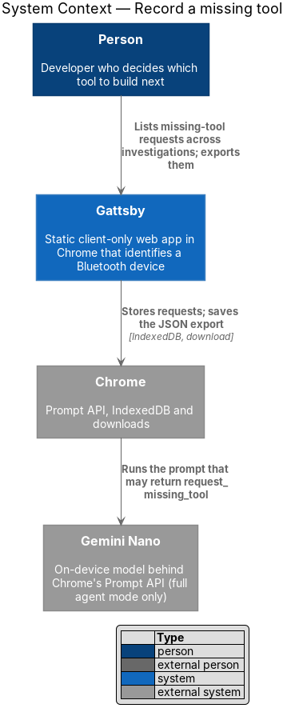
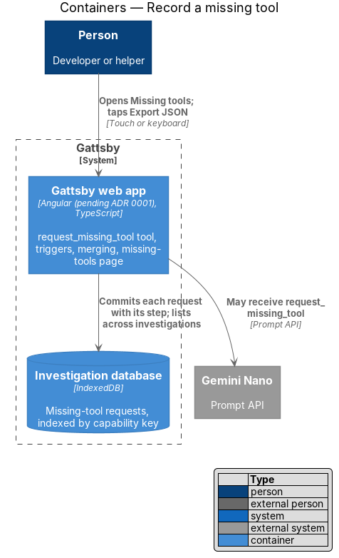
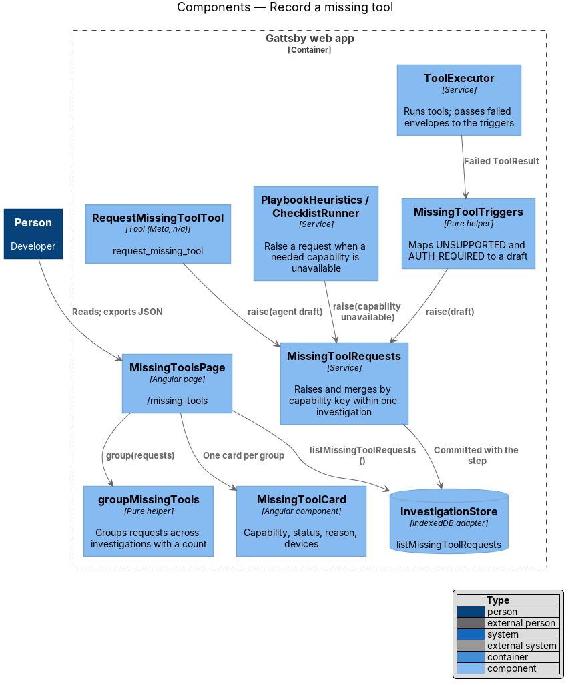
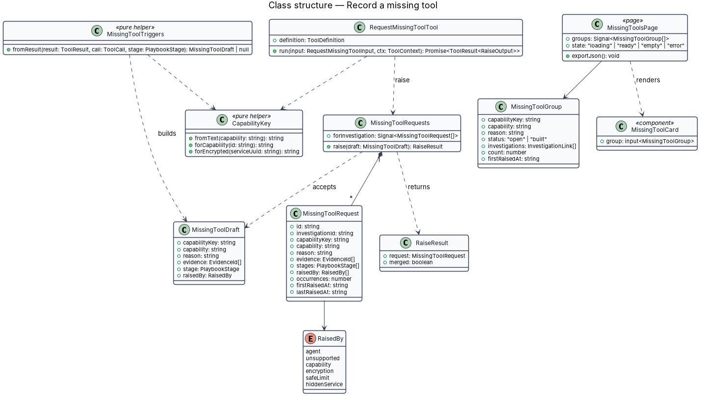
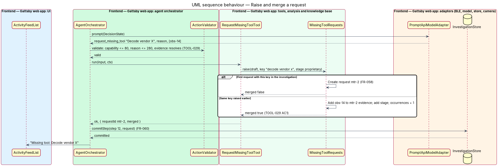
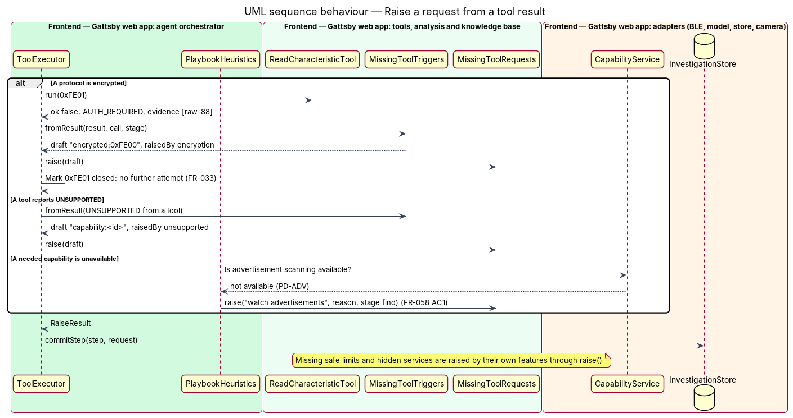
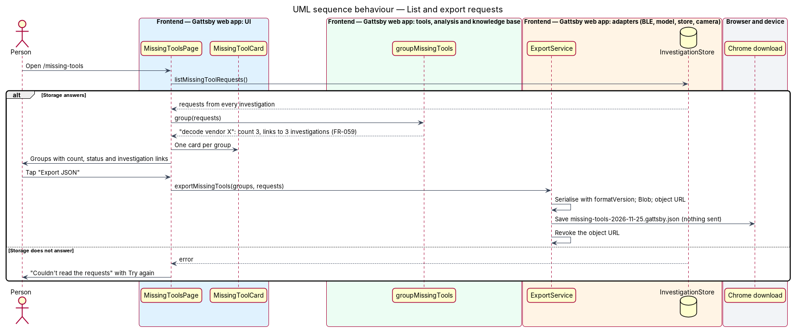

# Record a missing tool

## Overview

Gattsby will meet devices it cannot fully handle: an encrypted vendor protocol, a decoder it does not
have, a browser capability that is off on this platform. Rather than fail silently, it records each
such gap as a missing-tool request with the reason and the evidence. Across many investigations those
requests show the owner which tool to build next. This feature records the requests, merges repeats,
and lists them across every stored investigation. It belongs to the outcome subsystem and can run in
any playbook stage.

**missing-tool request** — record of one capability the agent lacked, with the reason, the evidence
references and the stage where the need arose

**capability key** — normalised identifier that decides when two requests are the same: for a known
cause a fixed form (`capability:watch_advertisements`, `encrypted:0xFE00`), for the agent's own
wording its text lower-cased with spaces collapsed and trailing punctuation removed

**merge** — adding the evidence and stage of a repeated request to the existing request with the same
capability key in the same investigation, instead of creating a second one

The verdict screen shows the requests raised in that investigation as "Missing-tool request raised"
cards with "See all requests" (`docs/mocks/pages/verdict/default.html`, `partial.html`,
`missing-tool.html`). The home page links to them ("3 missing-tool requests",
`docs/mocks/pages/home/default.html`). The Missing tools page (route `/missing-tools`) lists every request across
investigations, once per capability, with a status, the reason, the devices involved, the date first
raised and an "Export JSON" button (`docs/mocks/pages/missing-tools/default.html`), plus `empty.html`,
`loading.html` and `error.html`.

## Description

The design introduces these building blocks in the Angular (pending ADR 0001) workspace under
`frontend/src/app/`:

- **`RequestMissingToolTool`** (`tools/meta/request-missing-tool.tool.ts`) — the `request_missing_tool`
  tool (TOOL-029): group Meta, safety class `n/a`, no preconditions. Its input schema limits
  `capability` to 80 characters and `reason` to 280, and its `evidence` items use the format
  `evidence-id`, so `ActionValidator` refuses an unresolved ID with `INVALID_INPUT`. It returns
  `{ requestId, merged }`.
- **`MissingToolRequests`** (`outcome/missing-tool-requests.ts`) — service holding the current
  investigation's requests as a signal. `raise(draft)` creates a request or merges into the one with
  the same capability key, and returns whether it merged. Every trigger below calls `raise`.
- **`CapabilityKey`** (`outcome/capability-key.ts`) — pure helper with unit tests that builds the key
  for each trigger.
- **`MissingToolTriggers`** (`outcome/missing-tool-triggers.ts`) — pure helper with unit tests.
  `fromResult(result, call, stage)` turns a failed `ToolResult` into a draft: `UNSUPPORTED` names the
  tool's required capability; `AUTH_REQUIRED` names the encrypted service. `ToolExecutor` (see
  [validate and run an action](../../agent/validate-and-run-an-action/README.md)) calls it for every
  failed envelope.
- **`PlaybookHeuristics`** and **`ChecklistRunner`** (`agent/`) — raise a request when a playbook step
  needs a tool whose required capability `CapabilityService` reports unavailable. The tool list given
  to the model leaves that tool out (FR-071), so the model cannot ask for it.
- **`groupMissingTools`** (`outcome/group-missing-tools.ts`) — pure helper with unit tests that groups
  the requests of every investigation by capability key into `MissingToolGroup`s.
- **`MissingToolsPage`** (`pages/missing-tools/missing-tools.page.ts`) — page that loads every request
  through `InvestigationStore.listMissingToolRequests`, groups them, owns the loading, empty and error
  states, and asks `ExportService` (`store/export.service.ts`) to save the JSON file.
- **`MissingToolCard`** (`ui/missing-tool-card/missing-tool-card.ts`) — presentation component used
  here and on the verdict screen: capability, status, reason, device names with links, first raised.

### Rules

1. A request is raised when the agent asks for one (TOOL-029), a tool reports `UNSUPPORTED`, a needed
   capability is unavailable, a protocol is encrypted (`AUTH_REQUIRED`), or a safe limit is missing
   (FR-058).
2. A missing safe limit is raised by `ActionValidator` when `SafetyLimits` refuses a value with
   `UNSAFE_VALUE` and the reason `noSafeLimit` (see
   [keep commands conservative](../../device-control/keep-commands-conservative/README.md)); the
   reason tells a missing limit from a value above it. Hidden services are
   raised by Identify (FR-023, see
   [report hidden services](../../identification/report-hidden-services/README.md)). Both call `raise`.
3. Each request holds the capability, the reason, the evidence IDs and the stage (FR-058). Model text
   and device strings in it render as text (NFR-013).
4. Within one investigation, requests with the same capability key merge: the evidence lists join
   without duplicates, the stage list grows, and `merged` is true (FR-058 AC2, TOOL-029 AC1). The
   first capability text and reason are kept.
5. An encrypted characteristic is closed after its request: no further attempt is made on it, and
   nothing tries to get around the encryption (FR-033).
6. Each request is committed with the step that raised it (FR-060), so it survives a crash.
7. The Missing tools page shows one group per capability key across all investigations. Its count is
   the number of investigations that raised it, and it links to each (FR-059 AC1).
8. "Export JSON" saves the groups and their requests as one file named after the date, following the
   `*.gattsby.json` pattern; nothing is sent over the network (NFR-012).

The mock shows a group as *Open* or *Built* and orders open groups first. No requirement defines
*Built* or how a request becomes built; both are `<TO SUPPLY>`. The design leaves room for a status
derived from whether the current tool registry or knowledge base provides the capability key. The
page's lead line ("Build the tool, and old investigations can be re-run against the recorded data")
promises a re-run that no requirement asks for.

### Data shapes

| Type | Fields |
|---|---|
| `MissingToolDraft` | `capabilityKey`, `capability`, `reason`, `evidence`, `stage`, `raisedBy` |
| `MissingToolRequest` (`store/model/missing-tool-request.ts`) | `id`, `investigationId`, `capabilityKey`, `capability`, `reason`, `evidence`, `stages`, `raisedBy`, `occurrences`, `firstRaisedAt`, `lastRaisedAt` |
| `MissingToolGroup` | `capabilityKey`, `capability`, `reason`, `status`, `investigations`, `count`, `firstRaisedAt` |
| `request_missing_tool` input | `{ capability: string (≤ 80 chars), reason: string (≤ 280 chars), evidence: [id] }` |
| `request_missing_tool` output | `{ requestId, merged: boolean }` |

### Errors

| Code | Raised by | Meaning to the person |
|---|---|---|
| `INVALID_INPUT` | `ActionValidator` | Not shown as an error; the model sees the reason in its next state. |
| `STORAGE_FULL` | `InvestigationStore` | The step's save fails as described in [save as it runs](../../persistence/save-as-it-runs/README.md). |
| Storage read failure | `InvestigationStore` | "Couldn't read the requests. Chrome didn't answer when Gattsby opened its storage. Nothing has been lost." with "Try again" (`missing-tools/error.html`). |

### Tests that prove it

Acceptance specs use the fake `navigator.bluetooth` (`e2e/fixtures/fake-bluetooth.ts`), the fake
`LanguageModel` (`e2e/fixtures/fake-language-model.ts`) and the `MissingToolsPage` page object
(`e2e/pages/missing-tools.page.ts`). With advertisement scanning absent from the fake browser and
four look-alike FTMS candidates, a "watch advertisements" request is recorded with its reason
(FR-058 AC1). A scripted model raises the same capability twice and the verdict lists it once with
both pieces of evidence (FR-058 AC2, TOOL-029 AC1). Three investigations seeded through import raise
"decode vendor X", and the page shows it once with the count 3 and three links (FR-059 AC1). The
scripted encrypted device raises "encrypted" with the error as evidence and records no further attempt
(FR-033 AC1). Unit tests cover `CapabilityKey`, `MissingToolTriggers` and `groupMissingTools`.

## Requirements

The feature realizes the following level-2 (L2) requirements; each refines the level-1 (L1)
requirement cited beside it.

| L2 ID | Refines (L1) | Requirement |
|-------|--------------|-------------|
| [`FR-058`](../../../specs/L2.md#fr-058-record-a-missing-tool-request) | `L1-013` | Gattsby must record a missing-tool request whenever the agent asks for one, a tool reports `UNSUPPORTED`, a capability is unavailable, a protocol is encrypted, or a safe limit is missing. Each request holds the capability needed, the reason, the evidence references, and the stage. Identical requests in one investigation are merged. |
| [`FR-059`](../../../specs/L2.md#fr-059-list-missing-tool-requests-across-investigations) | `L1-013` | Gattsby must list every missing-tool request across all stored investigations, grouped by capability with a count, and let the person export the list as JSON. |
| [`TOOL-029`](../../../specs/L2.md#tool-029-request_missing_tool) | `L1-013` | Records a capability the agent lacks (FR-058). |

## Diagrams

### System context

The developer reads and exports the requests in Gattsby; Gemini Nano may raise one through the
Prompt API, and Gattsby stores the requests in Chrome's IndexedDB.

### Containers

The web app commits each request to the investigation database with its step, and lists them across
investigations for the Missing tools page.

### Components

The agent's `request_missing_tool`, the triggers on failed tool results and the heuristics' capability
checks all call `MissingToolRequests.raise`; the page groups stored requests with `groupMissingTools`
and renders a `MissingToolCard` per group.

### Class structure

`MissingToolRequests` owns the investigation's `MissingToolRequest`s and accepts `MissingToolDraft`s
from the tool and from `MissingToolTriggers`, both of which build keys with `CapabilityKey`; the page
holds `MissingToolGroup`s.

### Behaviour — raise and merge a request

The model raises "Decode vendor X". The first time a request is created; a repeat with the same key
merges its evidence and returns `merged` true. The request is committed with its step and shown in the
activity feed.

### Behaviour — raise a request from a tool result

An `AUTH_REQUIRED` read raises an encrypted-protocol request and closes the characteristic; an
`UNSUPPORTED` result raises a capability request; a heuristic that needs advertisement scanning raises
"watch advertisements" when it is unavailable.

### Behaviour — list and export requests

The Missing tools page reads every stored request, groups them by capability key with a count and
links, and saves the JSON export through `ExportService`; a storage failure shows the error state.

