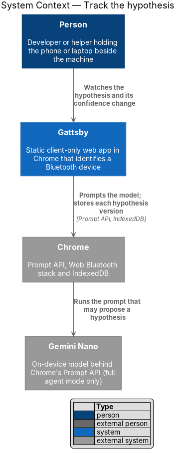
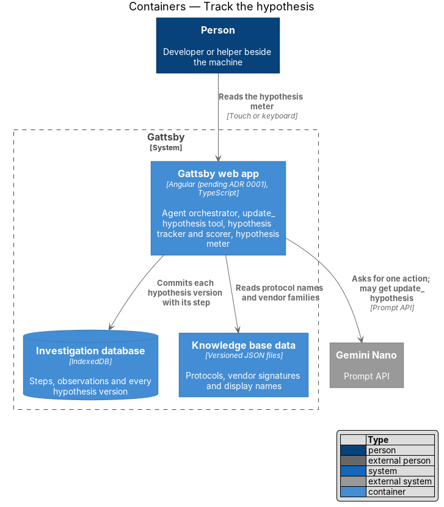
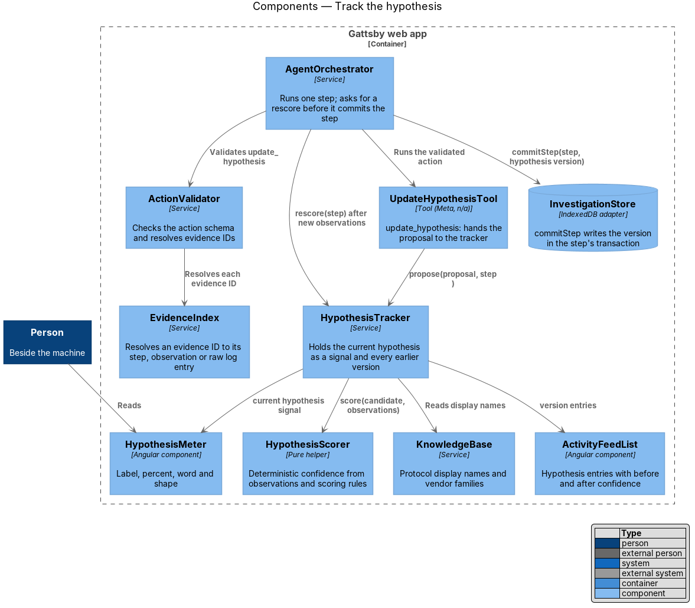
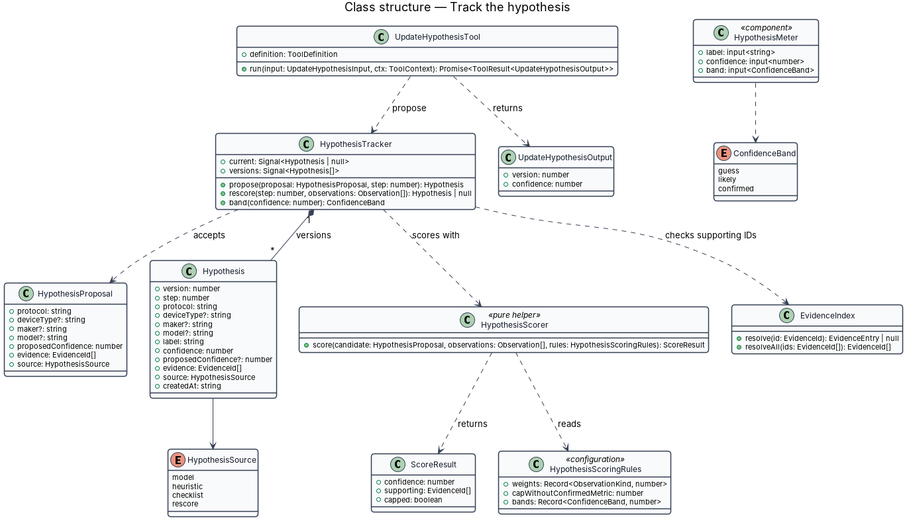
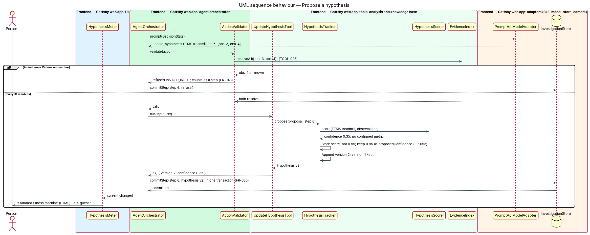
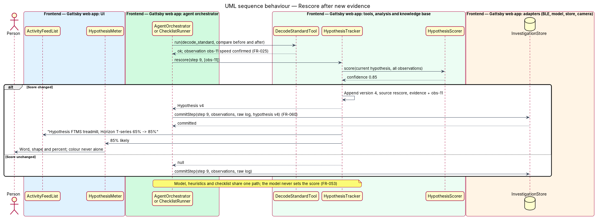

# Track the hypothesis

## Overview

An investigation moves from "an unknown device" to "an FTMS treadmill by Johnson Health Tech" in
small steps. This feature keeps that running guess, scores how well the evidence supports it, and
keeps every earlier version, so that the verdict, the device profile and an exported record can show
how the conclusion was reached. It belongs to the outcome subsystem and runs in every playbook stage
from Identify onwards, in full agent mode and in checklist mode.

**hypothesis** — current protocol guess for the device under investigation, with its device type,
maker, model, confidence and evidence

**hypothesis version** — one stored state of the hypothesis, tied to the step that produced it

**confidence** — number from 0 to 1, computed by deterministic scoring, that says how strongly the
recorded observations support the hypothesis

**evidence ID** — identifier of one step, observation, raw log entry or person's answer in the
investigation record (see [build the device profile](../build-the-device-profile/README.md))

**confidence band** — word and shape shown beside the percentage: *guess*, *likely* or *confirmed*

The investigation screen shows the hypothesis in two places: the stage header ("Hypothesis FTMS
treadmill, Horizon T-series 85%") and the side panel's hypothesis meter with its band word
(`docs/mocks/pages/investigation/default.html`). Each change also appears in the activity feed as a
before-and-after entry ("Hypothesis Standard fitness machine (FTMS) 0% → 35% guess",
`docs/mocks/pages/investigation/identify.html`). Before the first connection the meter reads "None
yet — Forms after the first connection" (`docs/mocks/pages/investigation/error.html`). Checklist mode
shows the same meter (`docs/mocks/pages/investigation/checklist.html`), and a proprietary device shows
a low-confidence guess (`docs/mocks/pages/investigation/proprietary.html`).

The model may propose a hypothesis through the `update_hypothesis` action, but it never sets the
confidence. AGENTS.md assigns scoring to deterministic code: `HypothesisScorer` computes the score
from the observations, and the tracker stores that score whatever the model proposed.

## Description

The design introduces these building blocks in the Angular (pending ADR 0001) workspace under
`frontend/src/app/`:

- **`UpdateHypothesisTool`** (`tools/meta/update-hypothesis.tool.ts`) — the `update_hypothesis` tool
  (TOOL-028). Its registry entry has group Meta, safety class `n/a`, no preconditions, and an input
  schema whose `evidence` items use the format `evidence-id`. It passes a `HypothesisProposal` to the
  tracker and returns `{ version, confidence }` in the result envelope (FR-072).
- **`ActionValidator`** (`agent/action-validator.ts`, see
  [validate and run an action](../../agent/validate-and-run-an-action/README.md)) — resolves every
  input field of format `evidence-id` through `EvidenceIndex` before the tool runs. An ID that does
  not resolve refuses the action with `INVALID_INPUT`, and the refusal counts as a step (FR-043).
- **`HypothesisTracker`** (`outcome/hypothesis-tracker.ts`) — holds the current `Hypothesis` as a
  signal and the list of every version. `propose(proposal, step)` scores the proposal and appends a
  version. `rescore(step, observations)` re-scores the current hypothesis after a step that added
  observations and appends a version only when the score or the identity fields change. It never
  edits or deletes an earlier version.
- **`HypothesisScorer`** (`outcome/hypothesis-scorer.ts`) — pure helper with unit tests.
  `score(candidate, observations, rules)` returns the confidence, the IDs of the observations that
  support it, and whether a cap applied. It reads no clock, no store and no model.
- **`HypothesisScoringRules`** (`outcome/hypothesis-scoring-rules.ts`) — typed configuration: the
  weight of each observation kind, the cap that applies while no metric is confirmed, and the band
  thresholds. The values are `<TO SUPPLY>`; the specs give none.
- **`InvestigationStore.commitStep`** (`store/investigation-store.ts`) — writes the step, its raw
  traffic, its observations and any new hypothesis version in one transaction (FR-060).
- **`HypothesisMeter`** (`ui/hypothesis-meter/hypothesis-meter.ts`) — presentation component. Inputs:
  label, confidence and band. It shows the percentage, the band word and the band shape (filled ring,
  half ring, open ring), so colour never carries the state alone. It injects no app service.
- **`ActivityFeedList`** (`ui/activity-feed-list/activity-feed-list.ts`, see
  [show agent activity](../../agent/show-agent-activity/README.md)) — renders a hypothesis entry with
  the old and new percentages and the band word.

### Rules

1. One hypothesis is current at a time. A new protocol, device type, maker or model replaces it as a
   new version; the earlier version stays in the record with its step number (FR-053).
2. The stored confidence is always `HypothesisScorer`'s score. A model's `proposedConfidence` is kept
   in the version for the record and has no other effect (FR-053, TOOL-028).
3. The model, `PlaybookHeuristics` and `ChecklistRunner` all propose through the same
   `update_hypothesis` action, so every version passes `ActionValidator` and the same scorer. The
   `source` field records which of them proposed it.
4. After each step that adds an observation, the orchestrator (or the checklist runner) calls
   `rescore` before `commitStep`, so a confirmed metric raises the confidence in checklist mode too.
5. Device Information reads set the hypothesis's maker and model, with the reads as evidence (FR-020).
6. While no metric of the hypothesised protocol is confirmed by live data (FR-025), the score stays
   below the finish threshold (0.9, A-05). The finish threshold therefore never ends the loop on
   structure alone (FR-045).
7. The label is composed from the knowledge base's protocol display name, the device type and the
   matched vendor family where `match_known_profiles` found one, else the maker. Model text and
   device strings in it are rendered as text (NFR-013).

The scoring rules weigh these observation kinds; the weights are `<TO SUPPLY>`:

| Observation kind | Effect on the score |
|---|---|
| The protocol's service discovered or advertised (FR-019) | Raises it |
| A known-profile or vendor-signature match (FR-021, TOOL-020) | Raises it by the match score |
| A Device Information maker or model that fits the match (FR-020) | Raises it |
| A metric of the protocol confirmed by live data (FR-025) | Raises it and lifts the cap |
| A metric marked *not confirmed*, or a decode error (FR-024, FR-025) | Lowers it |

The mocks show 35 % after the FTMS service is discovered, 65 % after a known-profile match and 85 %
after speed is confirmed. These are illustrations of the rules, not their values. The band thresholds
are also `<TO SUPPLY>`; the mocks draw 30 % and 35 % as *guess* and 65 % and 85 % as *likely*.

### Data shapes

| Type | Fields |
|---|---|
| `HypothesisProposal` | `protocol`, `deviceType?`, `maker?`, `model?`, `proposedConfidence`, `evidence`, `source` |
| `Hypothesis` (`store/model/hypothesis.ts`) | `version`, `step`, `protocol`, `deviceType?`, `maker?`, `model?`, `label`, `confidence`, `proposedConfidence?`, `evidence`, `source`, `createdAt` |
| `ScoreResult` | `confidence`, `supporting`, `capped` |
| `update_hypothesis` input | `{ protocol, deviceType?, maker?, model?, proposedConfidence: 0–1, evidence: [id] }` |
| `update_hypothesis` output | `{ version, confidence }` |

### Errors

| Code | Raised by | Meaning to the person |
|---|---|---|
| `INVALID_INPUT` | `ActionValidator` | Not shown as an error. The activity feed records that the agent's guess was refused, and the model sees the reason in its next state. |

### Tests that prove it

The acceptance spec drives the fake `LanguageModel` (`e2e/fixtures/fake-language-model.ts`) with
three scripted `update_hypothesis` actions against the scripted FTMS treadmill in the fake
`navigator.bluetooth` (`e2e/fixtures/fake-bluetooth.ts`), exports the record through the
`ExportDialog` page object, and checks that all three versions are present with their step numbers
and evidence (FR-053 AC1). A second scripted action proposes 0.95 with no supporting observation, and
the `InvestigationPage` page object reads the deterministic score from the hypothesis meter (FR-053
AC2). A third cites an evidence ID that does not exist and expects the refusal (TOOL-028 AC1). Unit
tests cover `HypothesisScorer` for each observation kind, the cap without a confirmed metric, and
clamping to 0–1.

## Requirements

The feature realizes the following level-2 (L2) requirements; each refines the level-1 (L1)
requirement cited beside it.

| L2 ID | Refines (L1) | Requirement |
|-------|--------------|-------------|
| [`FR-053`](../../../specs/L2.md#fr-053-track-the-hypothesis-with-evidence) | `L1-012` | Gattsby must hold one current hypothesis (protocol, maker, model, device type, confidence from 0 to 1, and evidence references) and keep every earlier version with the step that changed it. Confidence is computed by deterministic scoring; the model may propose a hypothesis but not set its confidence above what the scoring supports. |
| [`TOOL-028`](../../../specs/L2.md#tool-028-update_hypothesis) | `L1-012` | Records the current protocol guess with its evidence (FR-053). The stored confidence is the deterministic score, capped by the evidence. |

## Diagrams

### System context

The person watches the hypothesis form in Gattsby. In full agent mode Gemini Nano, through Chrome's
Prompt API, may propose a guess; Gattsby scores it and stores each version in Chrome's IndexedDB.

### Containers

The web app reads protocol names and vendor families from the knowledge base data, asks the model for
one action, and commits each hypothesis version to the investigation database with its step.

### Components

`ActionValidator` resolves the evidence IDs, `UpdateHypothesisTool` hands the proposal to
`HypothesisTracker`, `HypothesisScorer` computes the confidence, and the orchestrator commits the
version with its step; the meter and the feed read the tracker's signals.

### Class structure

`HypothesisTracker` owns the list of `Hypothesis` versions and depends on the pure `HypothesisScorer`,
which reads `HypothesisScoringRules`; `UpdateHypothesisTool` is the only entry for a proposal.

### Behaviour — propose a hypothesis

The model proposes "FTMS treadmill" at 0.95 citing two observations. An unknown evidence ID refuses
the action with `INVALID_INPUT`; otherwise the tracker stores the deterministic score (0.35) as
version 2 and keeps 0.95 only as the proposed value.

### Behaviour — rescore after new evidence

When `decode_standard` confirms speed, the orchestrator (or the checklist runner) asks the tracker to
rescore before it commits the step; a changed score becomes a new version in the same transaction and
appears in the feed and the meter.

