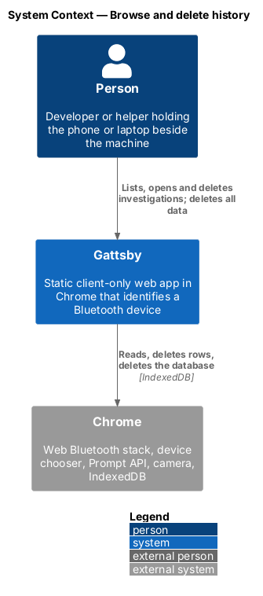
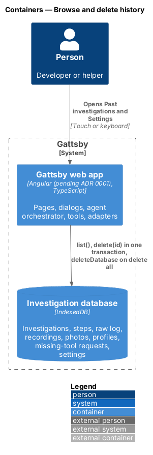
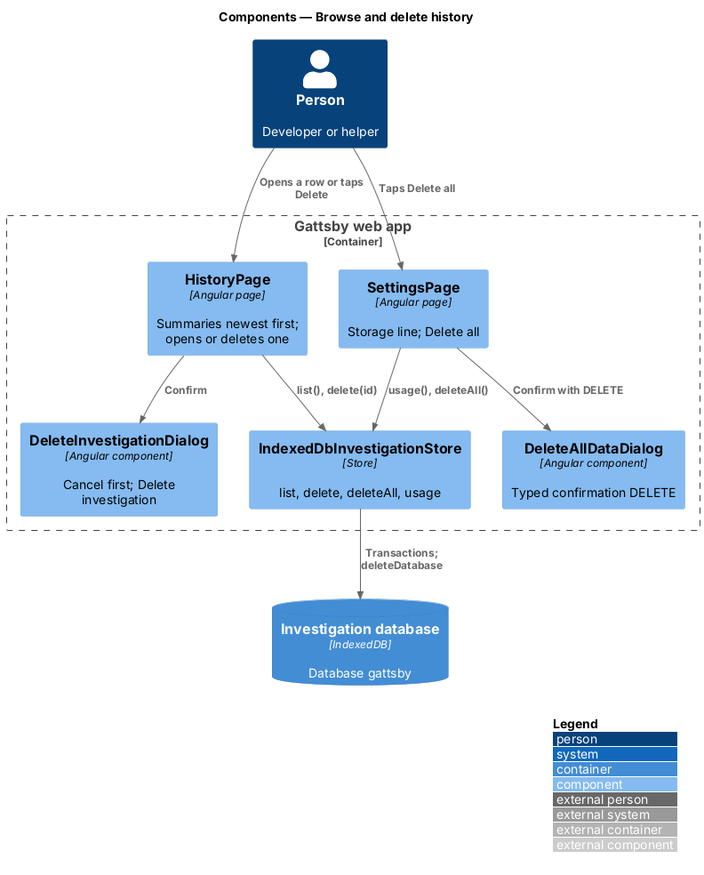
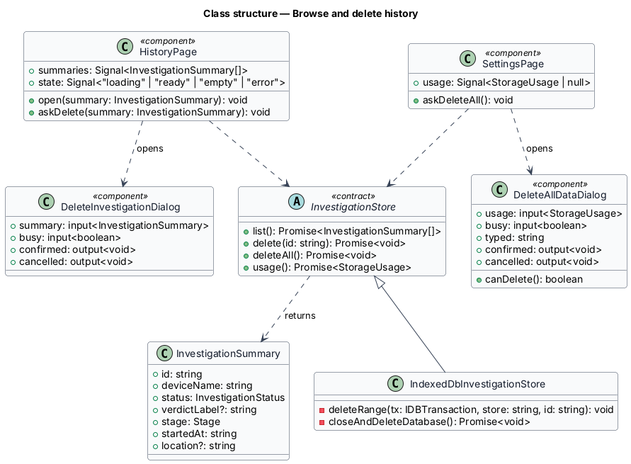
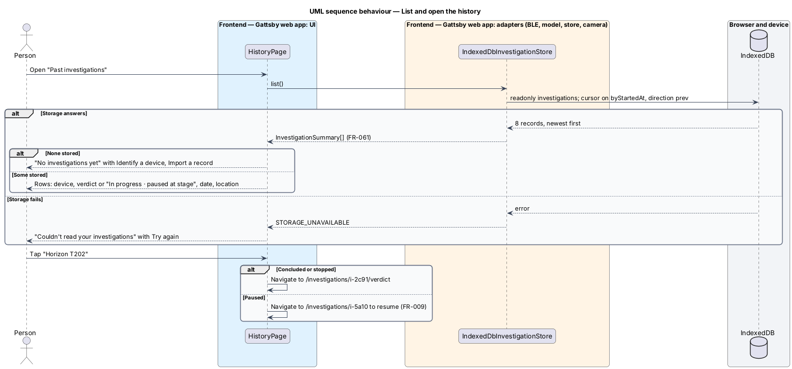
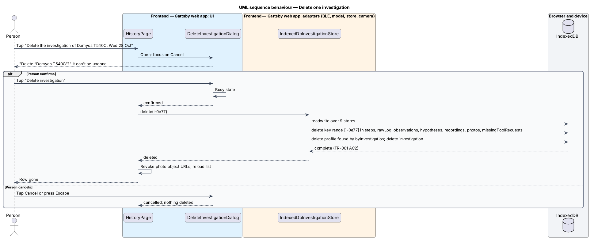
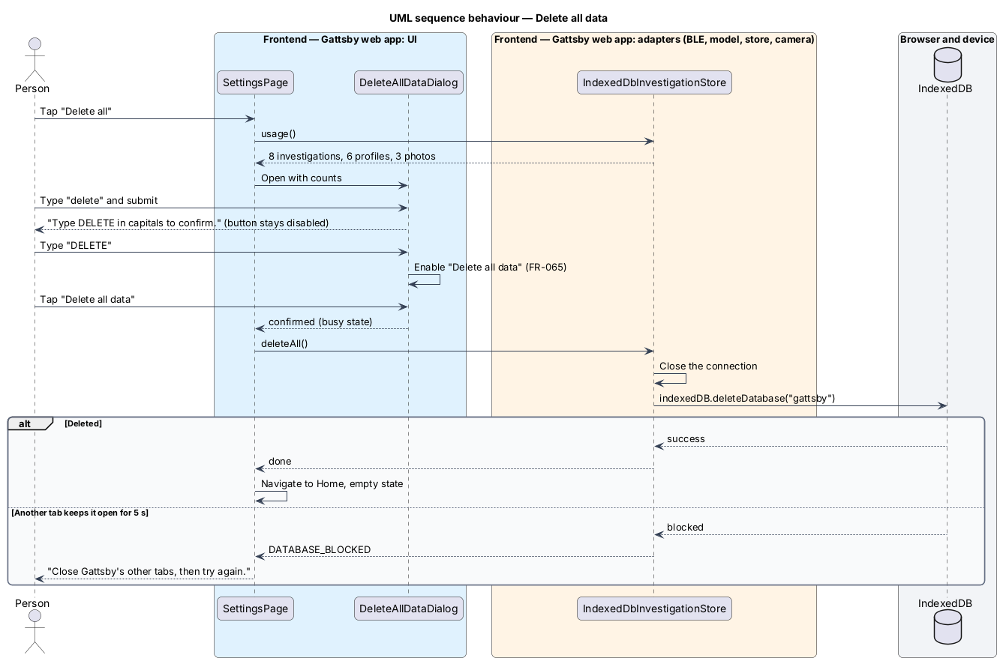

# Browse and delete history

## Overview

Every investigation stays on the device after its verdict, so the person can come back to its
evidence, export it later, or resume one that was interrupted. This feature lists past
investigations newest first, opens one, deletes one after confirming, and deletes everything Gattsby
holds in one action after a stronger confirmation. It belongs to the persistence subsystem and runs
outside the playbook, on the Past investigations and Settings pages.

**history** — list of every stored investigation on this device, newest first

**investigation summary** — one history row: device name, verdict or progress, date and time, and
location label

**typed confirmation** — confirmation that keeps a destructive button disabled until the person
types a fixed word exactly

The Past investigations page (`/investigations`) shows the history: `docs/mocks/pages/history/default.html`
lists 8 investigations ("8 on this device · newest first"), each with a delete control; `empty.html`
("No investigations yet", with "Identify a device" and "Import a record"), `loading.html` and
`error.html` ("Couldn't read your investigations") cover the other states. Deleting one opens the
Delete an investigation dialog (`docs/mocks/dialogs/delete-investigation/default.html`, `busy.html`).
"Delete all" on the Settings page (`docs/mocks/pages/settings/default.html`) opens the Delete all data
dialog (`docs/mocks/dialogs/delete-all-data/default.html`, `invalid.html`, `confirm.html`,
`busy.html`).

Deleting is the only way data leaves storage other than eviction, and it cannot be undone. Both
dialogs therefore say so, both start focus on the safe action, and delete all asks for the word
`DELETE`.

## Description

The design introduces these building blocks in the Angular (pending ADR 0001) workspace under
`frontend/src/app/`:

- **`HistoryPage`** (`pages/history/history.page.ts`) — lazy route. It loads summaries through
  `InvestigationStore.list()`, renders one row per investigation, opens a concluded or stopped one
  at its Verdict page and an interrupted one at its Investigation page for resuming (see the
  stop-pause-and-resume design), and opens `DeleteInvestigationDialog` from a row's delete control.
- **`DeleteInvestigationDialog`** (`dialogs/delete-investigation/delete-investigation.dialog.ts`) —
  presentation component. Input: the summary. Outputs: `confirmed`, `cancelled`. Focus starts on
  "Cancel"; "Delete investigation" shows the busy state while the store works.
- **`SettingsPage`** (`pages/settings/settings.page.ts`) — shows the storage line from
  `InvestigationStore.usage()` and opens `DeleteAllDataDialog`.
- **`DeleteAllDataDialog`** (`dialogs/delete-all-data/delete-all-data.dialog.ts`) — presentation
  component. Input: the counts. Output: `confirmed`. "Delete all data" stays disabled until the field
  holds exactly `DELETE`; other text shows "Type DELETE in capitals to confirm." when the person
  submits or leaves the field.
- **`InvestigationStore.list()`, `delete(id)` and `deleteAll()`**
  (`store/indexed-db-investigation-store.ts`) — the store operations below.
- **`InvestigationSummary`** (`store/model/investigation-summary.ts`) — `id`, `deviceName`,
  `status`, `verdictLabel?`, `stage`, `startedAt`, `location?`.

### Listing

`list()` opens one `readonly` transaction on `investigations` and walks the `byStartedAt` index with
direction `prev`, so the newest comes first (FR-061 AC1). It reads no step, raw log or photo, so the
list costs the same for a 30-minute investigation as for a short one.

| Row part | Source | Example |
|---|---|---|
| Device name | `deviceName` on the investigation record: the advertised name once known, replaced by the profile's display name at the verdict | "Horizon T202" |
| Verdict or progress | `verdict.label`, or "In progress · paused at *stage*" | "Connected — FTMS" |
| Date | "Today, 14:26" for today, else weekday, day and month | "Sun 22 Nov" |
| Location | The location label, when the person typed one (FR-010) | "Decathlon, Lille" |

Each delete control has an accessible name that names the row ("Delete the investigation of
Concept2 RowErg, Sat 14 Nov"). Device names are rendered as text (NFR-013).

### Deleting one investigation

1. The dialog reads `Delete “Domyos T540C”?` and "This deletes the investigation from Wed 28 Oct with
   its raw log, photos and device profile. It can't be undone; export it first if you might need
   it."
2. `delete(id)` runs one `readwrite` transaction over `investigations`, `steps`, `rawLog`,
   `observations`, `hypotheses`, `recordings`, `photos`, `profiles` and `missingToolRequests`. Each
   per-investigation store deletes the key range `IDBKeyRange.bound([id], [id, []])`; `profiles`
   deletes the key found through `byInvestigation`; `investigations` deletes `id` last. All of it
   goes, or none of it (FR-061 AC2).
3. Object URLs the app holds for that investigation's photos are revoked.
4. No investigation is live while the history is open: leaving the Investigation page releases the
   connection and the loop (`leaveInvestigationGuard`, see the release-the-connection design).
5. The history reloads without the row; missing-tool groups recount on their next read.

### Deleting all data

1. The dialog states the counts from `usage()`: "This removes every investigation, device profile,
   photo and setting Gattsby holds on this device: 8 investigations, 6 profiles and 3 photos. It
   can't be undone." and "Export anything you want to keep first."
2. `deleteAll()` closes the store's connection and calls `indexedDB.deleteDatabase('gattsby')`, so
   IndexedDB holds no Gattsby database afterwards (FR-065 AC1). The next store call recreates an
   empty one from `DatabaseSchema`.
3. If another Gattsby tab holds the database open, the request fires `blocked`. Every Gattsby
   connection closes on `versionchange`, so the block clears unless the other tab is frozen; after
   5 seconds blocked (a proposed limit) the store rejects with `DATABASE_BLOCKED`.
4. Gattsby keeps every setting in the `settings` store and writes nothing to `localStorage`,
   `sessionStorage` or cookies, so deleting the database deletes every setting. The service
   worker's cache holds only static files, and Chrome's copy of the model is not Gattsby data; both
   remain.
5. After deletion the app navigates to Home, which shows its empty state
   (`docs/mocks/pages/home/empty.html`). A confirmation toast is `<TO SUPPLY>`; no mock shows one.

### Errors

| Code | Raised by | Meaning to the person |
|---|---|---|
| `STORAGE_UNAVAILABLE` | `list()` | "Couldn't read your investigations. Chrome didn't answer when Gattsby opened its storage. Nothing has been lost. Try again, or reload the page." |
| `NOT_FOUND` | `delete(id)` | The row is already gone; the history reloads |
| `DATABASE_BLOCKED` | `deleteAll()` | "Close Gattsby's other tabs, then try again." (provisional; no mock) |

### Tests that prove it

Acceptance specs seed five investigations and check the order and verdicts; delete one, confirm,
reload, and check that its raw log, photos and profile are gone; and run "Delete all data" with
`DELETE` typed, then check that IndexedDB lists no Gattsby database. Page objects own the history
rows and both dialogs.

## Requirements

The feature realizes the following level-2 (L2) requirements; each refines the level-1 (L1)
requirement cited beside it.

| L2 ID | Refines (L1) | Requirement |
|-------|--------------|-------------|
| [`FR-061`](../../../specs/L2.md#fr-061-keep-a-history-of-investigations) | `L1-014` | The person must be able to list past investigations (newest first, with device name, verdict, date and location label), open one, and delete one after confirming. |
| [`FR-065`](../../../specs/L2.md#fr-065-delete-all-data) | `L1-014` | The person must be able to delete every investigation, profile, photo and setting held by Gattsby in one action, after confirming. |

## Diagrams

### System context

The person browses and deletes investigations in Gattsby, which reads and deletes them through
Chrome's IndexedDB.

### Containers

The web app lists summaries from the investigation database, deletes one investigation in one
transaction, and deletes the whole database on delete all.

### Components

`HistoryPage` and `SettingsPage` call the store through its contract and confirm through
`DeleteInvestigationDialog` and `DeleteAllDataDialog`.

### Class structure

Both pages depend on the `InvestigationStore` contract; the dialogs are presentation components that
emit the person's decision.

### Behaviour — list and open

The history lists summaries newest first through the `byStartedAt` index and opens a row at its
Verdict or Investigation page.

### Behaviour — delete one investigation

After "Delete investigation", one transaction removes the investigation and every row it owns.

### Behaviour — delete all data

With `DELETE` typed, the store closes its connection and deletes the database; another open tab can
block it.

