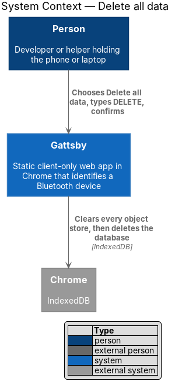
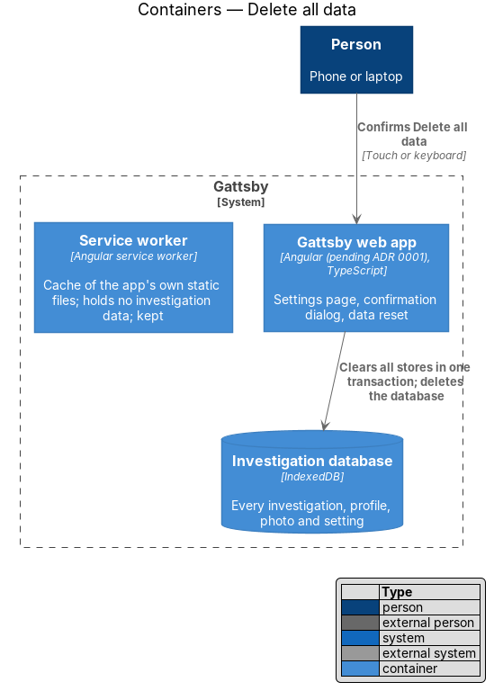
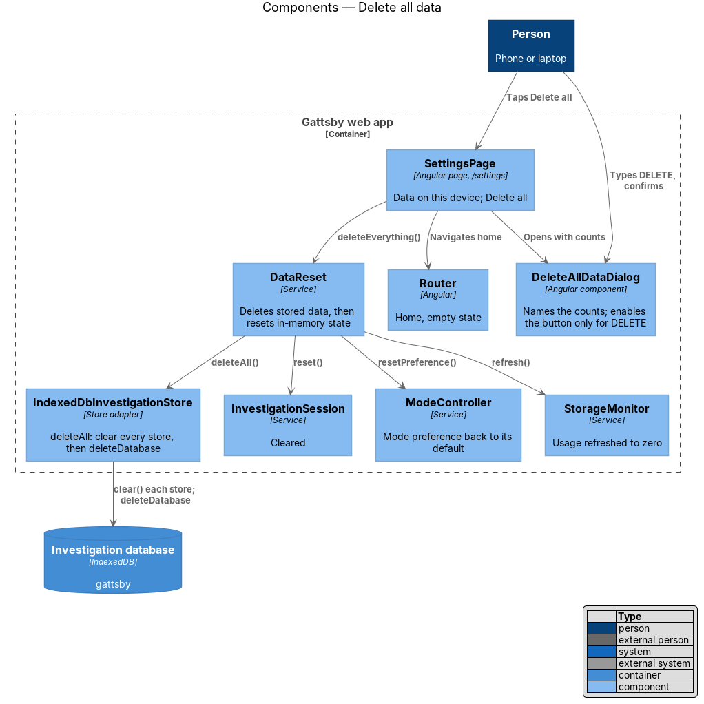
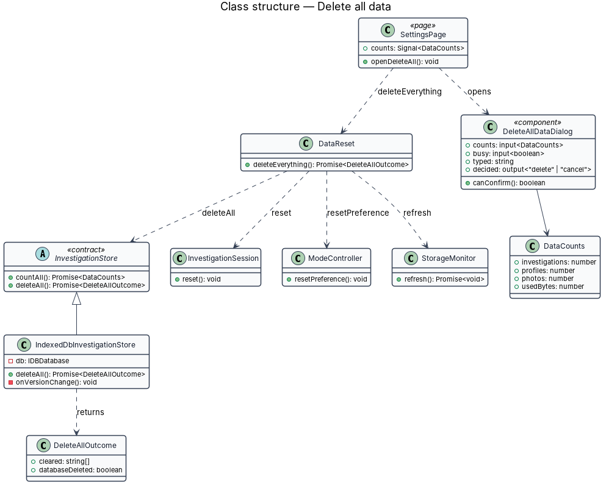
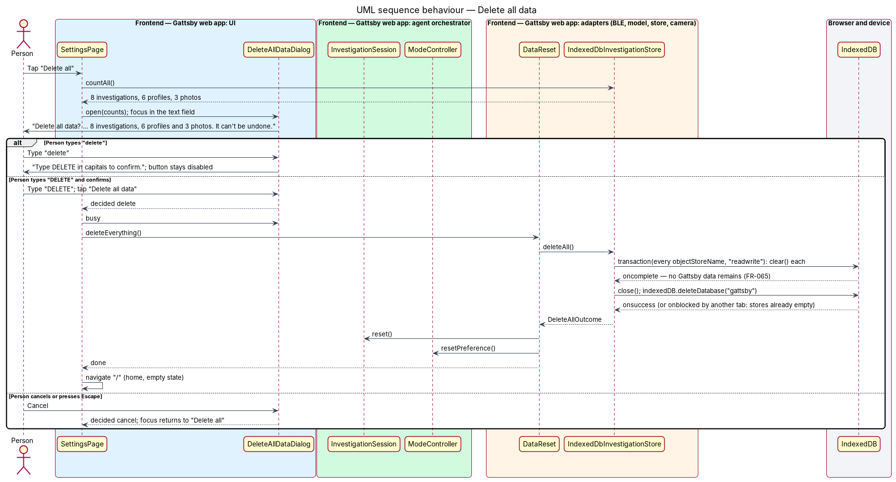

# Delete all data

## Overview

Everything Gattsby knows lives in the browser on this one device: investigations with their raw
traffic, device profiles, photos, missing-tool requests and settings. This feature lets the person
remove all of it in one action, for example before handing a shared laptop back, after a test
session, or to start over. It belongs to the persistence subsystem and is reached from Settings,
outside any running investigation.

**Gattsby data** — every record Gattsby has written to the browser's IndexedDB database `gattsby`:
investigations, steps, raw log, observations, hypotheses, recordings, photos, device profiles,
missing-tool requests, settings, and any store a later design adds to the same database

**typed confirmation** — confirmation the person gives by typing a fixed word, `DELETE`, before the
destructive button is enabled

Settings shows "Delete all data · Every investigation, profile, photo and setting. Can't be undone."
with a danger "Delete all" button (`docs/mocks/pages/settings/default.html`). It opens the Delete all
data dialog (`docs/mocks/dialogs/delete-all-data/default.html`): "Delete all data? This removes every
investigation, device profile, photo and setting Gattsby holds on this device: 8 investigations, 6
profiles and 3 photos. It can't be undone." The field "Type DELETE to confirm" carries the hint
"Export anything you want to keep first." The "Delete all data" button stays disabled until `DELETE`
is typed exactly; any other text shows "Type DELETE in capitals to confirm." (`invalid.html`).
`confirm.html` shows the button enabled and `busy.html` the deletion running.

## Description

The design introduces these building blocks in the Angular (pending ADR 0001) workspace under
`frontend/src/app/`:

- **`SettingsPage`** (`pages/settings/settings.page.ts`) — reads the counts from
  `InvestigationStore.countAll()`, opens the dialog, and on confirmation calls `DataReset`. On
  success it navigates to the home screen, which then shows its empty state
  (`docs/mocks/pages/home/empty.html`).
- **`DeleteAllDataDialog`** (`dialogs/delete-all-data/delete-all-data.dialog.ts`) — presentation
  component. Inputs: `DataCounts` and `busy`. Output: `delete` or `cancel`. It compares the field to
  `DELETE` exactly (case-sensitive, no trimming); the button is disabled until they match. Focus
  starts in the field. Escape, Close and Cancel all cancel and return focus to "Delete all".
- **`DataReset`** (`store/data-reset.ts`) — the one call that deletes everything:
  `InvestigationStore.deleteAll()` first, then the in-memory state (`InvestigationSession.reset()`,
  `ModeController.resetPreference()`, `StorageMonitor.refresh()`), so no screen can show a record
  that storage no longer holds. It revokes any object URL still held for a photo preview.
- **`IndexedDbInvestigationStore.deleteAll()`** (`store/indexed-db-investigation-store.ts`) — opens
  one `readwrite` transaction over every name in `db.objectStoreNames` and clears each store, so the
  deletion covers stores added by later designs without a change here. When it completes no
  Gattsby data remains. It then closes its connection and calls
  `indexedDB.deleteDatabase("gattsby")` to remove the empty schema; the next store call recreates it
  empty. If another tab holds the database open, the delete request reports `blocked`; the data is
  already gone, and that tab's `versionchange` handler closes its connection.
- **`InvestigationStore.countAll()`** — counts investigations, profiles and photos, and returns the
  bytes used, for the dialog's sentence.

### Rules

1. One action deletes every investigation, profile, photo and setting, after the typed confirmation
   (FR-065).
2. Clearing is one transaction: either every store is empty afterwards or nothing changed.
3. Gattsby keeps all of its data in IndexedDB. It writes nothing to `localStorage`,
   `sessionStorage` or cookies, so IndexedDB is the only place to clear. The service worker's cache
   holds only the app's own static files and is kept, so Gattsby still opens offline after the
   deletion (NFR-006).
4. Deleting data does not touch the device or its pairings (NFR-019). Settings sits outside the
   investigation route and leaving an investigation disconnects (FR-018), so no device is connected
   while the deletion runs.
5. A persistent-storage grant from Chrome (see the save-as-it-runs design) outlives the deletion;
   the page cannot revoke it.
6. What another open Gattsby tab shows after its data is deleted is not mocked or specified and is
   `<TO SUPPLY>`; this design only guarantees that tab no longer holds the database open.
7. A confirmation after the deletion is not mocked; the home empty state is the visible result, and
   a polite announcement of the deletion is `<TO SUPPLY>` in `docs/mocks/`.

### Data shapes

| Type | Fields |
|---|---|
| `DataCounts` | `investigations`, `profiles`, `photos`, `usedBytes` |
| `DeleteAllOutcome` | `cleared` (store names), `databaseDeleted` |

### Errors

| Code | Raised by | Meaning to the person |
|---|---|---|
| `STORAGE_UNAVAILABLE` | `IndexedDbInvestigationStore` | The deletion did not run; nothing changed. "Couldn't delete. Try again, or reload the page." (provisional, `A-01`) |

A `blocked` delete request is not an error: the stores are already empty.

### Tests that prove it

The acceptance spec runs the simulated FTMS treadmill to a verdict, imports one profile, opens the
`SettingsPage` page object and the `DeleteAllDataDialog` page object, checks that the button stays
disabled for `delete`, types `DELETE`, confirms, and then reads IndexedDB from the test through
`page.evaluate` to check that no `gattsby` database holds any record (FR-065 AC1). It also checks
that the home screen shows its empty state and that the history and saved devices are empty after a
reload. A unit test of `deleteAll` against an in-memory IndexedDB checks that a store added in a
later schema version is cleared too.

## Requirements

The feature realizes the following level-2 (L2) requirements; each refines the level-1 (L1)
requirement cited beside it.

| L2 ID | Refines (L1) | Requirement |
|-------|--------------|-------------|
| [`FR-065`](../../../specs/L2.md#fr-065-delete-all-data) | `L1-014` | The person must be able to delete every investigation, profile, photo and setting held by Gattsby in one action, after confirming. |

## Diagrams

### System context

The person confirms in Gattsby, which clears its own IndexedDB database in Chrome; nothing else is
touched.

### Containers

The web app clears the investigation database and leaves the service worker's cache of app files in
place.

### Components

`SettingsPage` opens `DeleteAllDataDialog` and calls `DataReset`, which deletes through the store and
then resets the session, the mode preference and the storage figures.

### Class structure

`DataReset` depends on the `InvestigationStore` contract and on the in-memory services it resets;
the dialog takes `DataCounts` and emits a decision.

### Behaviour — delete all data

Typing `delete` keeps the button disabled; typing `DELETE` and confirming clears every store in one
transaction, deletes the database, resets the in-memory state and returns to the empty home screen.

