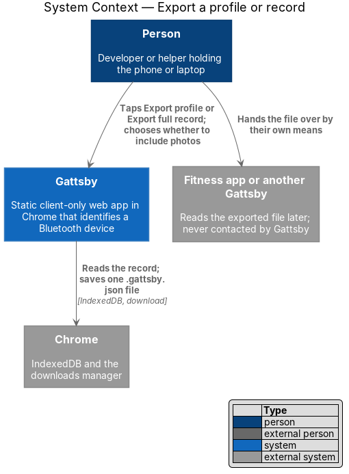
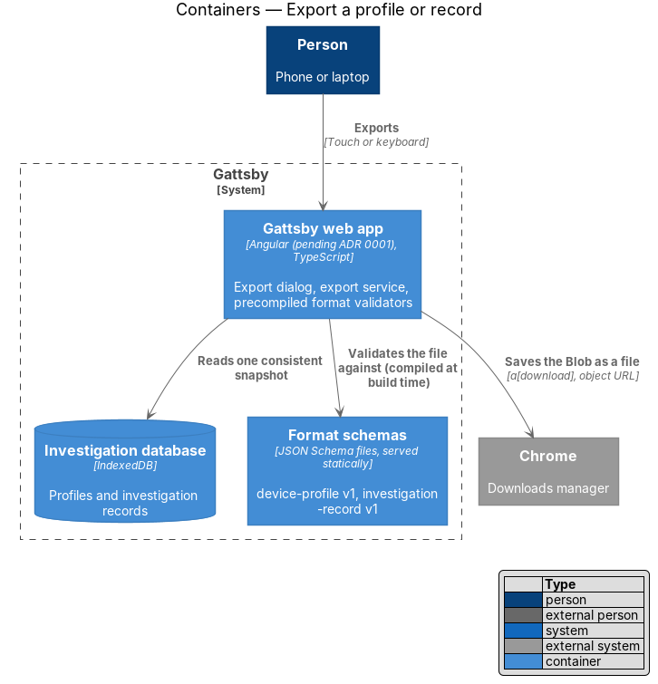
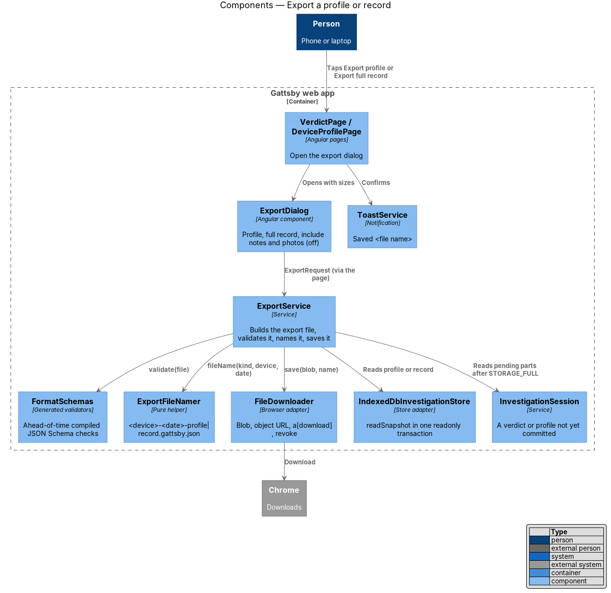
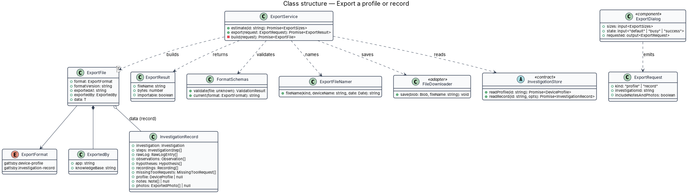
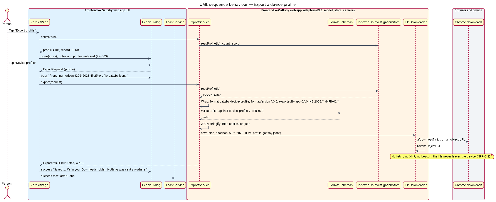
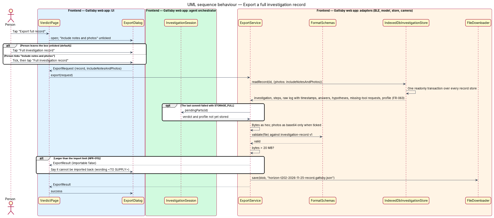

# Export a profile or record

## Overview

Export is the only way data leaves Gattsby, and the person starts it. This feature turns what an
investigation found into a file the person can keep, hand to a colleague, attach to an issue or feed
to their own fitness software. It belongs to the persistence subsystem and is reached from the
verdict page and the device profile page once an investigation has concluded, or from the verdict
page's storage-full error to rescue a record that could not be saved.

**device profile export** — JSON file holding one device profile: identity, services and
characteristic UUIDs, protocol and confidence, readable metrics with decoding rules, controllable
features with command bytes, handshake, connection quirks, verdict, evidence references, date and
location label (FR-055)

**investigation record export** — JSON file holding a whole investigation: every step with the
agent's action, tool inputs and outputs, raw traffic with timestamps, the person's answers,
hypotheses over time, missing-tool requests and the profile; notes and photos only when the person
asks for them

**export file** — envelope common to both kinds: a `format` name, a semantic `formatVersion`, the
export time, the app and knowledge-base versions that wrote it, and the data

**format schema** — published JSON Schema that an export file of one format and major version
conforms to

The verdict page's "Export profile" and "Export full record" buttons and the device profile page's
"Export" button open the Export dialog (`docs/mocks/dialogs/export/default.html`). It lists "Device
profile · Identity, protocol, metrics, controls · 4 KB" and "Full investigation record · Every step,
packet and answer · 86 KB", with "Include notes and photos · Left out unless you tick this"
unticked, under the line "Saved as a file on this device. Nothing is sent anywhere." While the file
is prepared the dialog shows "Preparing horizon-t202-2026-11-25-profile.gattsby.json…" (`busy.html`);
then "Saved horizon-t202-2026-11-25-profile.gattsby.json. It's in your Downloads folder. Nothing was
sent anywhere." (`success.html`), echoed by the success toast
(`docs/mocks/notifications/toast/success.html`).

## Description

The design introduces these building blocks in the Angular (pending ADR 0001) workspace under
`frontend/src/app/`:

- **`ExportDialog`** (`dialogs/export/export.dialog.ts`) — presentation component. Inputs: the
  `ExportSizes` and the state (`default`, `busy`, `success`). Output: one `ExportRequest` (kind
  `profile` or `record`, the investigation ID, `includeNotesAndPhotos`, default `false`). The
  `VerdictPage` and `DeviceProfilePage` open it and pass its request to `ExportService`.
- **`ExportService`** (`store/export.service.ts`) — `estimate(id)` returns the sizes the dialog
  shows. `export(request)` reads the data through the store, wraps it in an `ExportFile`, validates
  it with `FormatSchemas`, serializes it, names it with `ExportFileNamer` and saves it with
  `FileDownloader`. It returns an `ExportResult` (file name, bytes, whether the file is small enough
  to import back).
- **`InvestigationStore`** (`store/investigation-store.ts`) — gains `readProfile(id)` and
  `readRecord(id, { photos })`. `IndexedDbInvestigationStore` reads a record in one `readonly`
  transaction over every record store, so the export is a consistent snapshot even while another tab
  writes.
- **`InvestigationSession`** (`agent/investigation-session.ts`) — after a commit failed with
  `STORAGE_FULL` (see the save-as-it-runs design), `pendingParts(id)` returns the verdict and profile
  that are held in memory but not stored. `ExportService` merges them into the record, which is how
  "Export the full record now so nothing is lost" (`docs/mocks/pages/verdict/error.html`) keeps
  its promise.
- **`FormatSchemas`** (`store/formats/format-schemas.ts`) — validators for
  `gattsby.device-profile` and `gattsby.investigation-record`, one per supported major version,
  compiled from the JSON Schema files at build time. The Content Security Policy forbids
  `unsafe-eval` (NFR-014), so a validator that compiles schemas into functions at run time cannot
  run; the build generates plain validation code instead. The validator library is `<TO SUPPLY>`
  (an ADR; Ajv's standalone output is a candidate).
- **Format schema files** (`frontend/public/schemas/device-profile.v1.schema.json`,
  `investigation-record.v1.schema.json`) — served as static files at `/schemas/…`, so other apps can
  read them. Where else they are published, and whether the profile follows a schema the owner's
  fitness apps already use, is open (`OQ-09`).
- **`ExportFileNamer`** (`store/formats/export-file-namer.ts`) — pure helper. It builds
  `<device>-<yyyy-mm-dd>-profile.gattsby.json` or `…-record.gattsby.json` from the device's display
  name and the investigation's start date (`docs/mocks/README.md`, item 7). The name is lower-cased,
  reduced to `a–z`, `0–9` and single hyphens, and falls back to `device` when nothing is left; the
  maximum length is `<TO SUPPLY>`.
- **`FileDownloader`** (`store/file-downloader.ts`) — the one place that saves a file: it creates an
  object URL for the `Blob`, clicks a detached `<a download>` and revokes the URL straight after. It
  makes no network request.

### Rules

1. Export makes no network request of any kind; the file goes to Chrome's downloads (FR-062,
   NFR-012).
2. Every export file names its `format` and a semantic `formatVersion`, starting at `1.0.0`. A minor
   version only adds optional fields; a new major version ships a migration from the previous major
   version (NFR-024, see the import-profiles-and-records design). The knowledge base is versioned the
   same way by its own design (FR-069).
3. `ExportService` validates its own file against the current schema before saving it. A file that
   fails is not saved; the failure is a defect, recorded in local diagnostics (NFR-025) with the
   format and the failing path, and the person sees "Couldn't export. Nothing was saved."
4. Bytes are written as hex strings, timestamps as ISO 8601 in UTC, and every string from a device,
   the model or the person as plain JSON strings. Nothing in the file is markup.
5. Photos are left out unless the person ticks the box, which is unticked every time the dialog
   opens (FR-063). The mocked box also covers the person's notes; FR-063 names photos only. This
   design follows the mock and the difference is reported as a conflict.
6. A record larger than 20 MB cannot be imported back (NFR-015). The export still saves it and
   says so; that message is not mocked and is `<TO SUPPLY>` in `docs/mocks/`.
7. "Copy summary" in the mocked dialog has no L2 requirement behind it; it is outside this design
   until one is written (`<TO SUPPLY>`).

### Data shapes

| Type | Fields |
|---|---|
| `ExportFile<T>` | `format`, `formatVersion`, `exportedAt`, `exportedBy` (`app`, `knowledgeBase`), `data` |
| `InvestigationRecord` | `investigation`, `steps`, `rawLog`, `observations`, `hypotheses`, `recordings`, `missingToolRequests`, `profile`, `notes` (optional), `photos` (optional) |
| `ExportRequest` | `kind`, `investigationId`, `includeNotesAndPhotos` |
| `ExportResult` | `fileName`, `bytes`, `importable` |
| `ExportSizes` | `profileBytes`, `recordBytes`, `photoBytes` |

### Errors

| Code | Raised by | Meaning to the person |
|---|---|---|
| `NOT_FOUND` | `IndexedDbInvestigationStore` | The profile or investigation was deleted in another tab; the dialog closes and the not-found page explains. |
| `STORAGE_UNAVAILABLE` | `IndexedDbInvestigationStore` | "Couldn't read this investigation. Nothing has been lost. Try again." |
| `EXPORT_INVALID` | `ExportService` | "Couldn't export. Nothing was saved." Never expected; recorded in diagnostics. |

The mocks show none of these three messages; their wording is provisional (`A-01`).

### Tests that prove it

The acceptance spec runs the simulated FTMS treadmill to its verdict, opens the `ExportDialog` page
object from the `VerdictPage` page object, exports the profile, and catches Playwright's `download`
event: the file is named `horizon-t202-<date>-profile.gattsby.json`, parses, names format
`gattsby.device-profile` version `1.0.0`, and passes the profile schema; the shared fixture fails the
spec on any request off localhost (FR-062 AC1). A second spec adds a photo through the
`PhotoReadDialog` page object, exports the record, checks that the box starts unticked and that the
file holds no photo, then ticks it and checks that it does (FR-063 AC1). Unit tests cover
`ExportFileNamer` (accents, emoji, an empty name) and the schema check of a deliberately broken
profile.

## Requirements

The feature realizes the following level-2 (L2) requirements; each refines the level-1 (L1)
requirement cited beside it.

| L2 ID | Refines (L1) | Requirement |
|-------|--------------|-------------|
| [`FR-062`](../../../specs/L2.md#fr-062-export-a-device-profile) | `L1-014` | The person must be able to export a device profile as a JSON file named after the device and date, holding the profile format version, and conforming to the published profile JSON Schema. |
| [`FR-063`](../../../specs/L2.md#fr-063-export-a-full-investigation-record) | `L1-014` | The person must be able to export a whole investigation (steps, actions, tool inputs and outputs, raw traffic with timestamps, answers, hypotheses, missing-tool requests and profile) as one JSON file. Photos are included only if the person chooses to include them. |
| [`NFR-024`](../../../specs/L2.md#nfr-024-versioned-backward-compatible-data-formats) | `L1-022` | The device profile, investigation record and knowledge base must each have a published JSON Schema and a semantic version. A minor version only adds optional fields; a major version ships a migration from the previous major version. |

## Diagrams

### System context

The person exports from Gattsby, which reads the record from IndexedDB and saves one file through
Chrome's downloads; any later reader of the file is reached by the person, never by Gattsby.

### Containers

The web app reads one consistent snapshot from the investigation database, checks it against the
format schemas compiled at build time, and saves the file.

### Components

`ExportService` reads through the store (and the session after a storage-full failure), validates
with `FormatSchemas`, names with `ExportFileNamer` and saves with `FileDownloader`.

### Class structure

Both export kinds share the `ExportFile` envelope; an `InvestigationRecord` is the data of a record
export, and `ExportDialog` emits an `ExportRequest` without injecting any service.

### Behaviour — export a device profile

The profile is wrapped as format `gattsby.device-profile` 1.0.0, validated, and saved as
`horizon-t202-2026-11-25-profile.gattsby.json` with no network request.

### Behaviour — export a full investigation record

The record is read in one transaction, joined by any verdict still held in memory after a storage
failure, includes photos only when ticked, and is flagged when it exceeds the 20 MB import limit.

