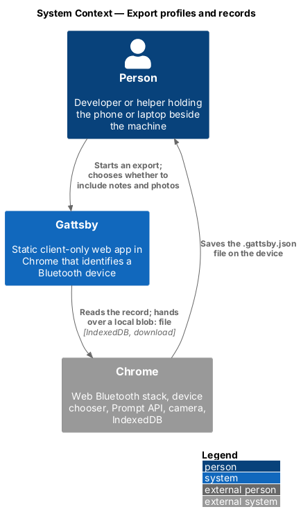
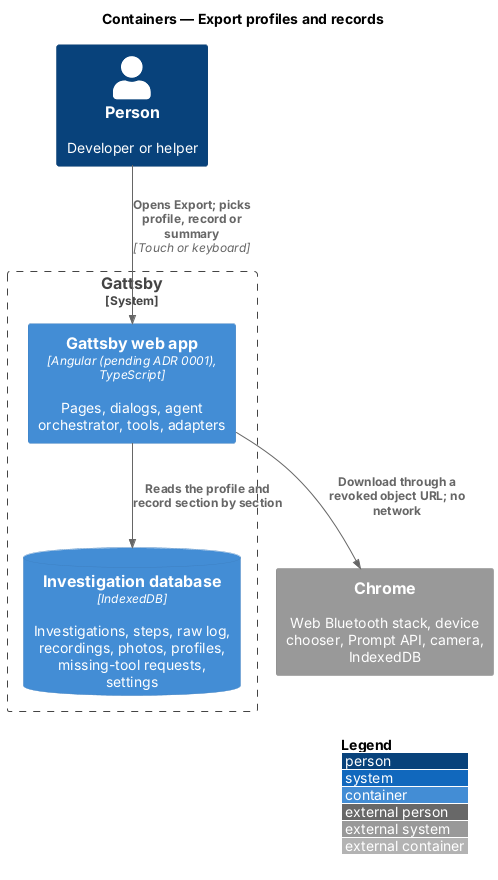
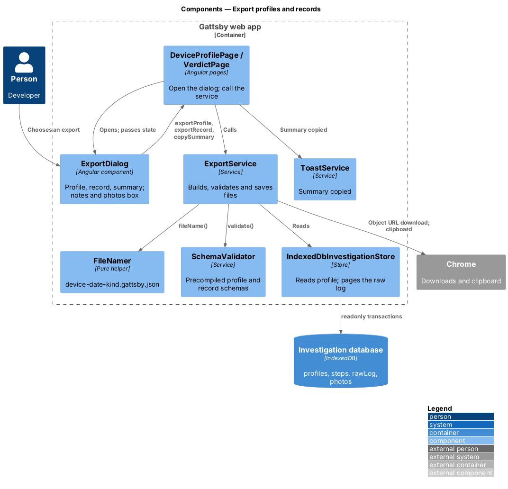
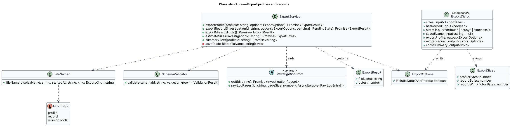
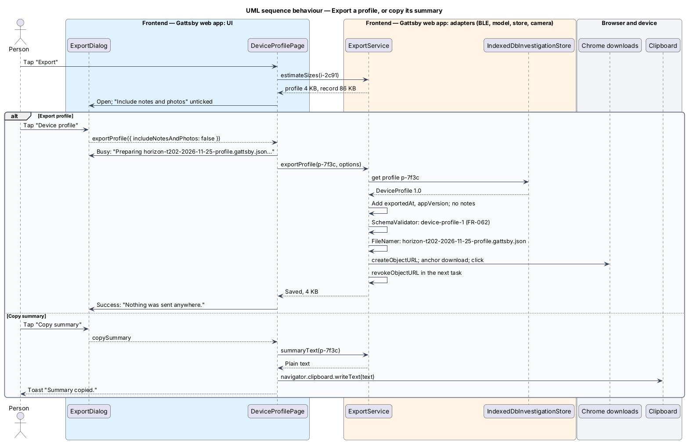
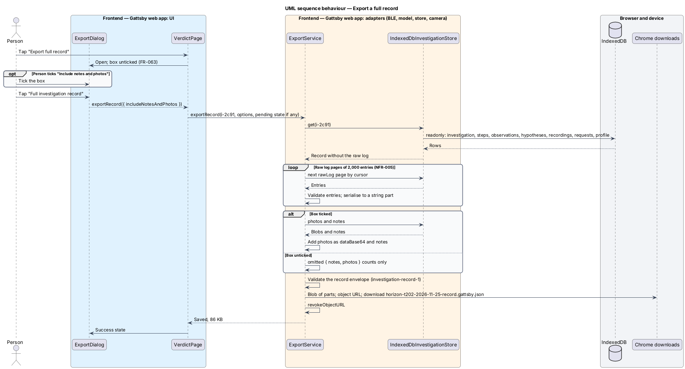

# Export profiles and records

## Overview

Export is the only way data leaves Gattsby, and the person starts it. This feature saves a device
profile, or a whole investigation record, as a JSON file on the device, named after the device and
the date, in a versioned format that other apps and a later Gattsby can read. It belongs to the
persistence subsystem and runs after an investigation, from the Verdict and Device profile pages.

**profile file** — JSON file holding one device profile in profile format 1.0, named
`{device}-{date}-profile.gattsby.json`

**record file** — JSON file holding one whole investigation record in record format 1.0, named
`{device}-{date}-record.gattsby.json`

**format version** — `MAJOR.MINOR` version of a file's JSON format; a minor version only adds
optional fields, a major version ships a migration (NFR-024)

The Export dialog opens from the Device profile page (`docs/mocks/dialogs/export/default.html`) and
from "Export profile" and "Export full record" on the Verdict page. It offers "Device profile —
Identity, protocol, metrics, controls · 4 KB", "Full investigation record — Every step, packet and
answer · 86 KB", "Copy summary — Plain text for a chat or an issue", and the unticked checkbox
"Include notes and photos — Left out unless you tick this." Its busy state shows "Preparing
horizon-t202-2026-11-25-profile.gattsby.json…" (`busy.html`); its success state shows "Saved
horizon-t202-2026-11-25-profile.gattsby.json. It's in your Downloads folder. Nothing was sent
anywhere." (`success.html`). Copying the summary raises the info toast "Summary copied."
(`docs/mocks/notifications/toast/info.html`).

The file is built in the browser and handed to Chrome's download through a `blob:` URL. No request
leaves the origin (NFR-012); the brief's MVP acceptance criterion 6 needs exactly that.

## Description

The design introduces these building blocks in the Angular (pending ADR 0001) workspace under
`frontend/src/app/`:

- **`ExportService`** (`store/export-service.ts`) — `exportProfile(profileId, options)`,
  `exportRecord(investigationId, options, pending?)`, `exportMissingTools()` (see the
  record-missing-tool-requests design), `estimateSizes(investigationId)` and
  `summaryText(profileId)`. It reads through `InvestigationStore`, validates every file with
  `SchemaValidator` before saving it, and saves through one private `save(blob, fileName)`.
- **`FileNamer`** (`store/file-namer.ts`) — pure helper: `fileName(displayName, startedAt, kind)`.
- **`SchemaValidator`** (`tools/schema-validator.ts`) — precompiled validators for profile format 1
  and record format 1 (`frontend/src/schemas/device-profile-1.schema.json`,
  `frontend/src/schemas/investigation-record-1.schema.json`); no run-time code generation
  (NFR-013).
- **`ExportDialog`** (`dialogs/export/export.dialog.ts`) — presentation component. Inputs: the
  estimated sizes, whether a record exists, whether the investigation has notes or photos, and the
  state (`default`, `busy`, `success`) with the saved file name. Outputs: `exportProfile`,
  `exportRecord` and `copySummary`, each with `{ includeNotesAndPhotos }`.
- **`DeviceProfilePage`** and **`VerdictPage`** — open the dialog, call `ExportService`, and pass
  the state back to the dialog.
- **`ToastService`** — shows "Summary copied. Paste it into a chat or an issue."

### File names

`FileNamer` lower-cases the profile's display name, removes diacritics (NFKD, then drops combining
marks), replaces each run of characters outside `a–z` and `0–9` with one hyphen, trims hyphens, cuts
the result at 40 characters, and falls back to `device` when nothing is left. It appends the
investigation's start date in local time as `YYYY-MM-DD` and the suffix `-profile.gattsby.json`
or `-record.gattsby.json`: "Horizon T202" started on 25 November 2026 gives
`horizon-t202-2026-11-25-profile.gattsby.json` (FR-062).

### Saving

1. The file is built as a `Blob` of type `application/json`.
2. `URL.createObjectURL(blob)` gives a `blob:` URL; an anchor with `download` set to the file name is
   created, clicked and removed.
3. The URL is revoked in the next task after the click, so no object URL outlives the export.
4. The page cannot know where Chrome saved the file; "It's in your Downloads folder" is provisional
   wording (A-01).

### Profile file

The profile file is the stored `DeviceProfile` exactly as the build-the-device-profile design
defines it (`kind` `gattsby.device-profile`, `formatVersion` `1.0`, `kbVersion`), with two export
fields added: `exportedAt` and `appVersion`. Notes are added as `notes` only when the person ticks
"Include notes and photos"; a profile never holds photos.

### Record format 1.0

```json
{
  "kind": "gattsby.investigation-record",
  "formatVersion": "1.0",
  "kbVersion": "2026.11",
  "appVersion": "0.1.0",
  "exportedAt": "2026-11-25T14:41:07.000Z",
  "includesNotesAndPhotos": false,
  "investigation": {
    "id": "i-2c91", "startedAt": "2026-11-25T14:26:02.000Z", "endedAt": "2026-11-25T14:32:30.000Z",
    "status": "concluded", "mode": "agent", "deviceName": "Horizon T202",
    "location": "Decathlon, Lille", "lastCommittedStep": 11,
    "verdict": { "kind": "connected", "label": "Connected — FTMS", "stopReason": "finish" }
  },
  "steps": [
    {
      "n": 7, "stage": "standard", "startedAt": "2026-11-25T14:28:03.000Z",
      "action": { "type": "call_tool", "tool": "subscribe_and_record", "input": { "characteristic": "0x2acd", "seconds": 10 } },
      "result": { "ok": true, "summary": "10 notifications at 1 per second, decoded with the FTMS layout.", "data": {}, "error": null, "evidence": ["r-118", "o-8"] },
      "answer": "Ready", "approvalId": null, "error": null
    }
  ],
  "rawLog": [
    { "id": "r-118", "t": 121034.512, "kind": "notification", "uuid": "0x2acd", "direction": "in", "hex": "0C 04 2C 01 08 00 00 00 00 00 00 34 00", "stepN": 7 }
  ],
  "observations": [], "hypotheses": [], "recordings": [], "missingToolRequests": [],
  "profile": { "kind": "gattsby.device-profile", "formatVersion": "1.0" },
  "omitted": { "notes": 1, "photos": 0 }
}
```

Arrays are shortened here. The file holds every step with its action, tool input and output, every
raw log entry with its millisecond timestamp (`t`, relative to the investigation's start), every
answer, hypothesis version and missing-tool request, and the profile (FR-063). With "Include notes
and photos" ticked, it also holds `notes` and `photos` (each `{ id, mediaType, takenAt, dataBase64 }`)
and `omitted` is absent.

### Rules the export enforces

1. Notes and photos are left out unless the person ticks the box; the box starts unticked on every
   opening (FR-063 AC1).
2. Every file is validated against its own schema before it is saved; a file that fails is a defect,
   recorded with its code (NFR-025), and nothing is saved.
3. The record is built section by section: the store reads `rawLog` by cursor in pages of 2,000
   entries, each page is validated and serialised to a string, and the strings become the parts of
   one `Blob`. Peak memory stays near one page, not the whole log (NFR-005).
4. The dialog shows each file's size from `estimateSizes`. A record above 20 MB cannot be imported
   again (NFR-015). The dialog explains that the file is too large to import into Gattsby and
   still offers the download.
5. "Full investigation record" is unavailable for a profile imported without its record.
6. On the Verdict page's error state (the verdict could not be saved), `exportRecord` adds the
   pending step and verdict held in memory, so nothing is lost (NFR-008).
7. "Copy summary" writes a plain-text summary of the profile (verdict, identity, readable metrics,
   controllable features) with `navigator.clipboard.writeText` and raises the info toast.

### Tests that prove it

An acceptance spec completes the scripted FTMS treadmill investigation, taps "Export profile",
captures the download with Playwright, validates it against the profile schema, checks its name, and
checks that no request left localhost. Another exports the record of an investigation with a photo
and checks that the box starts unticked and the file holds no photo. Unit tests cover `FileNamer`.

## Requirements

The feature realizes the following level-2 (L2) requirements; each refines the level-1 (L1)
requirement cited beside it.

| L2 ID | Refines (L1) | Requirement |
|-------|--------------|-------------|
| [`FR-062`](../../../specs/L2.md#fr-062-export-a-device-profile) | `L1-014` | The person must be able to export a device profile as a JSON file named after the device and date, holding the profile format version, and conforming to the published profile JSON Schema. |
| [`FR-063`](../../../specs/L2.md#fr-063-export-a-full-investigation-record) | `L1-014` | The person must be able to export a whole investigation (steps, actions, tool inputs and outputs, raw traffic with timestamps, answers, hypotheses, missing-tool requests and profile) as one JSON file. Photos are included only if the person chooses to include them. |

## Diagrams

### System context

The person starts an export in Gattsby; Chrome saves the file locally, and nothing goes to any
server.



### Containers

The web app reads the profile or the record from the investigation database, validates it, and hands
it to Chrome's download as a local file.



### Components

`ExportDialog` emits the person's choice; `ExportService` reads through the store, names the file
with `FileNamer`, validates it with `SchemaValidator` and saves it.



### Class structure

`ExportService` depends on the `InvestigationStore` contract, `FileNamer` and `SchemaValidator`, and
takes `ExportOptions` from the dialog.



### Behaviour — export a profile, or copy its summary

"Export profile" builds, validates and saves the profile file through a revoked object URL; "Copy
summary" writes plain text to the clipboard.



### Behaviour — export a full record

"Full investigation record" reads the record section by section, leaves notes and photos out unless
ticked, and saves one file.


