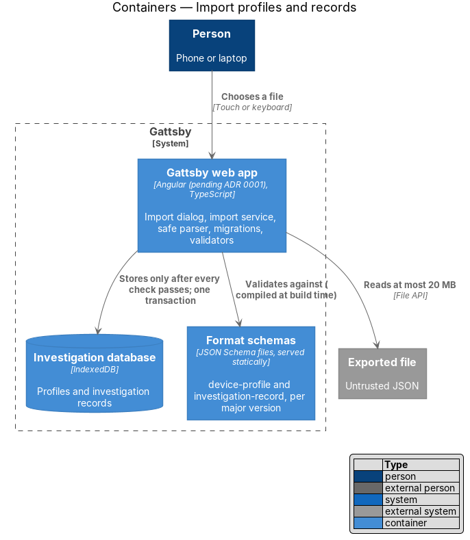
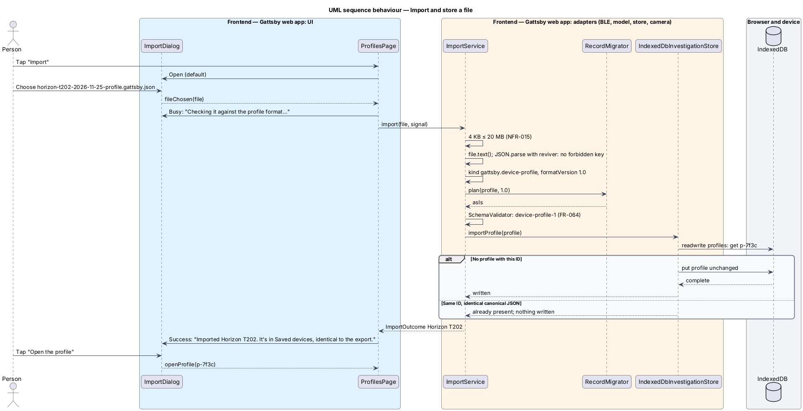
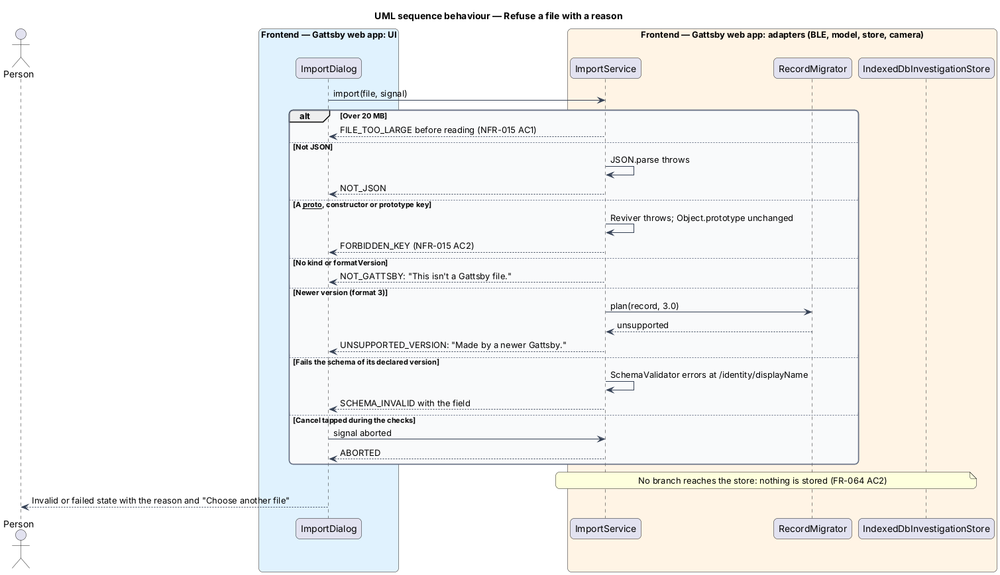
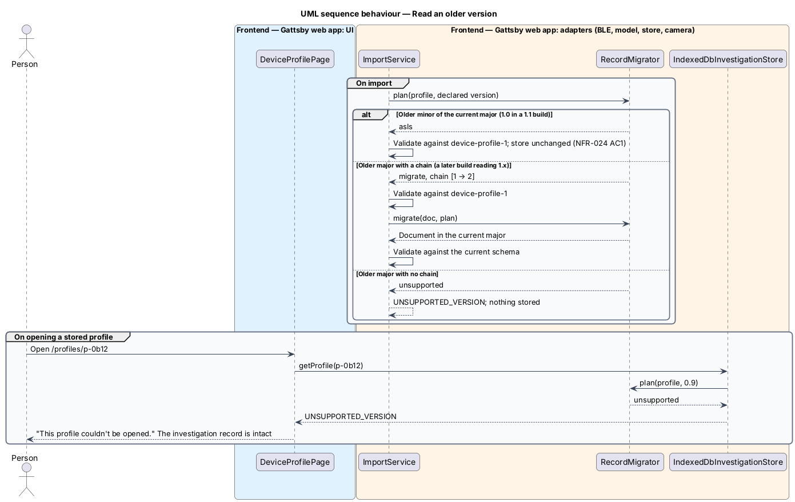

# Import profiles and records

## Overview

A profile or record exported by Gattsby can come back: on another laptop, after "Delete all data",
or from a colleague. This feature reads such a file, proves it is a Gattsby file of a type and
version this build reads, migrates an older supported major version, and only then stores it. Every
other file is refused with a reason, and nothing is stored. It belongs to the persistence subsystem
and runs outside the playbook.

**import** — reading one exported Gattsby file into this device's investigation database

**declared type and version** — the file's own `kind` (`gattsby.device-profile` or
`gattsby.investigation-record`) and `formatVersion` (`MAJOR.MINOR`)

**migration** — pure function that turns a document of one major format version into the next

**prototype-polluting key** — object key (`__proto__`, `constructor` or `prototype`) that could
change `Object.prototype` when a parsed document is merged into another object

The Import dialog opens from "Import" on the Saved devices page (`docs/mocks/dialogs/import/default.html`:
"A device profile or investigation record exported by Gattsby (.json)", "Choose a file"), from
Settings, and from "Import a record" on the empty history. While it checks, it shows the file name,
its size and "Checking it against the profile format…" with "Cancel" (`busy.html`). A file that is
not a Gattsby file shows the invalid state ("This isn't a Gattsby file. It has no format version, so
it wasn't exported by Gattsby. Nothing was imported.", `invalid.html`); a file from a newer Gattsby
shows the failed state ("Made by a newer Gattsby.", `failed.html`); a stored file shows "Imported
Horizon T202. It's in Saved devices, identical to the export." with "Open the profile"
(`success.html`).

An imported file is untrusted input. The checks run in a fixed order, cheapest first, and the first
failure ends the import before any write (NFR-015).

## Description

The design introduces these building blocks in the Angular (pending ADR 0001) workspace under
`frontend/src/app/`:

- **`ImportService`** (`store/import-service.ts`) — `import(file, signal): Promise<ImportOutcome>`.
  Runs the checks below, asks `RecordMigrator` for a plan, and stores through `InvestigationStore`.
  It refuses with an `ImportError` whose `code` the dialog branches on.
- **`RecordMigrator`** (`store/record-migrator.ts`) — knows, for each kind, the current version and
  the migrations between majors. `plan(kind, version)` returns `asIs`, `migrate` (with the chain of
  majors) or `unsupported`; `migrate(document, plan)` applies the chain.
- **`SchemaValidator`** (`tools/schema-validator.ts`) — precompiled validators for every supported
  major of each kind: `device-profile-1`, `investigation-record-1` at format 1. Each later major adds
  its schema and keeps the older ones it still reads.
- **`InvestigationStore.importProfile(profile)` and `importRecord(record)`**
  (`store/indexed-db-investigation-store.ts`) — each writes in one `readwrite` transaction, so an
  import is stored whole or not at all.
- **`ImportDialog`** (`dialogs/import/import.dialog.ts`) — presentation component. Inputs: the state
  (`default`, `busy`, `invalid`, `failed`, `success`), the file name and size, and the outcome or
  error. Outputs: `fileChosen`, `cancelled`, `openProfile`. "Choose a file" uses an
  `<input type="file" accept=".json,application/json">`.
- **`ProfilesPage`**, **`SettingsPage`** and **`HistoryPage`** — open the dialog and call
  `ImportService` with an `AbortController`'s signal, aborted by "Cancel".
- **`ImportError`** (`store/import-error.ts`) — `{ code, message, detail? }`.

### Checks, in order

| # | Check | Refusal code | Dialog state |
|---|---|---|---|
| 1 | `file.size` at most 20 MB (20,971,520 bytes), checked before the file is read (NFR-015 AC1) | `FILE_TOO_LARGE` | invalid |
| 2 | The text parses as JSON | `NOT_JSON` | invalid |
| 3 | No key anywhere is `__proto__`, `constructor` or `prototype`; a `JSON.parse` reviver sees every key and throws on these (NFR-015 AC2) | `FORBIDDEN_KEY` | invalid |
| 4 | The top level is an object with a known `kind` and a `formatVersion` of the form `MAJOR.MINOR` | `NOT_GATTSBY` | invalid |
| 5 | `RecordMigrator.plan` finds the version readable | `UNSUPPORTED_VERSION` | failed |
| 6 | The document is valid against the schema of its declared kind and major; strings are length-limited there | `SCHEMA_INVALID` (with the first failing JSON pointer) | invalid |
| 7 | Migrated, if planned, and valid against the current schema | `SCHEMA_INVALID` | invalid |
| 8 | No stored item has the same ID with different content | `ALREADY_EXISTS` | failed |
| 9 | The write transaction completes | `STORAGE_FULL` | failed |

`JSON.parse` defines a `__proto__` key as an own property and never changes `Object.prototype`; the
reviver refuses it anyway, so no later merge can (NFR-015 AC2). "Cancel" aborts between checks; once
the write transaction has started it completes or aborts whole.

### Versions

| Kind | Current | Reads | Rule |
|---|---|---|---|
| Device profile | 1.0 | 1.0 | A minor version only adds optional fields; a major version ships a migration from the previous major (NFR-024) |
| Investigation record | 1.1 | 1.0 and 1.1 | Both minor versions use the same schema. Optional fields introduced in 1.1 remain optional on import. |

1. An older minor of the current major is stored as it is, without migration and without loss: a
   1.0 profile in a build that writes 1.1 keeps every field (NFR-024 AC1).
2. A newer minor or major is refused with `UNSUPPORTED_VERSION`. Every object in the schemas sets
   `additionalProperties: false`, and storing a newer file would drop the fields this build does not
   know. The message reads "Made by a newer Gattsby. This record uses format 3; this version reads
   formats 1 and 2. Update Gattsby, then import it again. Nothing was imported." The mock's numbers
   illustrate a later build; this build reads format 1 only.
3. An older major is migrated one major at a time through the chain; a major with no chain to the
   current one is refused with `UNSUPPORTED_VERSION`. At format 1 there is no migration.
4. The same plan runs when a stored profile is opened. A stored profile whose version cannot be read
   shows the Device profile page's error state: "This profile couldn't be opened. It was saved in a
   format this version of Gattsby doesn't read (format 0.9, from a test build). The investigation
   record is intact." (`docs/mocks/pages/device-profile/error.html`).
5. The knowledge base's version follows its own rules (see the maintain-the-knowledge-base design).

### Storing

1. **Profile.** `importProfile` writes the profile object unchanged into `profiles` under its own
   `id`, so a re-imported profile is identical to the original in every field (FR-064 AC1). Without
   its record, its evidence IDs do not resolve on this device; the Evidence page says so for each
   one. It appears in Saved devices. Past investigations lists the full investigation records.
2. **Record.** `importRecord` writes the investigation, its steps, raw log, observations,
   hypotheses, recordings, missing-tool requests, notes, photos (decoded from base64 into `Blob`s)
   and its profile, each under its own key, in one transaction over every store. It appears in Past
   investigations and in Saved devices when it includes a profile. An imported investigation opens
   as saved evidence. Import does not start a model, Bluetooth connection, or a command.
3. **Same ID.** When an item with the same ID is already stored, the import compares canonical JSON
   (keys sorted). Identical content is a success with nothing written ("Already on this device");
   different content is refused with `ALREADY_EXISTS`.
4. **Display.** Imported strings are rendered as text; a device name holding `<script>` shows as
   those characters (FR-064 AC3; see the render-untrusted-text design).

### Errors

| Code | Meaning to the person (provisional, A-01) |
|---|---|
| `FILE_TOO_LARGE` | "This file is over 20 MB, so Gattsby didn't open it. Nothing was imported." |
| `NOT_JSON`, `FORBIDDEN_KEY`, `NOT_GATTSBY` | "This isn't a Gattsby file." with the reason; "Nothing was imported." |
| `SCHEMA_INVALID` | "This file doesn't match the profile format." with the failing field; "Nothing was imported." |
| `UNSUPPORTED_VERSION` | "Made by a newer Gattsby." (or "an older Gattsby") with the formats this build reads |
| `ALREADY_EXISTS` | "A different version of this is already on this device. Nothing was imported." |
| `STORAGE_FULL` | "There isn't room to store it. Delete old investigations, then import it again." |

Only the `invalid.html` and `failed.html` messages above come from the mocks; the rest wait on the
mocks.

### Tests that prove it

Acceptance specs export a profile, delete all data, re-import it and compare it field by field;
import a non-JSON file, a schema-failing file and a format 3 file and check that nothing is stored
and the reason is shown; and import a profile whose device name holds `<script>` and check it shows
as text. Unit tests cover the size check with a 25 MB file before parsing, a `__proto__` key with
`Object.prototype` unchanged, and `RecordMigrator.plan` for each version case.

## Requirements

The feature realizes the following level-2 (L2) requirements; each refines the level-1 (L1)
requirement cited beside it.

| L2 ID | Refines (L1) | Requirement |
|-------|--------------|-------------|
| [`FR-064`](../../../specs/L2.md#fr-064-import-profiles-and-records) | `L1-014` | The person must be able to import a profile or investigation record exported by Gattsby. Gattsby must validate it against its schema and version before storing anything, migrate older supported versions, and refuse anything else with a reason. |
| [`NFR-015`](../../../specs/L2.md#nfr-015-validate-every-import) | `L1-018` | An imported file must be at most 20 MB, valid JSON, valid against the schema of its declared type and version, and free of prototype-polluting keys (`__proto__`, `constructor`, `prototype`) before anything is stored. Strings are length-limited by the schema. |
| [`NFR-024`](../../../specs/L2.md#nfr-024-versioned-backward-compatible-data-formats) | `L1-022` | The device profile, investigation record and knowledge base must each have a published JSON Schema and a semantic version. A minor version only adds optional fields; a major version ships a migration from the previous major version. |

## Diagrams

### System context

The person chooses a file through Chrome's file picker; Gattsby checks it and stores it in
IndexedDB, without any network request.

### Containers

The web app reads the chosen file, validates and migrates it, and writes it to the investigation
database in one transaction.

### Components

`ImportDialog` hands the file to `ImportService`, which validates it with `SchemaValidator`, plans
with `RecordMigrator`, and stores through the store.

### Class structure

`ImportService` depends on `RecordMigrator`, `SchemaValidator` and the `InvestigationStore`
contract, and refuses with an `ImportError` of one `ImportErrorCode`.

### Behaviour — import and store a file

A profile exported by Gattsby passes every check and is stored unchanged, then shown in Saved
devices.

### Behaviour — refuse a file with a reason

A file over 20 MB, a file that is not JSON or holds a forbidden key, a file with no format version,
a newer version or a schema failure each ends the import before any write.

### Behaviour — read an older version

An older minor is stored as it is; an older major runs through the migration chain and is validated
again; a version with no chain is refused, on import and on opening a stored profile.

