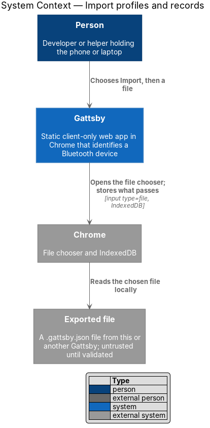
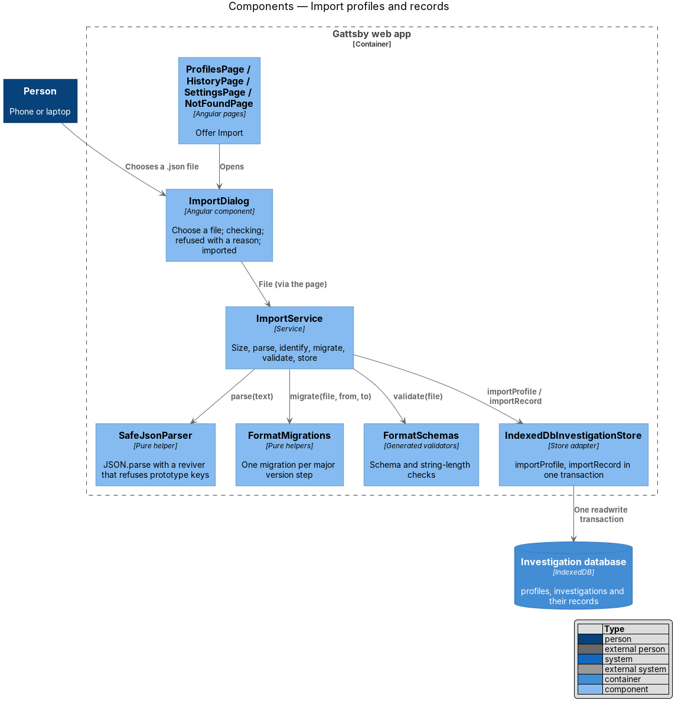
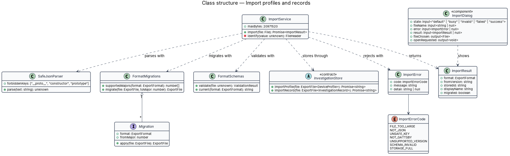
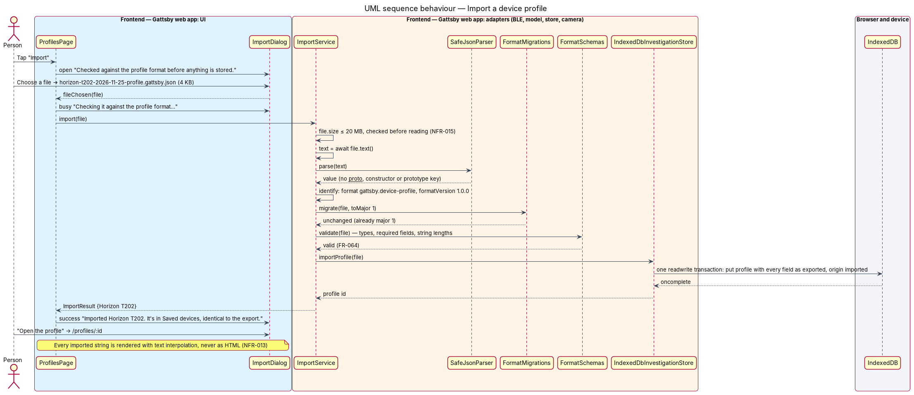

# Import profiles and records

## Overview

Investigations are stored only in the browser where they ran. Import is how a device profile or a
whole investigation record moves to another browser, another device or another person: someone
exports it (see the export-a-profile-or-record design), and someone else imports the file. It also
closes the brief's sixth MVP check, that a profile exports as JSON and re-imports identical. It
belongs to the persistence subsystem and is offered from Saved devices, Past investigations,
Settings and the not-found page.

**import** — the act of reading one exported file, checking it, bringing an older format up to the
current one, and storing it; or refusing it with a reason and storing nothing

**prototype-polluting key** — JSON object key (`__proto__`, `constructor` or `prototype`) that, once
merged into a JavaScript object, can change the behaviour of every object in the page

**migration** — pure function that turns a file of one major format version into the next major
version without losing data

An imported file is untrusted input, in the same class as model output and device data (L1-018).
Every check runs before anything is stored, and every string from the file is rendered as text.

The Import dialog opens over Saved devices (`docs/mocks/dialogs/import/default.html`): "A device
profile or investigation record exported by Gattsby (.json). Choose a file", under "Checked against
the profile format before anything is stored." While checking it shows the file name and size with
"Checking it against the profile format…" (`busy.html`). A file with no format version is refused
with "This isn't a Gattsby file. It has no format version, so it wasn't exported by Gattsby. Nothing
was imported." (`invalid.html`); a newer format with "Made by a newer Gattsby. … Update Gattsby, then
import it again. Nothing was imported." (`failed.html`). Success reads "Imported Horizon T202. It's in
Saved devices, identical to the export." with Done and "Open the profile" (`success.html`).

## Description

The design introduces these building blocks in the Angular (pending ADR 0001) workspace under
`frontend/src/app/`:

- **`ImportDialog`** (`dialogs/import/import.dialog.ts`) — presentation component. Inputs: state
  (`default`, `busy`, `invalid`, `failed`, `success`), file name and size, `ImportError`,
  `ImportResult`. Outputs: `fileChosen(File)` and `openRequested`. It holds a native
  `<input type="file" accept=".json,application/json">` behind the "Choose a file" button. The page
  that opened it passes the file to `ImportService`.
- **`ImportService`** (`store/import.service.ts`) — runs the checks in a fixed order and stops at
  the first refusal: size, parse, identify, version, migrate, validate, store. It returns an
  `ImportResult` or rejects with an `ImportError` whose `code` the dialog branches on.
- **`SafeJsonParser`** (`store/formats/safe-json-parser.ts`) — pure helper. It calls `JSON.parse`
  with a reviver that throws `UNSAFE_KEY` the moment it meets a `__proto__`, `constructor` or
  `prototype` key at any depth. `JSON.parse` itself only creates such keys as own data properties,
  and the parse is abandoned before any object is merged or spread, so `Object.prototype` stays
  unchanged (NFR-015 AC2).
- **`FormatMigrations`** (`store/formats/format-migrations.ts`) — a registry of `Migration`s, one
  per major step, in files such as `store/formats/migrations/device-profile-1-to-2.ts`. At MVP each
  format has major version 1 only, so the chain is empty; the registry is where NFR-024's "a major
  version ships a migration from the previous major version" lands.
- **`FormatSchemas`** (`store/formats/format-schemas.ts`) — the validators the export design
  introduces, compiled at build time. The schemas set a maximum length for every string and a
  maximum count for every array, so an imported file cannot carry unbounded text (NFR-015). The
  limits themselves are `<TO SUPPLY>` in the schema files.
- **`InvestigationStore`** (`store/investigation-store.ts`) — gains `importProfile(file)` and
  `importRecord(file)`. `IndexedDbInvestigationStore` writes everything in one `readwrite`
  transaction and keeps every field as exported, including IDs and timestamps, adding only
  `origin: "imported"` outside the exported data. An imported profile appears in Saved devices; an
  imported record appears in Past investigations (see the keep-a-history design).

### The checks, in order

1. **Size.** `file.size` above 20 MB is refused with `FILE_TOO_LARGE` before the file is read
   (NFR-015 AC1). 20 MB is taken as 20 × 1,048,576 bytes; whether decimal megabytes are meant is
   `<TO SUPPLY>`.
2. **Parse.** `file.text()` then `SafeJsonParser.parse`. A syntax error is `NOT_JSON`; a
   prototype-polluting key is `UNSAFE_KEY`.
3. **Identify.** The value is an object with a known `format` (`gattsby.device-profile` or
   `gattsby.investigation-record`) and a semantic `formatVersion`; otherwise `NOT_GATTSBY`.
4. **Version.** A major version newer than this build's is `UNSUPPORTED_VERSION`, as is a major
   version older than the oldest migration. A newer minor version of the current major is also
   `UNSUPPORTED_VERSION`, since its added fields cannot be validated by this build. An older minor
   version of the current major passes unchanged, because a minor version only adds optional fields
   (NFR-024 AC1).
5. **Migrate.** An older supported major version is migrated step by step to the current one.
6. **Validate.** The (migrated) file shall pass the schema of its format and current version;
   otherwise `SCHEMA_INVALID`, with the first failing field named in plain words.
7. **Store.** One transaction stores the item. `STORAGE_FULL` stores nothing (see the
   save-as-it-runs design).

### Rules

1. Nothing is stored unless every check passes; a refusal leaves IndexedDB exactly as it was
   (FR-064).
2. A re-imported profile is identical to the original in every exported field (FR-064 AC1).
3. Every string from the file (device name, location label, notes, model output, decoded text) is
   rendered through Angular text interpolation. No imported value reaches `[innerHTML]`, a
   `bypassSecurityTrust…` call, a URL or a style (FR-064 AC3, NFR-013).
4. An item whose ID is already stored with the same content imports as a no-op and reports success.
   An item whose ID is already stored with different content has no mocked or specified handling;
   that case is `<TO SUPPLY>`.
5. An imported investigation record is evidence only: it cannot reconnect to a device that is not
   here. How an unfinished imported record opens is `<TO SUPPLY>`.
6. The file is read in the browser and nothing about it is sent anywhere (NFR-012).

### Data shapes

| Type | Fields |
|---|---|
| `ImportResult` | `format`, `fromVersion`, `storedId`, `displayName`, `migrated` |
| `ImportError` | `code`, `message`, `detail` (the failing field or the versions involved) |
| `Migration` | `format`, `fromMajor`, `apply(file)` |

### Errors

| Code | Raised by | Meaning to the person |
|---|---|---|
| `FILE_TOO_LARGE` | `ImportService` | The file is over 20 MB, so it was not opened. Nothing was imported. |
| `NOT_JSON` | `SafeJsonParser` | The file isn't readable as JSON. Nothing was imported. |
| `UNSAFE_KEY` | `SafeJsonParser` | The file holds a key Gattsby never writes, so it was refused. Nothing was imported. |
| `NOT_GATTSBY` | `ImportService` | "This isn't a Gattsby file. It has no format version, so it wasn't exported by Gattsby. Nothing was imported." |
| `UNSUPPORTED_VERSION` | `ImportService` | "Made by a newer Gattsby. This record uses format 3; this version reads formats 1 and 2. Update Gattsby, then import it again. Nothing was imported." (or the older-format wording) |
| `SCHEMA_INVALID` | `FormatSchemas` | The file doesn't match the profile (or record) format at the named field. Nothing was imported. |
| `STORAGE_FULL` | `IndexedDbInvestigationStore` | Storage is full. Export old investigations, then delete them. Nothing was imported. |

Only the `NOT_GATTSBY` and `UNSUPPORTED_VERSION` messages are mocked; the others are provisional
(`A-01`). Each keeps the mocked pattern: the reason, then "Nothing was imported.", then "Choose
another file". The mocked "this version reads formats 1 and 2" is illustrative; at MVP each format
has one major version.

### Tests that prove it

The acceptance spec runs the simulated FTMS treadmill to a verdict, exports the profile, deletes
all data, imports the downloaded file through the `ImportDialog` page object, and compares the
re-imported profile, field by field, with the exported file (FR-064 AC1). Further specs import a
file that is not JSON, one that fails the schema and one with format version `99.0.0`, and check that
the dialog gives the reason and that the `ProfilesPage` count is unchanged (FR-064 AC2); import a
profile whose device name is `` and check it shows as that literal text
with no dialog raised (FR-064 AC3); and import a 25 MB file and one holding `__proto__`, checking the
refusal and that `({}).polluted` is still `undefined` (NFR-015). Unit tests cover `SafeJsonParser`
for each forbidden key at depth, and the version rules for older and newer minor and major versions.

## Requirements

The feature realizes the following level-2 (L2) requirements; each refines the level-1 (L1)
requirement cited beside it.

| L2 ID | Refines (L1) | Requirement |
|-------|--------------|-------------|
| [`FR-064`](../../../specs/L2.md#fr-064-import-profiles-and-records) | `L1-014` | The person must be able to import a profile or investigation record exported by Gattsby. Gattsby must validate it against its schema and version before storing anything, migrate older supported versions, and refuse anything else with a reason. |
| [`NFR-015`](../../../specs/L2.md#nfr-015-validate-every-import) | `L1-018` | An imported file must be at most 20 MB, valid JSON, valid against the schema of its declared type and version, and free of prototype-polluting keys (`__proto__`, `constructor`, `prototype`) before anything is stored. Strings are length-limited by the schema. |

## Diagrams

### System context

The person chooses a file in Chrome's file chooser; Gattsby reads it locally, treats it as untrusted,
and stores it in IndexedDB only after it passes every check.

### Containers

The web app reads at most 20 MB from the file, validates it against the format schemas compiled at
build time, and stores it in one transaction.

### Components

`ImportService` runs `SafeJsonParser`, `FormatMigrations` and `FormatSchemas` in order and calls the
store only when all of them pass.

### Class structure

`ImportService` rejects with an `ImportError` whose `ImportErrorCode` the dialog branches on;
`FormatMigrations` holds one `Migration` per major version step.

### Behaviour — import a device profile

A 4 KB profile of format 1.0.0 passes the size check, the safe parse, the version check and the
schema, and is stored with every field as exported.

### Behaviour — refuse a file

A file that is too large, not JSON, carries a prototype-polluting key, has no format, has a newer
version or fails the schema is refused with its reason, and the store is never called.

