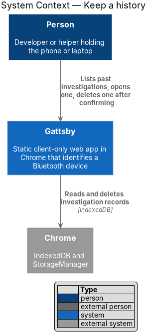
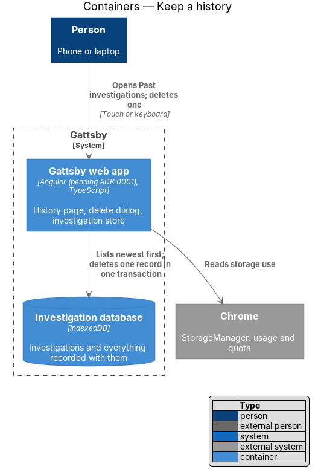
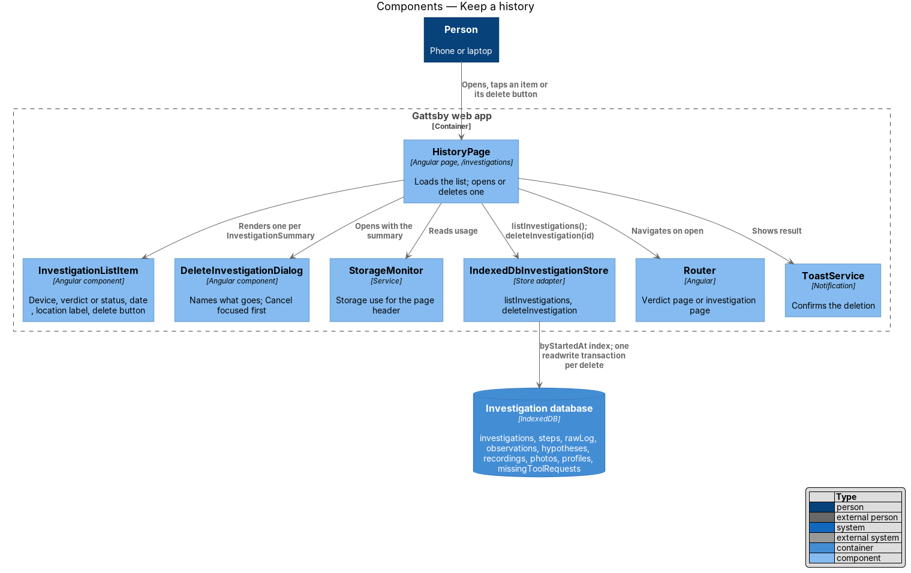
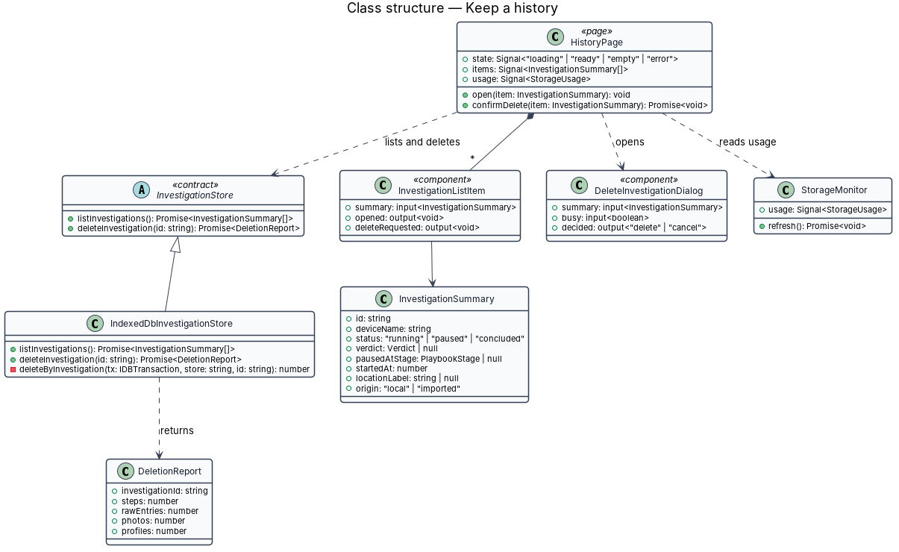
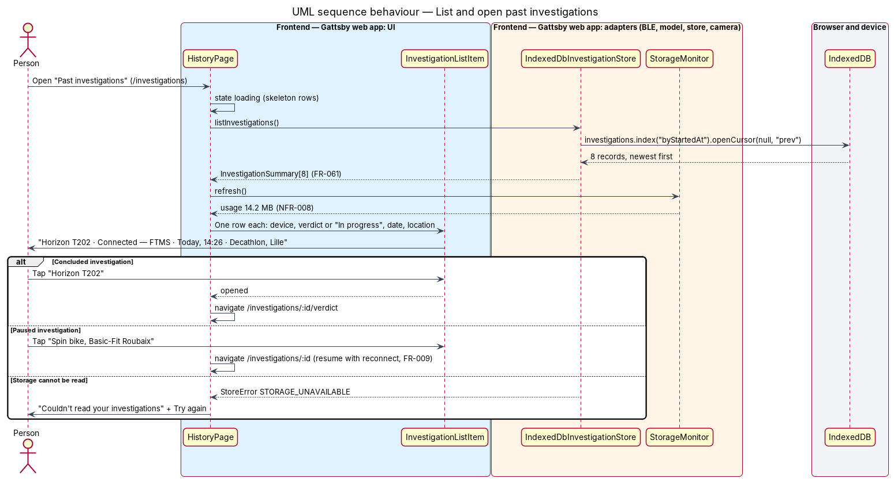
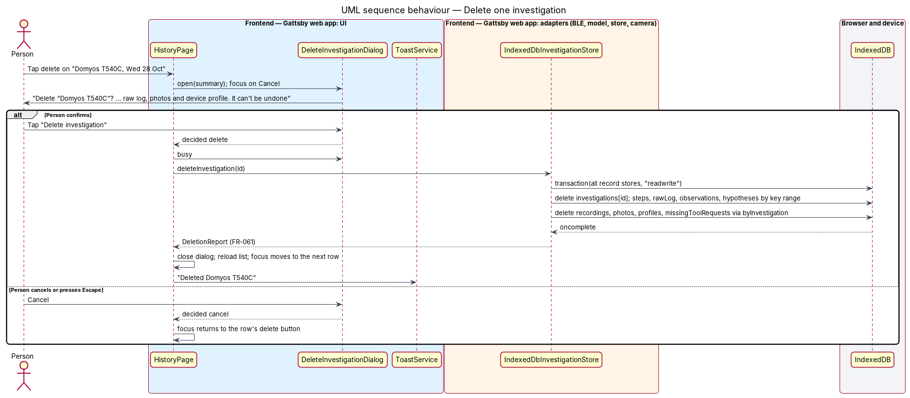

# Keep a history

## Overview

Gattsby keeps every investigation on the device where it ran, with its steps, raw traffic, answers,
hypotheses, photos and device profile. This feature is the place the person goes back to them: a
list of past investigations, newest first, from which one can be opened or deleted. It belongs to
the persistence subsystem and sits outside any running investigation, reached from the home screen
("Past investigations · 8 on this device").

**past investigation** — investigation stored on this device, whatever its state: concluded with a
verdict, paused part-way, or imported from another device

**investigation summary** — the few fields the list shows for one past investigation: device name,
verdict or status, start date and location label

**deletion** — removal of one investigation together with everything recorded under it, after the
person confirms

The list is the Past investigations page (`docs/mocks/pages/history/default.html`, route
`/investigations`), with its loading, empty and error states (`loading.html`, `empty.html`,
`error.html`). Each row shows the device name, the verdict (or "In progress · paused at Standard
path"), the date and time, and the location label, and has its own delete button labelled with the
device and date for screen readers. Delete opens the confirmation dialog
(`docs/mocks/dialogs/delete-investigation/default.html`), whose focus starts on Cancel, and its busy
state (`busy.html`). The empty state offers "Identify a device" and "Import a record" (see the
import-profiles-and-records design).

## Description

The design introduces these building blocks in the Angular (pending ADR 0001) workspace under
`frontend/src/app/`:

- **`HistoryPage`** (`pages/history/history.page.ts`) — the lazy-loaded page at `/investigations`.
  It loads `InvestigationSummary[]` from `InvestigationStore.listInvestigations()`, shows the
  `loading`, `empty`, `ready` or `error` state, and reads storage use from `StorageMonitor` (see the
  save-as-it-runs design). Tapping a concluded investigation opens its verdict page
  (`/investigations/:id/verdict`); tapping a paused one opens the investigation page
  (`/investigations/:id`), from which it resumes with a reconnect (FR-009).
- **`InvestigationListItem`** (`ui/investigation-list-item/investigation-list-item.ts`) —
  presentation component. Input: one `InvestigationSummary`. Outputs: `opened` and
  `deleteRequested`. It renders the verdict as a word plus a shape, never colour alone, and renders
  the device name and location label as text, since both can come from the device or an imported
  file (NFR-013).
- **`DeleteInvestigationDialog`** (`dialogs/delete-investigation/delete-investigation.dialog.ts`) —
  presentation component. Inputs: the summary and `busy`. Output: `delete` or `cancel` (Cancel,
  the close button and Escape all cancel). It names the device and date and states what goes with
  it: the raw log, photos and device profile.
- **`InvestigationStore`** (`store/investigation-store.ts`) — the contract gains
  `listInvestigations()` and `deleteInvestigation(id)`.
- **`IndexedDbInvestigationStore`** (`store/indexed-db-investigation-store.ts`) —
  `listInvestigations()` walks the `byStartedAt` index of `investigations` backwards, so the list is
  newest first without sorting in memory. `deleteInvestigation(id)` opens one `readwrite`
  transaction over every record store and removes the investigation, its steps, raw log,
  observations and hypotheses (by key range on `[id, …]`), and its recordings, photos, profiles and
  missing-tool requests (through each store's `byInvestigation` index). It resolves with a
  `DeletionReport` on `complete`.

### Rules

1. The list holds every stored investigation, including paused and imported ones, newest first by
   start time (FR-061).
2. Each row shows device name, verdict or status, date and location label. A missing location label
   shows nothing in its place rather than a placeholder.
3. Deleting needs the person's confirmation in the dialog. Focus starts on Cancel, the safe action.
4. One deletion is one transaction: either the investigation and everything recorded under it are
   gone, or nothing is. Its missing-tool requests go with it, since they are part of its record
   (FR-063), so the missing-tools list (FR-059) no longer counts it.
5. An investigation that is connected right now is not in reach: leaving the investigation page
   disconnects first (FR-018), so the history never deletes a running investigation.
6. After a deletion, the list reloads, focus moves to the next row (or to the page heading when the
   list is empty), and the result is confirmed in a polite toast. The toast's wording is not mocked
   and is `<TO SUPPLY>` in `docs/mocks/`.
7. The page shows storage use next to the count (NFR-008). The history mock shows only "8 on this
   device · newest first"; the storage wording on this page is `<TO SUPPLY>` until the mock adds it.
   Settings already shows "14.2 MB".
8. How long investigations are kept, and whether old ones are deleted automatically, is open
   (`OQ-10`). Nothing is deleted without the person's confirmation.

### Data shapes

| Type | Fields |
|---|---|
| `InvestigationSummary` | `id`, `deviceName`, `status`, `verdict`, `pausedAtStage`, `startedAt`, `locationLabel`, `origin` |
| `DeletionReport` | `investigationId`, `steps`, `rawEntries`, `photos`, `profiles` |

### Errors

| Code | Raised by | Meaning to the person |
|---|---|---|
| `STORAGE_UNAVAILABLE` | `IndexedDbInvestigationStore` | "Couldn't read your investigations. Chrome didn't answer when Gattsby opened its storage. Nothing has been lost." with Try again (`error.html`). |
| `NOT_FOUND` | `IndexedDbInvestigationStore` | The investigation was deleted in another tab; the list reloads without it. |

### Tests that prove it

The acceptance spec seeds five investigations through the app's own import (see the
import-profiles-and-records design), opens the `HistoryPage` page object and checks that all five
are listed newest first with their verdicts (FR-061 AC1). A second spec deletes one through the
`DeleteInvestigationDialog` page object, reloads, and checks that the history, the evidence log and
the saved devices no longer show it, its photos or its profile (FR-061 AC2). A unit test of
`IndexedDbInvestigationStore.deleteInvestigation` against an in-memory IndexedDB checks that no
record keyed by that investigation remains in any store.

## Requirements

The feature realizes the following level-2 (L2) requirements; each refines the level-1 (L1)
requirement cited beside it.

| L2 ID | Refines (L1) | Requirement |
|-------|--------------|-------------|
| [`FR-061`](../../../specs/L2.md#fr-061-keep-a-history-of-investigations) | `L1-014` | The person must be able to list past investigations (newest first, with device name, verdict, date and location label), open one, and delete one after confirming. |

## Diagrams

### System context

The person lists, opens and deletes past investigations; Gattsby reads and deletes them in Chrome's
IndexedDB.

### Containers

The web app lists investigations newest first from the investigation database, deletes one in a
single transaction, and reads storage use from Chrome.

### Components

`HistoryPage` renders one `InvestigationListItem` per summary, opens `DeleteInvestigationDialog`
before a deletion, and calls `IndexedDbInvestigationStore` for the list and the deletion.

### Class structure

The page depends on the `InvestigationStore` contract; the presentation components take an
`InvestigationSummary` and emit outputs, and inject no app service.

### Behaviour — list and open past investigations

The store walks the `byStartedAt` index backwards; a concluded investigation opens at its verdict,
a paused one at the investigation page, and a storage failure shows the error state.

### Behaviour — delete one investigation

After the person confirms, one transaction removes the investigation with its raw log, photos,
profile and every other record under it; cancelling returns focus to the row's delete button.

