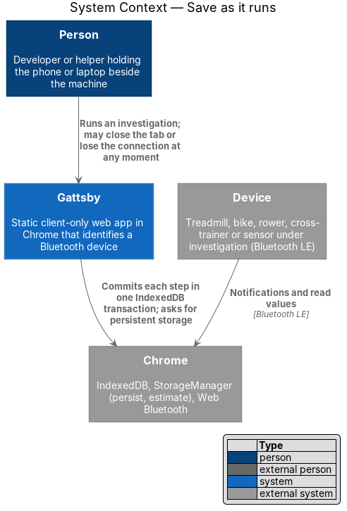
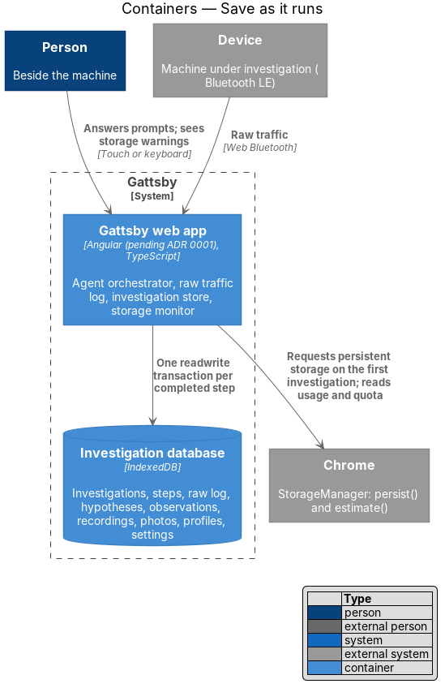
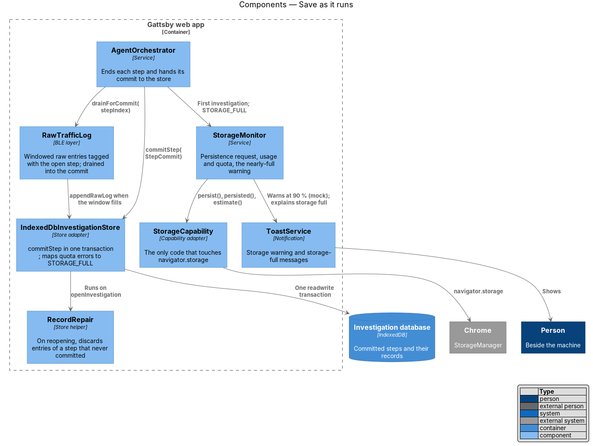
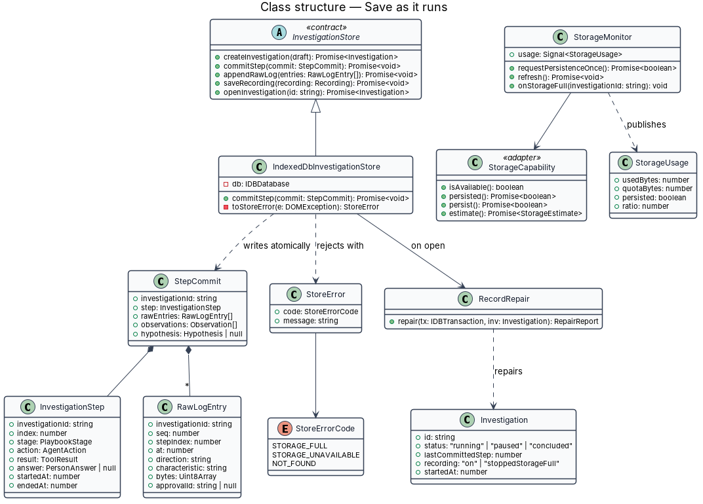
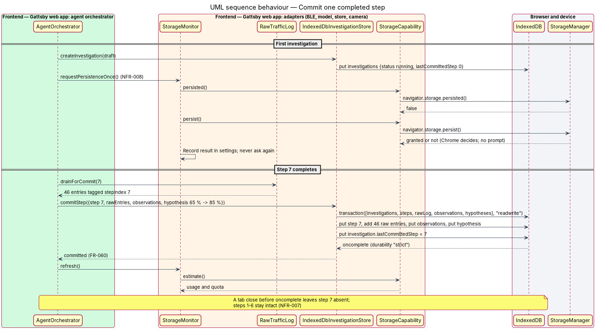
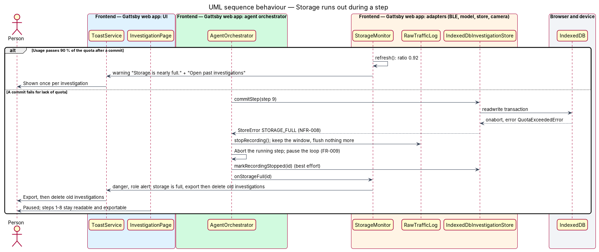
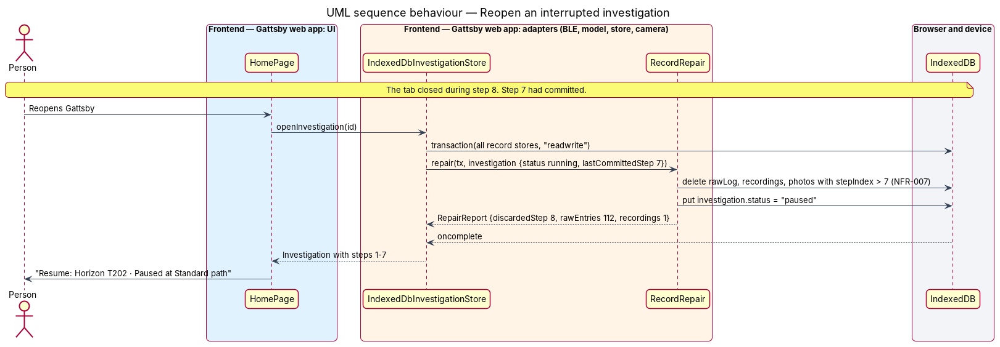

# Save as it runs

## Overview

An investigation happens beside a machine, on a phone or a laptop, where a tab can be closed, a
battery can run out and a Bluetooth connection can drop at any moment. This feature keeps the
investigation record safe through all of that. Each step is written to the browser's IndexedDB the
moment it completes, so an interruption loses at most the step that was running. The feature also
handles the other way storage fails: the browser refusing a write because Gattsby's quota is full.
It belongs to the persistence subsystem and runs in every playbook stage, in full agent mode and in
checklist mode alike.

**step commit** — unit of work written when one step completes: the step itself (action, tool
input and output, the person's answer), the raw traffic tagged with that step, the observations it
established and any hypothesis change

**committed step** — step whose commit transaction has completed; the investigation's
`lastCommittedStep` names the latest one

**open step** — step that has started but not yet committed; its raw entries, recordings and photos
may already be in storage and are discarded if the step never commits

**persistent storage** — Chrome's promise not to evict a site's data under storage pressure,
requested through `navigator.storage.persist()`

The person never saves anything by hand. The leave dialog says so ("It's saved. Leaving disconnects
from HZN-T202-4F1A; resume it from the home screen later", `docs/mocks/dialogs/leave-investigation/default.html`),
and the verdict page confirms "Saved to this device as a device profile"
(`docs/mocks/pages/verdict/default.html`). Storage trouble has three mocked faces: the readiness
check when Chrome blocks storage for the site (`docs/mocks/pages/readiness/error.html`), the
nearly-full warning toast (`docs/mocks/notifications/toast/warning.html`, raised past 90 % of the
quota) and the storage-full error on the verdict page (`docs/mocks/pages/verdict/error.html`).
Storage use is shown in Settings (`docs/mocks/pages/settings/default.html`: "8 investigations · 6
device profiles · 3 photos · 14.2 MB") with the "Keep data when space is low" switch that reflects
persistent storage.

## Description

The design introduces these building blocks in the Angular (pending ADR 0001) workspace under
`frontend/src/app/`:

- **`AgentOrchestrator`** (`agent/agent-orchestrator.ts`) — ends each step by building one
  `StepCommit` and awaiting `InvestigationStore.commitStep`. The next step starts only after the
  commit resolves, so a step's record is never ahead of the step that follows it. On the first
  investigation it asks `StorageMonitor` to request persistent storage. `ChecklistRunner` commits
  through the same call.
- **`StepCommit`** (`store/model/step-commit.ts`) — the unit of work: the `InvestigationStep`, the
  `RawLogEntry`s drained from the raw traffic log for that step, the `Observation`s and the
  `Hypothesis` change (or `null`).
- **`RawTrafficLog`** (`ble/raw-traffic-log.ts`, see the log-raw-traffic design) — tags each entry
  with the open step's index. `drainForCommit(stepIndex)` hands the step's unflushed entries to the
  commit. When unflushed entries reach the in-memory window of 2,000 (NFR-005), for example during a
  long recording, it flushes them early through `appendRawLog`, still tagged with the open step.
- **`InvestigationStore`** (`store/investigation-store.ts`) — the contract. `commitStep(commit)`
  resolves when the commit is durable and rejects with a `StoreError` otherwise.
- **`IndexedDbInvestigationStore`** (`store/indexed-db-investigation-store.ts`) — the only code
  that touches IndexedDB. `commitStep` opens one `readwrite` transaction over `investigations`,
  `steps`, `rawLog`, `observations` and `hypotheses`, writes every part, sets
  `investigation.lastCommittedStep`, and resolves on the transaction's `complete` event. It asks for
  `durability: "strict"`, so `complete` fires only after the data is flushed to disk. A
  `QuotaExceededError` (on the request or the transaction's `abort`) becomes `STORAGE_FULL`; any
  other failure to open or write becomes `STORAGE_UNAVAILABLE`.
- **`RecordRepair`** (`store/record-repair.ts`) — runs inside the transaction that opens an
  investigation. It deletes raw entries, recordings and photos whose `stepIndex` is greater than
  `lastCommittedStep`, and turns a `running` investigation into `paused`, so the investigation can
  be resumed (FR-009) or concluded. This is how a partly written step is detected and discarded
  (NFR-007, see the recover-a-dropped-connection design).
- **`StorageCapability`** (`capabilities/storage.capability.ts`) — the only code that touches
  `navigator.storage`: `isAvailable()`, `persisted()`, `persist()` and `estimate()`. It reports
  storage as unavailable when IndexedDB cannot be opened (private window, blocked site data), which
  the readiness check shows (FR-001).
- **`StorageMonitor`** (`store/storage-monitor.ts`) — requests persistent storage once, on the
  first investigation, and records the outcome in the `settings` store. It exposes `usage` (bytes
  used, quota, persisted, ratio) to Settings and the history (FR-061), refreshes it after each
  commit, raises the nearly-full warning once per investigation when the ratio passes 0.9, and
  raises the storage-full error.
- **`ToastService`** (`notifications/toast/toast.service.ts`) — shows the warning as a polite toast
  with "Open past investigations", and the storage-full error with `role="alert"`, which never
  dismisses on its own.

### Object stores

Database `gattsby`, schema version 1. Each record carries the `investigationId` it belongs to.

| Store | Key | Indexes | Holds |
|---|---|---|---|
| `investigations` | `id` | `byStartedAt` | Status, device, location label, mode, `lastCommittedStep`, `recording`, verdict |
| `steps` | `[investigationId, index]` | — | `InvestigationStep`: stage, action, tool input and output, answer |
| `rawLog` | `[investigationId, seq]` | `byStep` | `RawLogEntry` with `stepIndex` |
| `observations` | `[investigationId, id]` | — | Facts tools established, with evidence IDs |
| `hypotheses` | `[investigationId, stepIndex]` | — | The hypothesis after each change |
| `recordings` | `id` | `byInvestigation` | Baseline and activity recordings (FR-028) |
| `photos` | `id` | `byInvestigation` | Photo blobs (NFR-017) |
| `profiles` | `id` | `byInvestigation`, `bySavedAt` | `DeviceProfile` (FR-055) |
| `missingToolRequests` | `id` | `byInvestigation` | `MissingToolRequest` (FR-058) |
| `settings` | `name` | — | Mode preference, persistence outcome |

Stores that later designs add (for example local diagnostics, NFR-025) join the same database and
the same delete paths.

### Rules

1. One completed step is one transaction. The step, its raw traffic, its observations and its
   hypothesis change are written together or not at all (FR-060).
2. The orchestrator does not start step *n + 1* until step *n* has committed. A crash therefore
   leaves at most one open step.
3. Entries flushed early by `appendRawLog`, and recordings or photos saved during a step, carry the
   open step's index. If that step never commits, `RecordRepair` deletes them on reopening. A
   reopened investigation shows steps 1 to `lastCommittedStep` and no trace of the open step.
4. Persistent storage is requested once, on the first investigation, never at app start. Chrome
   grants or refuses it without a prompt. Settings shows the result; the page cannot revoke a grant.
5. On `STORAGE_FULL` the orchestrator aborts the open step, stops the raw traffic log from
   recording, pauses the loop (FR-009) and sets `recording: "stoppedStorageFull"` when a small write
   still succeeds. Everything already committed stays readable and exportable. The person is told to
   export and delete old investigations (NFR-008).
6. Store calls return plain data; screens read it through signals. Byte-derived strings from the
   record render as text (NFR-013).

### Data shapes

| Type | Fields |
|---|---|
| `StepCommit` | `investigationId`, `step`, `rawEntries`, `observations`, `hypothesis` |
| `StoreError` | `code` (`STORAGE_FULL`, `STORAGE_UNAVAILABLE`, `NOT_FOUND`), `message` |
| `StorageUsage` | `usedBytes`, `quotaBytes`, `persisted`, `ratio` |
| `RepairReport` | `investigationId`, `discardedStep`, `rawEntries`, `recordings`, `photos` |

### Errors

| Code | Raised by | Meaning to the person |
|---|---|---|
| `STORAGE_FULL` | `IndexedDbInvestigationStore` | "Storage is full. Export old investigations, then delete them." The investigation pauses; what is stored stays readable. |
| `STORAGE_UNAVAILABLE` | `IndexedDbInvestigationStore`, `StorageCapability` | "Gattsby can't save on this device." The readiness check names the cause (private window or blocked site data). |
| `NOT_FOUND` | `IndexedDbInvestigationStore` | The not-found page (`docs/mocks/pages/not-found/default.html`). |

The investigation page has no mocked state for a storage-full failure mid-investigation; the
verdict-page error and the danger toast are the nearest mocks. The investigation-page state is
`<TO SUPPLY>` in `docs/mocks/`.

### Tests that prove it

The acceptance spec drives a simulated FTMS treadmill (`e2e/fixtures/fake-bluetooth.ts`) in
checklist mode and with the fake `LanguageModel` (`e2e/fixtures/fake-language-model.ts`) through 7
steps, closes the page during step 8, opens a new page on the same context and checks through the
`HistoryPage` and `InvestigationPage` page objects that steps 1–7 are present and step 8 is absent.
A second spec installs a test-only quota stub on the store's database wrapper so the next commit
fails with `QuotaExceededError`, and checks that recording stops, the investigation stays readable
and the storage-full message offers past investigations. Unit tests cover `RecordRepair` (open step
with early-flushed entries, recording and photo; nothing to repair) and the error mapping in
`IndexedDbInvestigationStore`, against an in-memory IndexedDB.

## Requirements

The feature realizes the following level-2 (L2) requirements; each refines the level-1 (L1)
requirement cited beside it.

| L2 ID | Refines (L1) | Requirement |
|-------|--------------|-------------|
| [`FR-060`](../../../specs/L2.md#fr-060-save-as-the-investigation-runs) | `L1-014` | Gattsby must write each completed step, its raw traffic and any hypothesis change to IndexedDB in one transaction as the step completes, so that a crash, tab close or connection drop loses at most the step in progress. |
| [`NFR-008`](../../../specs/L2.md#nfr-008-handle-storage-limits) | `L1-020` | Gattsby must request persistent storage on the first investigation, show storage use in the history, and, when a write fails for lack of quota, stop recording, keep what is stored, and tell the person to export and delete old investigations. |

## Diagrams

### System context

The person runs the investigation; Gattsby commits each step to IndexedDB through Chrome and asks
Chrome once for persistent storage.

### Containers

The web app writes one transaction per completed step to the investigation database and reads
storage use and quota from Chrome's storage manager.

### Components

`AgentOrchestrator` drains the step's raw entries from `RawTrafficLog` and hands one `StepCommit` to
`IndexedDbInvestigationStore`; `RecordRepair` cleans up an open step on reopening; `StorageMonitor`
talks to Chrome only through `StorageCapability`.

### Class structure

`IndexedDbInvestigationStore` implements the `InvestigationStore` contract, writes `StepCommit`s
atomically and rejects with a coded `StoreError`; `StorageMonitor` publishes `StorageUsage`.

### Behaviour — commit one completed step

On the first investigation the monitor requests persistent storage. When step 7 completes, its 46
raw entries, observations and hypothesis change are written with the step in one transaction, and
`lastCommittedStep` becomes 7.

### Behaviour — storage runs out during a step

Past 90 % of the quota the person sees a warning; when a commit fails for lack of quota, recording
stops, the loop pauses, and the person is told to export and delete old investigations.

### Behaviour — reopen an interrupted investigation

After the tab closed during step 8, opening the investigation discards step 8's early-flushed raw
entries and recording, marks it paused and offers to resume from step 7.

