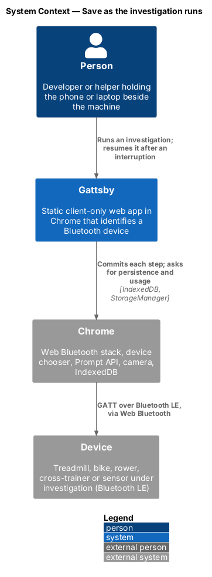
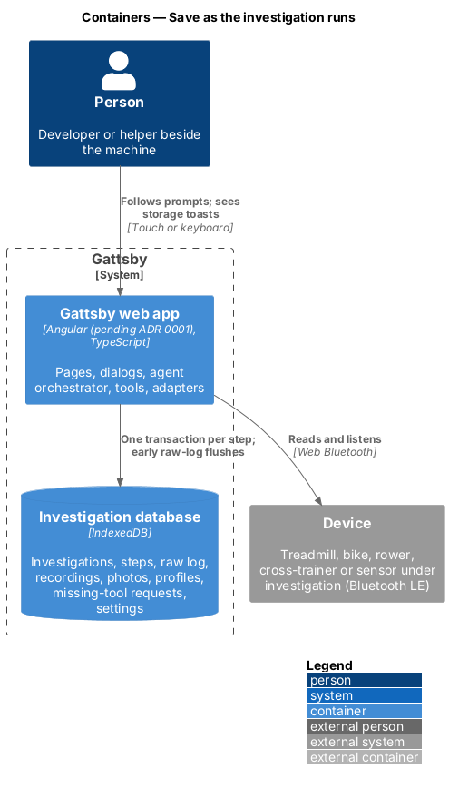
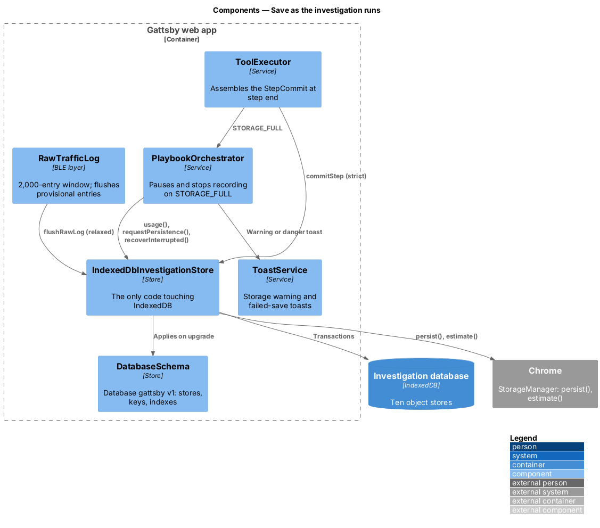
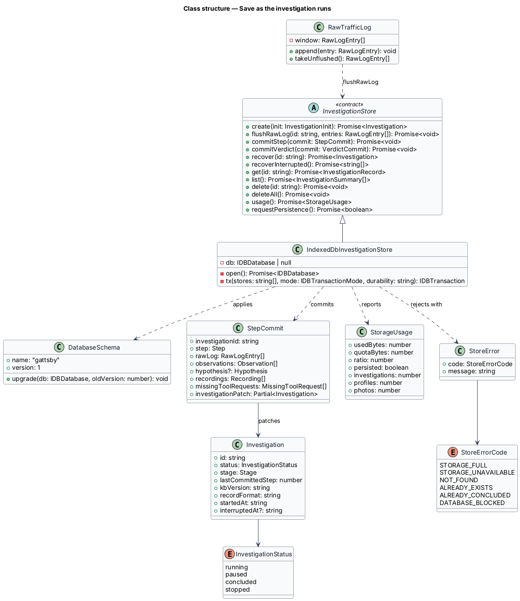
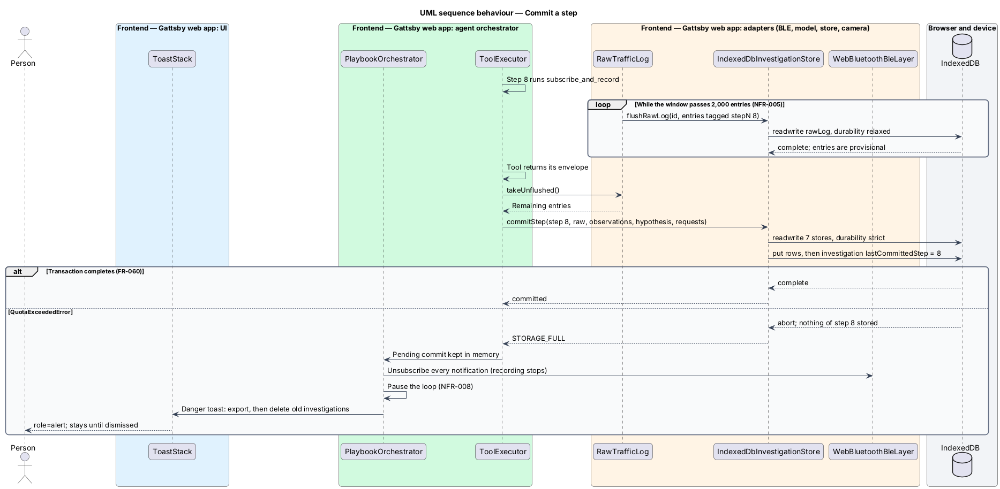
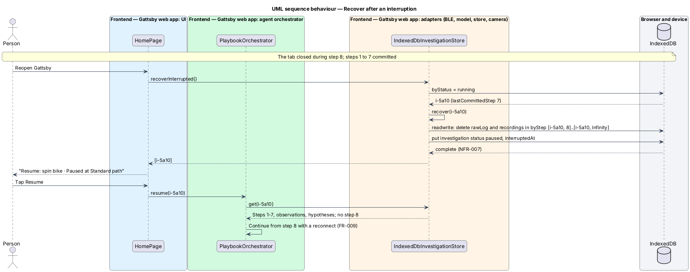
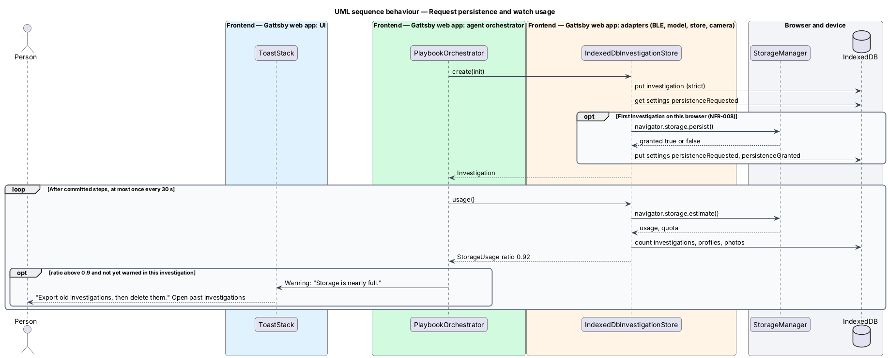

# Save as the investigation runs

## Overview

An investigation happens beside a machine, on a phone or laptop that can lose its connection, its
tab or its battery at any moment. This feature writes each completed step to IndexedDB as it
completes, with its raw traffic, observations and any hypothesis change, in one transaction, so a
crash, tab close or connection drop loses at most the step in progress. It also detects and discards
a partly written step on reopening, asks Chrome to keep Gattsby's storage, watches how full it is,
and stops recording cleanly when it is full. It belongs to the persistence subsystem and runs at
every stage of the playbook.

**step commit** — the single IndexedDB transaction that writes one completed step and everything
that step produced

**commit marker** — `lastCommittedStep` on the investigation record, written last in each step
commit; anything tagged with a later step is provisional

**provisional entry** — raw log entry or recording flushed to the store during a step that has not
yet committed

**persistent storage** — Chrome's promise, granted through `navigator.storage.persist()`, not to
evict the origin's data under storage pressure (`PD-STORAGE`)

The person rarely sees this feature work, by design. It shows in the Leave the investigation dialog
("It's saved.", `docs/mocks/dialogs/leave-investigation/default.html`); in the Home page's resume card
for an interrupted investigation ("Resume: spin bike, Basic-Fit Roubaix · Paused at Standard path",
`docs/mocks/pages/home/default.html`); in the storage line of Settings ("8 investigations · 6 device
profiles · 3 photos · 14.2 MB", `docs/mocks/pages/settings/default.html`); and in two toasts, the
warning "Storage is nearly full." (`docs/mocks/notifications/toast/warning.html`) and the danger toast
for a failed save (`docs/mocks/notifications/toast/danger.html`).

`IndexedDbInvestigationStore` is the only code that touches IndexedDB (NFR-021). This design fixes
the database layout that every other persistence and verdict-and-profile design uses.

## Description

The design introduces these building blocks in the Angular (pending ADR 0001) workspace under
`frontend/src/app/`:

- **`InvestigationStore`** (contract, `store/investigation-store.ts`) and
  **`IndexedDbInvestigationStore`** (`store/indexed-db-investigation-store.ts`) — `create(init)`,
  `flushRawLog(id, entries)`, `commitStep(commit)`, `commitVerdict(commit)`, `recover(id)`,
  `recoverInterrupted()`, `get(id)`, `list()`, `delete(id)`, `deleteAll()`, `usage()` and
  `requestPersistence()`. Every refusal is a `StoreError` whose `code` a screen branches on.
- **`DatabaseSchema`** (`store/database-schema.ts`) — the database name `gattsby`, its version (1),
  and the object stores and indexes below, applied in `onupgradeneeded`. A later version adds an
  upgrade step here; it never edits version 1's.
- **`StoreError`** (`store/store-error.ts`) — `{ code, message }` with the codes in "Errors".
- **`StepCommit`** (`store/model/step-commit.ts`) — everything one step produced: the `Step`, the raw
  log entries not yet flushed, new observations, an optional hypothesis version, recordings,
  created or merged missing-tool requests, and the investigation patch.
- **`ToolExecutor`** (`agent/tool-executor.ts`) — assembles the `StepCommit` when a step ends and
  calls `commitStep`; on `STORAGE_FULL` it keeps the commit in memory as the pending step.
- **`RawTrafficLog`** (`ble/raw-traffic-log.ts`) — keeps the last 2,000 entries in memory (NFR-005)
  and flushes older entries with `flushRawLog` during long steps; each entry carries the number of
  the step in progress.
- **`PlaybookOrchestrator`** (`agent/playbook-orchestrator.ts`) — on `STORAGE_FULL`, pauses the loop
  and stops recording; on start, calls `requestPersistence()` and `usage()`.
- **`ToastService`** (`notifications/toast.service.ts`) — shows the storage warning and the failed-save
  danger toast; danger toasts use `role=alert` and never dismiss on their own.

### Database `gattsby`, version 1

Every per-investigation store uses the compound key `[investigationId, localId]`. One key range,
`IDBKeyRange.bound([id], [id, []])`, then reads or deletes all of one investigation's rows (arrays
sort after numbers and strings in IndexedDB key order). Local IDs double as evidence IDs (`r-`, `s-`,
`o-`, `h-`, `rec-`, `ph-`, `m-`; see the track-the-hypothesis design).

| Object store | Key | Indexes | Holds |
|---|---|---|---|
| `investigations` | `id` (`i-` + `crypto.randomUUID()`) | `byStartedAt`, `byStatus` | `Investigation`: status (`running`, `paused`, `concluded`, `stopped`), stage, mode, device name, location label, notes, `kbVersion`, `recordFormat`, `lastCommittedStep`, ID counters, verdict, `profileId` |
| `steps` | `[investigationId, n]` | — | `Step`: stage, times, the action, tool input, result envelope, refusal, approval ID, the person's answer, error with code, tool, stage and time (NFR-025) |
| `rawLog` | `[investigationId, seq]` | `byStep` (`[investigationId, stepN]`) | `RawLogEntry` (`t` ms, kind, UUID, direction, hex, `approvalId?`) plus `stepN` |
| `observations` | `[investigationId, id]` | — | `Observation` with its evidence IDs |
| `hypotheses` | `[investigationId, version]` | — | `Hypothesis` versions |
| `recordings` | `[investigationId, id]` | `byStep` | `Recording`: characteristic, label, start, duration and the raw log sequence range it covers (bytes are not copied) |
| `photos` | `[investigationId, id]` | — | `Photo`: `Blob`, media type, time |
| `profiles` | `id` (`p-` + UUID) | `byInvestigation` (unique), `byCreatedAt`, `byDeviceType` | `DeviceProfile` |
| `missingToolRequests` | `[investigationId, id]` | `byCapabilityKey`, `byInvestigationAndKey` (unique) | `MissingToolRequest` |
| `settings` | `key` | — | Mode preference, `persistenceRequested`, `persistenceGranted`, last usage warning time |

### Transactions

| Operation | Mode and stores | Durability |
|---|---|---|
| `create` | `readwrite`: `investigations` | `strict` |
| `flushRawLog` | `readwrite`: `rawLog`, `investigations` (counter) | `relaxed`; the entries stay provisional |
| `commitStep` | `readwrite`: `investigations`, `steps`, `rawLog`, `observations`, `hypotheses`, `recordings`, `missingToolRequests` | `strict` |
| `commitVerdict` | `readwrite`: `investigations`, `steps`, `profiles` | `strict` |
| `recover` | `readwrite`: `investigations`, `rawLog`, `recordings` | `strict` |
| `get`, `list`, `usage` counts | `readonly` | — |

`commitStep` writes the step and its rows first and the investigation patch, carrying
`lastCommittedStep = n`, last. IndexedDB commits all of it or none of it (FR-060). The promise
resolves on the transaction's `complete` event, never on a request's `success`, so a caller never
treats an uncommitted step as saved.

### Recovery on reopening

1. At app start, `recoverInterrupted()` reads `byStatus` for `running` investigations. With no live
   orchestrator, each was interrupted.
2. `recover(id)` deletes every `rawLog` and `recordings` row whose `stepN` is above
   `lastCommittedStep`, using the `byStep` index range `[id, lastCommittedStep + 1]` to `[id,
   Infinity]`, and sets the status to `paused` with `interruptedAt`. A step that never committed has
   no `steps` row, so step 8 of FR-060 AC1 is absent.
3. The investigation is then readable, valid against the record schema, and resumable from its last
   completed step with a reconnect (NFR-007; resuming belongs to the stop-pause-and-resume design).

### Storage limits

1. **Persistence.** The first `create()` on this browser calls `requestPersistence()`, which calls
   `navigator.storage.persist()` once and stores the answer in `settings` (NFR-008). The Settings
   toggle "Keep data when space is low" shows `navigator.storage.persisted()`. The web platform has
   no call that withdraws persistence, so turning the toggle off is `<TO SUPPLY>`.
2. **Usage.** `usage()` combines `navigator.storage.estimate()` with object store counts:
   `{ usedBytes, quotaBytes, ratio, persisted, investigations, profiles, photos }`. The orchestrator
   checks it on start and after committed steps, at most once every 30 seconds (a proposed interval).
   Above a ratio of 0.9 it raises the warning toast "Storage is nearly full. Gattsby is using 92% of
   the space Chrome allows it. Export old investigations, then delete them." with "Open past
   investigations", at most once per investigation.
3. **Quota failure.** When a transaction aborts with `QuotaExceededError`, the store rejects with
   `STORAGE_FULL` and nothing from that step is stored. The orchestrator pauses the loop, unsubscribes
   every notification (recording stops), keeps the pending commit in memory for "Try saving again"
   and for "Export full record", and shows a danger toast that tells the person to export and delete
   old investigations (NFR-008 AC1). Its wording for a step is provisional; the mocks show the
   wording for a note.
4. **Showing use in the history.** NFR-008 asks for storage use in the history. The Past
   investigations mock shows only the count ("8 on this device · newest first"); Settings shows the
   full line. The history's storage line waits on a mock update, `<TO SUPPLY>`.

### Data shapes

| Type | Fields |
|---|---|
| `StepCommit` | `investigationId`, `step`, `rawLog`, `observations`, `hypothesis?`, `recordings`, `missingToolRequests`, `investigationPatch` |
| `StorageUsage` | `usedBytes`, `quotaBytes`, `ratio`, `persisted`, `investigations`, `profiles`, `photos` |
| `StoreError` | `code`, `message` |

### Errors

| Code | Raised by | Meaning to the person |
|---|---|---|
| `STORAGE_FULL` | Any `readwrite` operation | Recording stops; what is stored is kept; "export, then delete old investigations" |
| `STORAGE_UNAVAILABLE` | `indexedDB.open` fails, is blocked or does not answer within 5 seconds (a proposed limit) | "Chrome didn't answer when Gattsby opened its storage. Nothing has been lost." with "Try again" |
| `NOT_FOUND` | `get`, `delete` | The page's error state, with "Back" |
| `ALREADY_EXISTS` | Imports (see the import-profiles-and-records design) | "This is already on this device." |
| `ALREADY_CONCLUDED` | `commitVerdict` | Never expected in use (see the issue-the-verdict design) |
| `DATABASE_BLOCKED` | `deleteAll` (see the browse-and-delete-history design) | "Close Gattsby's other tabs, then try again." |

### Tests that prove it

An acceptance spec completes 7 steps against the scripted FTMS treadmill, reloads the page during
step 8, and checks that steps 1 to 7 are intact and step 8 is absent. A second spec makes the fake
store's quota fail and checks that recording stops, the investigation stays readable and the person
is told how to free space. Unit tests run 50 random interruptions over a fake IndexedDB
(`fake-indexeddb`), then reopen each and validate it against the record schema (NFR-007 AC1).

### Built in journey 2

The database, `create`, `commitStep`, `flushRawLog`, `commitVerdict`, `recover`, `get`, `list`, `usage` and `requestPersistence` are built. Opening an investigation whose status is still `running` with committed steps (a tab closed or reloaded mid-step) recovers it as paused and shows its steps; resuming it is journey 11. Not built yet: the storage warning and the failed-save toast (journey 15, with the history), `delete` and `deleteAll`.

## Requirements

The feature realizes the following level-2 (L2) requirements; each refines the level-1 (L1)
requirement cited beside it.

| L2 ID | Refines (L1) | Requirement |
|-------|--------------|-------------|
| [`FR-060`](../../../specs/L2.md#fr-060-save-as-the-investigation-runs) | `L1-014` | Gattsby must write each completed step, its raw traffic and any hypothesis change to IndexedDB in one transaction as the step completes, so that a crash, tab close or connection drop loses at most the step in progress. |
| [`NFR-007`](../../../specs/L2.md#nfr-007-survive-connection-drops-without-corruption) | `L1-020` | No connection drop, tab close, crash or model failure may leave an investigation unreadable or inconsistent: each step is committed atomically (FR-060), and a partly written step is detectable and discarded on reopening. |
| [`NFR-008`](../../../specs/L2.md#nfr-008-handle-storage-limits) | `L1-020` | Gattsby must request persistent storage on the first investigation, show storage use in the history, and, when a write fails for lack of quota, stop recording, keep what is stored, and tell the person to export and delete old investigations. |

## Diagrams

### System context

Gattsby writes each step through Chrome's IndexedDB and asks Chrome's storage manager for
persistence and usage; the device's traffic is what it saves.

### Containers

The web app commits each step to the investigation database in one transaction, and flushes raw
traffic early during long steps.

### Components

`ToolExecutor` assembles the `StepCommit`; `RawTrafficLog` flushes provisional entries;
`IndexedDbInvestigationStore` applies `DatabaseSchema` and commits; the orchestrator reacts to a
full disk.

### Class structure

`IndexedDbInvestigationStore` implements the `InvestigationStore` contract over the stores that
`DatabaseSchema` declares, and takes a `StepCommit` per step.

### Behaviour — commit a step

Raw traffic flushes early as provisional entries; at the step's end one strict transaction writes the
step, its rows and the commit marker, and a quota failure stops recording with nothing half-written.

### Behaviour — recover after an interruption

On reopening, the store finds the interrupted investigation, deletes provisional entries above the
commit marker, and marks it paused for resuming.

### Behaviour — request persistence and watch usage

The first investigation asks Chrome for persistent storage; usage checks raise the warning toast
above 90 %.

