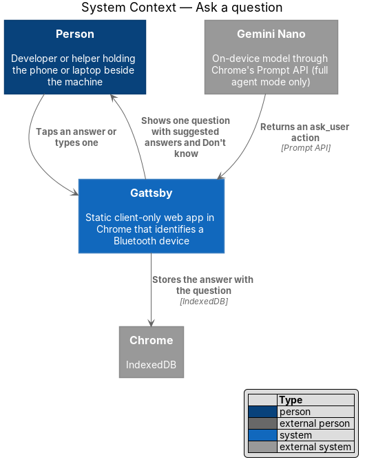
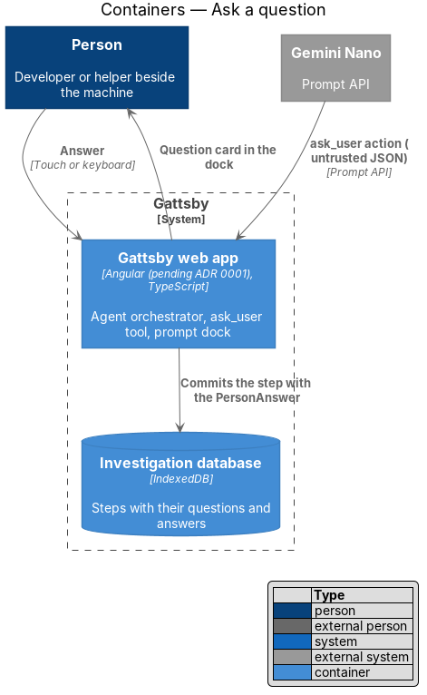
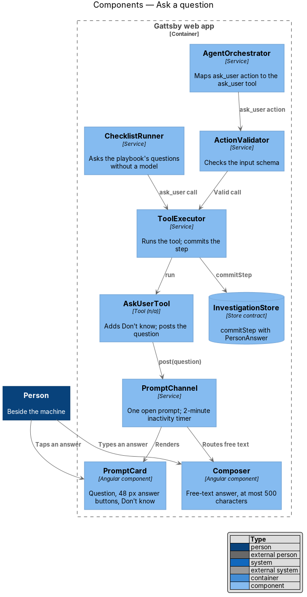
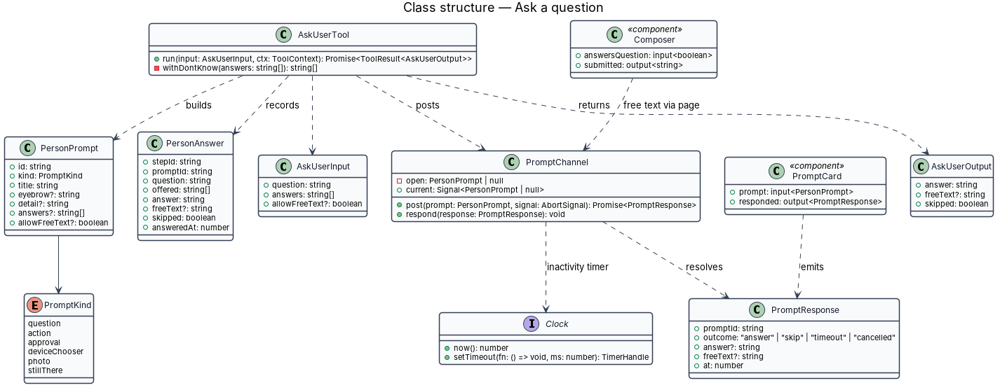
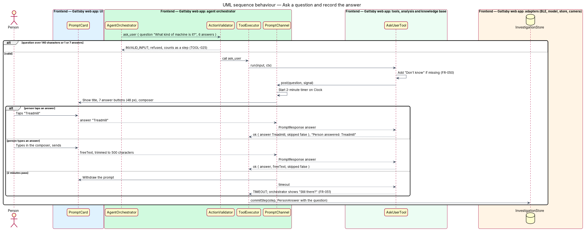

# Ask a question

## Overview

Some facts about a device are quicker to get from the person standing next to it than from its
radio: what kind of machine it is, the brand on the console, whether the belt sped up. This feature
lets the agent, or the checklist, ask the person one question at a time with a few suggested answers
as large buttons, an optional typed answer, and always a "Don't know". The answer is recorded with
the question in the investigation record and returned to the agent as an ordinary tool result. It
belongs to the person-interaction subsystem and runs in any playbook stage; most questions come in
the Prepare stage.

**question** — prompt with one line of text (at most 140 characters) and 2 to 6 suggested answers
(each at most 40 characters), shown on its own in the prompt dock

**suggested answer** — button that answers the question in one tap

**free-text answer** — typed answer of at most 500 characters, given through the composer when the
question allows it

**"Don't know"** — answer present on every question; it records that the person could not answer
and counts as a skip (see [skip a step](../skip-a-step/README.md))

**person answer** — record of one answered question: the question, the answers offered, the answer
chosen or typed, whether it was skipped, and when

Questions reach the person in two ways that share one tool. The model returns an `ask_user` action,
or calls the `ask_user` tool (TOOL-025); the orchestrator maps both to the same `AskUserTool`, so
both are validated and recorded alike. In checklist mode `ChecklistRunner` calls the tool with the
playbook's own questions.

The Prepare mock (`docs/mocks/pages/investigation/prepare.html`) shows the question card in the dock:
the eyebrow "Question 1 of 3", the title "What kind of machine is it?", the detail "Pick one, or type
your own answer below.", six suggested answers (Treadmill, Bike, Rower, Cross-trainer, Heart-rate
sensor, Other), "Don't know", and below them the composer "Ask, or tell Gattsby what to try…". The
dock is a polite live region, so the question is announced. In the default mock
(`docs/mocks/pages/investigation/default.html`) the answered questions stay in the activity feed as
the agent's message followed by the person's reply ("Treadmill", "Horizon, on the console").

## Description

The design introduces these building blocks in the Angular (pending ADR 0001) workspace under
`frontend/src/app/`:

- **`AskUserTool`** (`tools/person/ask-user.tool.ts`) — the `ask_user` tool, safety class `n/a`,
  allowed at every stage, no preconditions. Its input schema refuses a question over 140
  characters, fewer than 2 or more than 6 answers, or an answer over 40 characters, with
  `INVALID_INPUT`. It adds "Don't know" when no answer matches it (ignoring case and the form of the
  apostrophe), posts one `question` prompt through `PromptChannel`, and turns the `PromptResponse`
  into the tool output `{ answer, freeText?, skipped }`.
- **`PromptChannel`** (`agent/prompt-channel.ts`) — holds at most one open prompt. Posting while a
  prompt is open is a programming error and fails with `PRECONDITION_FAILED`, which is how "one
  question at a time" is enforced. For `question` and `action` prompts it starts a 2-minute
  inactivity timer on the injected `Clock`; when it fires, the prompt is withdrawn and the post
  resolves as `timeout` (see [request a physical action](../request-a-physical-action/README.md) for
  the "Still there?" step that follows).
- **`PersonPrompt`** (`agent/person-prompt.ts`) — the prompt shown in the dock. For a question:
  `kind: 'question'`, `title` (the question), `eyebrow?` ("Question 1 of 3", set by the playbook in
  checklist mode and in the Prepare stage), `detail?`, `answers`, `allowFreeText`. The "Why:" line
  under the agent's message in the feed belongs to the activity feed entry, not to the prompt (see
  [show agent activity](../../agent/show-agent-activity/README.md)).
- **`PromptCard`** (`ui/prompt-card/prompt-card.component.ts`) — presentation component. Input: the
  `PersonPrompt`. Output: a `PromptResponse`. It renders the title as the dock's heading, the
  answers as a `role="group"` labelled "Suggested answers" of buttons at least 48 × 48 px, and
  "Don't know" last. Every string is rendered through text interpolation, never as HTML, because a
  question from the model is untrusted (NFR-013).
- **`Composer`** (`ui/composer/composer.component.ts`) — the text field under the dock. While a
  question with `allowFreeText` is open, a submitted message is that question's free-text answer;
  otherwise it is a message to the agent. The component trims the text and keeps at most 500
  characters (FR-050 AC2).
- **`PersonAnswer`** (`store/model/person-answer.ts`) — written with the step by
  `InvestigationStore.commitStep`, so the answer is stored beside its question. A chosen answer that
  states a fact (machine type, brand) is also an observation the hypothesis can use (see
  [track the hypothesis](../../outcome/track-the-hypothesis/README.md)); the model reads only the
  tool's one-line summary ("Person answered: Treadmill").

### Rules

1. One question at a time. The orchestrator runs one step at a time, and `PromptChannel` refuses a
   second open prompt.
2. "Don't know" is always offered. When the model leaves it out, the tool adds it; the model cannot
   remove it.
3. "Don't know" answers with `answer: "Don't know"` and `skipped: true`. The mocks give a question no
   separate "Skip" button, so "Don't know" is the question's skip.
4. A free-text answer is stored as text, at most 500 characters. It is never parsed as markup or
   evaluated, and the evidence log and exports show it literally.
5. A question without `allowFreeText` hides the composer's answer role: text typed then goes to the
   agent as a message, not as the answer.
6. A question has no approval and touches no device; it cannot lead to a write by itself.
7. The emergency stop stays reachable while a question is open; emergency stop and stop withdraw
   the prompt and the tool returns `ABORTED`.

### Data shapes

| Type | Fields |
|---|---|
| `AskUserInput` | `question` (≤ 140 characters), `answers` (2–6, each ≤ 40 characters), `allowFreeText?` |
| `AskUserOutput` | `answer`, `freeText?`, `skipped` |
| `PersonPrompt` (question) | `id`, `kind`, `title`, `eyebrow?`, `detail?`, `answers`, `allowFreeText` |
| `PromptResponse` | `promptId`, `outcome` (`answer` \| `skip` \| `timeout` \| `cancelled`), `answer?`, `freeText?`, `at` |
| `PersonAnswer` | `stepId`, `promptId`, `question`, `offered`, `answer`, `freeText?`, `skipped`, `answeredAt` |

### Errors

| Code | Raised by | Meaning to the person |
|---|---|---|
| `INVALID_INPUT` | `ActionValidator` with the tool's input schema | None; nothing is shown, and the model sees the reason in its next state. |
| `TIMEOUT` | `PromptChannel` after 2 minutes | "Still there?" with "Continue" and "Stop" (FR-051). |
| `ABORTED` | `PromptChannel` on stop or emergency stop | None; the stop already explained it. |

### Tests that prove it

The acceptance specs use the fake `LanguageModel` (`e2e/fixtures/fake-language-model.ts`) scripted
to return `ask_user` actions, and the `InvestigationPage` page object, which owns the prompt-card
and composer selectors.

- FR-050 AC1: the model asks the machine type; the spec checks that each suggested answer is a
  button of at least 48 × 48 px and that "Don't know" is among them.
- FR-050 AC2: the spec types 500 characters, then 501, as a free-text answer and checks that the
  stored answer holds at most 500 characters and is shown as text.
- TOOL-025 AC1: the model asks a 200-character question; the spec checks that no question is shown
  and the refusal is in the evidence log as `INVALID_INPUT`.
- TOOL-025 AC2: the model leaves out "Don't know"; the spec checks that it is shown.
- NFR-013: the model's question contains ``; the spec checks that it is
  shown literally and no script runs.

Unit tests cover the "Don't know" match (case, straight and curly apostrophes) and the
`PromptChannel` inactivity timer on a fake `Clock`.

## Requirements

The feature realizes the following level-2 (L2) requirements; each refines the level-1 (L1)
requirement cited beside it.

| L2 ID | Refines (L1) | Requirement |
|-------|--------------|-------------|
| [`FR-050`](../../../specs/L2.md#fr-050-ask-questions-with-suggested-answers) | `L1-011` | Gattsby must ask one question at a time, with two to six suggested answers as large buttons, an optional free-text answer, and always a "Don't know" answer. Answers are recorded with the question. |
| [`TOOL-025`](../../../specs/L2.md#tool-025-ask_user) | `L1-011` | Asks one question with suggested answers (FR-050). |

## Diagrams

### System context

The person answers on the phone or laptop; the question comes from Gemini Nano in full agent mode
or from the playbook in checklist mode.

### Containers

The web app shows the question, records the answer with the question in the investigation database,
and returns it to the agent.

### Components

`AskUserTool` validates and completes the question, `PromptChannel` holds it as the one open prompt,
`PromptCard` and `Composer` collect the answer, and the step is committed with a `PersonAnswer`.

### Class structure

`AskUserTool` builds a `PersonPrompt`, posts it through `PromptChannel`, and turns the
`PromptResponse` into `AskUserOutput` and a `PersonAnswer`.

### Behaviour — ask and record an answer

The model asks the machine type; the tool adds "Don't know", the person taps "Treadmill", and the
answer is committed with its question. A question over 140 characters is refused before it is
shown, and 2 minutes without an answer end in "Still there?".

