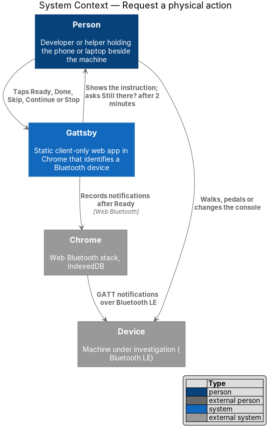
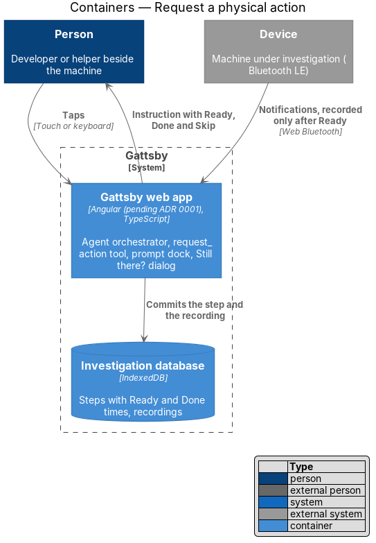
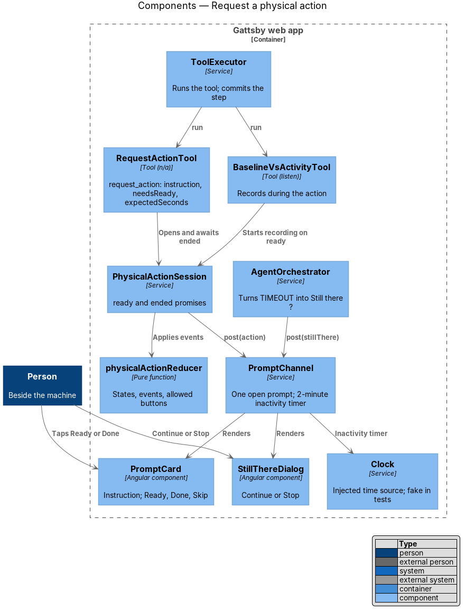
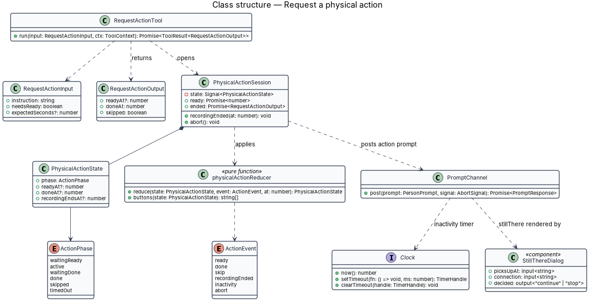
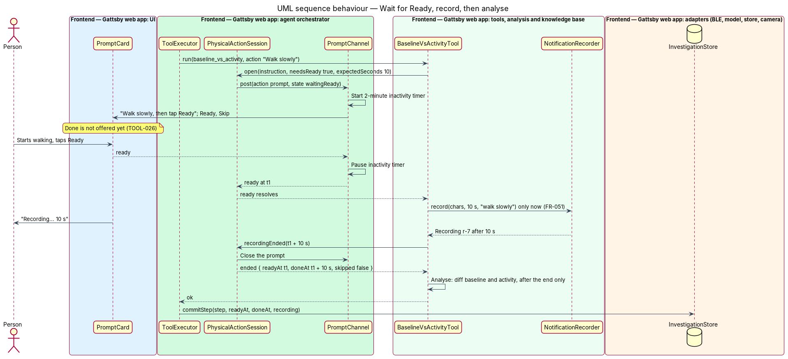
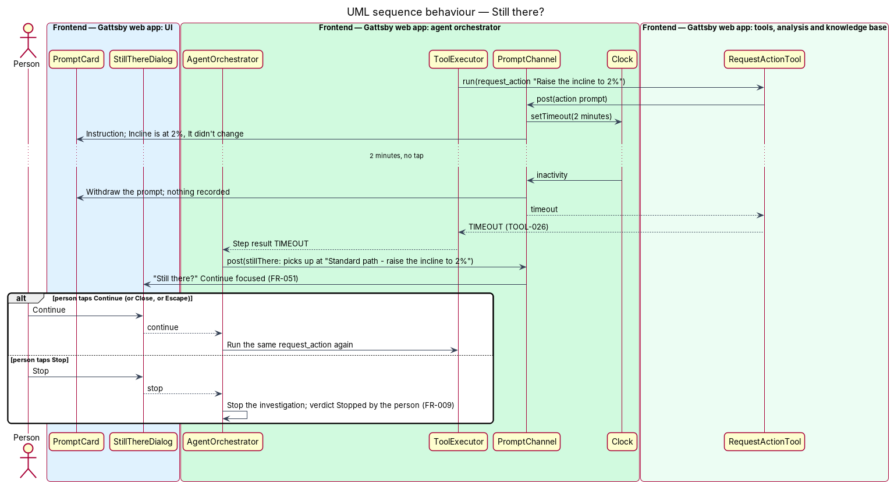

# Request a physical action

## Overview

Gattsby learns most about a device by watching it respond to the person: walking slowly, pedalling
harder, raising the incline on the console. Each of those is a physical action the agent or the
checklist asks for, and the timing matters. A recording that starts before the person is moving
captures the wrong thing, and an analysis that runs before the person is done compares the wrong
data. This feature shows the instruction, waits for "Ready" before any recording starts, waits for
"Done" (or the recording's end) before any analysis, and asks "Still there?" when nothing happens for
2 minutes. It belongs to the person-interaction subsystem and runs mainly in the Standard path
(confirming metrics) and the Proprietary path (baseline and activity recordings).

**physical action** — change the person makes on or with the device, described by an instruction of
at most 140 characters, for example "Walk slowly, then tap Ready"

**"Ready"** — the person's tap that says the action is under way; a recording tied to the action
starts only after it

**"Done"** — the person's tap that says the action is finished; analysis of the action starts only
after it, or after the recording ends when a recording is tied to the action

**inactivity limit** — 2 minutes without the person's "Ready" or "Done", after which Gattsby stops
waiting and asks whether to continue

**"Still there?"** — dialog shown when the inactivity limit passes, with "Continue" and "Stop"

The proprietary mock (`docs/mocks/pages/investigation/proprietary.html`) shows an action with a
recording: the dock reads "Walk slowly, then tap Ready" with the detail "Recording starts when you
tap Ready and runs for 10 s", and offers "Ready" and "Skip". The default mock
(`docs/mocks/pages/investigation/default.html`) shows an action without a "Ready" step: "Raise the
incline to 2%" with "Incline is at 2%" (the "Done" button, labelled by the step) and "It didn't
change" (the skip). The "Still there?" dialog (`docs/mocks/dialogs/still-there/default.html`) says
"Nothing has happened for 2 minutes, so I've stopped listening. Everything so far is saved.", names
where the investigation picks up ("Standard path — raise the incline to 2%"), confirms "Still
connected to HZN-T202-4F1A", and offers "Stop" and "Continue" (focused). Its paused state belongs to
[stop, pause and resume](../../investigation/stop-pause-and-resume/README.md).

## Description

The design introduces these building blocks in the Angular (pending ADR 0001) workspace under
`frontend/src/app/`:

- **`RequestActionTool`** (`tools/person/request-action.tool.ts`) — the `request_action` tool,
  safety class `n/a`, allowed at every stage, no preconditions. Its input schema refuses an
  instruction over 140 characters or `expectedSeconds` outside 5–120 with `INVALID_INPUT`. It opens a
  `PhysicalActionSession`, awaits its end, and returns `{ readyAt?, doneAt, skipped }`. Used alone
  (by the model or the checklist) it ends at "Done".
- **`PhysicalActionSession`** (`agent/physical-action-session.ts`) — one action from instruction to
  end. It posts an `action` prompt through `PromptChannel` and exposes two promises: `ready` (resolves
  at "Ready", or at once when `needsReady` is false) and `ended` (resolves at "Done", at the tied
  recording's end, at a skip, or at a timeout). Tools that record during an action
  (`baseline_vs_activity`, see
  [record a baseline and activity levels](../../proprietary-analysis/record-baseline-and-activity/README.md),
  and the confirmation step in
  [confirm with an action](../../standard-protocols/confirm-with-an-action/README.md)) start the
  recording on `ready` and call `recordingEnded()` when it stops.
- **`physicalActionReducer`** (`agent/physical-action-state.ts`) — pure function with unit tests that
  holds the rules. States: `waitingReady`, `active`, `waitingDone`, `done`, `skipped`, `timedOut`.
  Events: `ready`, `done`, `skip`, `recordingEnded`, `inactivity`, `abort`. It decides which buttons
  the prompt offers in each state: "Ready" and "Skip" in `waitingReady`; a recording countdown in
  `active`; "Done" and "Skip" in `waitingDone`.
- **`PromptChannel`** (`agent/prompt-channel.ts`) — holds the one open prompt and runs the inactivity
  timer on the injected `Clock` (`shared/clock.ts`). The timer restarts on every tap and is paused
  while a tied recording runs, because the recording itself is the activity.
- **`PromptCard`** (`ui/prompt-card/prompt-card.component.ts`) — renders an `action` prompt: the
  instruction as the dock's heading, the detail line, and the buttons the reducer allows. "Done" may
  carry a step label ("Incline is at 2%") and "Skip" may carry one ("It didn't change"); both labels
  come from the playbook or the knowledge base, not from free model text.
- **`StillThereDialog`** (`dialogs/still-there/still-there.dialog.ts`) — presentation component for a
  `stillThere` prompt. Inputs: where the investigation picks up and the connection line. Output:
  `continue` or `stop`. "Continue" has initial focus; the close button and Escape count as
  "Continue", which loses nothing.
- **`AgentOrchestrator`** (`agent/agent-orchestrator.ts`) — on a `TIMEOUT` from `request_action` or
  `ask_user`, posts the `stillThere` prompt. "Continue" runs the same call again; "Stop" stops the
  investigation as FR-009 describes, with the verdict *Stopped by the person*.

### Rules

1. With `needsReady`, "Done" is not offered until "Ready" is tapped (TOOL-026 AC1), and a tied
   recording does not start before "Ready" (FR-051 AC1).
2. With a tied recording, the recording's end completes the action; no "Done" tap is asked
   for. Without one, "Done" completes it.
3. Analysis of the action (decoding, diffing, confirming) starts only after the action has ended.
4. If neither "Ready" nor "Done" arrives within 2 minutes, the prompt is withdrawn, the tool returns
   `TIMEOUT`, and "Still there?" is shown with "Continue" and "Stop" (FR-051 AC2). No recording
   starts. The device stays connected and its live readings keep updating.
5. "Skip" (or a step's skip label) ends the action with `skipped: true` and is recorded as an
   observation (see [skip a step](../skip-a-step/README.md)).
6. An instruction from the model is rendered as text (NFR-013). The model cannot set the button
   labels; it sets only the instruction, `needsReady` and `expectedSeconds`.
7. Stop and emergency stop abort the session; any tied recording keeps what arrived, and the tool
   returns `ABORTED`. The emergency stop stays one tap away in the dock and inside "Still there?".
8. A physical action never sends anything to the device. Motion the person causes is their own, on
   the machine's own controls; commands Gattsby sends need an approval (see
   [approve a command](../../device-control/approve-a-command/README.md)).

### Data shapes

| Type | Fields |
|---|---|
| `RequestActionInput` | `instruction` (≤ 140 characters), `needsReady`, `expectedSeconds?` (5–120) |
| `RequestActionOutput` | `readyAt?`, `doneAt`, `skipped` |
| `PersonPrompt` (action) | `id`, `kind`, `title`, `detail?`, `needsReady`, `expectedSeconds?`, `doneLabel?`, `skipLabel?`, `state` |
| `PersonPrompt` (stillThere) | `id`, `kind`, `picksUpAt`, `connection` |
| `PhysicalActionState` | `phase`, `readyAt?`, `doneAt?`, `recordingEndsAt?` |

### Errors

| Code | Raised by | Meaning to the person |
|---|---|---|
| `INVALID_INPUT` | `ActionValidator` with the tool's input schema | None; the model sees the reason in its next state. |
| `TIMEOUT` | `PromptChannel` after 2 minutes | "Still there?" — "Nothing has happened for 2 minutes, so I've stopped listening. Everything so far is saved." |
| `ABORTED` | `PhysicalActionSession` on stop or emergency stop | None; the stop already explained it. |

### Tests that prove it

The acceptance specs use the fake `navigator.bluetooth` (`e2e/fixtures/fake-bluetooth.ts`) with the
unknown-services device and the FTMS treadmill, which record every subscription, and the
`InvestigationPage` and `StillThereDialog` page objects (`e2e/pages/`).

- FR-051 AC1: on the proprietary path the spec waits on the "pedal harder" prompt and checks that the
  fake device saw no recording subscription until it taps "Ready".
- FR-051 AC2: under Playwright's clock the spec advances 2 minutes without tapping "Ready" and checks
  that "Still there?" is shown with "Continue" and "Stop".
- TOOL-026 AC1: with `needsReady` true the spec checks that "Done" is absent until "Ready" is tapped.

Unit tests cover `physicalActionReducer` for every state and event, including "Done" before "Ready"
(ignored), a skip while a recording runs, and the inactivity timer on a fake `Clock`.

## Requirements

The feature realizes the following level-2 (L2) requirements; each refines the level-1 (L1)
requirement cited beside it.

| L2 ID | Refines (L1) | Requirement |
|-------|--------------|-------------|
| [`FR-051`](../../../specs/L2.md#fr-051-ask-for-a-physical-action-and-wait-for-it) | `L1-011` | For a physical action (for example "Walk faster"), Gattsby must show the instruction, wait for "Ready" before recording starts where a recording is involved, and for "Done" (or the recording's end) before analysis. If nothing happens within 2 minutes it must ask whether to continue. |
| [`TOOL-026`](../../../specs/L2.md#tool-026-request_action) | `L1-011` | Asks for a physical action and waits for "Ready" and then "Done" (FR-051). |

## Diagrams

### System context

The person acts on the machine and taps "Ready" and "Done" in Gattsby; Gattsby listens to the device
only between those taps.

### Containers

The web app shows the instruction, records the device's data during the action, and commits the
times of "Ready" and "Done" with the step.

### Components

`RequestActionTool` opens a `PhysicalActionSession`, whose reducer decides the buttons;
`PromptChannel` runs the inactivity timer, and the orchestrator turns a timeout into "Still there?".

### Class structure

`PhysicalActionSession` owns one `PhysicalActionState` and exposes `ready` and `ended`;
`physicalActionReducer` moves the state; `StillThereDialog` answers a `stillThere` prompt.

### Behaviour — wait for Ready, record, then analyse

The person is asked to walk slowly; the recording starts at "Ready", its end completes the action,
and only then does analysis run.

### Behaviour — ask "Still there?"

Two minutes pass without "Ready"; the prompt is withdrawn, nothing is recorded, and "Still there?"
either restarts the action or stops the investigation.

