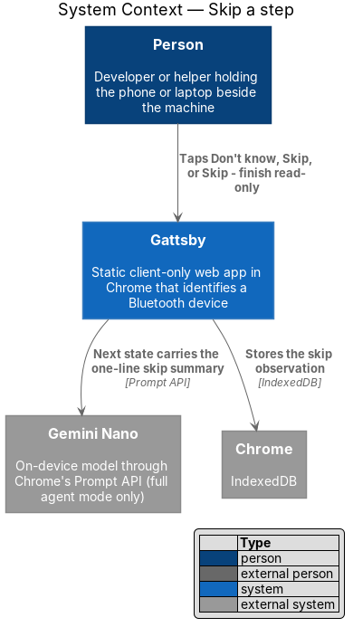
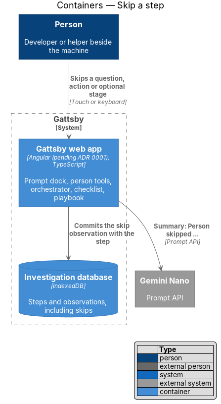
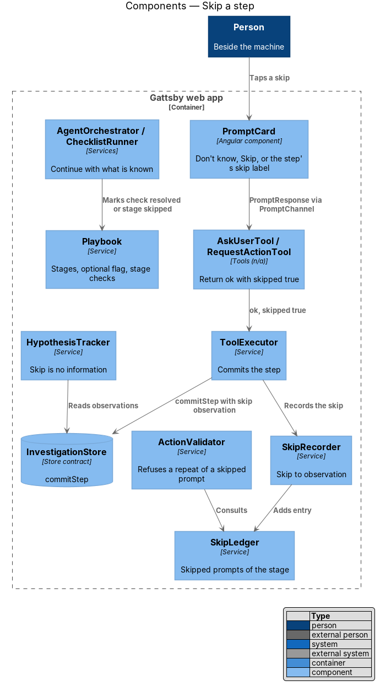
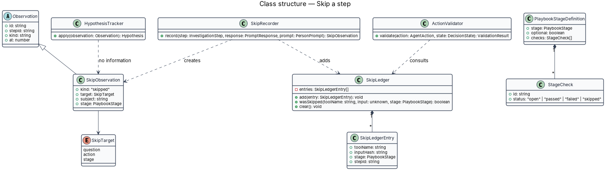
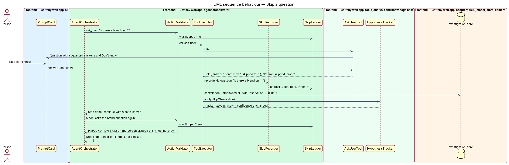
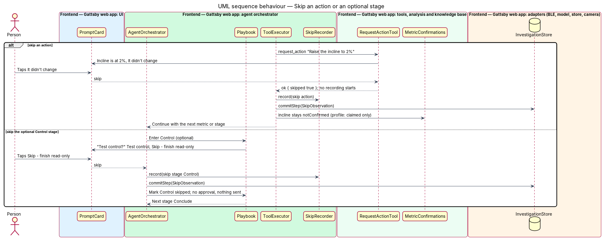

# Skip a step

## Overview

The person beside the machine will not always know the answer, be able to do the action, or want an
optional part of the investigation. The brand may be worn off the console, the incline may be locked,
and a store may not allow a control test. None of these should block the investigation. This feature
lets the person skip any question, any physical action and any optional stage, records each skip as
an observation, and lets the agent (or the checklist) continue with what it has. It belongs to the
person-interaction subsystem and applies at every playbook stage.

**skip** — the person's choice not to answer a question, not to do an action, or not to run an
optional stage, recorded as an observation

**optional stage** — playbook stage the investigation can finish without; at MVP the Control stage
(the brief's playbook step 6, "Control (optional, with approval)")

**skip observation** — observation of kind `skipped` that names what was skipped (the question, the
action or the stage), the step and the time

**skip ledger** — record of the prompts the person skipped in the current stage, used to refuse the
same prompt again

The mocks show one way to skip each kind of step. A question offers "Don't know"
(`docs/mocks/pages/investigation/prepare.html`), which the agent's opening message invites the person
to use: "answer 'Don't know' to any you're not sure about" (`docs/mocks/pages/investigation/default.html`).
An action offers "Skip" (`docs/mocks/pages/investigation/proprietary.html`) or a step-specific skip,
"It didn't change" (`docs/mocks/pages/investigation/default.html`). The Control stage opens with
"Test control?" and "Skip — finish read-only" (`docs/mocks/pages/investigation/control.html`). A
stage the playbook passes over shows as *skipped* in the stage track ("Proprietary path: skipped");
that is the playbook's branch, not the person's skip, and creates no skip observation.

## Description

The design introduces these building blocks in the Angular (pending ADR 0001) workspace under
`frontend/src/app/`:

- **`PromptCard`** (`ui/prompt-card/prompt-card.component.ts`) — every `question` and `action` prompt
  carries a skip: "Don't know" on a question (see [ask a question](../ask-a-question/README.md)),
  "Skip" or the step's skip label on an action (see
  [request a physical action](../request-a-physical-action/README.md)). Each emits a
  `PromptResponse` with `outcome: 'skip'` (for "Don't know", `outcome: 'answer'` with
  `skipped: true`).
- **`AskUserTool`** and **`RequestActionTool`** (`tools/person/`) — return `ok: true` with
  `skipped: true` and a summary that names the skip ("Person skipped: Is there a brand on it?"). A
  skip is a normal result, not an error, so the step does not count as a failure.
- **Stage skip** — the Control stage's opening prompt is an `action` prompt whose "Done" reads
  "Test control" and whose skip reads "Skip — finish read-only". `Playbook`
  (`agent/playbook.ts`) marks each `PlaybookStage` `optional`; `AgentOrchestrator` and
  `ChecklistRunner` treat a skip on an optional stage's opening prompt as the end of that stage and
  move to the next one. The stage track shows it as *skipped*. Skipping a stage in the middle, after
  its first command, is `<TO SUPPLY>`; no mock draws it.
- **`SkipRecorder`** (`agent/skip-recorder.ts`) — turns each skip into a skip observation and adds it
  to the step that `InvestigationStore.commitStep` commits, so it appears in the evidence log and the
  export like any other observation (FR-056).
- **`SkipLedger`** (`agent/skip-ledger.ts`) — holds the tool name and input of each skipped prompt
  for the current stage. `ActionValidator` consults it and refuses the same prompt again in the same
  stage with `PRECONDITION_FAILED` ("The person skipped this"). The ledger empties at each stage
  change. This keeps a model from asking the same question until the person answers.
- **`HypothesisTracker`** (`outcome/hypothesis-tracker.ts`) — reads a skip observation as "no
  information". A skipped brand question leaves the hypothesis's maker unknown (FR-052 AC1). Other
  evidence, such as Device Information or a vendor signature, can still set it later (see
  [track the hypothesis](../../outcome/track-the-hypothesis/README.md)).

### Rules

1. Every question and every action offers a skip, and the optional stage offers one at its start. A
   skip is one tap and needs no confirmation.
2. A skip is recorded as an observation with the step, the prompt and the time. It never deletes or
   changes an earlier observation.
3. The investigation is never blocked by a skip. A stage check that a skipped prompt would have
   answered counts as resolved by the skip; the stage moves on with what it has.
4. A skipped confirmation action leaves its metric *not confirmed*, so the profile lists it as
   *claimed only* (see [confirm with an action](../../standard-protocols/confirm-with-an-action/README.md)).
5. A skipped Control stage sends nothing to the device and asks for no approval; the profile's
   controllable features stay *claimed only*.
6. The same prompt is not shown again in the same stage after a skip. Repeated refusals count
   towards the no-progress stop (FR-045 AC3), so a model that keeps asking ends the loop.
7. Each skip adds one new observation, so it counts once as progress for FR-045's no-progress rule.
   Because the ledger refuses the same prompt again, a skip cannot be repeated to keep the loop
   alive.
8. A skip is not a refusal of a command: "Don't send" on an approval is `APPROVAL_DENIED` (see
   [approve a command](../../device-control/approve-a-command/README.md)), and closing Chrome's device
   chooser is `USER_CANCELLED` (see
   [handle a device not found](../../discovery/handle-a-device-not-found/README.md)).

### Data shapes

| Type | Fields |
|---|---|
| `SkipObservation` (an `Observation` of kind `skipped`) | `id`, `stepId`, `kind`, `target` (`question` \| `action` \| `stage`), `subject` (the question, the instruction or the stage), `stage`, `at` |
| `SkipLedgerEntry` | `toolName`, `inputHash`, `stage`, `stepId` |

### Errors

| Code | Raised by | Meaning to the person |
|---|---|---|
| `PRECONDITION_FAILED` | `ActionValidator` with `SkipLedger` | None; the model sees "The person skipped this" in its next state and nothing is shown again. |

### Tests that prove it

The acceptance specs use the fake `LanguageModel` (`e2e/fixtures/fake-language-model.ts`), scripted
to ask the brand question and then to ask it again, the fake `navigator.bluetooth`
(`e2e/fixtures/fake-bluetooth.ts`) with the FTMS treadmill, and the `InvestigationPage` and
`VerdictPage` page objects.

- FR-052 AC1: the spec taps "Don't know" on "Is there a brand on it?"; it checks that the next prompt
  is not the brand question, that the hypothesis shows no maker, and that the investigation reaches
  a verdict. The evidence log holds the skip.
- The spec taps "Skip — finish read-only" at "Test control?" and checks that no write was recorded,
  the stage track reads "Control: skipped", and the verdict is reached. The same spec runs in
  checklist mode.

Unit tests cover `SkipLedger` (refuse within the stage, allow after a stage change) and the stage
check that treats a skipped item as resolved.

## Requirements

The feature realizes the following level-2 (L2) requirement; it refines the level-1 (L1)
requirement cited beside it.

| L2 ID | Refines (L1) | Requirement |
|-------|--------------|-------------|
| [`FR-052`](../../../specs/L2.md#fr-052-let-the-person-skip-a-step) | `L1-011` | The person must be able to skip any question, action or optional stage. A skip is recorded as an observation, and the agent continues with what it has. |

## Diagrams

### System context

The person skips in Gattsby; nothing about a skip reaches the device, and in full agent mode Gemini
Nano sees the skip only as a one-line result.

### Containers

The web app records each skip as an observation in the investigation database and continues.

### Components

`PromptCard` emits the skip; the person tools return it as a normal result; `SkipRecorder` writes
the observation, `SkipLedger` stops the same prompt coming back, and the orchestrator or the
checklist moves on.

### Class structure

A `SkipObservation` is an `Observation`; `SkipRecorder` creates it, `SkipLedger` keeps the skipped
prompts of the stage, and `ActionValidator` and `Playbook` consult them.

### Behaviour — skip a question

The person taps "Don't know" on the brand question; the skip is recorded, the maker stays unknown,
and a repeat of the same question is refused.

### Behaviour — skip an action or an optional stage

A skipped action leaves its metric not confirmed; a skipped Control stage ends the stage without a
command, and the playbook moves to Conclude.

