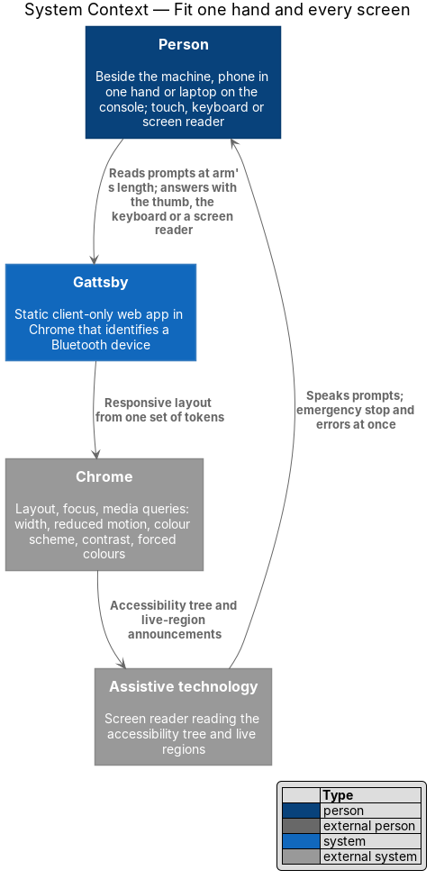
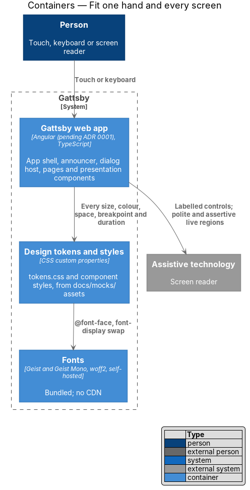
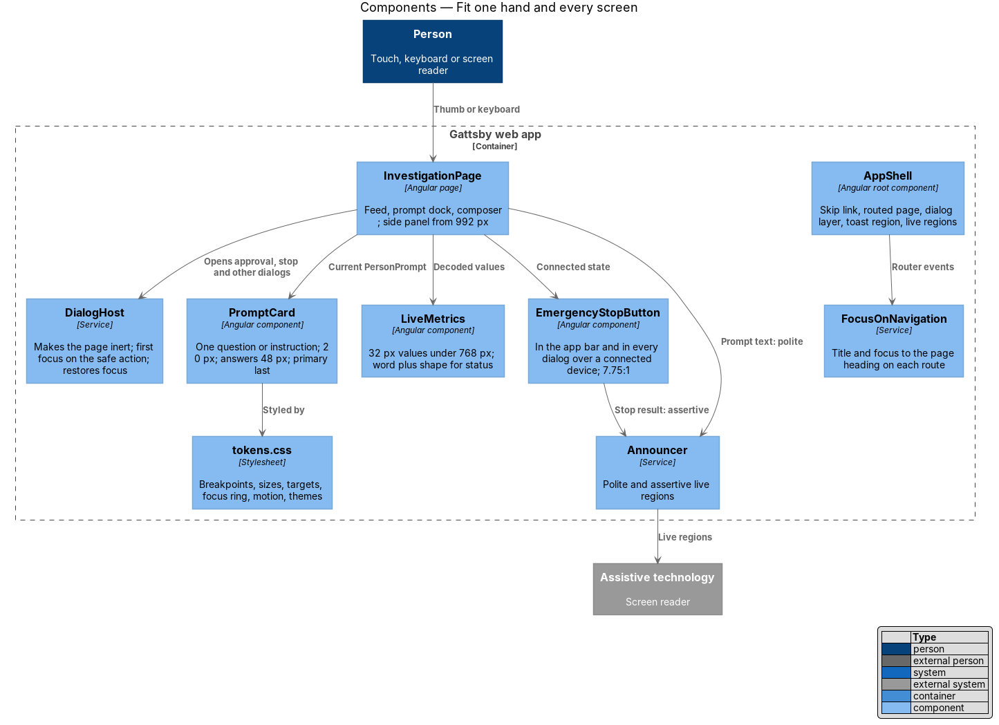
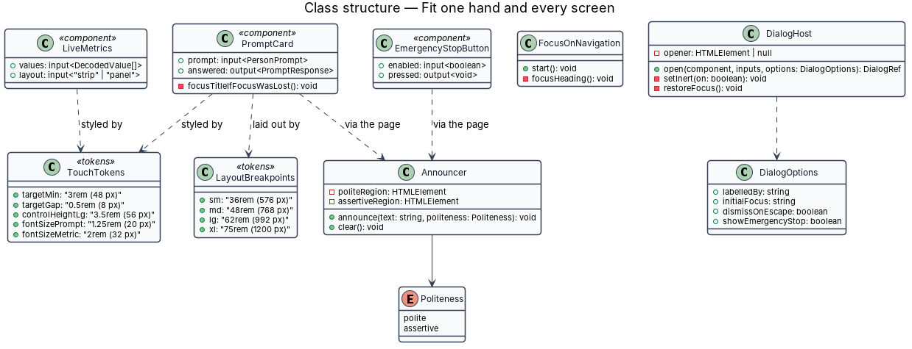
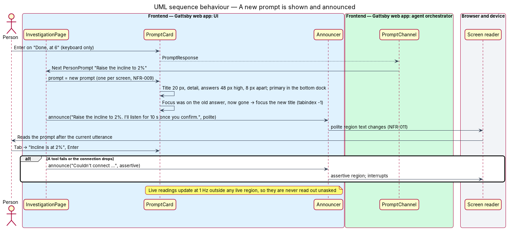
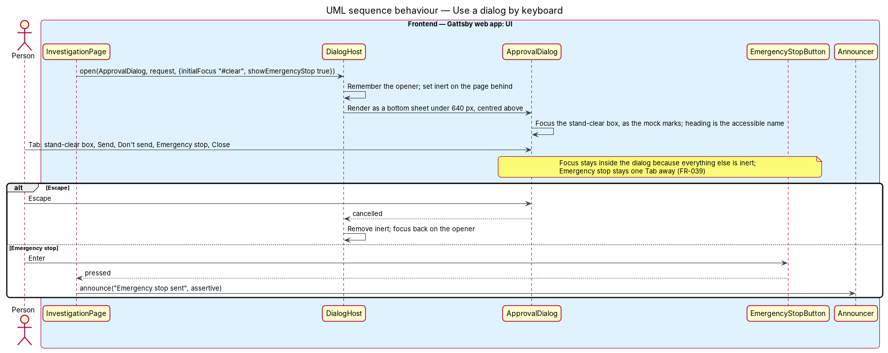

# Fit one hand and every screen

## Overview

The person using Gattsby is standing beside a treadmill or a spin bike, often holding the phone in
one hand while the other is on the machine, in bright store light, sometimes with a keyboard on a
laptop instead and sometimes with a screen reader. This feature sets the rules every screen follows
so that it can be read at arm's length, used with one thumb or a keyboard alone, laid out on any
width from a small phone to a wide laptop, and meet WCAG 2.2 AA. It belongs to the platform
subsystem; it has no screen of its own and shapes all of them.

**arm's-length reading** — reading a prompt or a live value with the phone held at the end of a
straight arm: prompt text at least 20 px and live metric values at least 32 px under 768 px wide

**thumb zone** — bottom third of the screen on a phone, where the primary action sits

**touch target** — area that answers a tap: at least 48 × 48 px, with at least 8 px between targets

**live region** — element whose text changes are read out by a screen reader without moving focus:
polite (after the current utterance) or assertive (at once)

**breakpoint** — viewport width at which the layout changes: small 576 px, medium 768 px, large
992 px and extra large 1200 px, below small being extra small

The mocks are the reference for every size, colour and layout here. `docs/mocks/assets/tokens.css`
holds the design tokens and `docs/mocks/assets/ui.css` the component styles; `docs/mocks/README.md`
lists the departures made for these requirements (48 px targets, 20 px prompts, 32 px values, the
emergency-stop red `#A11D1D`, the side panel from 992 px). The investigation page shows the layouts
best: `docs/mocks/pages/investigation/default.html` puts the feed, the prompt dock and the composer
in one column with the emergency stop in the app bar, and from 992 px puts the prompt and live
readings beside the feed. The mocks are checked at 360, 768, 992 and 1280 px.

## Description

The design introduces these building blocks in the Angular (pending ADR 0001) workspace under
`frontend/src/`:

- **`styles/tokens.css`** — `docs/mocks/assets/tokens.css` carried over unchanged until the
  `extracting-design-systems` skill produces `docs/design-system/`, which then becomes its source.
  It defines the breakpoints (`--layout-breakpoint-sm` 36rem to `--layout-breakpoint-xl` 75rem), the
  grid (4, 8 and 12 columns), `--font-size-prompt` (1.25rem, 20 px), `--font-size-metric` (2rem,
  32 px), `--target-min` (3rem, 48 px), `--target-gap` (0.5rem, 8 px), `--control-height-lg` (3.5rem,
  56 px), the focus ring, the light (paper) and dark (ink) themes, and the `prefers-reduced-motion`,
  `prefers-contrast` and `forced-colors` overrides. All sizes are in `rem`, so text zoom scales the
  whole layout.
- **Component styles** — each presentation component carries its part of `ui.css` in its own
  stylesheet and consumes only semantic tokens (`--color-*`, `--space-*`, `--text-*`), never
  primitives or raw values. Layout changes are CSS media queries on the breakpoints; no component
  measures the window in script.
- **`AppShell`** (`app/app.ts`) — the root component. It renders the skip link ("Skip to content"),
  the routed page, the dialog layer, the toast region and the two live regions, in that order, so
  that only the routed page is made inert when a dialog opens.
- **`Announcer`** (`app/ui/a11y/announcer.ts`) — owns two visually hidden regions created empty at
  start: `role="status"` with `aria-live="polite"` and `role="alert"` with `aria-live="assertive"`.
  `announce(text, politeness)` clears the region, then writes the text on the next frame, so a
  repeated message is read again. Prompts are polite; emergency stop and errors are assertive
  (NFR-011).
- **`FocusOnNavigation`** (`app/ui/a11y/focus-on-navigation.ts`) — after each route change it sets
  the document title and moves focus to the page's `h1` (`tabindex="-1"`), so a keyboard or screen
  reader user starts at the top of the new page.
- **`DialogHost`** (`app/ui/dialog-host/dialog-host.ts`) — opens every dialog. It remembers the
  opener, sets `inert` on the routed page, renders the dialog as a bottom sheet on narrow screens and
  centred from 40rem, focuses the element the mock marks first (Cancel in delete dialogs, the
  stand-clear box in the approval dialog, the text field in delete all data), closes on Escape when
  the dialog allows it, and returns focus to the opener. Over a connected investigation the dialog's
  own toolbar carries the `EmergencyStopButton`, so it stays one tap away while the page behind is
  inert (FR-039).
- **`PromptCard`** (`app/ui/prompt-card/prompt-card.ts`) — presentation component for one
  `PersonPrompt`: the title at `--text-prompt` (20 px), the detail, and the answers as buttons at
  least 48 px high, 8 px apart, primary first in reading order and filling the row on phones. When a
  new prompt replaces one whose answer had focus, it moves focus to the new title, so the next Tab
  reaches the answers.
- **`LiveMetrics`** (`app/ui/live-metrics/live-metrics.ts`) — values at `--text-metric` (32 px) in
  the phone strip, each with its status as a word or a symbol (`~` likely, `?` not labelled, with a
  visually hidden word), never colour alone. From 992 px the same values move to the side panel's
  list.
- **`EmergencyStopButton`** (`app/ui/emergency-stop-button/emergency-stop-button.ts`) — white on
  `--color-danger-solid` `#A11D1D` (7.75:1). Under 768 px its visible label shortens to "Stop" while
  its accessible name stays "Emergency stop".

### Layout by width

| Width | Columns, gutter, margin | Investigation page | Other pages and dialogs |
|---|---|---|---|
| Under 576 px (extra small) and 576–767 px (small) | 4, 16 px, 20 px | One column at the full viewport height: app bar with Back, title, Options and Stop; stage track; hypothesis strip; the feed scrolls; the prompt dock with live readings, then the composer, pinned at the bottom. Pause moves into the options sheet. | One column; dialogs are bottom sheets below 640 px with the primary action last, nearest the thumb; toasts at the bottom. |
| 768–991 px (medium) | 8, 24 px, 32 px | Still one column; the emergency stop shows its full label; prompt answers size to their text. | Dialogs centred; reading pages capped at 42rem. |
| 992 px and wider (large, extra large) | 12, 32 px, 32 px | Feed on the left; prompt and composer beside it with the side panel (22rem: hypothesis, live readings, device). The hypothesis strip and the phone live strip are hidden. | Content capped at 64rem. |

The emergency stop sits in the app bar outside the scrolling feed, so it stays visible however far
the person scrolls (NFR-010 AC2). Nothing is wider than its container: long UUIDs, hex and device
names wrap (`overflow-wrap: anywhere`), and wide tables scroll inside their own frame, so the page
never scrolls sideways (NFR-010 AC1).

### Rules

1. Under 768 px, prompt titles are at least 20 px and live metric values at least 32 px; every touch
   target is at least 48 × 48 px with 8 px between targets; the primary action sits in the bottom
   third (NFR-009).
2. One question or instruction per screen: the dock shows exactly one `PersonPrompt` at a time
   (FR-050, FR-051).
3. Every screen works at 360, 576, 768, 992 and 1280 px, portrait and landscape, with no horizontal
   scroll (NFR-010). The viewport meta is `width=device-width, initial-scale=1` with no zoom limit.
4. Every control is a native `button`, `a`, `input` or `label`, reachable by Tab in reading order,
   with a visible 2 px focus ring (`--color-focus-ring`, 5.47:1 on the light surface). No action
   needs a pointer, a gesture or a hover (NFR-011).
5. Prompts are announced through the polite region; emergency stop and errors through the assertive
   one. Live readings sit outside both, so values that change every second are not read out.
6. State is never carried by colour alone: confidence is a word plus a shape (filled confirmed, half
   likely, ring guess, dashed claimed only), stages carry their name in text, and verdicts are words.
7. Motion respects `prefers-reduced-motion`: durations drop to 0.01 ms, the live dot stops pulsing
   and skeletons stop shimmering.
8. Prompt titles and the emergency stop reach at least 7:1: ink on paper is 17.2:1, paper on ink
   14.75:1, and white on `#A11D1D` 7.75:1.
9. Fonts are the bundled Geist and Geist Mono, never from a CDN.

### Conflicts with the mocks

These are reported, not resolved here:

- The prompt dock in `pages/investigation/default.html` is itself `aria-live="polite"` and contains
  the live readings, which change at 1 Hz; a screen reader would read them continuously. This
  design announces through `Announcer` instead and keeps the dock out of any live region.
- The composer's icon buttons are 44 px (`.composer .btn--icon { width: 2.75rem }` in `ui.css`),
  under the 48 px minimum.
- The prompt detail (`.prompt__detail`) is 14 px in `--color-fg-muted` (5.6:1). This design reads
  NFR-009's "prompt text" and NFR-011's 7:1 as the prompt title, the question or instruction itself;
  whether the detail line is held to the same bar is `<TO SUPPLY>`.
- The composer's "Speak" button needs the microphone, which the `Permissions-Policy` of NFR-014 does
  not allow, and Chrome's speech recognition may send audio to a server, against NFR-012. No
  requirement asks for speech input.
- The mocks are checked at 360, 768, 992 and 1280 px; NFR-010 also names 576 px. Dialogs switch to
  centred at 40rem (640 px) and the kit's sidebar and top-bar menu at 64rem (1024 px), widths that
  are not NFR-010 breakpoints.
- No mock shows a phone in landscape (for example 844 × 390), where the fixed-height investigation
  page leaves little room for the feed; that layout is `<TO SUPPLY>`.
- The current-stage segment in signal orange reaches 2.76:1, under 3:1 for non-text contrast; the
  stage name beside it in text keeps the state readable (`docs/mocks/README.md`, open question 3).

### Tests that prove it

Two behaviour specs run by default. One runs the simulated FTMS treadmill
(`e2e/fixtures/fake-bluetooth.ts`) with the fake `LanguageModel` (`e2e/fixtures/fake-language-model.ts`)
from the home screen to the verdict using only `page.keyboard` through the page objects (NFR-011
AC2). The other checks that each new prompt's text appears in the polite live region (NFR-011 AC3).

Three sweeps are written and kept current but run only when a person asks (AGENTS.md). The
responsive sweep opens every screen in every state at 360, 576, 768, 992 and 1280 px, portrait and
landscape, and checks that the document is no wider than the viewport and that no element is
clipped; that the emergency stop stays visible after scrolling under 768 px with a device connected;
and that from 992 px the prompt and the feed are side by side (NFR-010). The one-hand sweep at
390 × 844 checks each prompt's computed title size (at least 20 px), each answer's box (at least
48 × 48 px, 8 px apart) and that the primary answer's top lies below two thirds of the viewport
height (NFR-009 AC1). The accessibility sweep runs axe (bundled with the test dependencies) with the
WCAG 2.2 AA rules on every screen and state, in both themes, and the enhanced-contrast rule on the
prompt title and the emergency stop (NFR-011 AC1).

## Requirements

The feature realizes the following level-2 (L2) requirements; each refines the level-1 (L1)
requirement cited beside it.

| L2 ID | Refines (L1) | Requirement |
|-------|--------------|-------------|
| [`NFR-009`](../../../specs/L2.md#nfr-009-usable-one-handed-at-arms-length) | `L1-021` | Every prompt must be readable at arm's length and usable one-handed: prompt text at least 20 px and live metric values at least 32 px on viewports under 768 px wide; touch targets at least 48 × 48 px with at least 8 px between them; the primary action within the bottom third of the screen on viewports under 768 px wide; one question or instruction per screen. |
| [`NFR-010`](../../../specs/L2.md#nfr-010-responsive-across-all-viewports) | `L1-021` | Every screen must work at extra small (<576 px), small (≥576 px), medium (≥768 px), large (≥992 px) and extra large (≥1200 px) widths, in portrait and landscape, with no horizontal scroll. Under 768 px: one column, the emergency stop pinned at the top, the primary action pinned at the bottom. From 992 px: the prompt and live metrics beside the activity feed. |
| [`NFR-011`](../../../specs/L2.md#nfr-011-accessible-to-wcag-22-aa) | `L1-021` | Every screen must meet WCAG 2.2 AA: keyboard operable with a visible focus, labelled controls, prompts announced to screen readers through a polite live region (emergency stop and errors through an assertive one), colour never the only carrier of a state, and motion respecting `prefers-reduced-motion`. Prompt text and the emergency stop must reach a contrast of at least 7:1 for reading in bright store light. |

## Diagrams

### System context

The person reads and answers Gattsby by touch, keyboard or screen reader; Chrome lays it out from
the tokens and passes live-region announcements to the assistive technology.

### Containers

The web app takes every size, colour, breakpoint and duration from the design tokens and the
self-hosted fonts, and exposes labelled controls and live regions.

### Components

`AppShell` hosts the live regions and the dialog layer; `InvestigationPage` composes `PromptCard`,
`LiveMetrics` and `EmergencyStopButton`, announces through `Announcer` and opens dialogs through
`DialogHost`.

### Class structure

`Announcer` writes to a polite or an assertive region; `DialogHost` opens a dialog with its
`DialogOptions`; the presentation components are styled by the breakpoint and touch tokens.

### Behaviour — a new prompt is shown and announced

After a keyboard answer the next prompt replaces the old one, takes focus on its title and is
announced politely; an error interrupts through the assertive region; live readings are never read
out.

### Behaviour — use a dialog by keyboard

The dialog host makes the page inert and focuses the element the mock marks; Tab stays inside the
dialog with the emergency stop one Tab away; Escape returns focus to the opener.

