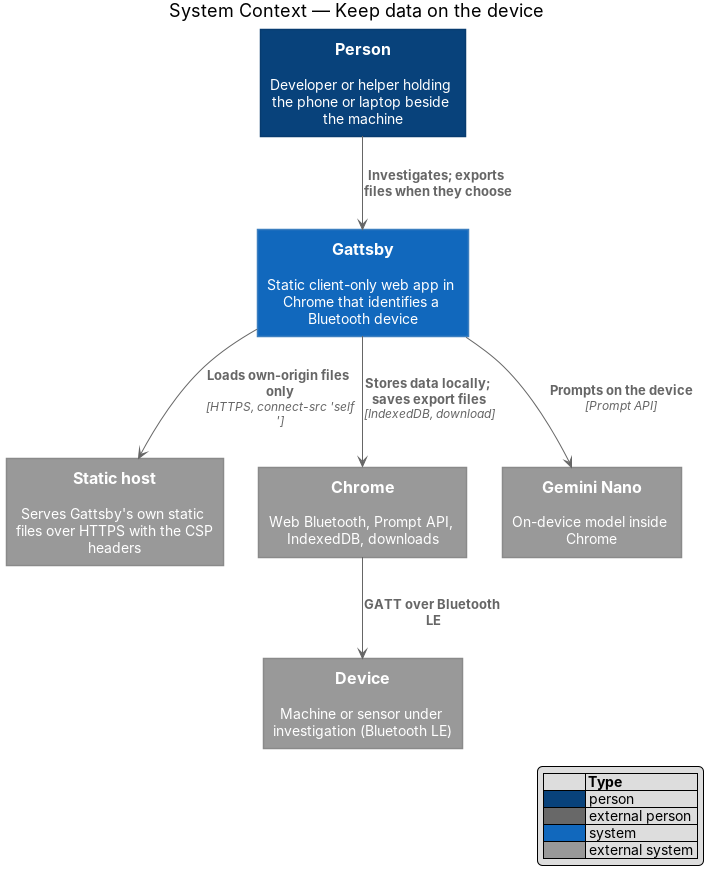
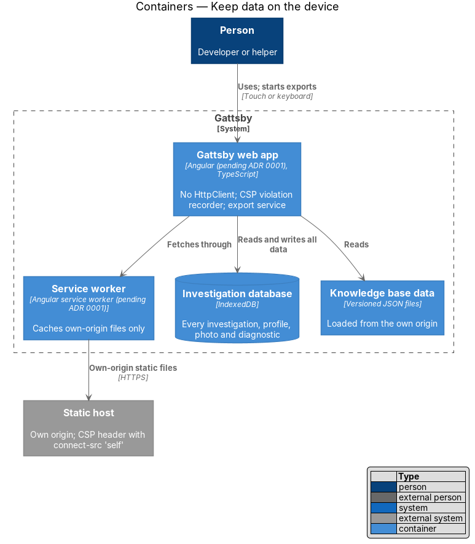
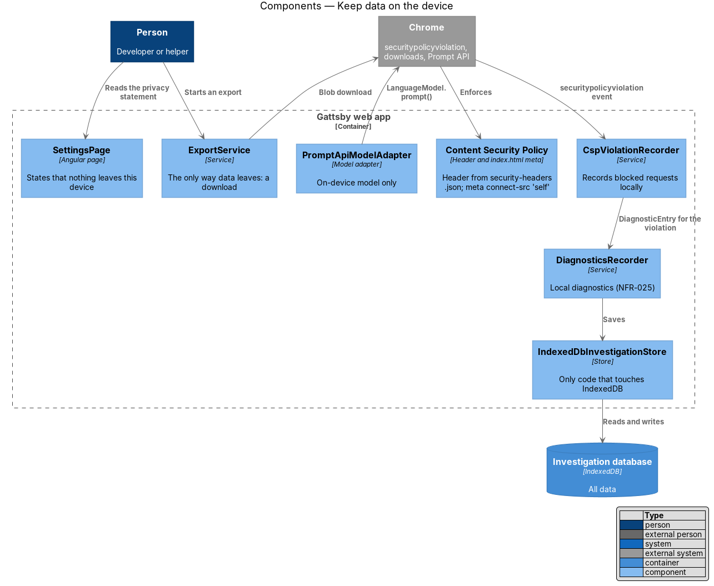
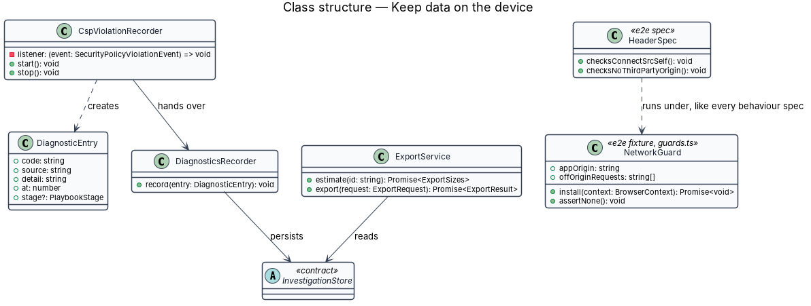
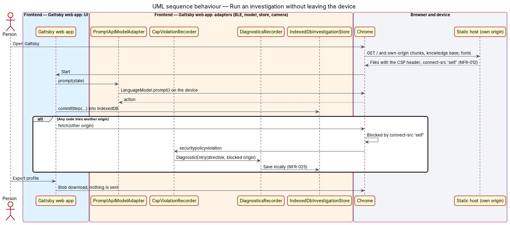
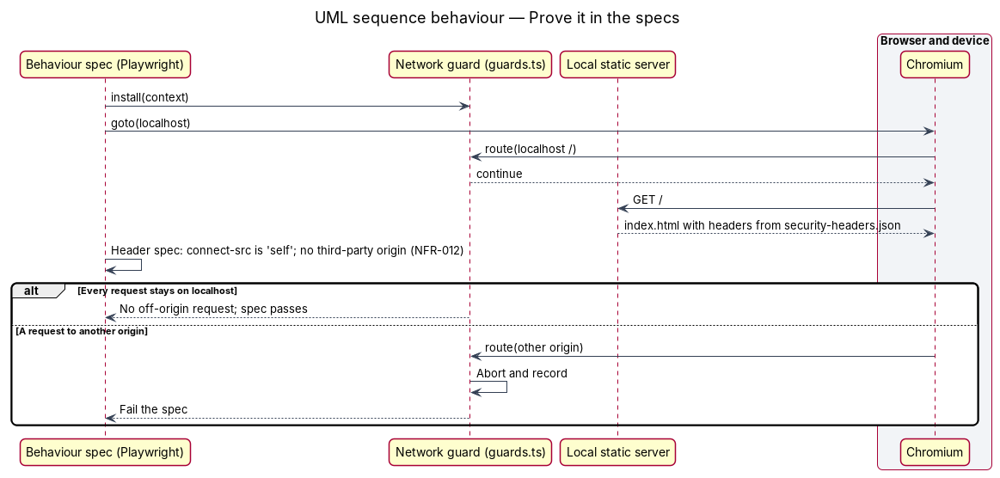

# Keep data on the device

## Overview

Gattsby records what a person did with a machine in a store: device names, serial numbers, raw
Bluetooth traffic, answers, photos and a location label. None of it leaves the browser. This feature
is the set of decisions that makes that true at run time and the checks that prove it: the app
fetches only its own static files from its own origin, has no analytics, telemetry, error reporting,
CDN, web font service or remote model, and declares `connect-src 'self'` in its Content Security
Policy so the browser blocks any other request. It belongs to the platform subsystem and spans every
part of the app.

**own origin** — scheme, host and port the app was loaded from; the only origin it may request

**run time** — period from the first request for the app's HTML until the tab closes, including
requests the service worker makes

**third-party request** — any request from the page or its service worker to an origin other than its
own

**network guard** — Playwright fixture that fails a behaviour spec on any third-party request

The promise appears in the UI in three places, and the design keeps each true. Home
(`docs/mocks/pages/home/default.html`): "Everything runs on this device. Nothing is sent to a
server." Settings (`docs/mocks/pages/settings/default.html`): "Nothing leaves this device: no
accounts, no analytics, no server. Exporting is the only way data leaves, and only when you start
it." Export (`docs/mocks/dialogs/export/default.html`): "Saved as a file on this device. Nothing is
sent anywhere."

Two downloads happen outside the page and are not requests the page makes. Chrome downloads Gemini
Nano itself when the person accepts the readiness page's offer
(`docs/mocks/pages/readiness/downloadable.html`); the page calls `LanguageModel.create()` and never
fetches model files. Chrome's own update and safe-browsing traffic belongs to the browser, not to
Gattsby.

## Description

The design introduces or constrains these building blocks in the Angular (pending ADR 0001)
workspace under `frontend/src/app/` and its build:

- **Response headers** — the static host serves a Content Security Policy whose `connect-src` is
  `'self'` and whose other directives name no third-party origin. The full header set (HSTS,
  `default-src 'self'`, `object-src 'none'`, `frame-ancestors 'none'`, `Referrer-Policy:
  no-referrer`, `Permissions-Policy`) belongs to NFR-014 and is designed in the
  [load-fast-and-work-offline design](../load-fast-and-work-offline/README.md). Their one source is
  `frontend/deploy/security-headers.json`, from which the host configuration is generated.
- **`index.html` CSP meta** (`frontend/src/index.html`) — repeats `connect-src 'self'` alone as a
  `<meta http-equiv="Content-Security-Policy">`, so the block on requests holds even on a host that
  drops the header. Both policies apply, so the meta names only `connect-src` and narrows nothing
  else. A meta policy cannot carry `frame-ancestors`, so the header stays the primary policy.
- **No HTTP client** — the app does not provide Angular's `HttpClient`, because nothing in the app
  calls an API. Lazy route chunks, the knowledge base's JSON files and the service worker's cache
  load from the own origin.
- **Self-hosted fonts and icons** (`frontend/src/assets/fonts/`, `frontend/src/assets/icons/`) — no
  web font service and no icon CDN; the mocks already bundle their fonts (`docs/mocks/assets/fonts/`).
- **No third-party scripts** — no analytics, tag manager, error reporting or feature-flag SDK is a
  dependency. Errors are recorded in the investigation record and shown to the person (NFR-025; see
  the [record-local-diagnostics design](../record-local-diagnostics/README.md)).
- **`CspViolationRecorder`** (`diagnostics/csp-violation-recorder.ts`) — listens for the document's
  `securitypolicyviolation` event and hands each blocked request's directive and blocked origin to
  `DiagnosticsRecorder` as a `DiagnosticEntry` (see the
  [record-local-diagnostics design](../record-local-diagnostics/README.md)). Nothing is reported
  remotely; the policy has no `report-uri` or `report-to`. It removes its listener when the app is
  destroyed.
- **On-device model only** — `PromptApiModelAdapter` uses Chrome's `LanguageModel`; there is no remote
  model call. Photos go only to that model (NFR-017).
- **Service worker** — caches and serves own-origin files only; it has no push, background sync or
  third-party fetch (see the load-fast-and-work-offline design).
- **`ExportService`** (`store/export.service.ts`) — the only way data leaves: a `Blob` handed to the
  browser as a download on the person's tap, with the object URL revoked afterwards. A download is
  not a network request.
- **Network guard** (in `e2e/fixtures/guards.ts`) — routes every request in a Playwright browser
  context, lets requests to the app's own origin through, and fails the spec on any other request or
  WebSocket. Every behaviour spec uses it through the shared `test` fixture (see the
  [test-without-hardware-or-a-model design](../test-without-hardware-or-a-model/README.md)).
- **Header spec** (`e2e/specs/platform/keep-data-on-the-device.spec.ts`) — loads `/` from the local
  static server, which serves the production build with the headers from `security-headers.json`, and
  checks that `connect-src` is
  `'self'` and that no directive names a third-party origin.

### Rules

1. At run time the page and its service worker request only own-origin static files.
2. The Content Security Policy's `connect-src` is `'self'`, and no directive names another origin.
3. No dependency shall send data anywhere: no analytics, telemetry, error reporting, CDN, web font
   service or remote model.
4. Export is the only way data leaves, and the person starts it.
5. A later feature that needs another origin, such as sharing (FR-075) or a backend (`OQ-05`), changes
   NFR-012 first, then this design, then the policy; see the
   [share-profiles-publicly design](../../later-phases/share-profiles-publicly/README.md).
6. A later in-browser model serves its weights from the own origin (see the
   [run-a-model-on-phones design](../../later-phases/run-a-model-on-phones/README.md)).

### Data shapes

| Type | Fields |
|---|---|
| `DiagnosticEntry` for a violation | `code` (`<TO SUPPLY>`; no shared code names a blocked request), `source` (`csp`), `detail` (directive and blocked origin), `at`, `stage?` |
| Content Security Policy (header) | `default-src 'self'`, `connect-src 'self'`, and the NFR-014 directives |

### Errors

A blocked request is not shown to the person as an error: the feature that made it fails with its
own code, and the violation is recorded locally. A blocked request in a behaviour spec is a failed
spec.

### Tests that prove it

The network guard runs in every behaviour spec and fails it on any request to an origin other than
the app's, which is NFR-012's first acceptance criterion. The header spec checks the served policy on
localhost. After each deploy, `HeaderCheck` (`frontend/scripts/check-headers.mjs`, from the
load-fast-and-work-offline design) compares the live headers with `security-headers.json`, which
covers NFR-012's second acceptance criterion on the deployed app. A unit test covers
`CspViolationRecorder` handing a violation to `DiagnosticsRecorder`.

## Requirements

The feature realizes the following level-2 (L2) requirement; it refines the level-1 (L1) requirement
cited beside it.

| L2 ID | Refines (L1) | Requirement |
|-------|--------------|-------------|
| [`NFR-012`](../../../specs/L2.md#nfr-012-no-data-leaves-the-device) | `L1-018` | At run time Gattsby must make no network request except for its own static files from its own origin. There must be no analytics, telemetry, error reporting service, CDN, web font service or remote model call. The Content Security Policy's `connect-src` must be `'self'`. |

## Diagrams

### System context

Gattsby's only network peer is the static host it was loaded from; Gemini Nano runs inside Chrome on
the device, and the device is reached over Bluetooth.

### Containers

The web app and its service worker fetch own-origin files from the static host; all investigation
data stays in IndexedDB on the device, and export hands a file to the person.

### Components

The Content Security Policy bounds every component; `CspViolationRecorder` records any blocked
request locally, and `ExportService` is the only path for data to leave.

### Class structure

`CspViolationRecorder` turns a `SecurityPolicyViolationEvent` into a `DiagnosticEntry` for
`DiagnosticsRecorder`; the network guard and the header spec are test fixtures beside the app.

### Behaviour — run an investigation without leaving the device

The app loads its own files, runs the model on the device, stores data in IndexedDB, and a stray
request to another origin is blocked by the policy and recorded locally.

### Behaviour — prove it in the specs

The network guard fails a spec on any third-party request, and the header spec checks the served
policy.

