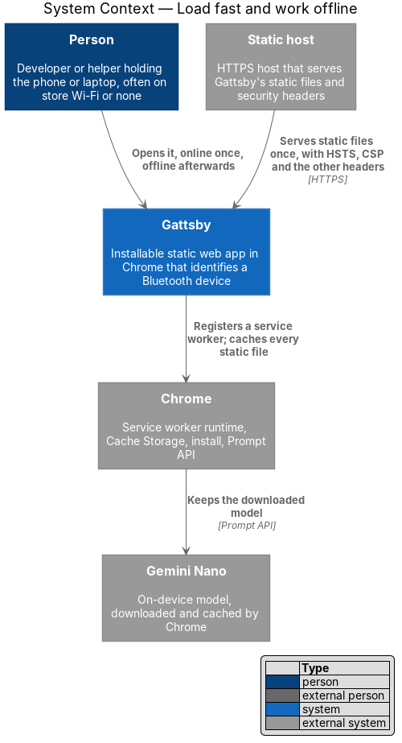
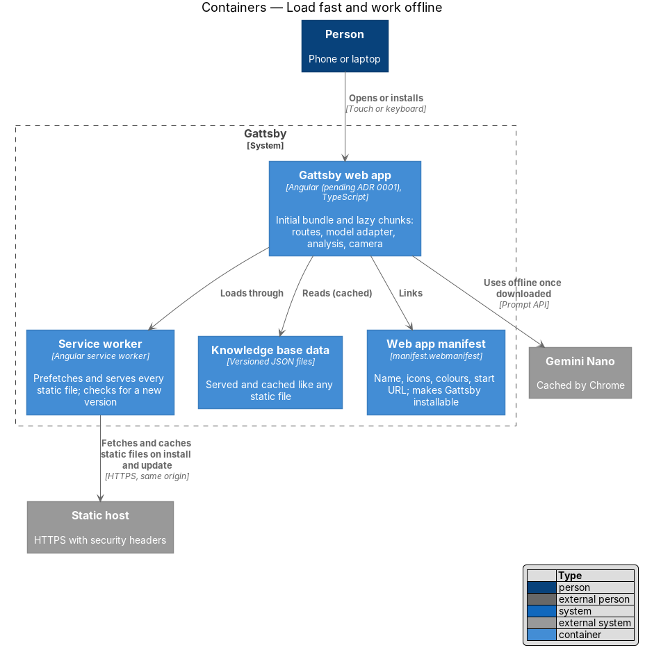
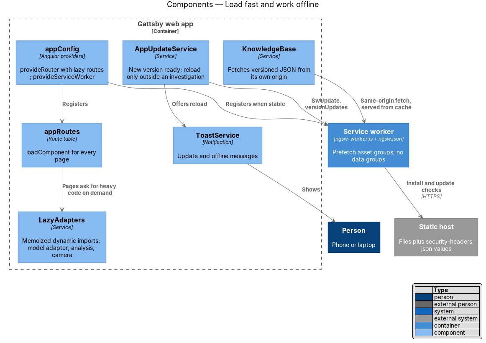
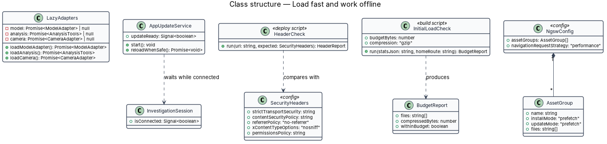
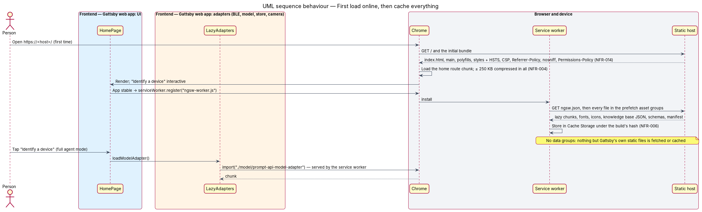
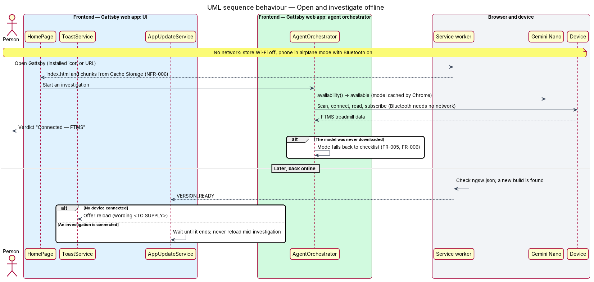
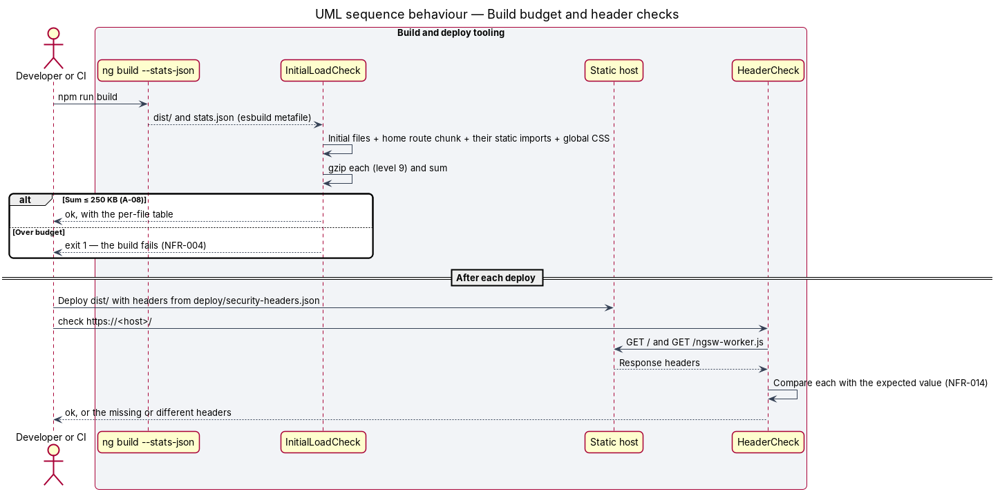

# Load fast and work offline

## Overview

Gattsby is opened on a phone or a laptop on a store floor or in a gym, where the network is slow,
captive or absent. This feature makes it open quickly the first time, open and run a full
investigation with no network afterwards, and come only from a host that serves it securely. It
belongs to the platform subsystem and touches no single screen: it shapes how every file is built,
served, cached and loaded.

**initial load** — files the browser downloads before the home screen is interactive: the
application's initial bundle, its global styles and the home route's chunk with the code it imports
statically

**lazy chunk** — JavaScript file loaded only when a route or a feature first needs it

**service worker** — script that Chrome runs beside the page and that answers the page's requests
for Gattsby's own files from a local cache

**installable progressive web app** — web app with a manifest and a service worker that Chrome can
add to the home screen or the app launcher and open without the network

**security headers** — HTTP response headers the static host sends with every file: HSTS, Content
Security Policy, `Referrer-Policy`, `X-Content-Type-Options` and `Permissions-Policy`

Nothing here has its own mock. The visible consequences are mocked elsewhere: the settings line
"Gemini Nano · ready · runs offline" (`docs/mocks/pages/settings/default.html`), the readiness check's
model and storage rows (`docs/mocks/pages/readiness/default.html`) and the home footer "Everything
runs on this device. Nothing is sent to a server." (`docs/mocks/pages/home/default.html`). The mocks
themselves open from disk with fonts and images bundled, as the app does.

## Description

The design introduces these building blocks in the Angular (pending ADR 0001) workspace under
`frontend/`:

- **`appRoutes`** (`src/app/app.routes.ts`) — every page route uses `loadComponent`, so each page is
  a lazy chunk. The initial bundle holds the app shell, the router, the capability adapters, the
  store contract and the emergency-stop wiring, and no page.
- **`LazyAdapters`** (`src/app/platform/lazy-adapters.ts`) — memoized dynamic imports for the heavy,
  optional code: `loadModelAdapter()` (the `PromptApiModelAdapter`), `loadAnalysis()` (the analysis
  helpers of the proprietary path) and `loadCamera()` (the `MediaDevicesCameraAdapter`). Each import
  runs at most once; callers get the same promise. When to call each is decided by the designs that
  use them (prepare-the-model, find-and-correlate-fields, read-a-photo).
- **`appConfig`** (`src/app/app.config.ts`) — `provideServiceWorker("ngsw-worker.js", { enabled:
  !isDevMode(), registrationStrategy: "registerWhenStable:30000" })`, so the service worker never
  competes with the first render.
- **`ngsw-config.json`** — two asset groups, `app` (index, JavaScript, CSS, manifest) and `assets`
  (fonts, icons, knowledge base JSON, format schemas), both `installMode: "prefetch"` and
  `updateMode: "prefetch"`. Every lazy chunk is prefetched, so a route never first opened online
  still opens offline. There are no data groups: Gattsby calls no API, and the service worker
  fetches only its own static files.
- **`manifest.webmanifest`** — name "Gattsby", `start_url` `/`, `display: "standalone"`, background
  paper `#F3F1EA`, theme ink `#15171B`, and icons drawn from the mark (`docs/assets/gattsby-mark.svg`);
  the icon PNGs at 192 px and 512 px, including a maskable one, are `<TO SUPPLY>`.
- **`AppUpdateService`** (`src/app/platform/app-update.service.ts`) — listens to
  `SwUpdate.versionUpdates`. On `VERSION_READY` it offers a reload through `ToastService`, but only
  while no device is connected (`InvestigationSession.isConnected`); a reload never cuts an
  investigation short. On `SwUpdate.unrecoverable` it offers the same reload. The toast's wording is
  not mocked and is `<TO SUPPLY>` in `docs/mocks/`.
- **`KnowledgeBase`** (`src/app/knowledge-base/knowledge-base.ts`, see the load-the-knowledge-base
  design) — whatever way it loads its versioned JSON, it loads it from Gattsby's own origin, and the
  service worker has it cached.
- **`InitialLoadCheck`** (`frontend/scripts/check-initial-load.mjs`) — runs after `ng build
  --stats-json` as part of `npm run build`. From the esbuild metafile it takes the initial outputs,
  the home route's chunk and every file those import statically, plus the global CSS; compresses
  each with gzip at level 9; and fails the build when the sum exceeds 250 KB (A-08). Fonts are left
  out: they load with `font-display: swap` and do not delay interactivity. Angular's own `budgets`
  measure uncompressed sizes, so they cannot carry NFR-004 alone.
- **`security-headers.json`** (`frontend/deploy/security-headers.json`) — the one source of the
  header values. The host configuration is generated from it, and the local static server that
  Playwright uses serves the same headers, so a Content Security Policy violation fails a spec as a
  page error long before a deploy.
- **`HeaderCheck`** (`frontend/scripts/check-headers.mjs`) — fetches `/` and `/ngsw-worker.js` from a
  deployed URL and compares every header with `security-headers.json` (NFR-014 AC1). It runs after
  each deploy; which pipeline runs it is `<TO SUPPLY>` with the host (A-04).

### Security headers

| Header | Value |
|---|---|
| `Strict-Transport-Security` | `max-age=<TO SUPPLY>; includeSubDomains` |
| `Content-Security-Policy` | `default-src 'self'; script-src 'self'; style-src 'self' 'unsafe-inline'; img-src 'self' blob:; font-src 'self'; connect-src 'self'; worker-src 'self'; manifest-src 'self'; object-src 'none'; base-uri 'self'; form-action 'none'; frame-ancestors 'none'` |
| `Referrer-Policy` | `no-referrer` |
| `X-Content-Type-Options` | `nosniff` |
| `Permissions-Policy` | `bluetooth=(self), camera=(self)`, every other policy-controlled feature the browser supports set to `()`, except the Prompt API's feature (see rule 5) |

The host redirects every `http:` request to `https:` and serves nothing over plain HTTP.

### Rules

1. The initial load stays within 250 KB compressed, and the build fails otherwise (NFR-004). The
   home screen is interactive within 2 seconds on a mid-range phone over a fast 4G connection; a
   person measures this with Lighthouse in Chrome, since CI keeps under 5 minutes and runs no
   timing checks. The device and throttling profile that stand for "mid-range phone" and "fast 4G"
   are `<TO SUPPLY>`, as is whether the host serves brotli (gzip is measured as the larger of the
   two).
2. Every page is a lazy route. The model adapter, the analysis tools and the camera adapter are
   dynamic imports through `LazyAdapters`, never static imports from a page or a service in the
   initial bundle.
3. After one load online, every static file is in the service worker's cache, so Gattsby opens and
   runs a full investigation with no network. Bluetooth needs no network; the model, once
   downloaded, is cached by Chrome. Without a downloaded model, Gattsby runs in checklist mode
   (FR-005, FR-006).
4. The Content Security Policy forbids inline and evaluated script, so the build turns off
   Angular's critical-CSS inlining (`optimization.styles.inlineCritical: false`, which writes an
   `onload` attribute), and no code compiles functions at run time (the format validators are
   compiled at build time, see the export-a-profile-or-record design). Angular adds component styles
   as `<style>` elements, and a static host cannot issue a fresh nonce per response, so `style-src`
   allows `'unsafe-inline'`; NFR-014 forbids it for scripts only.
5. A literal "only `bluetooth` and `camera`" `Permissions-Policy` would also switch off the Prompt
   API, whose policy-controlled feature (`language-model`) defaults to `self`. The header leaves
   that feature at its default. This is reported as a conflict to settle in NFR-014.
6. No request leaves Gattsby's origin at run time: no CDN, no font service, no analytics (NFR-012).
   `connect-src 'self'` enforces it.

### Errors

None reach the person from this feature directly. A failed service-worker install leaves the app
working online; the next load retries it. Storage that Chrome blocks is reported by the readiness
check (`docs/mocks/pages/readiness/error.html`).

### Tests that prove it

The offline acceptance spec serves the production build on localhost with the headers from
`security-headers.json`, loads `/`, waits until the service worker controls the page, sets the
browser context offline, reloads, and runs the simulated FTMS treadmill (`e2e/fixtures/fake-bluetooth.ts`)
with the fake `LanguageModel` (`e2e/fixtures/fake-language-model.ts`) through the `HomePage`,
`InvestigationPage` and `VerdictPage` page objects to "Connected — FTMS" (NFR-006 AC1). Every spec
fails on a `securitypolicyviolation` event. `InitialLoadCheck` is the build step that carries NFR-004
AC1, and `HeaderCheck` carries NFR-014 AC1 against the deployed URL.

## Requirements

The feature realizes the following level-2 (L2) requirements; each refines the level-1 (L1)
requirement cited beside it.

| L2 ID | Refines (L1) | Requirement |
|-------|--------------|-------------|
| [`NFR-004`](../../../specs/L2.md#nfr-004-small-initial-load) | `L1-019` | The initial bundle (what loads before the home screen is interactive) must be at most 250 KB compressed (assumed budget; see A-08), and the home screen must be interactive within 2 seconds on a mid-range phone over a fast 4G connection. The model adapter, analysis tools and camera code are loaded on demand. |
| [`NFR-006`](../../../specs/L2.md#nfr-006-work-offline-after-first-load) | `L1-020` | Gattsby must be an installable progressive web app whose service worker caches every static file, so that, after one load online, it opens and runs a full investigation with no network. The model, once downloaded, is cached by Chrome. |
| [`NFR-014`](../../../specs/L2.md#nfr-014-secure-hosting) | `L1-018` | Gattsby must be served only over HTTPS with HSTS, a strict Content Security Policy (`default-src 'self'`, no `unsafe-inline` or `unsafe-eval` for scripts, `object-src 'none'`, `frame-ancestors 'none'`), `Referrer-Policy: no-referrer`, `X-Content-Type-Options: nosniff`, and a `Permissions-Policy` allowing only `bluetooth`, `camera` (self) and nothing else. |

## Diagrams

### System context

The static host serves Gattsby once with its security headers; afterwards Chrome runs it from the
service worker's cache and keeps the downloaded model.

### Containers

The web app loads through the service worker, which prefetches every static file, the knowledge
base data among them; the manifest makes Gattsby installable.

### Components

`appConfig` registers lazy routes and the service worker; pages pull heavy code through
`LazyAdapters`; `AppUpdateService` offers a new version only outside an investigation.

### Class structure

`LazyAdapters` memoizes three dynamic imports; the build-time `InitialLoadCheck` and the deploy-time
`HeaderCheck` produce reports against the budget and the expected `SecurityHeaders`.

### Behaviour — first load online, then cache everything

The host sends the initial load with its security headers; once the app is stable the service
worker prefetches every other static file, and the model adapter chunk later loads from that cache.

### Behaviour — open and investigate offline

With no network the service worker serves every file, the cached model and Bluetooth carry the
investigation to a verdict, and a new version found later is offered only when no device is
connected.

### Behaviour — build budget and header checks

The build fails when the compressed initial load exceeds 250 KB; after each deploy the header check
compares the live headers with the expected values.

