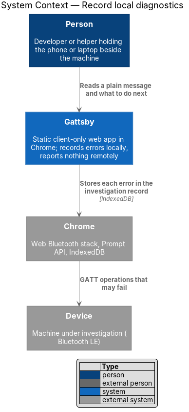
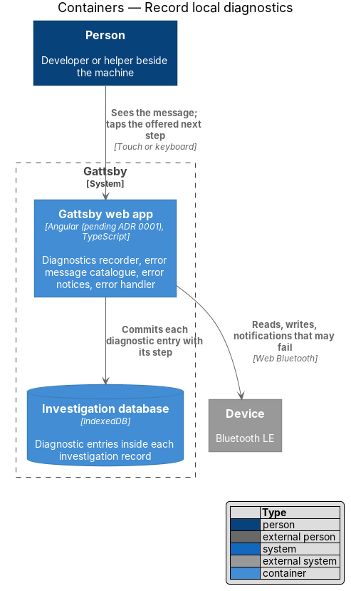
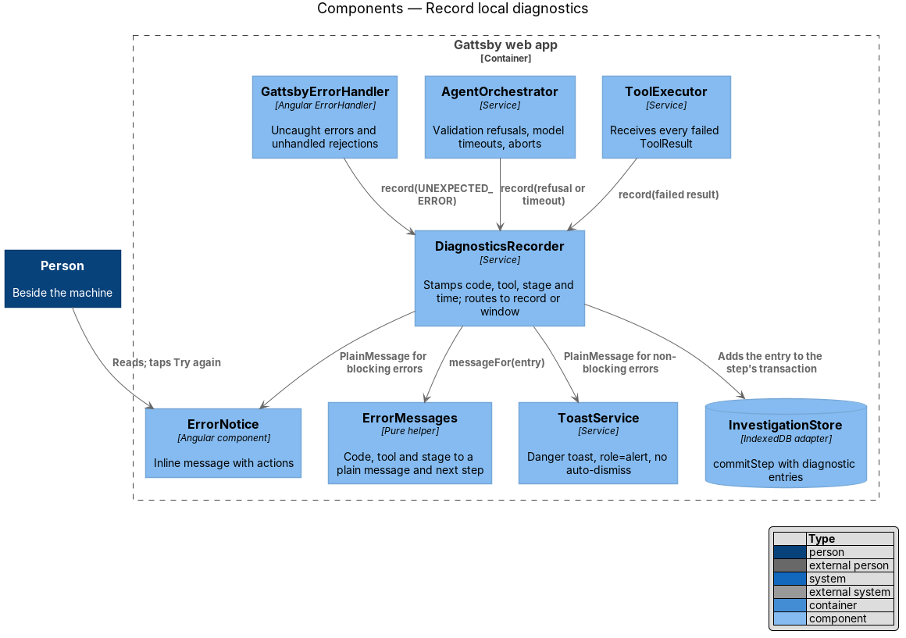
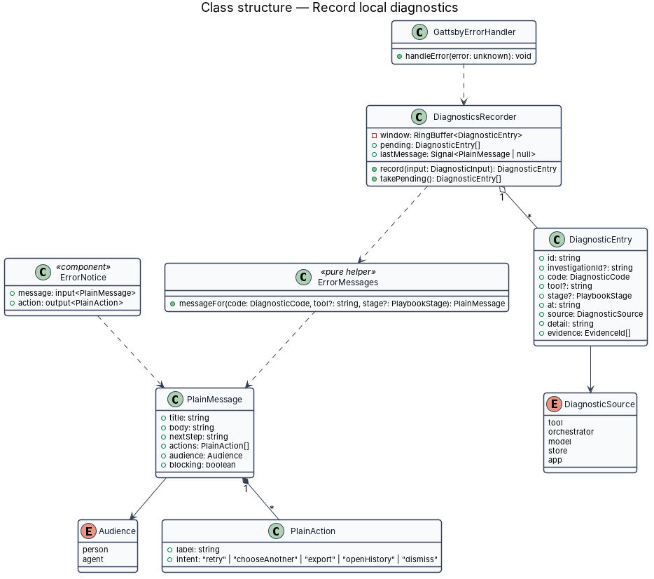
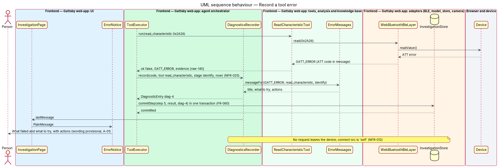
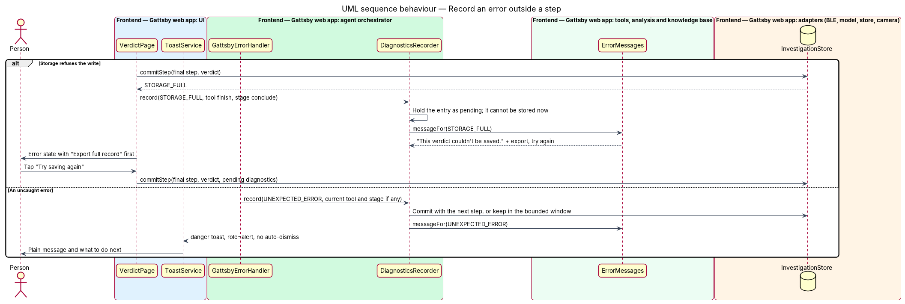

# Record local diagnostics

## Overview

Things go wrong beside a machine: a read fails, the connection drops, storage fills up. Gattsby has no
backend and sends nothing off the device, so it cannot rely on a remote error-reporting service to
learn what happened. This feature records every error locally, in the investigation record, with
enough context to diagnose it later from an exported record, and shows the person a plain message that
says what to do next. It is a platform capability that every subsystem uses.

**diagnostic entry** — record of one error: its code, the tool and playbook stage where it occurred,
a timestamp, its source and a technical detail

**plain message** — what the person sees for an error: a short title, what happened, what to do next,
and the actions that do it

**blocking error** — error that stops the current step until the person acts (for example, a failed
connection); a non-blocking error lets the investigation continue

**audience** — who an error is for: the *person*, who sees a plain message, or the *agent*, which sees
the refusal in its next state while the activity feed records one line

The mocks show the message shape in each place it appears: inline in the prompt dock ("Couldn't
connect. Wake the console, stand within 2 metres of it, then try again." with "Try again" and "Choose
another device", `docs/mocks/pages/investigation/error.html`); as a connection banner ("Couldn't
reconnect after 3 tries", `docs/mocks/notifications/connection-banner/danger.html`); as a page error
state (`docs/mocks/pages/verdict/error.html`, `docs/mocks/pages/history/error.html`,
`docs/mocks/pages/missing-tools/error.html`, `docs/mocks/pages/device-profile/error.html`); and as a
danger toast that uses `role=alert` and never dismisses itself
(`docs/mocks/notifications/toast/danger.html`). Each names what happened and offers the next step.

No error leaves the device. There is no analytics, telemetry or error-reporting service, and the
Content Security Policy's `connect-src 'self'` blocks any attempt (NFR-012, see
[keep data on the device](../keep-data-on-the-device/README.md)). The record is the diagnostic
channel: a developer reads it in the evidence log or in an exported full record (FR-063).

## Description

The design introduces these building blocks in the Angular (pending ADR 0001) workspace under
`frontend/src/app/`:

- **`DiagnosticsRecorder`** (`diagnostics/diagnostics-recorder.ts`) — service with unit tests.
  `record(input)` stamps the entry with the current investigation, tool, stage (from
  `InvestigationSession`) and timestamp, asks `ErrorMessages` for the plain message, and routes both.
  Inside an investigation the entry joins the current step and is committed with it. Outside one, or
  when storage refused the write, it stays in a bounded in-memory window (`RingBuffer`, size
  `<TO SUPPLY>`) and joins the next successful commit when an investigation is open.
- **`DiagnosticEntry`** (`store/model/diagnostic-entry.ts`) — the stored entry; part of the
  investigation record and of its export.
- **`ErrorMessages`** (`diagnostics/error-messages.ts`) — pure helper with unit tests.
  `messageFor(code, tool?, stage?)` returns a `PlainMessage`: a specific entry for a code at a tool or
  stage where the next step differs (for example `CONNECTION_FAILED` at `connect`), else the code's
  default. Every shared error code of L2 section 3 has a default. The wording is provisional (A-01,
  OQ-06) and comes from the mocks where they draw it.
- **`GattsbyErrorHandler`** (`diagnostics/gattsby-error-handler.ts`) — replaces Angular's
  `ErrorHandler` and listens for `unhandledrejection`. It records an uncaught error with the code
  `UNEXPECTED_ERROR` and shows a danger toast. In a development build it also writes to the console;
  the production build writes nowhere else.
- **`ToolExecutor`** and **`AgentOrchestrator`** (`agent/`) — call `record` for every failed result
  envelope (FR-072), every validation refusal (FR-043), every model timeout or abort (FR-047), and
  every step that failed to commit.
- **`ErrorNotice`** (`ui/error-notice/error-notice.ts`) — presentation component. Input: a
  `PlainMessage`. Output: the chosen `PlainAction`. Pages place it in the prompt dock or the page's
  error state; it injects no app service.
- **`ToastService`** (`ui/toast/toast.service.ts`) — shows a non-blocking error as a danger toast with
  `role=alert` that stays until dismissed.

### Rules

1. Every error is recorded with its error code, tool, stage and timestamp in the investigation record
   (NFR-025). The tool is empty for an error outside a tool call; the stage is empty outside an
   investigation.
2. Codes are the shared error codes of L2 section 3. `UNEXPECTED_ERROR` is added for an uncaught
   error; it is not a tool error code and no tool returns it.
3. An entry inside an investigation is committed in the same transaction as its step (FR-060), so a
   crash loses at most the step in progress and its entry.
4. A `STORAGE_FULL` entry cannot be stored when it happens. It stays pending in memory, is shown at
   once, and joins the next commit that succeeds; an export of the full record taken from memory
   includes it.
5. Errors for the *person* show a plain message with what to do next, through `ErrorNotice` when
   blocking and a danger toast otherwise. Errors for the *agent* (validation refusals, decode errors
   the agent can route around) are summarised as one line in the activity feed, and the model or
   checklist sees the reason in its next state.
6. The technical detail (for example the ATT error code in a `GATT_ERROR`) stays in the entry and in
   the evidence log; the person's message does not show raw codes.
7. Messages, details and any device or model string in them render as text, never as HTML (NFR-013).
8. Nothing is reported remotely: no network call, no third-party script, no beacon (NFR-012).

### Data shapes

| Type | Fields |
|---|---|
| `DiagnosticEntry` | `id`, `investigationId?`, `code`, `tool?`, `stage?`, `at`, `source`, `detail`, `evidence` |
| `PlainMessage` | `title`, `body`, `nextStep`, `actions`, `audience`, `blocking` |
| `PlainAction` | `label`, `intent` (`retry`, `chooseAnother`, `export`, `openHistory`, `dismiss`) |

### Messages drawn in the mocks

| Code and place | Plain message |
|---|---|
| `CONNECTION_FAILED` at `connect` | "Couldn't connect" — wake the console, stand within 2 metres, try again; "Try again", "Choose another device" |
| `CONNECTION_FAILED` at `reconnect` | "Couldn't reconnect after 3 tries." — check it is on and near; "Try again", "Stop" |
| `STORAGE_FULL` at Conclude | "This verdict couldn't be saved." — export the full record, then delete old investigations |
| Storage read failure on a list page | "Couldn't read …" — "Nothing has been lost"; "Try again" |
| Unknown profile format | "This profile couldn't be opened" — names the format; "Open the investigation" |

The messages for the other codes, including `GATT_ERROR` on a read (NFR-025 AC1), are `<TO SUPPLY>`
until the Behavior Description is added (OQ-06).

### Tests that prove it

The acceptance spec scripts the fake `navigator.bluetooth` (`e2e/fixtures/fake-bluetooth.ts`) to
answer one Device Information read with a GATT error. It exports the full record through the
`ExportDialog` page object and checks the entry holds the error code, the tool and the stage, and the
`InvestigationPage` page object (`e2e/pages/investigation.page.ts`) reads a message that says what to
try (NFR-025 AC1). The shared network guard fails the spec on any request off localhost. Unit tests
cover `ErrorMessages` (a default for each shared code) and `DiagnosticsRecorder` (routing, the pending
`STORAGE_FULL` entry and the bounded window).

## Requirements

The feature realizes the following level-2 (L2) requirement, which refines the level-1 (L1)
requirement cited beside it.

| L2 ID | Refines (L1) | Requirement |
|-------|--------------|-------------|
| [`NFR-025`](../../../specs/L2.md#nfr-025-local-diagnostics-without-telemetry) | `L1-022` | Errors must be recorded with their error code, tool, stage and timestamp in the investigation record, and shown to the person as a plain message with what to do next. Nothing is reported remotely. |

## Diagrams

### System context

The person reads a plain message in Gattsby, which stores each error in the investigation record in
Chrome's IndexedDB. Gattsby has no relationship with any external reporting system.

### Containers

The web app's operations on the device may fail; each failure becomes a diagnostic entry committed to
the investigation database with its step.

### Components

`ToolExecutor`, `AgentOrchestrator` and `GattsbyErrorHandler` hand errors to `DiagnosticsRecorder`,
which stores the entry with the step and shows the `ErrorMessages` result through `ErrorNotice` or a
danger toast. The sequences draw the `diagnostics/` components in the orchestrator band.

### Class structure

`DiagnosticsRecorder` keeps a bounded window of `DiagnosticEntry`s and asks the pure `ErrorMessages`
for `PlainMessage`s, each with its `PlainAction`s; `ErrorNotice` renders one.

### Behaviour — record a tool error

A Device Information read fails with `GATT_ERROR`; the executor records it with tool, stage and time,
commits it with the step, and the investigation screen shows what failed and what to try.

### Behaviour — record an error outside a step

A `STORAGE_FULL` refusal is held in memory, shown at once with the export offered first, and stored
with the retried commit; an uncaught error is recorded as `UNEXPECTED_ERROR` and shown as a danger
toast.

