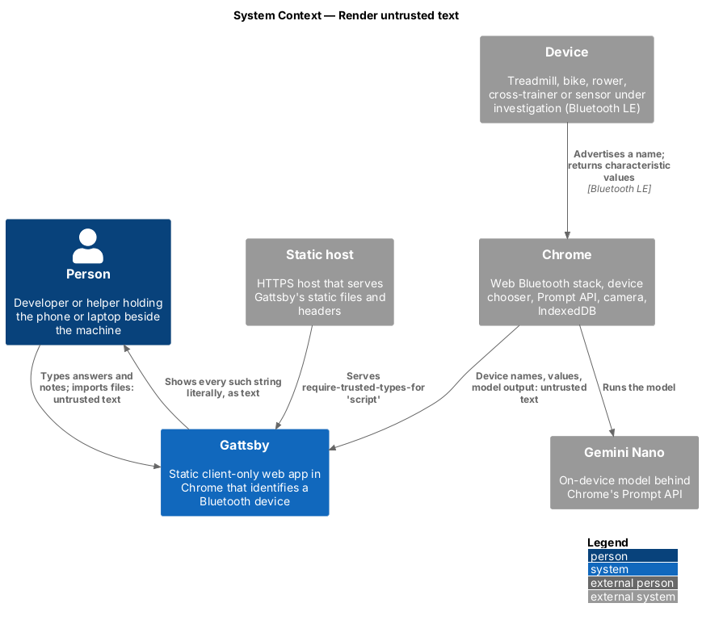
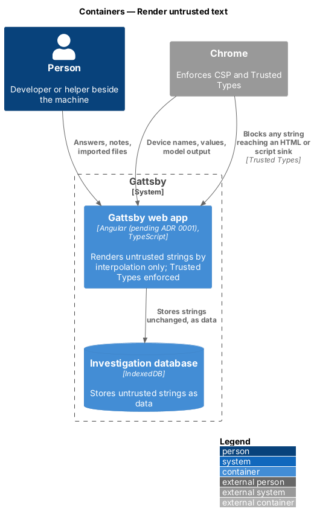
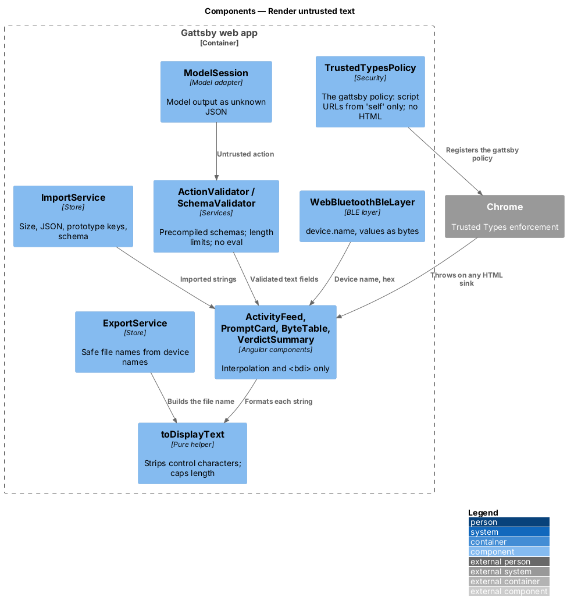
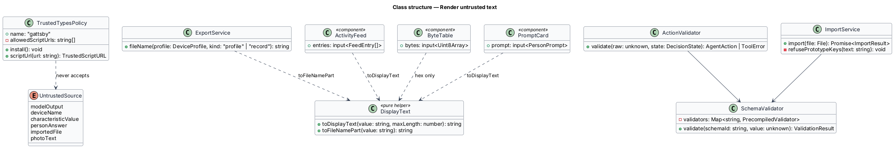
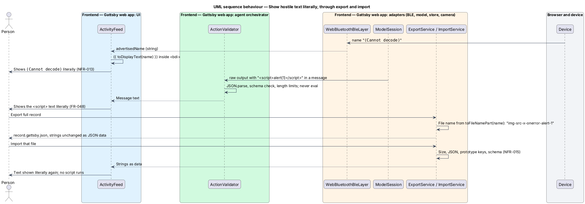
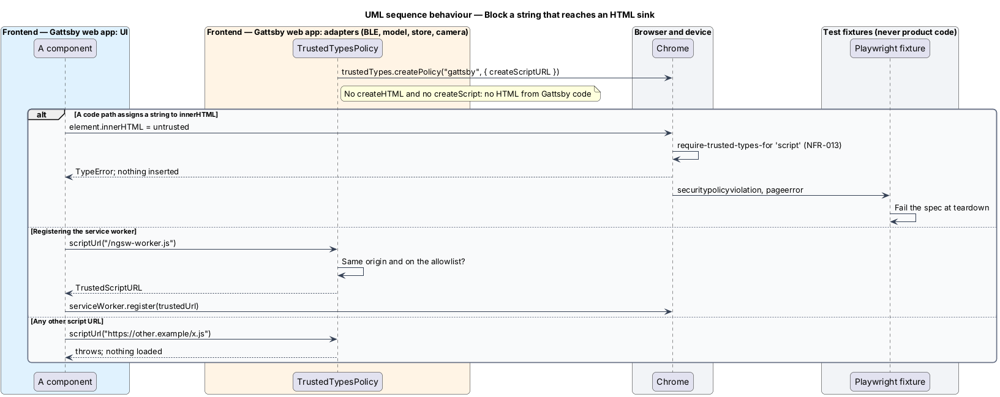

# Render untrusted text

## Overview

Much of what Gattsby shows was written by something it does not control: the model's messages and
reasons, the name a device advertises, the bytes and strings a device returns, the person's own
answers and notes, files the person imports, and text the model reads from a photo. Any of them may
contain markup, script or control characters, by accident or by design. This feature makes every
such string inert: it is rendered as text, stored as data, and never evaluated, and the browser
itself refuses any attempt to turn a string into HTML or script. It belongs to the platform subsystem
and applies to every screen, the export and the import.

**untrusted text** — string whose content Gattsby did not author: model output, device names,
characteristic values, answers, imported files and text read from photos

**sink** — browser API that turns a string into markup or code, such as `innerHTML`, `eval`,
`new Function` or a script URL

**Trusted Types** — browser mechanism, enforced by the Content Security Policy directive
`require-trusted-types-for 'script'`, that refuses a plain string at a sink and accepts only a value
created by a named policy

Untrusted text appears on most screens: device names in the Investigation page's title and feed
(`docs/mocks/pages/investigation/identify.html`), model messages in the feed, hex and decoded values
in the Evidence log (`docs/mocks/pages/evidence/default.html`), maker and model on the Device profile
(`docs/mocks/pages/device-profile/default.html`), and imported profiles on the Saved devices page
(`docs/mocks/pages/profiles/default.html`).

The feature exists so that a hostile device name or a model output with a ``. The behaviour spec runs the
investigation, exports the record, re-imports it, and checks through the page objects that the text
appears literally on the Investigation, Verdict, Device profile and Saved devices pages. The shared
fixture fails the spec on any `dialog` event, `pageerror` or `securitypolicyviolation`. The specs run
against the production build served with its Content Security Policy, so a Trusted Types violation
anywhere fails them (NFR-013). Unit tests cover `toDisplayText` and `toFileNamePart` for control
characters, bidirectional overrides and markup.

## Requirements

The feature realizes the following level-2 (L2) requirements; each refines the level-1 (L1)
requirement cited beside it.

| L2 ID | Refines (L1) | Requirement |
|-------|--------------|-------------|
| [`NFR-013`](../../../specs/L2.md#nfr-013-treat-model-output-and-device-data-as-untrusted) | `L1-018` | Model output, device names, characteristic values, answers, imported files and text read from photos must be rendered as text, never as HTML, and never evaluated. The app must enforce Trusted Types (`require-trusted-types-for 'script'`) and contain no `innerHTML`, `eval` or `new Function` on such data. |

## Diagrams

### System context

Device names and values, model output, the person's text and imported files all reach Gattsby as
untrusted text; Gattsby shows them literally, and the host's headers make Chrome enforce it.

### Containers

The web app renders untrusted strings by interpolation and stores them unchanged as data; Chrome's
Trusted Types enforcement blocks any string that reaches an HTML or script sink.

### Components

Every source of untrusted text passes through a validator or straight to presentation components that
use interpolation, `<bdi>` and `toDisplayText`; `TrustedTypesPolicy` registers the one policy Gattsby
needs.

### Class structure

`ActionValidator` and `ImportService` share the precompiled `SchemaValidator`; the presentation
components and `ExportService` format text through the `DisplayText` helpers; `TrustedTypesPolicy`
accepts no untrusted source.

### Behaviour — show hostile text literally, through export and import

A device name with an `` tag and model output with a `<script>` tag are shown as text,
exported as JSON data under a safe file name, and shown as text again after import.

### Behaviour — block a string that reaches an HTML sink

Chrome throws when a plain string reaches `innerHTML`, and the spec fails; the `gattsby` policy
creates a script URL only for its same-origin allowlist.

