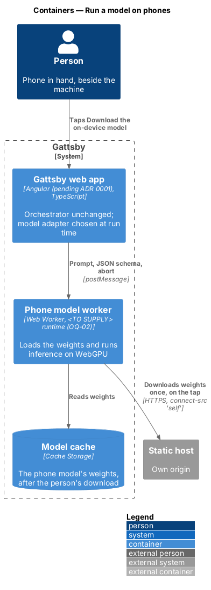
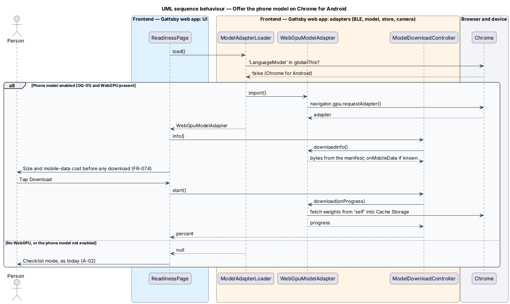
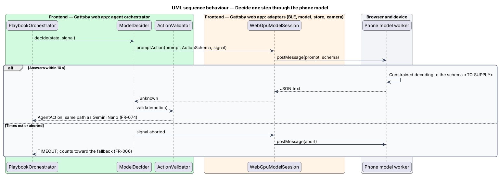

# Run a model on phones

## Overview

Full agent mode needs an on-device model, and Chrome's Gemini Nano runs only on desktop. On Chrome
for Android, where the in-store use case lives, Gattsby runs as a checklist at MVP (A-02). This
feature is the later option of running a smaller in-browser model on the phone's GPU, behind the same
model adapter, so that the orchestrator, tools and safety rules stay unchanged. It belongs to the
platform subsystem and is in the Later phase: it is built only if OQ-01 (is a laptop acceptable in
the store?) and OQ-02 (which model, at what size, speed and download cost?) decide so.

**phone model** — in-browser language model that runs on WebGPU in Chrome for Android, through a
runtime such as Transformers.js or WebLLM, and whose files are downloaded and cached by Gattsby rather
than by Chrome

**model adapter seam** — `ModelAdapter` contract through which the orchestrator reaches any model; a
new model is a new implementation of the contract, with no change to the orchestrator

**mobile data** — cellular connection on which the person may pay for each byte the download uses

Readiness reuses its existing components in four phone states under `docs/mocks/pages/readiness/`.
`phone-downloadable` shows the size and the mobile data note before the download.
`phone-downloading` shows progress and offers Cancel download. `phone-download-failed` offers
retry. `phone-webgpu-unavailable` explains why checklist mode is used.

## Description

The feature uses these building blocks in the Angular workspace under `frontend/src/app/`.
OQ-01 and OQ-02 gate the production model package.

- **`ModelAdapter`** (`model/model-adapter.ts`) — `availability()`, `open(signal)`,
  `download(onProgress, signal)`, `downloadInfo()` and optional `readImage(blob, signal)`.
  `downloadInfo()` returns the size in bytes or `null` when Chrome owns the download.
- **`ModelAdapterLoader`** (`model/model-adapter-loader.ts`) — imports the native Prompt API adapter
  when Chrome provides it, otherwise the phone adapter on Android. Capability detection, session
  handoff, Readiness downloads and plate photos use the loader.
- **`WebGpuModelAdapter`** (`model/web-gpu-model-adapter.ts`) — probes for an available WebGPU
  adapter, validates the same-origin manifest, and checks its versioned Cache Storage entries.
  It opens the dedicated worker when it starts a session. [Chrome's WebGPU documentation](https://developer.chrome.com/docs/web-platform/webgpu/troubleshooting-tips)
- **`WebGpuModelSession`** (`model/web-gpu-model-session.ts`) — sends requests with IDs to the worker.
  A canceled prompt sends an abort for that request. The worker returns JSON text and the existing
  `ActionValidator` checks it (FR-043).
- **`PhoneModelManifest`** (`model/phone-model-manifest.ts`) — a versioned model ID, context window
  and a list of model files with byte sizes. The default `/phone-model/manifest.json` is `null`.
  The worker and model files are supplied together when OQ-02 is decided.
- **`ModelDownloadController`** (`model/model-download-controller.ts`) — starts on the person's
  tap, reports progress and owns the per-download abort signal.

### Action validation and fallback

The orchestrator, `Decider`, `ModelDecider`, `DecisionStateBuilder`, `ActionValidator`, the tool
registry and the safety rules depend on the `ModelAdapter` and `ModelSession` contracts only. A
phone investigation in full agent mode uses the same orchestrator, 10-second timeout, abort on
stop and emergency stop, and checklist fallback conditions (FR-074, FR-006, FR-047).

### Constraints from other requirements

| Constraint | Consequence for the phone model |
|---|---|
| No request off the app's origin (NFR-012) | The model's files are served from Gattsby's own origin, not from a model hub or CDN. Their hosting and size limits on the static host are `<TO SUPPLY>` (A-04). |
| Initial bundle at most 250 KB (NFR-004) | The loader imports the phone adapter for capability checks. The runtime initializes in the worker when a session starts. |
| Offline after first load (NFR-006) | The service worker caches the manifest and, when supplied, the worker script. The model files go to versioned Cache Storage when the person starts a download. |
| Script CSP without `unsafe-eval` (NFR-014) | A WebAssembly runtime needs `'wasm-unsafe-eval'` in `script-src`. That keyword is distinct from `'unsafe-eval'`, but adding it needs an ADR. |
| Trusted Types (NFR-013) | Creating the worker passes a script URL through the `gattsby` policy's allowlist (see the render-untrusted-text design). |
| Structured output (FR-042) | The runtime constrains output to the action schema where it supports JSON-schema decoding; otherwise validation and the fallback rules catch invalid output. Which applies is `<TO SUPPLY>` (OQ-02). |
| Image input (FR-022) | The phone adapter reports that image input is unavailable. The plate dialog offers typing (see the read-a-model-plate-photo design). |
| Storage (NFR-008) | The adapter checks whether the storage estimate has room for the remaining model files. An insufficient estimate or a rejected cache write leads to the Readiness retry state. |

### Download on mobile data

Readiness shows the configured size and says "Mobile data charges may apply. Use Wi-Fi if you can."
Carrier charges vary by plan. The person chooses when to start (FR-074). A canceled or failed
transfer keeps only complete files so retry can reuse them.

### Worker package

The manifest lists a stable model version and immutable files under `/phone-model/assets/`.
The worker loads the files from the named Cache Storage cache. The app sends an `open` request
with the cache name, file list and model instructions. It sends `measure` and `ask` requests with
the prompt and response schema. Measurement includes the prompt, schema and system instructions.
The worker replies with the matching request ID and a value or an error. An `abort` message names
the request ID to release. The app terminates the worker when the investigation releases its model
session.

### Open decisions

- Whether the feature is built at all: OQ-01.
- The model, its runtime, its size, its context window and its speed on a mid-range phone: OQ-02.
- Desktop keeps the existing adapter selection. FR-074 covers Chrome for Android.

### Tests that prove it

The behaviour specs replace the worker's runtime with a scripted fake through the same
`ModelSession` contract, and check that an FTMS treadmill investigation runs in full agent mode on a
phone viewport, that the size is shown before the download, and that nothing downloads before the
tap. A person runs the hardware smoke test on a real Android phone.

## Requirements

The feature realizes the following level-2 (L2) requirements; each refines the level-1 (L1)
requirement cited beside it.

| L2 ID | Refines (L1) | Requirement |
|-------|--------------|-------------|
| [`FR-074`](../../../specs/L2.md#fr-074-run-a-model-on-phones) | `L1-023` | If OQ-01 and OQ-02 decide so, Gattsby must offer full agent mode on Chrome for Android through an in-browser model (for example WebGPU with Transformers.js or WebLLM) behind the same model adapter, with its download size and cost on mobile data stated before the download starts. |

## Diagrams

### System context

On Chrome for Android, Gattsby shows the phone model's size before the person downloads it from
Gattsby's own origin, then runs it on the phone's GPU through WebGPU.

### Containers

The web app talks to a worker that runs the phone model; the worker reads the weights from Cache
Storage after the one download the person started.

### Components

`ModelAdapterLoader` picks `PromptApiModelAdapter` or `WebGpuModelAdapter`; every consumer, including
`ModelDecider`, depends on the contract, so the orchestrator does not change.

### Class structure

`WebGpuModelAdapter` and `WebGpuModelSession` implement the existing contracts; the
`PhoneModelManifest` holds the facts that OQ-02 is to supply.

### Behaviour — offer the phone model on Chrome for Android

With WebGPU present and the phone model enabled, the size and mobile-data note appear before the
download, which starts only on the tap; otherwise the phone stays in checklist mode.

### Behaviour — decide one step through the phone model

The decision travels through the same `ModelDecider` and `ActionValidator` as on the desktop; a
timeout aborts the worker and counts toward the fallback.

