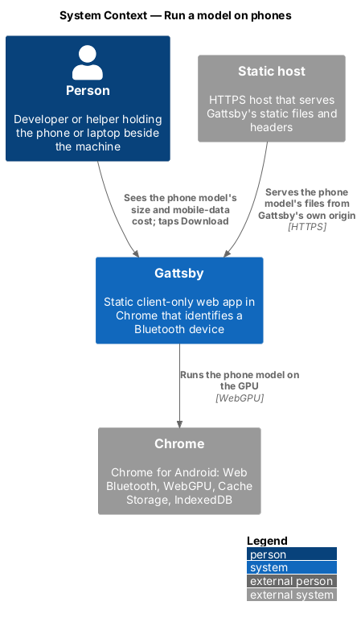
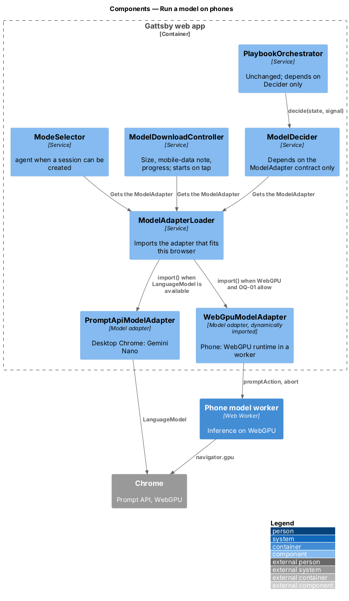
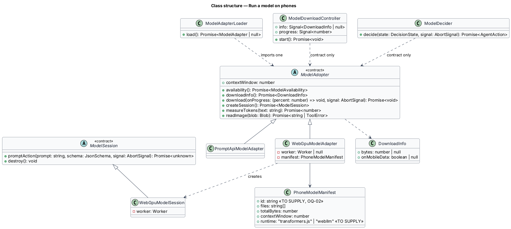

# Run a model on phones

## Overview

Full agent mode needs an on-device model, and Chrome's Gemini Nano runs only on desktop. On Chrome
for Android, where the in-store use case lives, Gattsby runs as a checklist at MVP (A-02). This
feature is the later option of running a smaller in-browser model on the phone's GPU, behind the same
model adapter, so that the orchestrator, tools and safety rules stay unchanged. It belongs to the
platform subsystem and is in the Later phase: it is built only if OQ-01 (is a laptop acceptable in
the store?) and OQ-02 (which model, at what size, speed and download cost?) decide so.

**phone model** — in-browser language model that runs on WebGPU in Chrome for Android, through a
runtime such as Transformers.js or WebLLM, and whose files are downloaded and cached by Gattsby rather
than by Chrome

**model adapter seam** — `ModelAdapter` contract through which the orchestrator reaches any model; a
new model is a new implementation of the contract, with no change to the orchestrator

**mobile data** — cellular connection on which the person may pay for each byte the download uses

The phone model reuses the Readiness page's model states: `downloadable`
(`docs/mocks/pages/readiness/downloadable.html`), `downloading` (`downloading.html`) and
`download-failed` (`download-failed.html`), with the size and a mobile-data note shown before the
download. No mock yet shows the phone wording; a mock is needed before implementation, and the
copy is `<TO SUPPLY>` (OQ-06).

The feature exists because the brief names the phone as the in-store device and the model as the
agent; the seam is designed now so that the MVP's adapter does not close the door on it.

## Description

The design introduces these building blocks in the Angular (pending ADR 0001) workspace under
`frontend/src/app/`. Everything marked `<TO SUPPLY>` waits on OQ-01 and OQ-02.

- **`ModelAdapter`** (`model/model-adapter.ts`) — the contract the MVP already defines:
  `availability()`, `download(onProgress)`, `createSession()`, `contextWindow`,
  `measureTokens(text)` and `readImage(blob)`. This feature adds `downloadInfo()`, returning the
  download's size in bytes and whether the device is on mobile data, and an `AbortSignal` on
  `download`. `PromptApiModelAdapter` returns `null` for the size it cannot know.
- **`ModelAdapterLoader`** (`model/model-adapter-loader.ts`) — imports the one adapter that fits this
  browser: `PromptApiModelAdapter` when `LanguageModel` exists; otherwise `WebGpuModelAdapter` when
  the phone model is enabled and WebGPU is present; otherwise none, and checklist mode. `ModeSelector`,
  `ModelDecider`, `ModelDownloadController` and `CapabilityDetector` get their adapter from it.
- **`WebGpuModelAdapter`** (`model/web-gpu-model-adapter.ts`) — the phone implementation. It is the
  only code that touches `navigator.gpu` (NFR-021). Its availability is `unavailable` without a WebGPU
  adapter, `downloadable` when the files are not cached, and `available` when they are. It runs the
  runtime in a Web Worker (`model/web-gpu-model.worker.ts`) so inference does not block the page.
  It is imported dynamically, and the runtime only after the person's tap.
- **`WebGpuModelSession`** (`model/web-gpu-model-session.ts`) — implements `ModelSession`:
  `promptAction(prompt, schema, signal)` posts to the worker and resolves the model's JSON text as
  `unknown`; an aborted signal tells the worker to stop. `ActionValidator` validates the result
  exactly as it validates Gemini Nano's (FR-043).
- **`PhoneModelManifest`** (`model/phone-model-manifest.ts`) — the model's `id`, `files`,
  `totalBytes`, `contextWindow` and `runtime`, all `<TO SUPPLY>` (OQ-02).
- **`ModelDownloadController`** (`model/model-download-controller.ts`) — unchanged in behaviour: it
  shows `downloadInfo()` before the download, starts only on the person's tap, and reports progress
  at least once a second (see the choose-operating-mode design).

### What does not change

The orchestrator, `Decider`, `ModelDecider`, `DecisionStateBuilder`, `ActionValidator`, the tool
registry and the safety rules depend on the `ModelAdapter` and `ModelSession` contracts only. A
phone investigation in full agent mode runs through them with no change to the orchestrator
(FR-074). The 10-second timeout, the abort on stop and emergency stop, and the fallback triggers
apply unchanged (FR-006, FR-047).

### Constraints from other requirements

| Constraint | Consequence for the phone model |
|---|---|
| No request off the app's origin (NFR-012) | The model's files are served from Gattsby's own origin, not from a model hub or CDN. Their hosting and size limits on the static host are `<TO SUPPLY>` (A-04). |
| Initial bundle at most 250 KB (NFR-004) | The runtime and adapter load by dynamic import after the tap. |
| Offline after first load (NFR-006) | The files are stored in Cache Storage after the download. The service worker does not precache them; they are too large to fetch without the person's consent. |
| Script CSP without `unsafe-eval` (NFR-014) | A WebAssembly runtime needs `'wasm-unsafe-eval'` in `script-src`. That keyword is distinct from `'unsafe-eval'`, but adding it needs an ADR. |
| Trusted Types (NFR-013) | Creating the worker passes a script URL through the `gattsby` policy's allowlist (see the render-untrusted-text design). |
| Structured output (FR-042) | The runtime constrains output to the action schema where it supports JSON-schema decoding; otherwise validation and the fallback rules catch invalid output. Which applies is `<TO SUPPLY>` (OQ-02). |
| Image input (FR-022) | `readImage` returns `UNSUPPORTED` unless the chosen model reads images; the photo tool then degrades (see the read-a-model-plate-photo design). |
| Storage (NFR-008) | The download is refused with `STORAGE_FULL` when `navigator.storage.estimate()` leaves less room than `totalBytes`. |

### Download on mobile data

The size is always shown before the download, and the download never starts without the person's
tap (FR-074). Whether the phone is on mobile data is read from the Network Information API
(`navigator.connection.type`) where Chrome provides it; where it does not, `onMobileData` is `null`
and the note asks the person to use Wi-Fi. The exact wording and whether Gattsby should refuse to
download on mobile data are `<TO SUPPLY>` (OQ-02, OQ-06).

### Open decisions

- Whether the feature is built at all: OQ-01.
- The model, its runtime, its size, its context window and its speed on a mid-range phone: OQ-02.
- Whether the phone model also serves desktop browsers without Gemini Nano: `<TO SUPPLY>`.

### Tests that prove it

The behaviour specs replace the worker's runtime with a scripted fake through the same
`ModelSession` contract, and check that an FTMS treadmill investigation runs in full agent mode on a
phone viewport, that the size is shown before the download, and that nothing downloads before the
tap. A person runs the hardware smoke test on a real Android phone.

## Requirements

The feature realizes the following level-2 (L2) requirements; each refines the level-1 (L1)
requirement cited beside it.

| L2 ID | Refines (L1) | Requirement |
|-------|--------------|-------------|
| [`FR-074`](../../../specs/L2.md#fr-074-run-a-model-on-phones) | `L1-023` | If OQ-01 and OQ-02 decide so, Gattsby must offer full agent mode on Chrome for Android through an in-browser model (for example WebGPU with Transformers.js or WebLLM) behind the same model adapter, with its download size and cost on mobile data stated before the download starts. |

## Diagrams

### System context

On Chrome for Android, Gattsby shows the phone model's size before the person downloads it from
Gattsby's own origin, then runs it on the phone's GPU through WebGPU.

### Containers

The web app talks to a worker that runs the phone model; the worker reads the weights from Cache
Storage after the one download the person started.

### Components

`ModelAdapterLoader` picks `PromptApiModelAdapter` or `WebGpuModelAdapter`; every consumer, including
`ModelDecider`, depends on the contract, so the orchestrator does not change.

### Class structure

`WebGpuModelAdapter` and `WebGpuModelSession` implement the existing contracts; the
`PhoneModelManifest` holds the facts that OQ-02 is to supply.

### Behaviour — offer the phone model on Chrome for Android

With WebGPU present and the phone model enabled, the size and mobile-data note appear before the
download, which starts only on the tap; otherwise the phone stays in checklist mode.

### Behaviour — decide one step through the phone model

The decision travels through the same `ModelDecider` and `ActionValidator` as on the desktop; a
timeout aborts the worker and counts toward the fallback.

