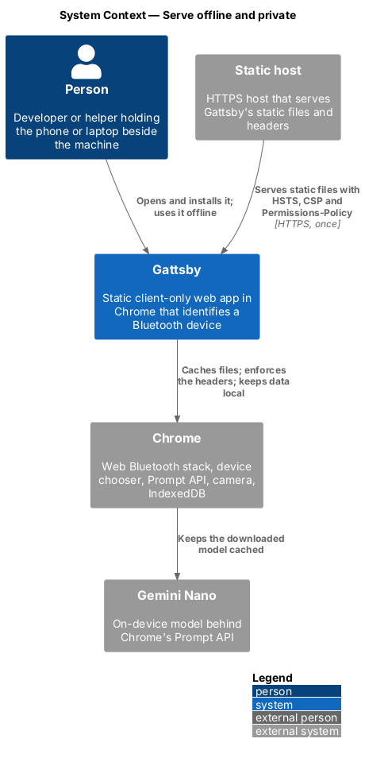
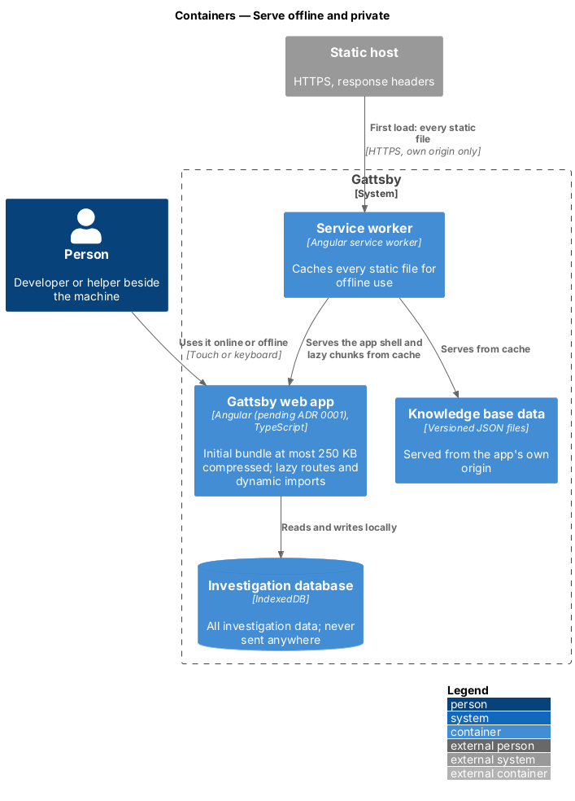
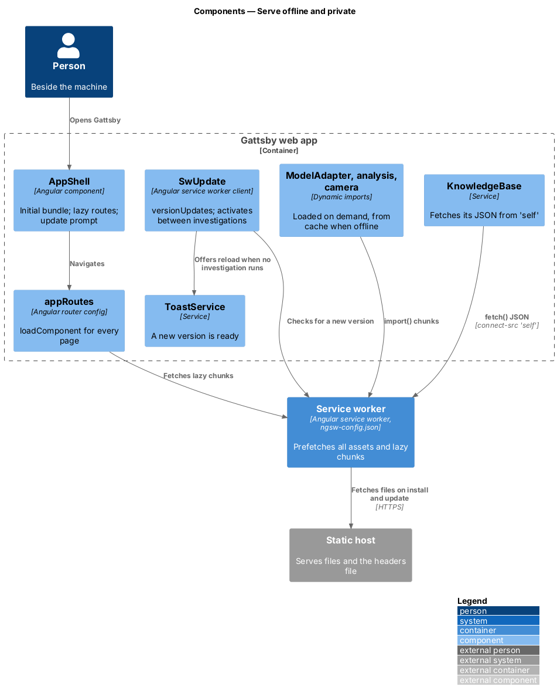
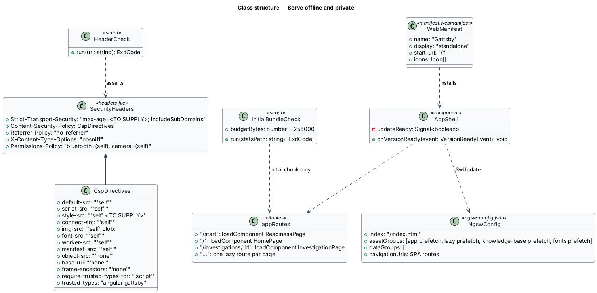
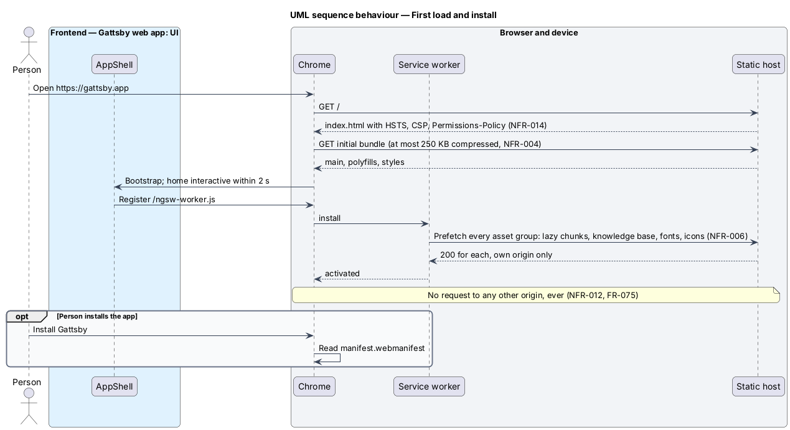
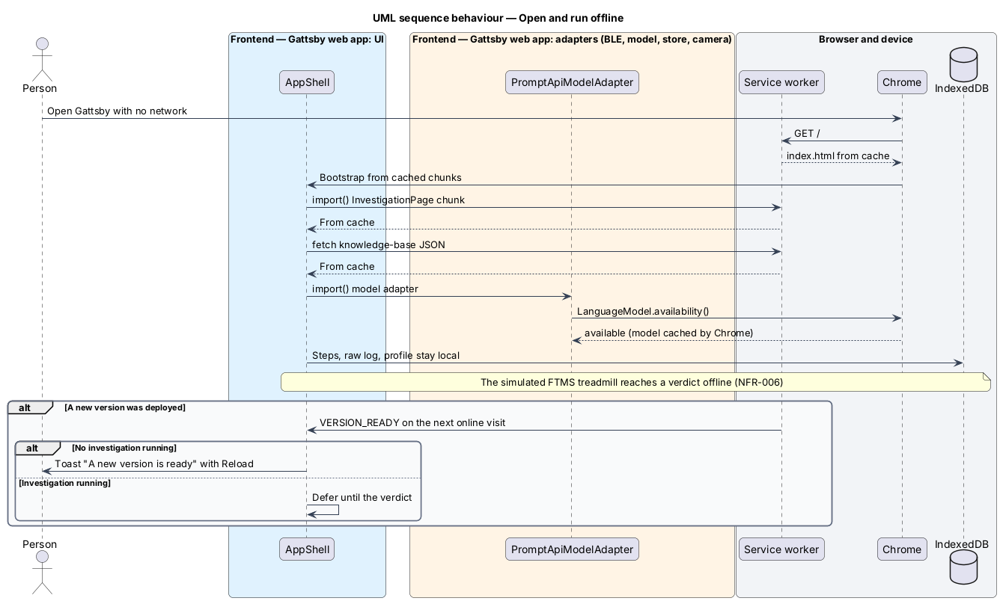
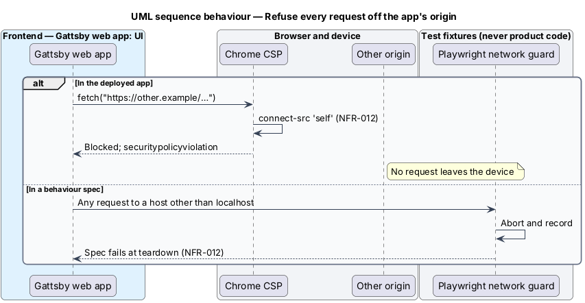

# Serve offline and private

## Overview

Gattsby is a set of static files and nothing else: no backend, no analytics, no remote model. This
feature covers how those files reach the browser and what they are allowed to do once there. They
are served once over HTTPS with strict security headers, cached by a service worker so that the app
opens and runs a full investigation with no network, kept small enough to start quickly on a phone,
and confined by the Content Security Policy to their own origin, so that no data leaves the device.
It belongs to the platform subsystem and applies to every screen and every stage.

**static host** — any HTTPS host that serves Gattsby's built files and can set the response headers
this design lists (A-04)

**initial bundle** — JavaScript and CSS loaded before the Home page is interactive; every route and
the model adapter, analysis tools and camera code load later, on demand

**own origin** — scheme, host and port Gattsby is served from; the only origin it may request

**headers file** — file in the repository, deployed with the build, that sets the security headers
for every response

The feature has no screen of its own. Its promise is printed on the Home page ("Everything runs on
this device. Nothing is sent to a server.", `docs/mocks/pages/home/default.html`) and the Settings
page ("Nothing leaves this device: no accounts, no analytics, no server. Exporting is the only way
data leaves, and only when you start it.", `docs/mocks/pages/settings/default.html`). A new version
is offered through a toast (`docs/mocks/notifications/toast/info.html`).

The feature exists because Gattsby is used in stores and gyms, often with weak or no signal, and
because the machines it examines and the person's notes and photos are nobody else's business. It
also keeps a later sharing feature (FR-075) out until OQ-03 and OQ-05 are answered.

## Description

The design introduces these building blocks in the Angular workspace under `frontend/`
([ADR 0001](../../../adr/0001-frontend-stack.md)):

- **`appRoutes`** (`src/app/app.routes.ts`) — one lazy route per page with `loadComponent`
  (`ReadinessPage` `/start`, `HomePage` `/`, `InvestigationPage` `/investigations/:id`, and the
  rest), and a last route `**` to `NotFoundPage` (`docs/mocks/pages/not-found/default.html`). The model adapter, the analysis helpers and the camera adapter are reached only through
  dynamic `import()` (NFR-004).
- **`InitialBundleCheck`** (`scripts/check-initial-bundle.ts`) — runs after the production build in
  CI, compresses each initial chunk with gzip and fails the build when the total exceeds 250 KB
  (A-08). Angular's own `budgets` in `angular.json` measure uncompressed bytes, so they are kept as an
  early warning but cannot prove the compressed limit; this departure from the framework's budget
  feature is [ADR 0002](../../../adr/0002-gzip-initial-bundle-check.md).
- **Service worker** (`ngsw-config.json`, Angular service worker) — asset groups with `installMode`
  `prefetch` for the app shell, every lazy chunk, the knowledge-base JSON, fonts and icons, so every
  route works offline after the first load (NFR-006). No data group caches anything off-origin. The
  model is cached by Chrome, not by the service worker.
- **`WebManifest`** (`public/manifest.webmanifest`) — name, icons, `display` `standalone` and
  `start_url` `/`, so Chrome offers to install Gattsby.
- **`AppShell`** (`src/app/app-shell.ts`) — registers the service worker and listens to
  `SwUpdate.versionUpdates`. When a new version is ready and no investigation is running, it raises
  the toast "A new version is ready" with "Reload" through `ToastService`; while an investigation
  runs, it waits for the verdict, so an update never reloads a live investigation.
- **Headers file** (`public/_headers`) — the headers below, for every path, in the `_headers`
  format that Cloudflare Pages and Netlify read (A-04, [ADR 0003](../../../adr/0003-static-host-and-headers-file.md)).
  A host that reads another format gets the same headers translated at deployment.
- **`HeaderCheck`** (`scripts/check-headers.ts`) — fetches a URL and asserts each header and
  directive below. CI runs it against the production build served locally with the same headers
  file; a person runs it against the deployed URL after each deployment (NFR-014).
- **`DistServer`** (`scripts/serve-dist.ts`) — the local static server: serves the production build
  with every header from the headers file and falls back to `index.html` for app routes, using only
  Node's built-in modules (ADR 0003). The behaviour specs and `HeaderCheck` run against it, so they
  see the same Content Security Policy as the deployed app.
- **Network guard** (the shared Playwright fixture, `e2e/fixtures/gattsby-test.ts`) — aborts and
  records any request to a host other than localhost, and fails the spec (see the
  simulate-devices-and-model design).

### Response headers

| Header | Value |
|---|---|
| `Strict-Transport-Security` | `max-age=63072000; includeSubDomains` (two years; ADR 0003) |
| `Content-Security-Policy` | See the directives below |
| `Referrer-Policy` | `no-referrer` |
| `X-Content-Type-Options` | `nosniff` |
| `Permissions-Policy` | `bluetooth=(self), camera=(self)`, and every other feature Gattsby could name, such as `geolocation`, `microphone` and `payment`, set to `()` |

| CSP directive | Value | Why |
|---|---|---|
| `default-src` | `'self'` | NFR-014 |
| `script-src` | `'self'` | No `unsafe-inline` or `unsafe-eval` (NFR-014) |
| `style-src` | `'self' 'unsafe-inline'` | Angular inserts component styles at run time as `<style>` elements; NFR-014 forbids `unsafe-inline` for scripts only. A static host cannot issue a nonce per response, so ADR 0001 allows inline styles; scripts stay `'self'` only |
| `connect-src` | `'self'` | NFR-012 |
| `img-src` | `'self' blob:` | Photos shown from object URLs |
| `font-src`, `worker-src`, `manifest-src` | `'self'` | Self-hosted fonts, the service worker, the manifest |
| `object-src` | `'none'` | NFR-014 |
| `base-uri` | `'none'` | Hardening |
| `frame-ancestors` | `'none'` | NFR-014 |
| `require-trusted-types-for` | `'script'` | NFR-013; see the render-untrusted-text design |
| `trusted-types` | `angular gattsby` | Angular's policy and Gattsby's own |

`Permissions-Policy` does not allow geolocation, so even a mistaken call cannot locate the person
(FR-010, NFR-016).

### Privacy rules

1. At run time the only requests are for Gattsby's own static files from its own origin (NFR-012).
   There is no analytics, telemetry, error-reporting service, CDN, web-font service or remote model
   call. Fonts and icons are bundled.
2. Errors are recorded locally in the investigation record (NFR-025), never reported remotely.
3. Export is the only way data leaves the device, and the person starts it (see the
   export-profiles-and-records design).
4. No build contains a sharing feature or a request to any other origin until OQ-03 and OQ-05 are
   answered (FR-075). The CSP's `connect-src 'self'` makes such a request fail even if code tried.

### Limits

| Limit | Value | Proven by |
|---|---|---|
| Initial bundle | At most 250 KB compressed (A-08) | `InitialBundleCheck` in CI |
| Home interactive | Within 2 s on a mid-range phone over fast 4G (NFR-004) | A person's measurement; the device and tool are `<TO SUPPLY>` |
| Offline | Full investigation of the simulated FTMS treadmill with the network off | Behaviour spec with Playwright's offline mode after a first online load |

### Tests that prove it

The offline spec loads the production build once, waits for the service worker to be ready, sets the
browser context offline, reloads, and runs the simulated FTMS treadmill to a verdict. Every behaviour
spec runs behind the network guard. CI runs `InitialBundleCheck` and `HeaderCheck` against the local
production build.

## Requirements

The feature realizes the following level-2 (L2) requirements; each refines the level-1 (L1)
requirement cited beside it.

| L2 ID | Refines (L1) | Requirement |
|-------|--------------|-------------|
| [`NFR-004`](../../../specs/L2.md#nfr-004-small-initial-load) | `L1-019` | The initial bundle (what loads before the home screen is interactive) must be at most 250 KB compressed (assumed budget; see A-08), and the home screen must be interactive within 2 seconds on a mid-range phone over a fast 4G connection. The model adapter, analysis tools and camera code are loaded on demand. |
| [`NFR-006`](../../../specs/L2.md#nfr-006-work-offline-after-first-load) | `L1-020` | Gattsby must be an installable progressive web app whose service worker caches every static file, so that, after one load online, it opens and runs a full investigation with no network. The model, once downloaded, is cached by Chrome. |
| [`NFR-012`](../../../specs/L2.md#nfr-012-no-data-leaves-the-device) | `L1-018` | At run time Gattsby must make no network request except for its own static files from its own origin. There must be no analytics, telemetry, error reporting service, CDN, web font service or remote model call. The Content Security Policy's `connect-src` must be `'self'`. |
| [`NFR-014`](../../../specs/L2.md#nfr-014-secure-hosting) | `L1-018` | Gattsby must be served only over HTTPS with HSTS, a strict Content Security Policy (`default-src 'self'`, no `unsafe-inline` or `unsafe-eval` for scripts, `object-src 'none'`, `frame-ancestors 'none'`), `Referrer-Policy: no-referrer`, `X-Content-Type-Options: nosniff`, and a `Permissions-Policy` allowing only `bluetooth`, `camera` (self) and nothing else. |
| [`FR-075`](../../../specs/L2.md#fr-075-share-profiles-publicly) | `L1-023` | Sharing profiles to a public device library is out of scope until OQ-03 and OQ-05 are answered. Until then Gattsby must make no network request to share anything. |

## Diagrams

### System context

The static host serves Gattsby once, with its headers; afterwards Chrome runs it from cache, keeps
every byte of data local and keeps the model cached.

### Containers

The service worker prefetches every static file from the app's own origin, including the knowledge
base, and serves them offline; the investigation database never leaves the device.

### Components

`AppShell` keeps the initial bundle small through lazy routes and dynamic imports, fetches only from
`'self'` through the service worker, and offers updates only between investigations.

### Class structure

The headers file, the service worker configuration and the manifest are configuration, not code; two
scripts check the compressed initial bundle and the deployed headers.

### Behaviour — first load and install

The first visit fetches the small initial bundle with its headers, then the service worker prefetches
every other file from the same origin.

### Behaviour — open and run offline

With no network, the service worker serves the shell, lazy chunks and knowledge base from cache, and
Chrome serves the cached model; a new version waits until no investigation is running.

### Behaviour — refuse every request off the app's origin

In the deployed app the CSP blocks any request to another origin; in the behaviour specs the network
guard fails the spec.

