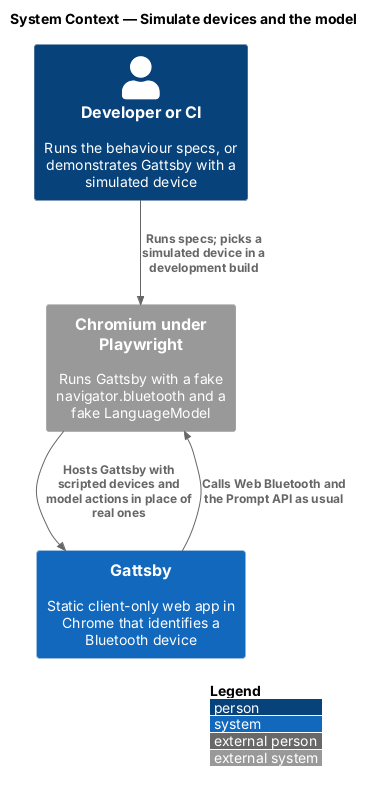
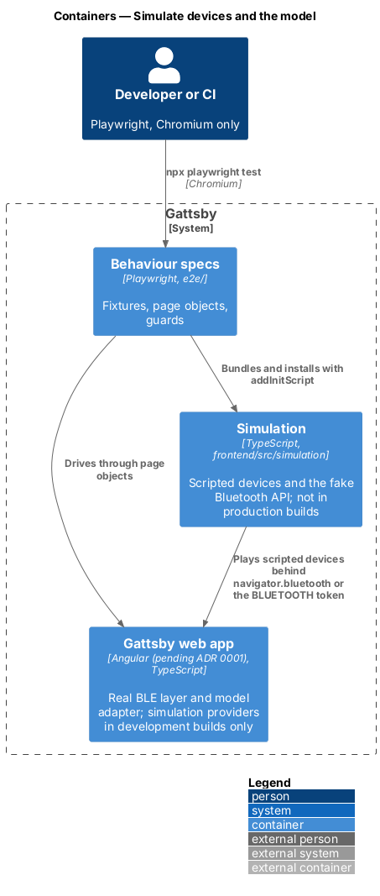
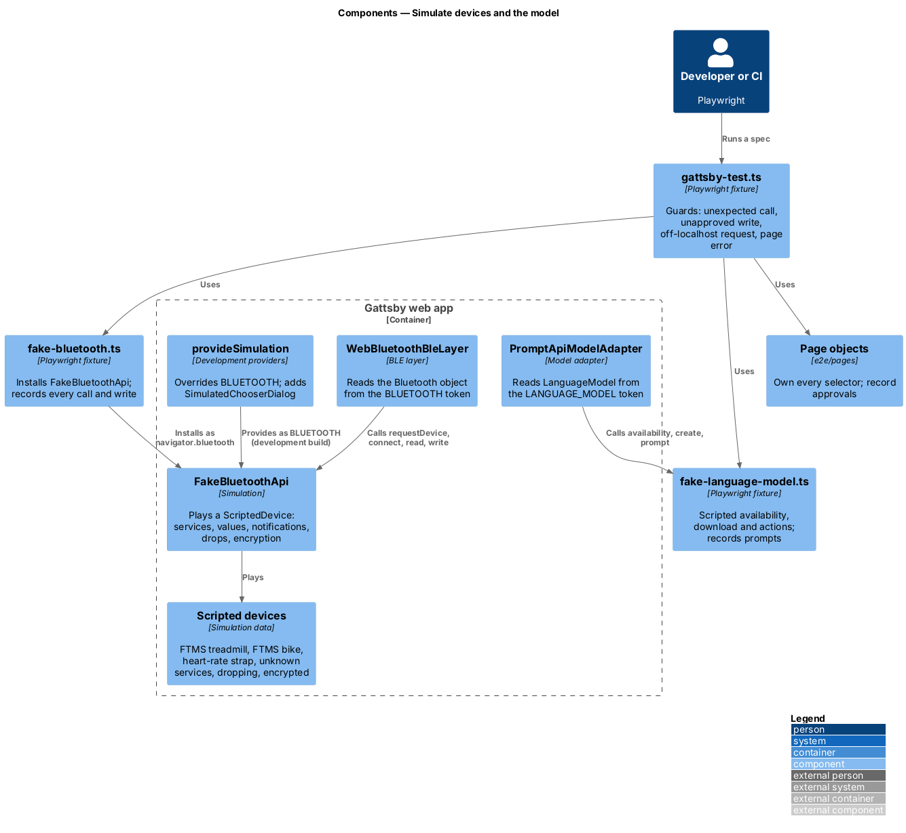
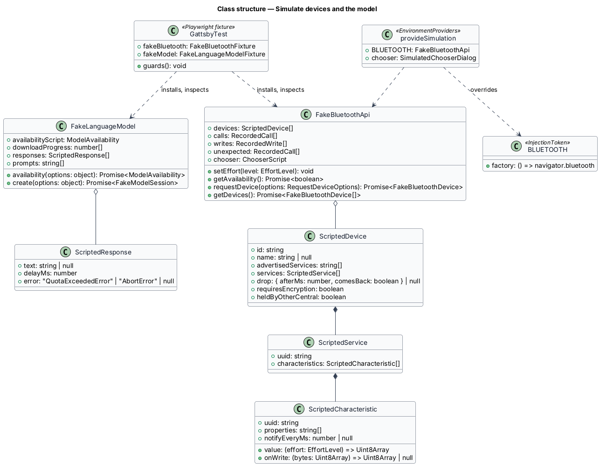
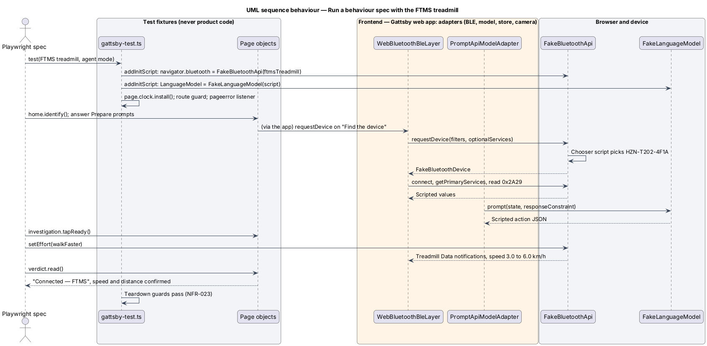
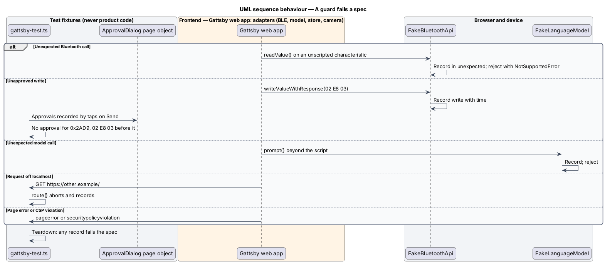
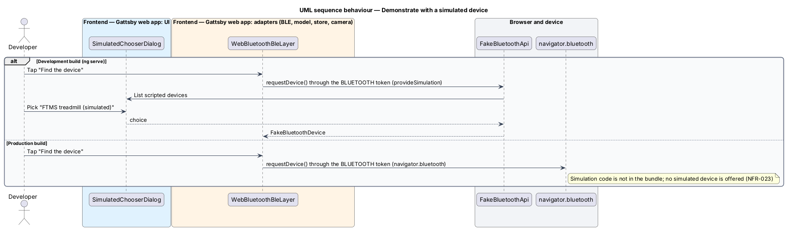

# Simulate devices and the model

## Overview

Gattsby's behaviour depends on two things no CI runner has: a Bluetooth fitness machine and an
on-device model. This feature replaces both with scripted fakes, so that every MVP acceptance
criterion runs as a Playwright behaviour spec in Chromium, and so that a developer can demonstrate
Gattsby in a development build with a simulated device. It belongs to the platform subsystem. It is
test and development code; none of it ships in a production build.

**scripted device** — data that describes one simulated device: its name, advertised and real
services, characteristic values, notifications that respond to an effort level, write responses, and
optional faults such as a dropped connection or a need for encryption

**fake Bluetooth API** — object with the shape of `navigator.bluetooth` that plays scripted devices
and records every call and write

**fake model** — object with the shape of Chrome's `LanguageModel` that reports a scripted
availability and download progress and returns scripted actions

**guard** — check in the shared Playwright fixture that fails a spec on an unexpected Bluetooth call,
an unapproved write, an unexpected model call, a request off localhost, a page error or a Content
Security Policy violation

The feature has no product screen. In a development build, "Find the device" opens a list of
simulated devices in place of Chrome's chooser; that list has no mock, because it never reaches a
person in production. Its layout reuses the design system's dialog and row list: the title "Pick a
simulated device", one 48 px row per scripted device with its advertised name and service UUIDs, and
"Cancel", which rejects `requestDevice` as Chrome's chooser does. It is built by the first journey
that offers "Find the device" (journey 2).

The feature exists because AGENTS.md forbids a real device, Bluetooth or model in the specs, and
because a spec that cannot fail on an unapproved write cannot prove the safety rules.

## Description

The design introduces these building blocks. Product code lives under `frontend/src/`; test code
under `frontend/e2e/` (written `e2e/` below).

- **Scripted devices** (`frontend/src/simulation/devices/*.device.ts`) — one `ScriptedDevice` each:
  FTMS treadmill (`HZN-T202-4F1A`, services `0x1826 0x180A 0x180D 0xFFF0`), FTMS bike, heart-rate
  strap, unknown-services device, a device that drops, and a device that requires encryption, plus
  the hostile-name device of the render-untrusted-text design and a device held by another central.
  Notification values are functions of an effort level the spec sets, so "walk faster" raises the
  speed field.
  The scaffold (journey 1) adds the four devices every MVP journey needs (FTMS treadmill, FTMS bike,
  heart-rate strap, unknown-services device); the device that drops, the device that requires
  encryption, the hostile-name device and the device held by another central are added by the
  journeys that first need them.
- **`FakeBluetoothApi`** (`frontend/src/simulation/fake-bluetooth-api.ts`) — implements the parts of
  `navigator.bluetooth` that `WebBluetoothBleLayer` uses: `getAvailability`, `requestDevice` (with a
  chooser script that picks a device or cancels), `getDevices`, GATT connect and disconnect, primary
  services, characteristics, reads, notifications and writes with response. It records every call
  in `calls`, every write in `writes`, and every call its script does not cover in `unexpected`, and
  rejects the latter.
- **`BLUETOOTH`** and **`LANGUAGE_MODEL`** (`frontend/src/app/ble/bluetooth.token.ts`,
  `frontend/src/app/model/language-model.token.ts`) — injection tokens whose default factories
  return `navigator.bluetooth` and `globalThis.LanguageModel`. `WebBluetoothBleLayer` and
  `PromptApiModelAdapter` read the API from these tokens, so the API is still touched only inside
  its adapter (NFR-021).
- **`provideSimulation`** (`frontend/src/simulation/provide-simulation.ts`) — providers that override
  `BLUETOOTH` with `FakeBluetoothApi` and show `SimulatedChooserDialog`
  (`frontend/src/simulation/simulated-chooser.dialog.ts`) on `requestDevice`. Only
  `environment.development.ts` imports it, through the build's file replacement, so a production
  build has no import path to `simulation/` and cannot offer a simulated device. A development
  build does not offer a scripted model: it uses Chrome's model where one is available and checklist
  mode where none is, so a demonstration shows the person's real operating mode.
- **`e2e/fixtures/fake-bluetooth.ts`** — bundles `FakeBluetoothApi` and the scripted devices with
  esbuild (`src/simulation/install-fakes.ts` as the entry point) and installs them with
  `page.addInitScript` before the app loads, on any build, including the production build with its
  Content Security Policy. The fake reports every call, write and unexpected call to the fixture
  through a binding (`page.exposeBinding`), so the records survive a reload. Exposes the recorded
  calls and writes, the chooser script and `setEffort` to the spec.
- **`e2e/fixtures/fake-language-model.ts`** — installs `FakeLanguageModel`: availability
  (`available`, `downloadable`, `downloading`, `unavailable` or absent), download progress events, and
  a queue of `ScriptedResponse`s (action JSON, a delay for timeouts, or an error such as a context
  overflow). Records every prompt, so a spec can assert its size (NFR-020) or that none was made
  (FR-005).
- **`e2e/fixtures/gattsby-test.ts`** — Playwright's `test` extended with both fakes, `page.clock`
  installed for time-driven rules, a stub `navigator.geolocation` that records any call, and the
  guards below. A spec that proves a guard trips calls `guards.acknowledge(kind)` after asserting the
  violation, so that only unacknowledged violations fail it.
- **Behaviour specs run against the production build** served by `scripts/serve-dist.ts` with the
  headers file (ADR 0003), so the Content Security Policy and Trusted Types apply in every spec.
- **Page objects** (`e2e/pages/*.page.ts`) — one per screen or dialog; they own every selector. The
  `ApprovalDialog` and `EmergencyStopButton` page objects record each approval (the bytes and
  characteristic shown, and the tap on "Send" or "Emergency stop") for the write guard.

### Guards

| Guard | Detects | Source |
|---|---|---|
| Unexpected Bluetooth call | A call the scripted device does not cover | `FakeBluetoothApi.unexpected` |
| Unapproved write | A recorded write not preceded by a recorded approval for that characteristic and those bytes | `FakeBluetoothApi.writes` and the page objects' approvals |
| Unexpected model call | A prompt beyond the script, or any call in checklist mode | `FakeLanguageModel.prompts` |
| Request off localhost | Any request to another host; the Content Security Policy blocks most of them first, and reports them to the page-error guard | `context.route('**/*')` |
| Page error | `pageerror`, an unhandled rejection, a `securitypolicyviolation` | Page listeners |
| Geolocation | Any call to `navigator.geolocation` | The stub |

Each guard records during the spec and fails it at teardown, so the failure names what happened.

### Rules for specs

- Chromium only; no other browser is configured.
- Only behaviour specs run by default; visual, responsive and accessibility sweeps run when a person
  asks.
- Every spec file starts with the header naming the requirement IDs it covers.
- Time-driven rules (the 2-minute prompt, the 10-second model timeout, reconnect delays, recording
  windows) advance Playwright's clock; no spec sleeps.
- Hardware smoke tests with a real treadmill, bike or strap are run by a person, never by an agent or
  CI.

### Coverage of the brief's MVP acceptance criteria

| Criterion | Scripted device | Mode |
|---|---|---|
| FTMS treadmill reports "Connected — FTMS" with live speed and distance | FTMS treadmill | Agent |
| Heart-rate strap identified, live BPM | Heart-rate strap | Agent |
| Unknown services: varying field found, *Partially decoded* or *Needs a missing tool* | Unknown-services device | Agent |
| No model: FTMS test passes in checklist mode | FTMS treadmill | Checklist (fake model absent) |
| No control command without approval | FTMS treadmill | Agent, with the write guard |
| Profile exports as JSON and re-imports | FTMS treadmill | Agent |

### Tests that prove it

The fakes are test infrastructure and get no tests of their own (AGENTS.md). They are proven by the
behaviour specs that use them: each MVP acceptance criterion above has at least one passing spec in
CI with no real Bluetooth or model (NFR-023). One spec against the production build checks that
"Find the device" calls the real API path and offers no simulated device.

### Built in journey 2

Journey 2 adds the held-by-other device (`refusedConnections`, a device that refuses its first connection, for FR-017) and the hostile-name device, and lets a spec delay a characteristic's reads on the page's clock (`readDelays`) to watch a running step. `SimulatedChooserDialog` for development builds is not built yet.

## Requirements

The feature realizes the following level-2 (L2) requirements; each refines the level-1 (L1)
requirement cited beside it.

| L2 ID | Refines (L1) | Requirement |
|-------|--------------|-------------|
| [`NFR-023`](../../../specs/L2.md#nfr-023-testable-without-hardware-or-a-model) | `L1-022` | The repository must provide a fake `navigator.bluetooth` that plays scripted devices (FTMS treadmill, FTMS bike, heart-rate strap, unknown-services device, device that drops, device requiring encryption) and records every write, and a fake `LanguageModel` that returns scripted actions, so that every MVP acceptance criterion runs in Playwright on Chromium. A simulated device must also be selectable in the running app for demonstrations, but not in a production build. |

## Diagrams

### System context

A developer or CI runs Gattsby in Chromium under Playwright, where scripted fakes stand in for the
device and the model; Gattsby calls the same browser APIs as in production.

### Containers

The behaviour specs drive the web app through page objects and install the simulation container's
fakes; development builds also provide the simulation, production builds never do.

### Components

The Playwright fixtures install `FakeBluetoothApi` and `FakeLanguageModel` beneath the real adapters
and guard every spec; `provideSimulation` reaches the same fake through the `BLUETOOTH` token in a
development build.

### Class structure

A `ScriptedDevice` is composed of services and characteristics whose values respond to an effort
level; `FakeBluetoothApi` and `FakeLanguageModel` record what the app did, and the shared fixture
inspects the records.

### Behaviour — run a behaviour spec with the FTMS treadmill

The fixture installs both fakes and the guards, the spec drives the app through page objects and sets
the effort level, and the verdict reads "Connected — FTMS".

### Behaviour — a guard fails a spec

An unscripted Bluetooth call, a write with no recorded approval, an extra model call, a request off
localhost or a page error is recorded and fails the spec at teardown.

### Behaviour — demonstrate with a simulated device

A development build lists the scripted devices in place of Chrome's chooser; a production build
contains no simulation code and calls the real `navigator.bluetooth`.

