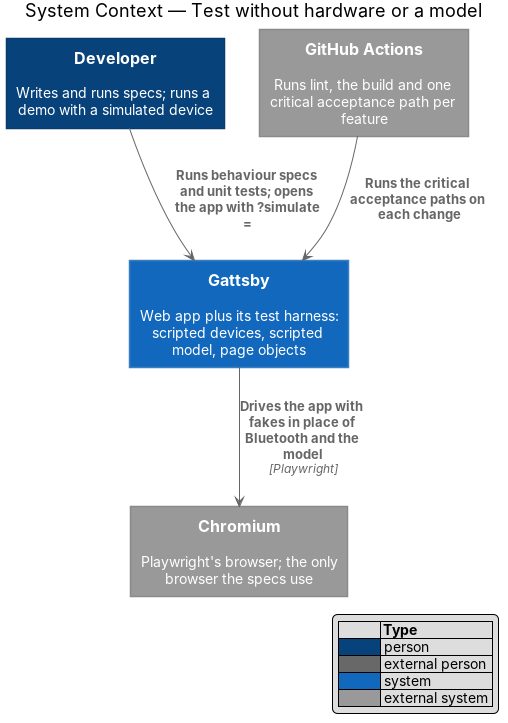
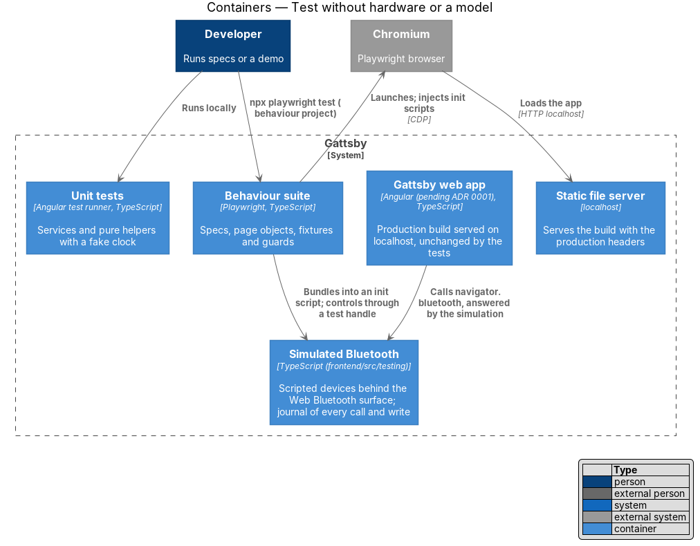
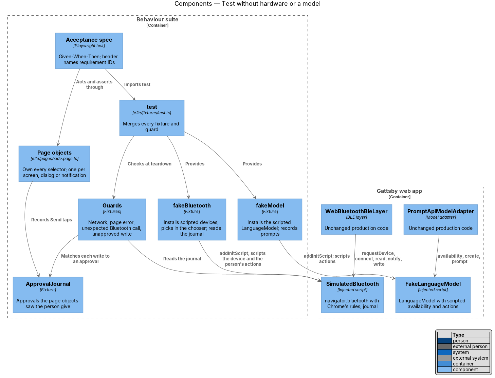
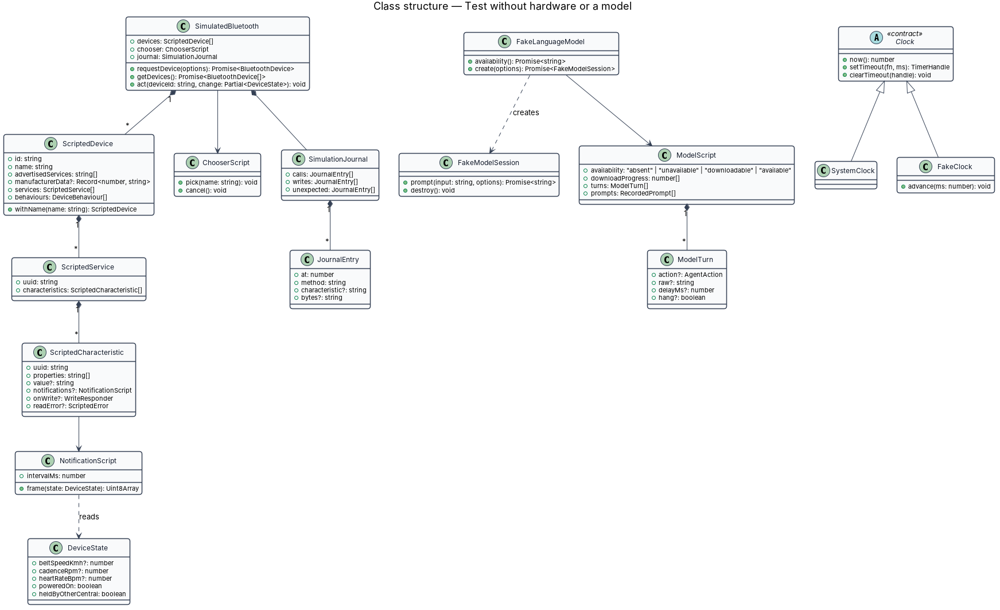
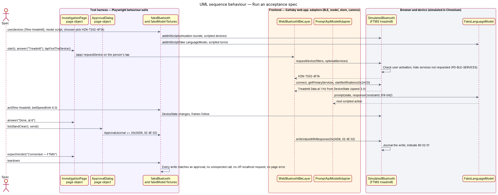
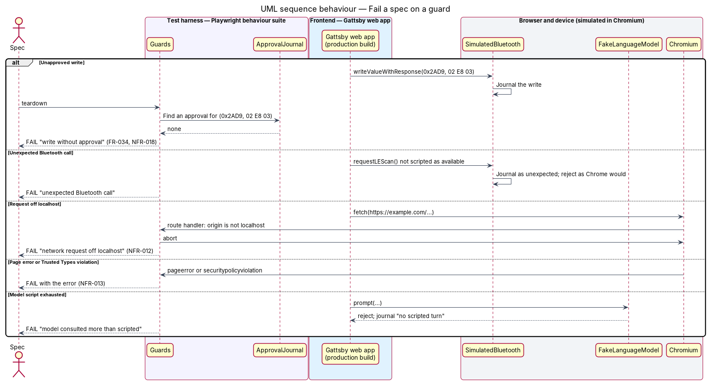
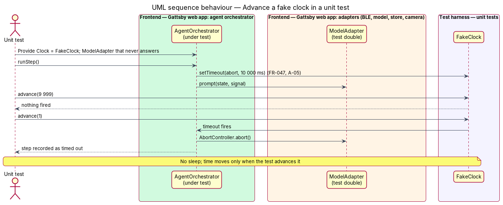
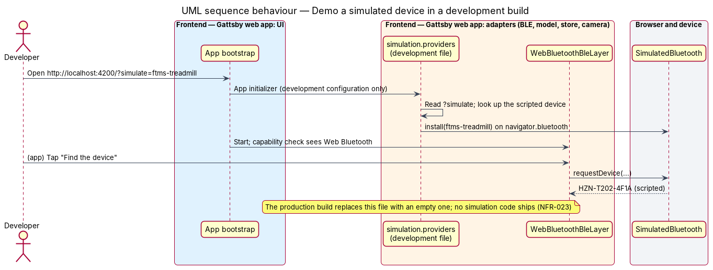

# Test without hardware or a model

## Overview

Gattsby talks to Bluetooth machines and to an on-device model, and neither is available to an
automated test: CI has no treadmill, no radio and no Gemini Nano, and an agent working in the
repository has none either. This feature is the test harness that stands in for them. It plays
scripted devices behind a fake `navigator.bluetooth`, returns scripted actions from a fake
`LanguageModel`, and lets the behaviour specs drive the real production build in Chromium through page
objects, so that every MVP acceptance criterion runs without hardware or a model. The same scripted
devices can be selected in a development build for demonstrations. It is a platform capability; it
adds no screen to the product.

**scripted device** — data description of one simulated device: advertised name and services, GATT
layout, values, notification frames computed from a device state, answers to writes, and behaviours
such as dropping the connection

**simulated Bluetooth** — implementation of the Web Bluetooth surface the BLE layer uses, answered by
scripted devices and following Chrome's rules, with a journal of every call and write

**model script** — ordered list of turns the fake `LanguageModel` plays: an action, malformed text, a
delay or no answer, plus the availability and download progress it reports

**page object** — test class that owns the selectors and actions for one screen, dialog or
notification

**guard** — fixture check that fails a spec on an unexpected Bluetooth call, an unapproved write, a
request off localhost, a page error or an exhausted model script

**fake clock** — clock a unit test moves forward explicitly, so time-driven rules run without sleeping

The harness has no mock of its own. It drives the screens the mocks in `docs/mocks/` define, through
one page object per screen id in `docs/mocks/manifest.json`. The simulated device in a development
build has no mock either; see *Rules*.

## Description

The design introduces these building blocks. App code is in the Angular (pending ADR 0001) workspace
under `frontend/`; the Playwright project is in `e2e/`, whose place beside or inside `frontend/` is
settled with ADR 0001.

**Scripted devices and the simulation** (`frontend/src/testing/simulated-bluetooth/`, shared by the
behaviour suite and the development build, never imported by `frontend/src/app/`):

- **`ScriptedDevice`** (`scripted-device.ts`) and one file per device in `devices/`: the FTMS
  treadmill (`ftms-treadmill.device.ts`, the mocks' Horizon T202 with `0x1826`, `0x180A`, `0x180D`,
  `0xFFF0`), the FTMS bike (`ftms-bike.device.ts`), the heart-rate strap (`heart-rate-strap.device.ts`),
  the device with only unknown services (`unknown-services.device.ts`), the device that drops
  (`dropping-device.device.ts`) and the device requiring encryption (`encrypted-device.device.ts`).
  `withName` and similar helpers derive variants: look-alike FTMS candidates (FR-013), or a device
  named `` (NFR-013 AC1).
- **`NotificationScript`** — computes each frame from a `DeviceState` (belt speed, cadence, heart
  rate, power, whether another central holds the device), so a spec changes the state the way the
  person would ("walk faster") and the frames follow. Frames use the real layouts, for example
  Treadmill Data with flags `0x040C`.
- **`SimulatedBluetooth`** (`simulated-bluetooth.ts`) — implements `requestDevice`, `getDevices`,
  `getAvailability`, `BluetoothDevice`, the GATT server, services and characteristics with `readValue`,
  `startNotifications`, `writeValueWithResponse` and their events. It follows Chrome's rules:
  `requestDevice` rejects without user activation; only services named in `filters` or
  `optionalServices` are reachable (PD-BLE-SERVICES); `watchAdvertisements`, `requestLEScan` and
  `getDevices` exist only when the spec scripts them as available (PD-ADV, PD-GETDEVICES).
- **`ChooserScript`** — the person's choice in Chrome's chooser, set by the spec in advance (`pick`,
  `cancel`), because the page cannot see or drive the chooser (A-10).
- **`SimulationJournal`** — every call with its arguments and timestamp, every write with its
  characteristic and bytes, and every call the script did not allow.

**Behaviour suite** (`e2e/`):

- **`fake-bluetooth.ts`** (`e2e/fixtures/`) — fixture `fakeBluetooth`. A global setup bundles the
  simulation into one script (with esbuild, which the Angular CLI already uses), and the fixture
  installs it with `page.addInitScript` before the app loads. It exposes `use(devices)`, the chooser,
  `act(deviceId, change)` for the person's physical actions, and the journal.
- **`fake-language-model.ts`** (`e2e/fixtures/`) — fixture `fakeModel`. It installs a global
  `LanguageModel` with `availability()`, `create({ monitor, signal })` with scripted download progress,
  and sessions whose `prompt(input, { responseConstraint, signal })` plays the next `ModelTurn` and
  honours the abort signal. It reports a context window (A-13) and records every prompt and its
  `responseConstraint` (FR-042). Availability `absent` leaves `LanguageModel` undefined, which puts the
  app in checklist mode.
- **`guards.ts`** (`e2e/fixtures/`) — a network guard (`context.route` aborts and records any request
  whose origin is not the app's localhost origin), a page-error guard (`pageerror`, and
  `securitypolicyviolation` events forwarded from the page for Trusted Types, NFR-013 AC2), the
  unexpected-call guard, the model-script guard and the approval guard.
- **`approval-journal.ts`** (`e2e/fixtures/`) — the approvals the page objects saw: each "Send" tap on
  the Approve a command dialog with the characteristic and bytes it showed, and each "Emergency stop"
  tap. The approval guard matches every journalled write to one of them, in order.
- **`test.ts`** (`e2e/fixtures/`) — `test = base.extend(...)` merging every fixture and guard, with
  options for capability profiles (for example no `LanguageModel`, no `watchAdvertisements`, no
  `getUserMedia`, NFR-021 AC1). Every spec imports `test` from here.
- **Page objects** (`e2e/pages/<id>.page.ts`) — one per screen id in the manifest, dialogs and
  notifications included (`verdict.page.ts`, `approval.page.ts`, `connection-banner.page.ts`). Each
  owns its locators, built from roles and accessible names, and exposes actions and reads in the
  person's words. No spec holds a selector.
- **Specs** (`e2e/specs/<subsystem>/<feature>.spec.ts`) — one per detailed design, each starting with
  the acceptance-test header that names the requirement IDs it covers.
- **`playwright.config.ts`** — Chromium only. The `behaviour` project runs by default; `visual`,
  `responsive` and `a11y` projects are kept current and run only when a person asks. The web server is
  the production build served on localhost with the production headers, so the specs exercise the
  Content Security Policy (NFR-012, NFR-013, NFR-014).

**Fake clock** (unit tests):

- **`Clock`** (`frontend/src/app/shared/clock.ts`) — contract for `now`, `setTimeout` and
  `clearTimeout`, provided as `SystemClock` in the app. Services with time-driven rules (recording
  windows, step and model timeouts, reconnect attempts, the chooser's 2-minute wait, "Still there?")
  take time from it.
- **`FakeClock`** (`frontend/src/testing/fake-clock.ts`) — `advance(ms)` fires due timers in order.
  Behaviour specs that need a long wait use Playwright's `page.clock` instead of sleeping.

**Demonstration in a development build:**

- **`simulation.providers.ts`** (`frontend/src/app/simulation/`) — an empty provider list in the
  production build. The development configuration replaces it, through Angular's `fileReplacements`,
  with `simulation.providers.development.ts`, an app initializer that reads `?simulate=<device id>`
  and installs `SimulatedBluetooth` with that scripted device before the BLE layer starts. The
  production bundle therefore holds no simulation code (NFR-023).

### Rules

1. App code is never changed for a test. The fakes replace browser globals; `WebBluetoothBleLayer`
   stays the only code that calls `navigator.bluetooth` and `PromptApiModelAdapter` the only code that
   calls `LanguageModel` (NFR-021).
2. No spec uses a real device, Bluetooth radio, model or network beyond localhost. A request off
   localhost, a page error, an unexpected Bluetooth call, an unapproved write or a prompt beyond the
   model script fails the spec.
3. Every write in the journal matches an earlier approval the person gave for that characteristic and
   those bytes, or an emergency-stop tap (FR-034, FR-039, NFR-018).
4. Specs act and assert only through page objects; a page object owns every selector.
5. Unit tests advance a fake clock; no test sleeps.
6. CI runs lint, the build and one critical acceptance path per feature, tagged `@critical`, within
   5 minutes; unit tests run locally. A flaky or slow spec is fixed or removed, never retried.
7. Hardware smoke tests on a real treadmill, bike or strap are run by a person (NFR-026), never by CI
   or an agent.
8. The harness holds no architecture test: nothing checks structure, naming, banned APIs or
   traceability headers.
9. The simulated device is for demonstrations only. Whether the app shows that a device is simulated,
   and how a person picks one other than through the URL, is `<TO SUPPLY>`; no mock draws it.

### MVP acceptance criteria and their specs

| Brief MVP acceptance criterion | Scripted device and model | Spec (example path) |
|---|---|---|
| FTMS treadmill gives "Connected — FTMS" with speed and distance confirmed | `ftms-treadmill`, scripted model | `e2e/specs/outcome/issue-the-verdict.spec.ts` |
| Heart-rate strap: Heart Rate Service identified, live BPM shown | `heart-rate-strap` | `e2e/specs/standard-protocols/show-live-metrics.spec.ts` |
| Unknown services: varying field found, "Partially decoded" or "Needs a missing tool" | `unknown-services` | `e2e/specs/proprietary-analysis/find-and-correlate-fields.spec.ts` |
| No model: the FTMS test passes in checklist mode | `ftms-treadmill`, model `absent` | `e2e/specs/agent/run-the-checklist.spec.ts` |
| No control command without explicit approval | any; approval guard on every spec | `e2e/specs/device-control/approve-a-command.spec.ts` |
| Profile exported as JSON and re-imported | `ftms-treadmill` | `e2e/specs/persistence/import-profiles-and-records.spec.ts` |

The dropping device serves FR-016 and NFR-007, and the encrypted device serves FR-033. The exact
`DOMException` Chrome raises for insufficient authentication or encryption is `<TO SUPPLY>`, to be
captured in a hardware smoke test.

### Data shapes

| Type | Fields |
|---|---|
| `ScriptedDevice` | `id`, `name`, `advertisedServices`, `manufacturerData?`, `services`, `behaviours` |
| `ScriptedCharacteristic` | `uuid`, `properties`, `value?`, `notifications?`, `onWrite?`, `readError?` |
| `DeviceState` | `beltSpeedKmh?`, `cadenceRpm?`, `heartRateBpm?`, `poweredOn`, `heldByOtherCentral` |
| `JournalEntry` | `at`, `method`, `characteristic?`, `bytes?` |
| `ModelScript` | `availability`, `downloadProgress`, `turns`, `prompts` |
| `ModelTurn` | `action?`, `raw?`, `delayMs?`, `hang?` |

### Tests that prove it

NFR-023's own criterion is met when the `behaviour` project, run in CI, has at least one passing spec
for each brief MVP acceptance criterion in the table above, with no real Bluetooth or model. The
harness itself is test code and gets no tests of its own (AGENTS.md exempts test-only changes); a
guard is trusted once a spec that breaks its rule on purpose fails while it is written.

## Requirements

The feature realizes the following level-2 (L2) requirement, which refines the level-1 (L1)
requirement cited beside it.

| L2 ID | Refines (L1) | Requirement |
|-------|--------------|-------------|
| [`NFR-023`](../../../specs/L2.md#nfr-023-testable-without-hardware-or-a-model) | `L1-022` | The repository must provide a fake `navigator.bluetooth` that plays scripted devices (FTMS treadmill, FTMS bike, heart-rate strap, unknown-services device, device that drops, device requiring encryption) and records every write, and a fake `LanguageModel` that returns scripted actions, so that every MVP acceptance criterion runs in Playwright on Chromium. A simulated device must also be selectable in the running app for demonstrations, but not in a production build. |

## Diagrams

### System context

A developer runs the specs and unit tests, or opens a development build with a simulated device;
GitHub Actions runs the critical paths; Playwright drives Chromium with fakes in place of Bluetooth
and the model.

### Containers

The behaviour suite bundles the simulated Bluetooth into an init script and drives the unchanged
production build, which a static server on localhost serves with the production headers; unit tests
run separately with a fake clock.

### Components

Specs act through page objects and the merged `test` fixture; `fakeBluetooth` and `fakeModel` inject
`SimulatedBluetooth` and `FakeLanguageModel`, which the unchanged BLE layer and model adapter call;
the guards read the journal and the approvals at teardown.

### Class structure

`SimulatedBluetooth` owns scripted devices, each with services and characteristics whose
`NotificationScript` reads a `DeviceState`, plus a `ChooserScript` and a `SimulationJournal`;
`FakeLanguageModel` plays a `ModelScript`; `FakeClock` and `SystemClock` implement `Clock`.

### Behaviour — run an acceptance spec

The spec installs the scripted treadmill and model, picks the device in the scripted chooser, changes
the belt speed as the person would, approves one command through the dialog's page object, and at
teardown the guards find every write approved. The sequences draw the harness in its own band.

### Behaviour — fail a spec on a guard

An unapproved write, an unexpected Bluetooth call, a request off localhost, a page error or a
Trusted Types violation, and a prompt beyond the model script each fail the spec with a named reason.

### Behaviour — advance a fake clock in a unit test

A unit test gives the orchestrator a `FakeClock` and a model that never answers, advances 10 seconds
and sees the call aborted and the step recorded as timed out (FR-047), without sleeping.

### Behaviour — demo a simulated device in a development build

In a development build `?simulate=ftms-treadmill` installs the scripted treadmill before the BLE layer
starts; the production build replaces the providers file with an empty one.

