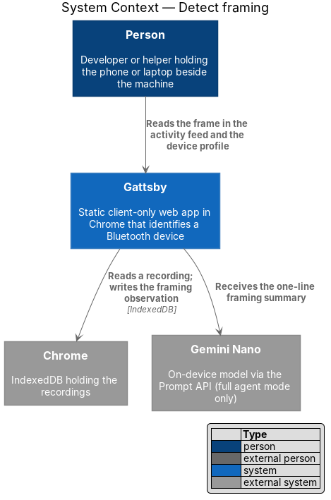
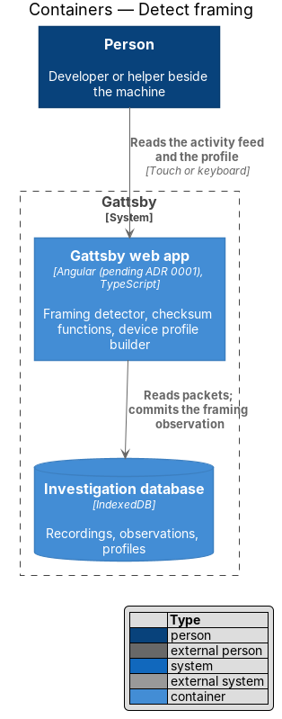
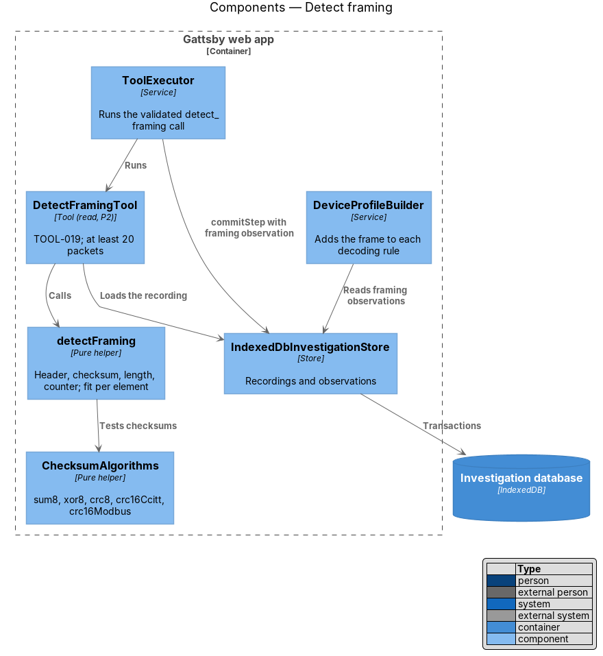
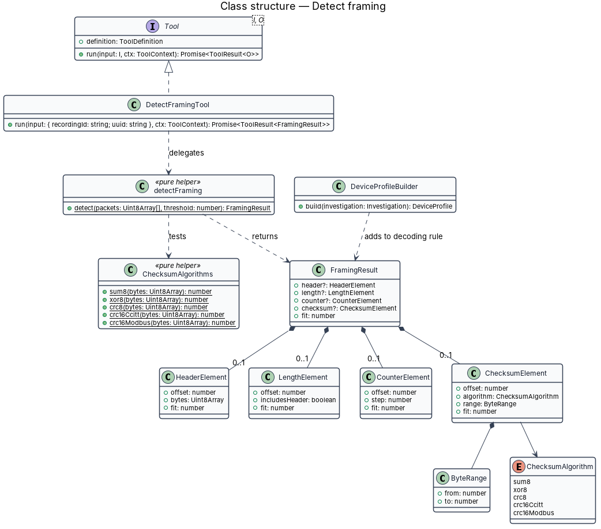
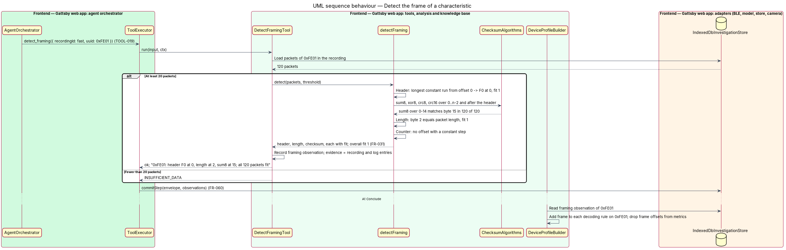

# Detect framing

## Overview

Many proprietary protocols wrap each packet in a frame: a fixed header, a length byte, a counter that
rises with each packet, and a checksum at the end. Those bytes carry no metric, yet they change from
packet to packet and so look like data to the fields analysis. This feature finds them. It examines
the packets of one characteristic in one recording, reports which parts of the frame it recognises
and how many packets fit each, and records the result as part of the characteristic's decoding rule,
so that an app reading the device later can check a packet's frame before decoding its fields. It
belongs to the proprietary-analysis subsystem, runs in the Proprietary stage of the playbook after
the fields analysis (see [find and correlate fields](../find-and-correlate-fields/README.md)), and is
a P2 feature.

**frame** — bytes of a packet that carry its structure rather than a metric: header, length,
counter and checksum

**header** — run of bytes at a fixed offset whose value is the same in every packet

**length byte** — byte whose value equals the packet's length, or the length of the bytes after the
header

**sequence counter** — byte that changes by the same step from one packet to the next, wrapping at
256

**checksum** — byte or pair of bytes computed from a range of the other bytes by a known algorithm

**fit** — share of packets (or of consecutive packet pairs, for a counter) that agree with a frame
element

**decoding rule** — device-profile entry that tells an app how to read a metric from a
characteristic: offset, type, scale, unit and, where found, the frame

The feature has no screen of its own. Its summary appears in the activity feed of the Investigation
screen in its proprietary state (`docs/mocks/pages/investigation/proprietary.html`), whose idle
recording already notes frame-like bytes ("Bytes 0–1 never change; byte 15 counts up"). Its result
belongs in the device profile's decoding rules (`docs/mocks/pages/device-profile/partial.html`), whose
table shows characteristic, bytes, type and scale per metric but has no place for a frame yet. No mock
shows a framing result; the summary wording below is provisional (A-01), and the profile mock needs a
frame line before the profile screen shows it.

## Description

The design introduces these building blocks in the Angular (pending ADR 0001) workspace under
`frontend/src/app/`:

- **`detectFraming`** (`analysis/framing-detector.ts`) — pure helper. Takes the packets of one
  characteristic and runs four detectors, each returning its best candidate and that candidate's fit:
  - **header** — the longest run of bytes from offset 0 that holds one value in every packet;
  - **length** — an offset whose value equals the packet length (`includesHeader` true) or the
    length after the header (`includesHeader` false);
  - **counter** — an offset whose value differs from the previous packet's by the same non-zero step,
    modulo 256;
  - **checksum** — the last byte, or the last two bytes in both byte orders, tested against 8-bit sum,
    8-bit XOR, CRC-8, CRC-16 CCITT and CRC-16 Modbus, over the range from the first byte, and from the
    byte after the header, to the byte before the checksum.
  Packets of different lengths are tested together for the header, length and checksum, which is how
  a length byte is told apart from a constant. Offsets already claimed by one element are not offered
  to the next (header first, then checksum, length and counter).
- **`ChecksumAlgorithms`** (`analysis/checksum-algorithms.ts`) — pure functions `sum8`, `xor8`,
  `crc8`, `crc16Ccitt` and `crc16Modbus`. CRC-16 Modbus uses its standard parameters (polynomial
  `0x8005` reflected, initial value `0xFFFF`). The CRC-8 polynomial and initial value, and the CRC-16
  CCITT variant (initial value `0xFFFF` or `0x0000`), are `<TO SUPPLY>`: neither the brief nor TOOL-019
  names them. The detector may test more than one variant once they are chosen; each is reported under
  its own algorithm name.
- **`DetectFramingTool`** (`tools/analysis/detect-framing.tool.ts`) — TOOL-019, safety class `read`,
  P2. Input `{ recordingId, uuid }`. It loads the recording's packets for that characteristic, refuses
  with `INSUFFICIENT_DATA` below 20 packets, calls `detectFraming`, and records one `Observation` of
  kind `framing` holding the result, with the recording and its raw-log entries as evidence (FR-056).
- **`FramingResult`** (`analysis/framing-result.ts`) — the tool's output: `header?`, `length?`,
  `counter?`, `checksum?`, each with its own `fit`, and an overall `fit`, the share of packets that
  agree with every element found.
- **`DeviceProfileBuilder`** (`outcome/device-profile-builder.ts`) — adds the `framing` observation of
  a characteristic to every decoding rule on that characteristic, and leaves the frame's offsets out
  of the readable metrics (see [build the device profile](../../outcome/build-the-device-profile/README.md)).

### Rules

1. An element is reported only when its fit reaches the framing threshold. The threshold is
   configuration; its value is `<TO SUPPLY>` (the specs give none). FR-031's criterion and TOOL-019's
   criterion expect a fit of 1 for a clean frame, which any threshold accepts.
2. Each element is reported with the share of packets that fit it (FR-031, criterion 1), not only the
   overall fit.
3. A packet that fails the checksum is counted against the checksum's fit and still kept in the
   recording; the detector never drops or rewrites data.
4. The detector never guesses keys or decrypts. A stream whose bytes show no frame and no varying
   field is reported with `fit` 0 and no elements; whether that points to encryption is the verdict's
   call (see [issue the verdict](../../outcome/issue-the-verdict/README.md) and the missing-tool
   verdict, `docs/mocks/pages/verdict/missing-tool.html`).
5. The summary names elements and offsets, for example "0xFE01: header F0 at 0, length at 2, sum8 over
   0–14 at 15; all 120 packets fit". Header bytes are knowledge about the frame, not a metric, so the
   summary may name them (FR-044).

### Data shapes

| Type | Fields |
|---|---|
| `FramingResult` | `header?: { offset, bytes, fit }`, `length?: { offset, includesHeader, fit }`, `counter?: { offset, step, fit }`, `checksum?: { offset, algorithm, range, fit }`, `fit` (0 to 1) |
| `ChecksumAlgorithm` | `sum8`, `xor8`, `crc8`, `crc16Ccitt`, `crc16Modbus` |
| `ByteRange` | `from`, `to` (inclusive offsets) |

TOOL-019's output names a single `fit`. FR-031 asks for the share of packets that fit each element, so
`FramingResult` adds a `fit` to each element and keeps the overall `fit` TOOL-019 names.

### Errors

| Code | Raised by | Meaning to the person |
|---|---|---|
| `INSUFFICIENT_DATA` | `DetectFramingTool` | "Not enough packets to look for a frame." The playbook may record longer, within 120 seconds. |
| `INVALID_INPUT` | `ActionValidator` | A recording ID or characteristic that does not resolve. Not shown; the agent sees the refusal. |

### Tests that prove it

Unit tests carry this feature, because the detector is a pure helper. They cover FR-031's criterion
(packets starting `F0`, a length byte at offset 2 and a final 8-bit sum give header, length and
checksum each with its fit), TOOL-019's criterion (`sum8` with fit 1), a counter with step 1 that
wraps from `FF` to `00`, a stream of 19 packets (`INSUFFICIENT_DATA`) and random bytes (no element).
The acceptance spec uses the fake `navigator.bluetooth` (`e2e/fixtures/fake-bluetooth.ts`) playing
the unknown-services device with framed packets, and the `DeviceProfilePage` page object, and checks
that the exported profile's decoding rule carries the frame.

## Requirements

The feature realizes the following level-2 (L2) requirements; each refines the level-1 (L1)
requirement cited beside it.

| L2 ID | Refines (L1) | Requirement |
|-------|--------------|-------------|
| [`FR-031`](../../../specs/L2.md#fr-031-detect-proprietary-framing) | `L1-008` | Gattsby must look for constant headers, length bytes, sequence counters and checksums (sum, XOR, CRC-8, CRC-16) in proprietary packets, and record any it finds as part of the decoding rule. |
| [`TOOL-019`](../../../specs/L2.md#tool-019-detect_framing) | `L1-008` | Finds constant headers, length bytes, sequence counters and checksums (8-bit sum, XOR, CRC-8, CRC-16 CCITT and Modbus) in proprietary packets. |

## Diagrams

### System context

Framing detection reads only recordings Gattsby already holds; the model, in full agent mode, may
choose to run it and sees its one-line summary.

### Containers

The web app reads the recording from the investigation database, runs the detector in the browser
and stores the framing observation with the step.

### Components

`DetectFramingTool` loads the packets, calls `detectFraming` and its checksum functions, and records
the result that `DeviceProfileBuilder` adds to the decoding rule.

### Class structure

`FramingResult` composes up to four frame elements, each with its own fit; the checksum element names
one `ChecksumAlgorithm` and the byte range it covers.

### Behaviour — detect the frame of a characteristic

The tool checks there are 20 packets, runs the four detectors in order, records a `framing`
observation, and the profile later carries it in the decoding rule.

