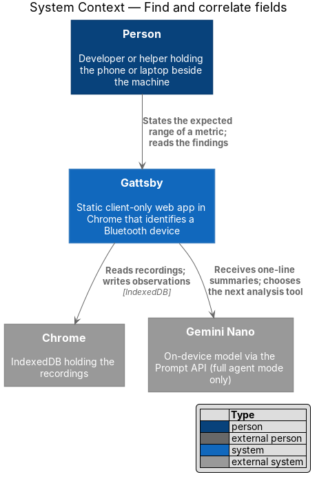
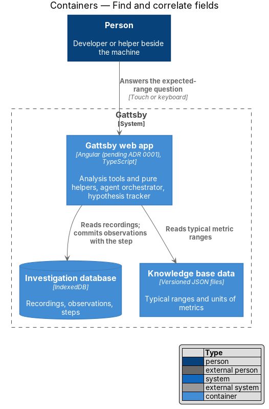
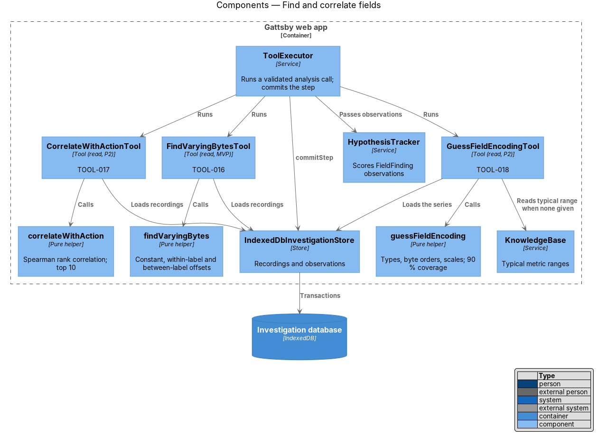
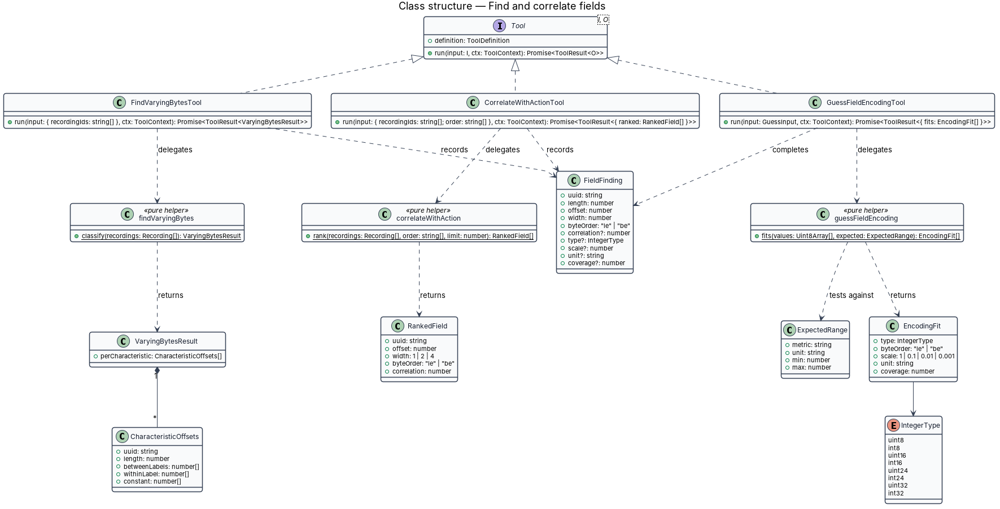
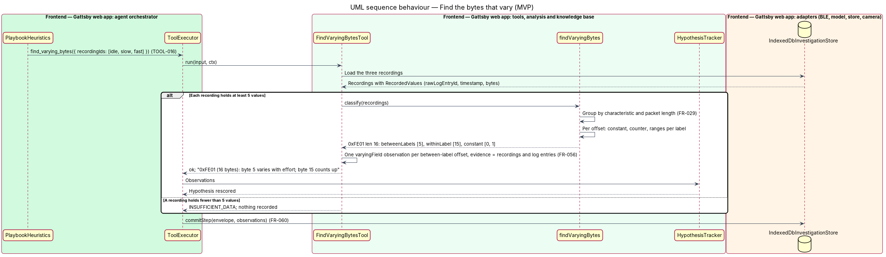
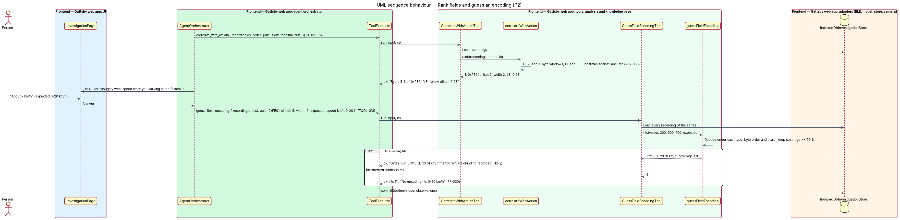

# Find and correlate fields

## Overview

A device that speaks an unknown protocol still has to put its numbers somewhere in the bytes it
sends. This feature finds where. It compares the labelled recordings made on the proprietary path
(see [record a baseline and activity levels](../record-baseline-and-activity/README.md)) and names
the byte positions that change with the person's actions. In P2 it then ranks those positions by how
closely they follow the effort levels, and tests candidate encodings against the range the person
expects ("a treadmill speed between 0 and 20 km/h"). It belongs to the proprietary-analysis
subsystem, runs in the Proprietary stage of the playbook, and is pure analysis: it reads stored
recordings and needs no connection.

**offset** — zero-based position of a byte within one packet of one characteristic

**packet length** — number of bytes in one notification or indication; a characteristic that sends
packets of several lengths is analysed once per length

**varying field** — offset, or window of adjacent offsets, whose value differs between recordings of
different labels

**between-label offset** — offset whose values under at least two labels do not overlap

**within-label offset** — offset that changes inside one recording but not consistently between labels,
such as a counter or noise

**candidate field** — window of one, two or four adjacent bytes, read in one byte order, scored as a
possible carrier of a metric

**encoding** — integer type (unsigned or signed; 8, 16, 24 or 32 bits), byte order and scale that turn
a candidate field's bytes into a value with a unit

**coverage** — share of a field's decoded values that fall inside the expected range

The feature has no screen of its own; its results appear in the activity feed of the Investigation
screen (`docs/mocks/pages/investigation/proprietary.html`) as one-line summaries, and on the verdict.
The partial verdict (`docs/mocks/pages/verdict/partial.html`) shows the outcome it feeds: a metric
decoded from a guessed encoding ("Calories bytes 9–10, uint16 LE likely"), and a characteristic whose
bytes vary with effort but whose layout is unknown ("Characteristic 0x0036 20 bytes, varies with
effort") under "Couldn't determine". MVP needs only `find_varying_bytes` (TOOL-016), which carries the
brief's MVP acceptance criterion 3: a device with only unknown services ends with at least one
varying field as evidence. `correlate_with_action` (TOOL-017) and `guess_field_encoding` (TOOL-018)
are P2.

## Description

The design introduces these building blocks in the Angular (pending ADR 0001) workspace under
`frontend/src/app/`. Each tool is a thin wrapper that loads recordings from the store, calls a pure
helper, records observations and returns the result envelope (FR-072). The pure helpers hold all the
logic and have unit tests.

- **`findVaryingBytes`** (`analysis/find-varying-bytes.ts`) — pure helper. Groups the samples of the
  given recordings by characteristic and packet length. For each offset it classifies the values as
  `constant` (one value in every recording), `betweenLabels` (the value ranges of at least two labels
  do not overlap) or `withinLabel` (it changes inside a recording but no two labels separate). An
  offset that steps by the same non-zero amount (modulo 256) from packet to packet in every recording
  is a counter and is classified `withinLabel` even when its ranges differ between labels, because a
  counter keeps rising over time. A single recording yields only `constant` and `withinLabel`; the
  recorder's summary uses that to say "Bytes 0–1 never change; byte 15 counts up".
- **`FindVaryingBytesTool`** (`tools/analysis/find-varying-bytes.tool.ts`) — TOOL-016, safety class
  `read`, MVP. Input `{ recordingIds }` (2–6). Refuses with `INSUFFICIENT_DATA` when a recording holds
  fewer than 5 values of a characteristic. Records one `Observation` of kind `varyingField` per
  between-label offset, with the recording IDs and the raw-log entry IDs of its samples as evidence
  (FR-056).
- **`correlateWithAction`** (`analysis/correlate-with-action.ts`) — pure helper. Builds every candidate
  field from the between-label and within-label offsets: single bytes, and 2- and 4-byte windows read
  little-endian and big-endian as unsigned integers. It gives each sample the rank of its label in the
  given order (for example `idle` 0, `slow` 1, `medium` 2, `fast` 3) and computes the Spearman rank
  correlation between the candidate's values and those ranks. It returns the 10 candidates with the
  highest absolute correlation, keeping the sign. Ties break by lower offset, then narrower width, so
  the result is deterministic.
- **`CorrelateWithActionTool`** (`tools/analysis/correlate-with-action.tool.ts`) — TOOL-017, `read`,
  P2. Input `{ recordingIds, order }`. Needs three or more labelled recordings whose labels all appear
  in `order`; otherwise `INSUFFICIENT_DATA`.
- **`guessFieldEncoding`** (`analysis/encoding-guesser.ts`) — pure helper. For one field it decodes
  every sample under each encoding: unsigned and signed 8, 16, 24 and 32 bits, little-endian and
  big-endian for widths above 8, scales 1, 0.1, 0.01 and 0.001. An encoding fits when at least 90 % of
  the decoded values fall inside `expected.min` to `expected.max` (TOOL-018, criterion 2). Fits are
  ordered by coverage, then by the share of the expected range the decoded values span (so 3 to 7 km/h
  ranks above 0.3 to 0.7 km/h for an expected 0–20 km/h), then unsigned before signed, then narrower
  width. When nothing fits, it returns an empty list, never the closest wrong one (FR-030,
  criterion 2).
- **`GuessFieldEncodingTool`** (`tools/analysis/guess-field-encoding.tool.ts`) — TOOL-018, `read`, P2.
  Input `{ recordingId, uuid, offset, width?, expected: { metric, unit, min, max } }`. It reads the
  field from every recording of the named recording's series, so that values recorded at different
  levels (300, 500 and 700 at 3, 5 and 7 km/h) are tested together. Without `width` it tests 1, 2, 3
  and 4 bytes from `offset`. The expected range comes from the person's answer to an `ask_user`
  question or from the knowledge base's typical range for the metric; the model may propose it but
  never computes the fit.
- **`FieldFinding`** (`analysis/field-finding.ts`) — the observation payload for a ranked field or an
  encoding fit: `uuid`, `length`, `offset`, `width`, `byteOrder`, `correlation`, and, once guessed,
  `type`, `scale`, `unit`, `coverage`. `HypothesisTracker` scores it and `DeviceProfileBuilder` turns
  a fitting one into a readable metric's decoding rule (offset, type, scale, unit) with the status
  "likely" (see [track the hypothesis](../../outcome/track-the-hypothesis/README.md) and
  [build the device profile](../../outcome/build-the-device-profile/README.md)).

### Rules

1. Analysis runs only in deterministic code. The model may choose to call these tools and may
   propose an expected range; it never decodes bytes, ranks fields or scores a fit (AGENTS.md).
2. Packets of different lengths from one characteristic are analysed separately; an offset is
   reported per characteristic and per packet length (FR-029).
3. `find_varying_bytes` needs 2 to 6 recordings of the same characteristic and at least 5 values in
   each; `correlate_with_action` needs three or more ordered labels.
4. A field ranked by `correlate_with_action` keeps the sign of its correlation, so a value that falls
   as effort rises (a pace in seconds per kilometre) is still found.
5. An encoding is reported only when it reaches 90 % coverage. The guesser never stretches a scale or
   range to make a field fit.
6. When an investigation concludes with at least one varying field and no confident decoding, the
   verdict is *Partially decoded* or *Needs a missing tool*, with the varying fields as evidence
   (FR-029, criterion 2). `VerdictService` applies that rule (see
   [issue the verdict](../../outcome/issue-the-verdict/README.md)); this feature supplies the
   `varyingField` observations it reads.
7. Each summary names the characteristic, offsets, widths and correlation or coverage, never payload
   bytes, for example "0xFE01 (16 bytes): bytes 5–6 vary with effort; byte 15 counts up" (FR-044).

### Data shapes

| Type | Fields |
|---|---|
| `VaryingBytesResult` | `perCharacteristic: [{ uuid, length, betweenLabels, withinLabel, constant }]` (offset lists) |
| `RankedField` | `uuid`, `offset`, `width` (1, 2 or 4), `byteOrder` (`le`, `be`), `correlation` (−1 to 1) |
| `ExpectedRange` | `metric`, `unit`, `min`, `max` |
| `EncodingFit` | `type` (`uint8` … `int32`), `byteOrder`, `scale`, `unit`, `coverage` (0 to 1) |
| `FieldFinding` | `uuid`, `length`, `offset`, `width`, `byteOrder`, `correlation?`, `type?`, `scale?`, `unit?`, `coverage?` |

### Errors

| Code | Raised by | Meaning to the person |
|---|---|---|
| `INSUFFICIENT_DATA` | All three tools | "Not enough data to compare yet." The playbook asks for another level or a longer recording. |
| `INVALID_INPUT` | `ActionValidator`, `GuessFieldEncodingTool` | An input outside the schema, or `expected.min` above `expected.max`. Not shown; the agent sees the refusal. |

### Tests that prove it

The acceptance spec uses the fake `navigator.bluetooth` (`e2e/fixtures/fake-bluetooth.ts`) playing
the unknown-services device with a script whose byte 5 rises when the person taps "Ready" for a
faster level, and the `InvestigationPage` and `VerdictPage` page objects. It checks that byte 5 is
reported as varying with the action, with the recordings as evidence (FR-029, criterion 1), and that
the verdict is *Partially decoded* or *Needs a missing tool* with that field as evidence (criterion 2).
A P2 spec scripts bytes 5–6 as little-endian uint16 in 0.01 km/h at 3, 5 and 7 km/h and checks the
top-ranked candidate is "bytes 5–6, uint16 LE, ×0.01, km/h" (FR-030, criterion 1). Unit tests cover
`findVaryingBytes` (one differing byte gives `betweenLabels` `[5]`; 3 values give
`INSUFFICIENT_DATA`; a counter is `withinLabel`), `correlateWithAction` (a rising 16-bit LE field
ranks first above 0.9) and `guessFieldEncoding` (300, 500, 700 at 0–20 km/h gives uint16 ×0.01;
nothing at 90 % gives an empty list).

## Requirements

The feature realizes the following level-2 (L2) requirements; each refines the level-1 (L1)
requirement cited beside it.

| L2 ID | Refines (L1) | Requirement |
|-------|--------------|-------------|
| [`FR-029`](../../../specs/L2.md#fr-029-find-the-fields-that-vary) | `L1-008` | Gattsby must compare the recordings and name the byte positions that change between labels and those that change within a label (counters, noise), per characteristic and per packet length. |
| [`FR-030`](../../../specs/L2.md#fr-030-correlate-fields-with-actions-and-guess-encodings) | `L1-008` | Gattsby must rank varying fields by correlation with the person's actions and test candidate encodings (unsigned and signed 8, 16 and 32-bit, both byte orders, scales 1, 0.1, 0.01, 0.001) against the expected range of the metric the person described. |
| [`TOOL-016`](../../../specs/L2.md#tool-016-find_varying_bytes) | `L1-008` | Compares two or more recordings and finds, per characteristic and packet length, the byte offsets that change between labels, those that change within a label, and those that never change. |
| [`TOOL-017`](../../../specs/L2.md#tool-017-correlate_with_action) | `L1-008` | Ranks candidate fields (single bytes and 2- and 4-byte windows in both byte orders) by correlation with the ordered effort levels of labelled recordings. |
| [`TOOL-018`](../../../specs/L2.md#tool-018-guess_field_encoding) | `L1-008` | Tests encodings (unsigned and signed 8, 16, 24 and 32-bit, both byte orders, scales 1, 0.1, 0.01, 0.001) for one field against an expected range and unit given by the person or the agent. |

FR-030 lists 8, 16 and 32-bit encodings; TOOL-018 adds 24-bit. The guesser follows TOOL-018, which
includes every encoding FR-030 names.

## Diagrams

### System context

The analysis reads only what Gattsby has already stored; the person supplies the expected range of a
metric when asked.

### Containers

The web app reads the recordings from the investigation database, runs the analysis in the browser
and writes the resulting observations back; the knowledge base supplies typical metric ranges.

### Components

Three analysis tools wrap three pure helpers; each reads recordings through the store and returns
observations that `HypothesisTracker` and `DeviceProfileBuilder` consume.

### Class structure

Each tool implements `Tool<I, O>` and delegates to its pure helper; `FieldFinding` is the shared
observation payload from varying offset to guessed encoding.

### Behaviour — find the bytes that vary (MVP)

`find_varying_bytes` compares the idle and level recordings and records one `varyingField`
observation per between-label offset; a recording with fewer than 5 values returns
`INSUFFICIENT_DATA`.

### Behaviour — rank fields and guess an encoding (P2)

`correlate_with_action` ranks candidate fields against the ordered levels; `guess_field_encoding`
tests the top field against the range the person gave and reports a fit, or an empty list when none
reaches 90 % coverage.

