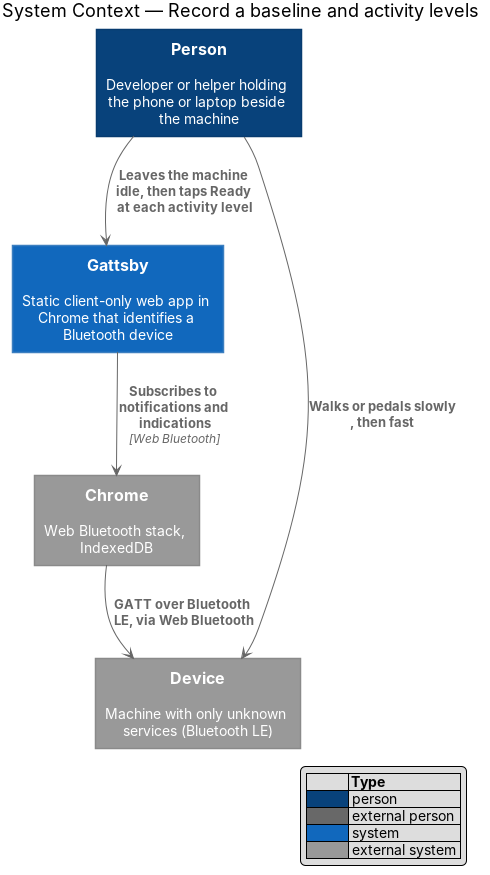
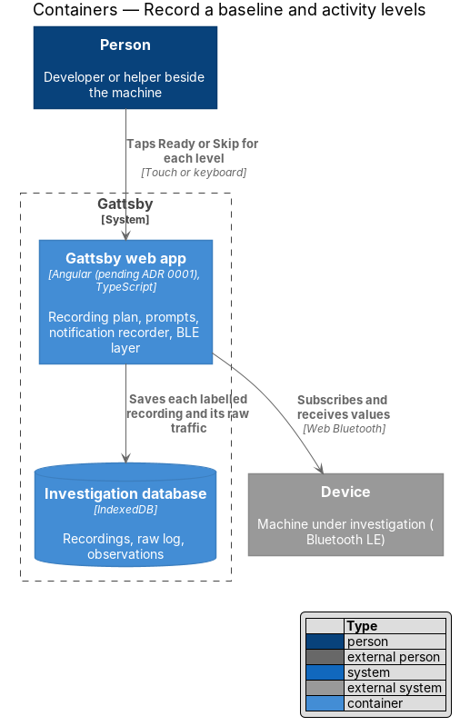
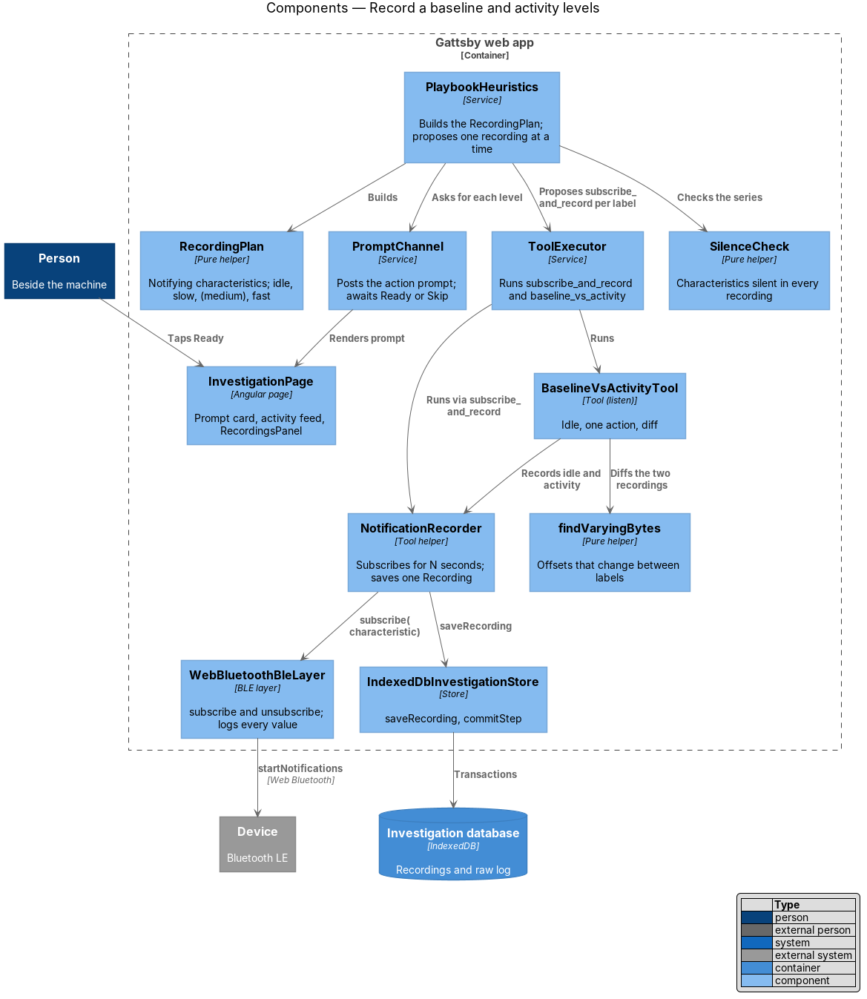
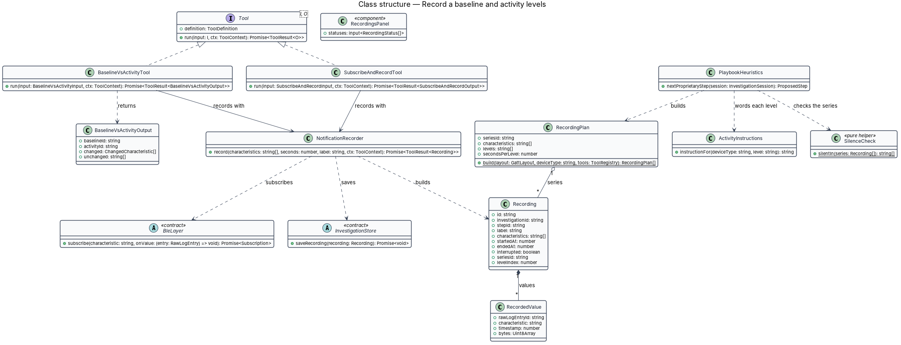
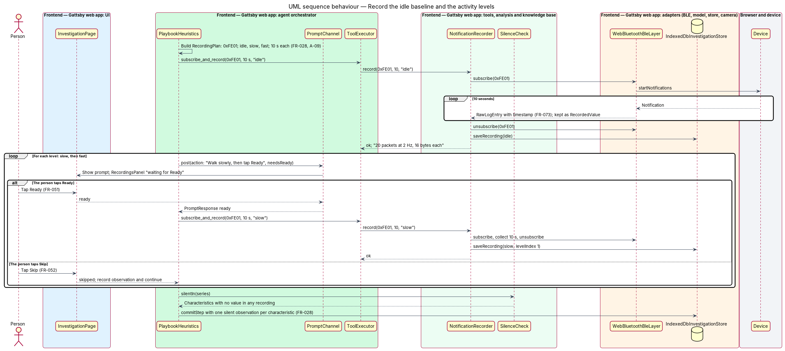
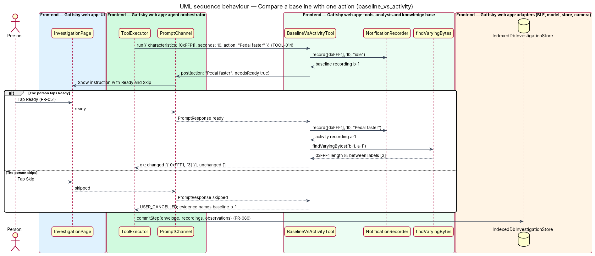

# Record a baseline and activity levels

## Overview

When a device exposes no standard profile that Gattsby can decode, the only way to learn its protocol
is to watch its data while the person changes what the machine is doing. This feature is the first
step of that work. It subscribes to every characteristic that notifies or indicates, records the
device standing idle, then asks the person for two or three activity levels and records each one
under its label. Every later step of the proprietary path (finding the fields that vary, correlating
them with effort, guessing encodings, detecting framing, trying a vendor handshake) reads the
recordings this feature makes. It belongs to the proprietary-analysis subsystem and runs in the
Proprietary stage of the playbook.

**recording** — stored, timestamped series of the values one or more characteristics sent during one
labelled interval

**label** — name of the condition the device was in during a recording: `idle`, or an activity level
such as `slow`, `medium` or `fast`

**baseline** — recording labelled `idle`, made while the device is switched on and not in use

**activity level** — one rung of an ordered effort scale the person produces on request (walking
slowly, then walking fast)

**recording series** — set of recordings made by one recording plan for the same characteristics,
whose labels share one order

**silent characteristic** — characteristic that notifies or indicates but sent no value during any
recording of a series

The Investigation screen in its proprietary state (`docs/mocks/pages/investigation/proprietary.html`)
shows the feature at work. The activity feed lists the idle recording as a `subscribe_and_record`
step with its one-line summary ("20 packets at 2 Hz, 16 bytes each. Bytes 0–1 never change; byte 15
counts up."). The prompt card asks the person to walk slowly and tap "Ready", and explains why ("I'll
record 10 s labelled "slow" and compare it with idle"). The side panel lists the series' recordings
with their state: "Idle 10 s · 20 packets", "Slow waiting for Ready", "Fast —". The live panel shows
raw packets only, marked "not labelled yet", because nothing is decoded on this path. Recording never
starts before the person taps "Ready"; after 2 minutes without it Gattsby asks "Still there?"
(`docs/mocks/dialogs/still-there/default.html`, FR-051).

The feature offers two ways to record. The **recording plan** is the playbook's fixed sequence for the
Proprietary stage: one idle recording, then one recording per activity level, each after "Ready".
`baseline_vs_activity` (TOOL-014) is a single tool call that records an idle baseline, asks for one
action, records during it, and reports which byte offsets changed. The plan builds the series that
the analysis tools need; `baseline_vs_activity` answers one quick question ("does anything change
when the person pedals faster?") in one step. Both record through the same recorder and store the
same `Recording` records.

## Description

The design introduces these building blocks in the Angular (pending ADR 0001) workspace under
`frontend/src/app/`:

- **`PlaybookHeuristics`** (`agent/playbook-heuristics.ts`) — on entering the Proprietary stage it
  builds a `RecordingPlan` from the GATT layout and the device type the person gave in Prepare, then
  proposes the plan's steps one at a time without consulting the model (FR-046). In checklist mode
  `ChecklistRunner` runs the same plan.
- **`RecordingPlan`** (`agent/recording-plan.ts`) — pure helper. Given the enumerated
  characteristics, it selects every characteristic with the `notify` or `indicate` property, at most
  8 per recording (TOOL-013's input limit; a layout with more is split across several series). It
  sets the labels: `idle`, then `slow` and `fast`, or `slow`, `medium` and `fast` when
  `correlate_with_action` (TOOL-017, P2) is in the registry, because that tool needs three ordered
  labelled recordings. Each level lasts 10 seconds by default (A-09).
- **`ActivityInstructions`** (`agent/activity-instructions.ts`) — maps a device type and a level to
  the plain instruction the person sees, for example "Step on, start the belt and walk slowly. Tap
  Ready once you're walking." for a treadmill at `slow`. The wording is provisional until the
  Behavior Description is added (A-01, OQ-06). An unknown device type gets a generic instruction
  ("Use the machine gently").
- **`NotificationRecorder`** (`tools/listening/notification-recorder.ts`) — records the given
  characteristics for a number of seconds under one label. Designed in
  [decode standard data](../../standard-protocols/decode-standard-data/README.md): it subscribes
  through `BleLayer.subscribe`, keeps each delivered `RawLogEntry` as a `RecordedValue`, unsubscribes
  when the time ends or the `AbortSignal` fires, and saves one `Recording` through
  `InvestigationStore.saveRecording`. It reports a characteristic `silent` when it sent nothing, and
  the recording `interrupted` when the connection drops (TOOL-013, criterion 3). This design adds the
  series fields below; `subscribe_and_record` (TOOL-013) and `baseline_vs_activity` share the
  recorder.
- **`SubscribeAndRecordTool`** (`tools/listening/subscribe-and-record.tool.ts`) — specified by
  TOOL-013 and designed in decode standard data. The plan calls it once per label.
- **`BaselineVsActivityTool`** (`tools/listening/baseline-vs-activity.tool.ts`) — TOOL-014, safety
  class `listen`. It records the baseline with `NotificationRecorder`, posts an `action` prompt
  through `PromptChannel` (the same prompt `request_action`, TOOL-026, shows, with `needsReady`
  true), records the activity once the person taps "Ready", and diffs the two recordings with the
  pure helper `findVaryingBytes` (see
  [find and correlate fields](../find-and-correlate-fields/README.md)).
- **`SilenceCheck`** (`analysis/silence-check.ts`) — pure helper. Given a recording series, it
  returns the characteristics that sent nothing in any recording. The orchestrator records one
  `Observation` of kind `silent` per such characteristic; when every characteristic is silent, the
  playbook moves to the vendor handshake check (see
  [try a vendor handshake](../try-a-vendor-handshake/README.md)).
- **`RecordingsPanel`** (`ui/recordings-panel/recordings-panel.component.ts`) — presentation
  component. Input: the series' `RecordingStatus` list. It shows each label with its length and packet
  count, "waiting for Ready", "recording", "interrupted" or "—", as the mock's side panel does.

### Rules

1. The plan subscribes to every characteristic that notifies or indicates. A characteristic the
   browser hides (`SERVICE_NOT_PERMITTED`, `BLOCKLISTED`) is reported by
   [report hidden services](../../identification/report-hidden-services/README.md), not recorded.
2. The baseline comes first and is labelled `idle`. The person is asked to leave the machine on and
   not use it; this prompt needs no "Ready" because nothing has to start.
3. An activity recording starts only after the person taps "Ready" (FR-051). The recorder runs for
   the level's seconds and ends by itself; the prompt then shows "Done" as the recording's end.
4. Each recording is at least 10 seconds by default (A-09). A recording longer than 120 seconds is
   refused with `INVALID_INPUT` (NFR-005, TOOL-013). `baseline_vs_activity` accepts 5 to 60 seconds.
5. A skipped level (FR-052) is recorded as an observation and the plan continues with the levels it
   has. With fewer than two labelled recordings, `find_varying_bytes` returns `INSUFFICIENT_DATA` and
   the verdict reports that no field could be compared.
6. A characteristic that sends nothing during every recording of the series is recorded as `silent`
   (FR-028, criterion 2). Silence is an observation, not an error: the tool still returns `ok: true`.
7. The recorder releases every subscription it opened, whether the recording ends, is skipped, is
   aborted by stop or emergency stop, or the connection drops.
8. Raw bytes never reach the model. The step's summary names packet counts, rates, lengths and byte
   offsets, never payload hex (FR-041, FR-044).

### Data shapes

| Type | Fields |
|---|---|
| `RecordingPlan` | `seriesId`, `characteristics` (UUIDs), `levels` (ordered labels, `idle` first), `secondsPerLevel` |
| `Recording` (`store/model/recording.ts`) | `id`, `investigationId`, `stepId`, `label`, `characteristics`, `startedAt`, `endedAt`, `interrupted`, `values: RecordedValue[]`, plus `seriesId` and `levelIndex` from this design |
| `RecordedValue` | `rawLogEntryId`, `characteristic`, `timestamp`, `bytes` |
| `RecordingStatus` | `label`, `state` (`pending`, `waitingForReady`, `recording`, `done`, `interrupted`, `skipped`), `seconds`, `packets` |
| `BaselineVsActivityInput` | `characteristics` (UUIDs), `seconds` (5–60), `action` |
| `BaselineVsActivityOutput` | `baselineId`, `activityId`, `changed: [{ uuid, offsets }]`, `unchanged` (UUIDs) |

`Recording` and `RecordedValue` are defined by decode standard data. `seriesId` and `levelIndex` are
the fields this design adds, so that the analysis tools can find the other recordings of a series
and their order. A silent characteristic is one with no `RecordedValue` in any recording of the
series.

### Errors

| Code | Raised by | Meaning to the person |
|---|---|---|
| `NOT_CONNECTED` | `NotificationRecorder` | "The machine disconnected. Gattsby is reconnecting." The recording is kept and marked interrupted. |
| `PROPERTY_MISSING` | `NotificationRecorder` | Never expected from the plan, which picks only notifying characteristics; it is recorded with the tool and stage (NFR-025). |
| `AUTH_REQUIRED` | `NotificationRecorder` via the BLE layer | "This machine needs pairing or a code Gattsby doesn't have." Handled by FR-033 (see try a vendor handshake). |
| `USER_CANCELLED` | `BaselineVsActivityTool` | The person skipped the action; the baseline is kept. |
| `INVALID_INPUT` | `ActionValidator` | A recording over 120 seconds, or `seconds` outside 5–60 for `baseline_vs_activity`. Not shown; the agent sees the refusal. |
| `STORAGE_FULL` | `InvestigationStore.saveRecording` | "Storage is full. Export and delete old investigations to free space." (NFR-008) |
| `ABORTED` | `NotificationRecorder` | Stop or emergency stop ended the recording; what arrived is kept. |

### Tests that prove it

The acceptance specs use the fake `navigator.bluetooth` (`e2e/fixtures/fake-bluetooth.ts`) playing
the unknown-services device, and the `InvestigationPage` page object
(`e2e/pages/investigation.page.ts`). One spec checks that the proprietary path stores an idle
recording and two labelled level recordings of at least 10 seconds each, and that no level recording
starts before "Ready" is tapped (FR-028, criterion 1). A second spec scripts a characteristic that
never notifies and checks it is reported silent (criterion 2). A third calls `baseline_vs_activity`
through the fake `LanguageModel` (`e2e/fixtures/fake-language-model.ts`) on a script whose byte 3
rises with cadence and checks `changed` names offset 3 (TOOL-014). Unit tests cover `RecordingPlan`
(level count with and without `correlate_with_action`, the 8-characteristic split) and
`NotificationRecorder` with a fake clock (duration, abort, release of subscriptions).

## Requirements

The feature realizes the following level-2 (L2) requirements; each refines the level-1 (L1)
requirement cited beside it.

| L2 ID | Refines (L1) | Requirement |
|-------|--------------|-------------|
| [`FR-028`](../../../specs/L2.md#fr-028-record-a-baseline-and-activity-levels) | `L1-008` | On the proprietary path Gattsby must subscribe to every characteristic that notifies or indicates, record an idle baseline, then ask the person for two or three activity levels (for example slow, medium, fast) and record each, with the level as a label. |
| [`TOOL-014`](../../../specs/L2.md#tool-014-baseline_vs_activity) | `L1-008` | Records an idle baseline, asks the person for an action through `request_action`, records during it, and diffs the two. |

## Diagrams

### System context

The person changes what the machine is doing on request; Gattsby records what the device sends
through Chrome's Web Bluetooth stack.

### Containers

The web app subscribes to the device's notifying characteristics and stores each labelled recording,
and the raw traffic behind it, in the investigation database.

### Components

`PlaybookHeuristics` builds the recording plan and proposes one recording at a time;
`NotificationRecorder` subscribes through the BLE layer and saves each `Recording`;
`BaselineVsActivityTool` reuses the recorder and diffs its two recordings with `findVaryingBytes`.

### Class structure

A `RecordingPlan` orders the labels of one series; each `Recording` owns its `RecordedValue`s, which
point back to raw-log entries.

### Behaviour — record the idle baseline and the activity levels

The plan records idle, then asks for each level and records it only after "Ready"; a characteristic
that sent nothing in any recording is recorded as silent.

### Behaviour — compare a baseline with one action in one call

`baseline_vs_activity` records idle, asks for one action, records it, and reports the changed offsets;
a skipped action returns `USER_CANCELLED` with the baseline kept.

