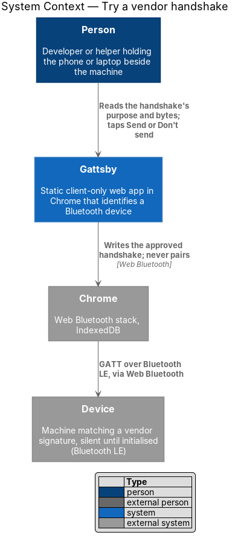
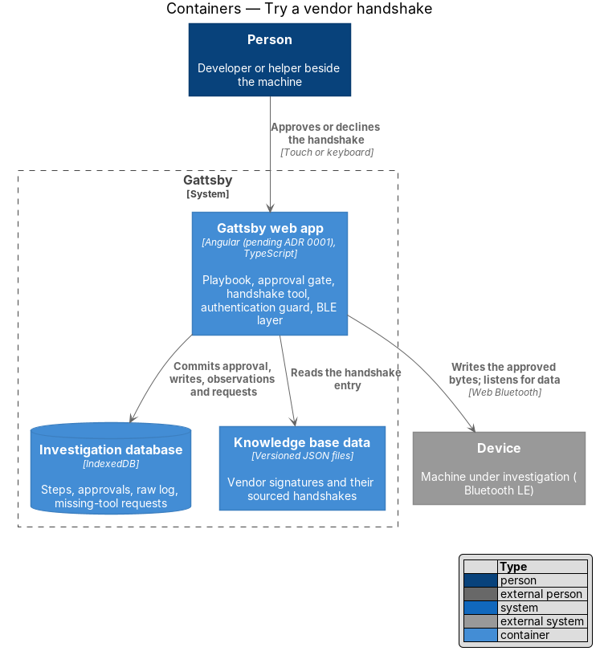
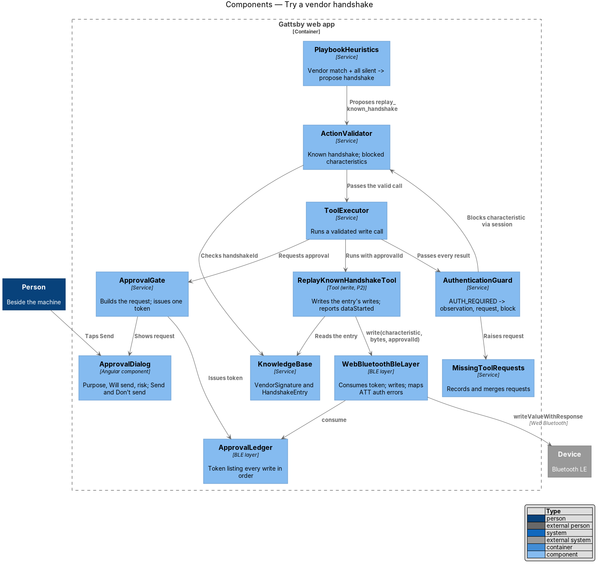
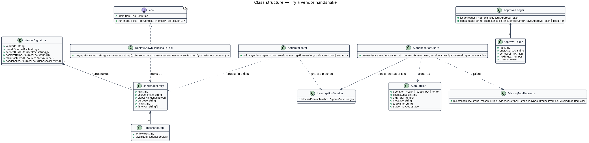
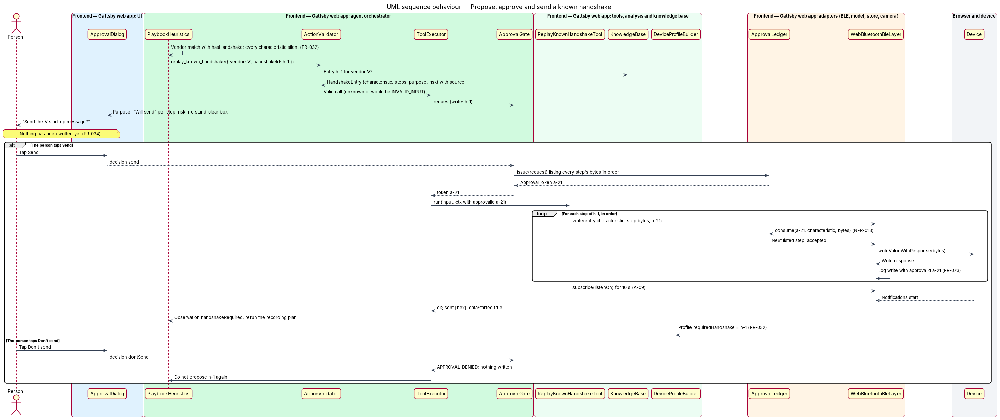
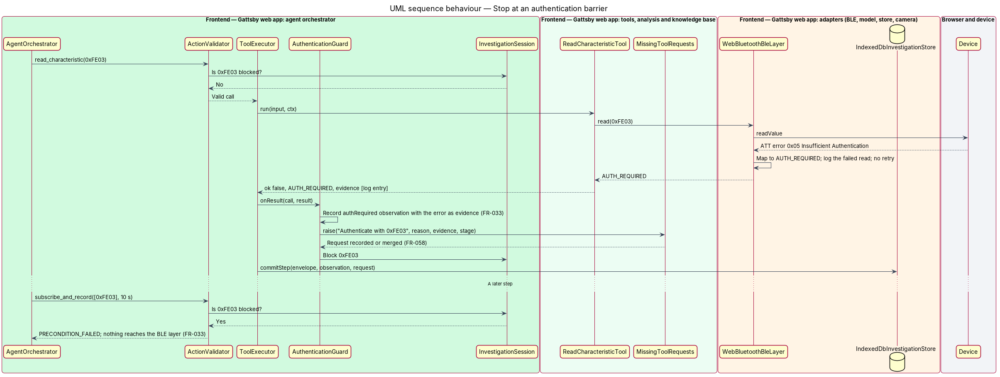

# Try a vendor handshake

## Overview

Some machines stay silent after a connection until an app sends them a start-up message. When
Gattsby recognises the maker from a vendor signature and every characteristic it recorded was
silent, it may propose the vendor's known initialisation sequence from the knowledge base. Sending it
is a `write`, so it passes through the same approval gate as every command (see
[approve a command](../../device-control/approve-a-command/README.md)). The same feature draws the
line Gattsby never crosses: when a device needs pairing, bonding, encryption or an authentication
exchange that Gattsby does not know, it records the evidence, raises a missing-tool request and stops
that line of investigation. It never guesses keys, replays captured authentication or forces pairing.
The feature belongs to the proprietary-analysis subsystem and runs in the Proprietary stage of the
playbook; the authentication rule (FR-033, MVP) applies in every stage, the handshake (FR-032,
TOOL-023) is P2.

**vendor signature** — knowledge-base entry that recognises a maker's device by name pattern, service
UUIDs or manufacturer ID (FR-068)

**handshake** — vendor's published initialisation sequence: one or more writes, each to a named
characteristic with fixed bytes, that makes the device start sending data

**handshake entry** — knowledge-base record of one handshake: its ID, the characteristic it writes
to, its ordered steps, and its public source (A-11)

**authentication barrier** — GATT error showing that the device needs authentication, authorisation
or encryption that Gattsby does not have

**blocked characteristic** — characteristic on which an authentication barrier was met, and on which
no further operation is attempted in the investigation

The person meets the handshake in the Approve a command dialog. No mock shows a handshake approval
yet; the dialog's layout for a command that needs no stand-clear check
(`docs/mocks/dialogs/approval/stop.html`) is the closest: a title, what Gattsby will send and why,
"Will send" with characteristic and bytes, the risk line, and "Don't send" and "Send". A handshake is
not a motion command, so it shows no stand-clear box. The authentication barrier surfaces on the
verdict and the Missing tools screen (`docs/mocks/pages/verdict/missing-tool.html`,
`docs/mocks/pages/missing-tools/default.html`), where a request such as "Decrypt Kingsmith FE00
packets" ends "I didn't try to get around it."

## Description

The design introduces these building blocks in the Angular (pending ADR 0001) workspace under
`frontend/src/app/`:

- **`HandshakeEntry`** (`knowledge-base/handshake-entry.ts`) — knowledge-base type held, as a
  `SourcedFact`, in a `VendorSignature`'s `handshakes` list. The add a vendor signature design
  ([add a vendor signature](../../knowledge-base/add-a-vendor-signature/README.md)) defines its
  fields `id`, `characteristic` and `steps: { writeHex, awaitNotification? }[]`. This design needs
  three more for the approval prompt and the result: `purpose` (plain text shown to the person),
  `risk`, and `listenOn` (characteristics expected to start sending). A fact without a source fails the
  knowledge base's load, so only published sequences are held (A-11). This design specifies no
  vendor's bytes; each entry's bytes come from its cited source, and every vendor is `<TO SUPPLY>`
  until researched (OQ-04, A-15).
- **`PlaybookHeuristics`** (`agent/playbook-heuristics.ts`) — proposes `replay_known_handshake` only
  when three facts hold: `vendor_signature_lookup` (TOOL-020) matched a vendor with `hasHandshake`
  true, every characteristic of the recording series was recorded `silent` (see
  [record a baseline and activity levels](../record-baseline-and-activity/README.md)), and the
  handshake has not been sent or declined in this investigation. In full agent mode the model may
  also propose it; `ActionValidator` checks the same three facts.
- **`ReplayKnownHandshakeTool`** (`tools/control/replay-known-handshake.tool.ts`) — TOOL-023, safety
  class `write`, P2. Input `{ vendor, handshakeId }`; there is no field for bytes, so neither the
  model nor the checklist can supply a captured or guessed sequence. `vendor` is the signature's
  `vendorId`. It looks the entry up in `KnowledgeBase`, writes each step's `writeHex` in order to the
  entry's `characteristic` through `BleLayer.write` with the call's approval ID (waiting for a
  notification after a step that sets `awaitNotification`), then subscribes to the entry's `listenOn` characteristics for 10 seconds (the default
  recording length, A-09) and reports `dataStarted`.
- **`ApprovalGate`** (`agent/approval-gate.ts`) — builds the `ApprovalRequest` from the handshake
  entry: title ("Send the <vendor> start-up message?"), the entry's `purpose` as the expected effect,
  each step as a "Will send" line, the entry's `risk`, and `isMotion` false. One approval covers the
  one call, which may hold several writes.
- **`ApprovalLedger`** (`ble/approval-ledger.ts`) — for a handshake, the issued token lists every
  step's bytes, in order, for the entry's characteristic. `consume(id, characteristic, bytes)` accepts each listed write once and in
  order, and the token is used up after the last. This extends the single-write `ApprovalToken` of
  approve a command; see Rules.
- **`AuthenticationGuard`** (`agent/authentication-guard.ts`) — watches every tool result for
  `AUTH_REQUIRED`. On one, it records an `Observation` of kind `authRequired` with the failing
  operation, characteristic and error as evidence, raises a missing-tool request through
  `MissingToolRequests` (FR-058) naming the capability ("Authenticate with <characteristic>" or, when a
  vendor is known, "<vendor> authentication"), and adds the characteristic to
  `InvestigationSession.blockedCharacteristics`.
- **`ActionValidator`** (`agent/action-validator.ts`) — refuses with `PRECONDITION_FAILED` any later
  call whose input names a blocked characteristic, so no other attempt is made on it (FR-033,
  criterion 1).
- **`WebBluetoothBleLayer`** (`ble/web-bluetooth-ble-layer.ts`) — maps a GATT failure caused by
  insufficient authentication, authorisation, encryption or encryption key size (ATT errors `0x05`,
  `0x08`, `0x0F`, `0x0C`) to `AUTH_REQUIRED`. Chrome reports these as `DOMException`s whose exact
  messages per platform are `<TO SUPPLY>` until confirmed on hardware. The BLE layer never retries an
  operation that failed this way, so it never re-triggers an operating-system pairing prompt.
- **`DeviceProfileBuilder`** (`outcome/device-profile-builder.ts`) — when a handshake was sent and
  data started, writes the vendor, the entry's ID, characteristic and steps into the profile's `requiredHandshake`
  (FR-032, criterion 2).

### Rules

1. Only a handshake entry from the knowledge base can be sent. An unknown `handshakeId`, or one that
   belongs to another vendor, is refused with `INVALID_INPUT` before any prompt, and nothing is
   written (TOOL-023, criterion 1).
2. Every handshake needs the person's approval at that moment (FR-032, FR-034). The prompt shows what
   the handshake is for and every byte it will send. Nothing is written until "Send".
3. The ledger's token for a handshake names every write in order. The BLE layer refuses a write that
   is not the next listed one with `APPROVAL_REQUIRED` (NFR-018). Approve a command's
   `ApprovalRequest` and `ApprovalToken` hold one characteristic and one byte string; this design
   needs them to hold a list. Until that design is brought in line, a handshake entry should hold a
   single step.
4. "Don't send" returns `APPROVAL_DENIED`, records the decision, and the playbook does not propose the
   handshake again in this investigation. The verdict then reports the silent device (see
   [issue the verdict](../../outcome/issue-the-verdict/README.md)).
5. When data starts, the playbook runs the recording plan again on the characteristics that now send,
   and the profile lists the handshake as required. When no data starts, the result says so and a
   missing-tool request records the vendor and the silence.
6. An authentication barrier stops that line of investigation: no further read, subscription or write
   on the blocked characteristic, no retry, no pairing request, no guessed key and no replay of
   captured traffic (FR-033). Gattsby has no API that pairs or bonds; the guard keeps it from
   triggering the browser's own pairing by retrying.
7. The raw log holds no write that was not a knowledge-base command or handshake approved by the
   person (FR-033, criterion 2). The BLE layer logs each write with its approval ID
   (see [log raw traffic](../../tool-registry/log-raw-traffic/README.md)).
8. After emergency stop the gate returns `EMERGENCY_STOPPED` with no prompt (FR-039).

### Data shapes

| Type | Fields |
|---|---|
| `HandshakeEntry` | `id`, `characteristic`, `steps: { writeHex, awaitNotification? }[]` (from add a vendor signature), plus `purpose`, `risk`, `listenOn` from this design |
| `ReplayKnownHandshakeInput` | `vendor`, `handshakeId` |
| `ReplayKnownHandshakeOutput` | `sent` (hex per step), `dataStarted` |
| `AuthBarrier` (observation payload) | `operation` (`read`, `subscribe`, `write`), `characteristic`, `attError?`, `message`, `toolName`, `stage` |

### Errors

| Code | Raised by | Meaning to the person |
|---|---|---|
| `INVALID_INPUT` | `ActionValidator` | An unknown handshake. Not shown; the agent sees the refusal. TOOL-023's error list omits this code although its criterion uses it. |
| `PRECONDITION_FAILED` | `ActionValidator` | Not connected, no vendor match with a handshake, data not silent, or a blocked characteristic. |
| `APPROVAL_DENIED` | `ApprovalGate` | "Not sent." |
| `EMERGENCY_STOPPED` | `ApprovalGate` | "Emergency stop was used. Nothing more will be sent." |
| `GATT_ERROR` | `WebBluetoothBleLayer` | "The machine refused the start-up message." The ATT code is in the record. |
| `AUTH_REQUIRED` | `WebBluetoothBleLayer` | "This part of the machine needs pairing or a code Gattsby doesn't have. Gattsby won't try to get around it." |

### Tests that prove it

The acceptance specs use the fake `navigator.bluetooth` (`e2e/fixtures/fake-bluetooth.ts`), which
records every write, the `ApprovalDialog` and `VerdictPage` page objects, and a test-only vendor in a
knowledge-base fixture with a made-up handshake, so no real vendor's bytes appear in tests. The first
slice that needs them adds two scripts to the unknown-services device: one silent until it receives
the fixture's handshake, and one whose characteristic fails reads with insufficient authentication.
One spec checks that the person sees the handshake's purpose and bytes and that nothing is written
before "Send" (FR-032, criterion 1), and that after data starts the exported profile lists the
handshake as required (criterion 2). Another checks that an authentication failure raises a
missing-tool request with the error as evidence and that no later call touches that characteristic
(FR-033, criterion 1). The shared check from approve a command, which fails a spec when a recorded
write has no recorded approval, also checks each recorded write's bytes against the knowledge base's
commands and handshakes (criterion 2). A unit test refuses an unknown `handshakeId` with
`INVALID_INPUT` (TOOL-023).

## Requirements

The feature realizes the following level-2 (L2) requirements; each refines the level-1 (L1)
requirement cited beside it.

| L2 ID | Refines (L1) | Requirement |
|-------|--------------|-------------|
| [`FR-032`](../../../specs/L2.md#fr-032-try-a-known-vendor-handshake-when-data-is-silent) | `L1-008` | When a device matches a vendor signature but sends no data, Gattsby may propose the vendor's known initialisation sequence from the knowledge base. Sending it is a `write` and needs approval (FR-034). |
| [`FR-033`](../../../specs/L2.md#fr-033-never-bypass-encryption-or-authentication) | `L1-008` | When a device requires pairing, bonding, encryption or an authentication exchange Gattsby does not know, Gattsby must record the evidence, raise a missing-tool request and stop that line of investigation. It must never try to guess keys, replay captured authentication or force pairing. |
| [`TOOL-023`](../../../specs/L2.md#tool-023-replay_known_handshake) | `L1-008` | Sends a vendor's known initialisation sequence from the knowledge base to unlock data. Never a captured or guessed sequence. |

## Diagrams

### System context

The person approves the vendor's published start-up message, which Gattsby writes through Chrome's
Web Bluetooth stack; the knowledge base is the only source of its bytes.

### Containers

The web app reads the handshake entry from the knowledge base, asks the person, writes the approved
bytes, and stores the decision, the writes and any authentication barrier in the investigation
database.

### Components

`PlaybookHeuristics` proposes the handshake; `ApprovalGate` asks and issues one token for its writes;
`ReplayKnownHandshakeTool` writes through the BLE layer. `AuthenticationGuard` turns an
`AUTH_REQUIRED` result into an observation, a missing-tool request and a blocked characteristic.

### Class structure

A `VendorSignature` holds `HandshakeEntry`s; the tool takes only a vendor and an entry ID;
`AuthenticationGuard` updates the session's blocked characteristics that `ActionValidator` checks.

### Behaviour — propose, approve and send a known handshake

With a vendor match and silent data, the person reads the handshake's purpose and bytes and taps
"Send"; the tool writes each approved value, data starts, and the profile lists the handshake as
required. "Don't send" writes nothing.

### Behaviour — stop at an authentication barrier

A read that fails for lack of authentication becomes an `authRequired` observation and a missing-tool
request; the characteristic is blocked, and a later call on it is refused before it reaches the BLE
layer.

