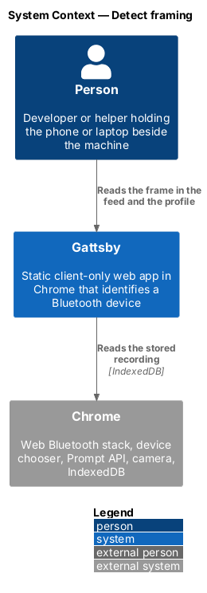
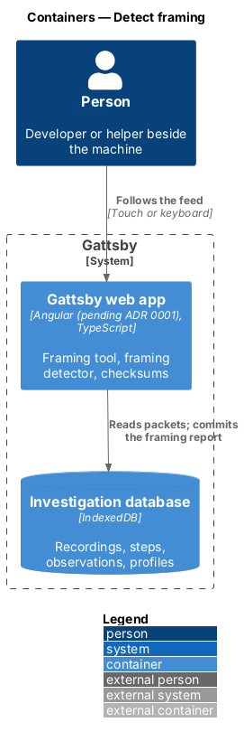
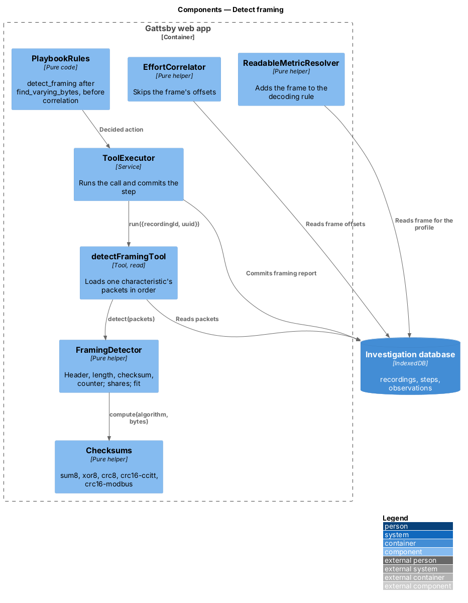
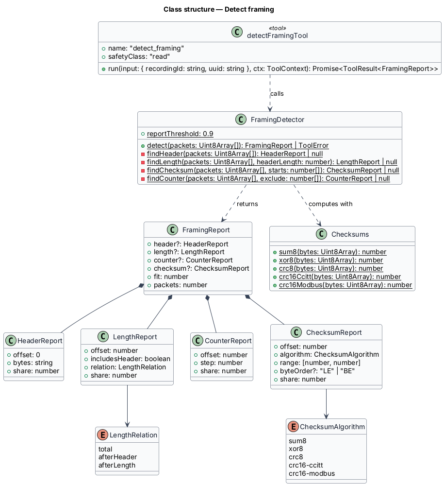
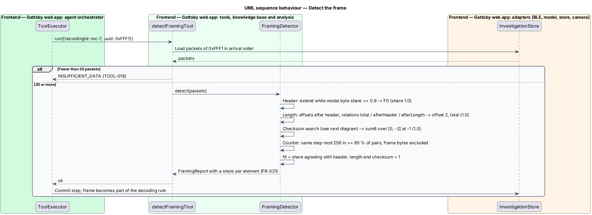
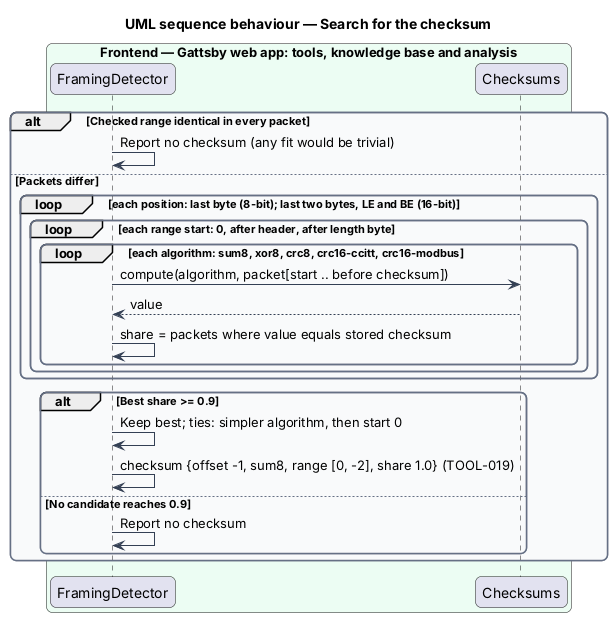

# Detect framing

## Overview

Proprietary fitness protocols often wrap each message in a frame: a constant header, a length byte, a
sequence counter and a checksum around the payload. Those bytes change with every packet. Unless
they are recognised, they look like data: a checksum moves whenever the payload moves, so it can
even seem to follow the person's effort. This feature finds the frame in a recording of one
characteristic, records it as part of the decoding rule, and keeps its bytes out of the field
search. It belongs to the Proprietary path of the playbook and is P2.

**frame** — fixed structure around a proprietary payload: any of a header, a length byte, a counter
and a checksum, at known positions

**header** — run of bytes at the start of a packet with the same value in (nearly) every packet

**length byte** — byte whose value equals the packet's length, or the number of bytes after the
header or after the length byte itself

**sequence counter** — byte that steps by the same amount from each packet to the next, modulo 256

**checksum** — trailing byte or pair of bytes computed from a range of the packet's other bytes by a
known algorithm

**share** — fraction of packets (or, for a counter, of consecutive packet pairs) that fit an element
of the frame

On screen, the feature shows as the step `detect_framing` in the Investigation page's activity feed,
state `proprietary` (`docs/mocks/pages/investigation/proprietary.html`), whose live readings show the
raw frame `A5 5A 10 3C 9F…` of a 16-byte packet. That packet's first two bytes and its length byte
(`0x10`, 16) are the kind of frame the detector finds. No mock draws the step's result line yet;
the result reports which framing candidates matched and the share of packets they explain.

## Description

The design introduces these building blocks in the Angular (pending ADR 0001) workspace under
`frontend/src/app/`:

- **`detectFramingTool`** (`tools/analysis/detect-framing.tool.ts`) — the `detect_framing` tool,
  safety class `read`, group Analysis. It loads the packets of one characteristic from one recording,
  in arrival order, and returns `FramingDetector`'s report.
- **`FramingDetector`** (`analysis/framing-detector.ts`) — pure helper that finds the header, then
  the length byte, the checksum and the counter, and computes each element's share and the overall
  fit.
- **`Checksums`** (`analysis/checksums.ts`) — pure functions for the five algorithms, each tested
  against its published check value.
- **`PlaybookRules`** (`agent/playbook-rules.ts`) — runs `detect_framing` after `find_varying_bytes`
  on each characteristic with at least 20 packets, before `correlate_with_action`. `EffortCorrelator`
  then skips the frame's bytes (see the guess-field-encodings design). The brief lists framing after
  encoding guesses; the design moves it earlier so that a checksum is never ranked as a field.
- **`ReadableMetricResolver`** and **`ProfileBuilder`** (`outcome/`) — put the frame into the
  characteristic's decoding rule in the device profile (FR-031; see the determine-readable-metrics
  and build-the-device-profile designs).

### Detection algorithm

The detector works on the packets *P* of one characteristic, in arrival order. It needs at least 20
packets; fewer returns `INSUFFICIENT_DATA` (TOOL-019). An element is reported only when its share is
at least 0.9, the same threshold used for encoding coverage.

1. **Header.** From offset 0, the detector extends the header while the most common value at the
   next offset has a share of at least 0.9. It stops at a byte that fits a length relation, and
   before the shortest packet's last byte. The header is reported as `{ offset: 0, bytes, share }`,
   where the share counts the packets that carry every header byte.
2. **Length.** For each of the first 4 offsets after the header, *k*, and each packet of length *L*,
   the detector tests three relations for the byte value *v*:
   - `total`: *v* = *L* (`includesHeader: true`);
   - `afterHeader`: *v* = *L* − *h*, where *h* is the header length (`includesHeader: false`);
   - `afterLength`: *v* = *L* − *k* − 1 (`includesHeader: false`).
   It reports the offset and relation with the largest share. Ties go in the order listed. The
   summary names the relation. When every packet has the same length, a constant byte equal to a
   relation cannot be told from a header byte, and the summary says so.
3. **Checksum.** Candidate positions are the last byte, for 8-bit algorithms, and the last two
   bytes, in both byte orders, for 16-bit ones. Candidate ranges start at offset 0, after the header,
   or after the length byte, and end just before the checksum. The detector computes every algorithm
   over every candidate range, and reports the one with the largest share. Ties go to the simpler
   algorithm (in the table's order), then to the range starting at 0.
4. **Counter.** Excluding header, length and checksum offsets, the detector looks for an offset
   where (next − previous) modulo 256 equals one non-zero step *s* for at least 90 % of consecutive
   pairs. It reports `{ offset, step, share }`. A dropped notification breaks one pair, not the
   counter.
5. **Overall fit.** `fit` is the share of packets that agree with every reported header, length and
   checksum element at once. When no element is reported, `fit` is 0 and the step summary says no
   framing was found.

Offsets are counted from the start of the packet. When packet lengths vary, the checksum offset is
negative and counts from the end: −1 is the last byte. A range is written `[start, end]` with the
same convention.

### Checksum algorithms

| Name | Definition | Check value for ASCII "123456789" |
|---|---|---|
| `sum8` | Sum of the bytes in the range, modulo 256 | `0xDD` |
| `xor8` | XOR of the bytes in the range | `0x31` |
| `crc8` | CRC-8, polynomial `0x07`, initial value `0x00`, not reflected, no final XOR | `0xF4` |
| `crc16-ccitt` | CRC-16, polynomial `0x1021`, initial value `0xFFFF`, not reflected, no final XOR (CCITT-FALSE) | `0x29B1` |
| `crc16-modbus` | CRC-16, polynomial `0x8005` reflected (`0xA001`), initial value `0xFFFF`, input and output reflected, no final XOR; sent low byte first | `0x4B37` |

The `crc16-ccitt` check uses the CCITT-FALSE initial value of `0xFFFF`.

### Guards against false fits

1. A random byte matches an 8-bit checksum with probability 1/256. A share of 0.9 over 20 or more
   packets therefore does not occur by chance in practice.
2. When the checked range has the same content in every packet, any algorithm that fits one packet
   fits them all. No checksum is reported then.
3. Header, length and checksum offsets are never reported as counters, and a counter is never
   reported as a header.

### Worked example (FR-031 AC1, TOOL-019 AC1)

Packets such as `F0 01 07 2C 01 05 2A` start with `F0`, carry a message type at offset 1 that varies
between packets, and hold their total length at offset 2 (`07`, 7 bytes). They end with the 8-bit
sum of the bytes before it: `F0 + 01 + 07 + 2C + 01 + 05` = 298, and 298 modulo 256 = 42 = `0x2A`.
The detector reports:

| Element | Report | Share |
|---|---|---|
| Header | `{ offset: 0, bytes: "F0" }` | 1.0 |
| Length | `{ offset: 2, includesHeader: true }` (relation `total`) | 1.0 |
| Checksum | `{ offset: -1, algorithm: "sum8", range: [0, -2] }` | 1.0 |
| Overall | `fit: 1` | — |

### Data shapes

`FramingReport` follows TOOL-019's output and adds a `share` to each element, so that each element
is reported with the share of packets that fit it (FR-031):

| Field | Shape |
|---|---|
| `header?` | `{ offset, bytes, share }` |
| `length?` | `{ offset, includesHeader, relation, share }` |
| `counter?` | `{ offset, step, share }` |
| `checksum?` | `{ offset, algorithm, range: [start, end], byteOrder?, share }` |
| `fit` | 0–1 |
| `packets` | number of packets examined |

### Errors

| Code | Raised by | Meaning to the person |
|---|---|---|
| `INSUFFICIENT_DATA` | `detect_framing` | Never shown; the agent may record longer. |
| `INVALID_INPUT` | `detect_framing` | Never shown; an unknown recording or characteristic. |

### Tests that prove it

Unit tests check each `Checksums` function against the check values above, and run `FramingDetector`
on generated packets: `F0`-headed packets with a `total` length byte and a `sum8` trailer, the same
with `crc16-modbus`, packets with a counter and one dropped packet, 19 packets, and 30 identical
packets. Framing has no screen of its own, so no acceptance spec is needed beyond the proprietary-path
spec of the record-and-find-varying-fields design.

## Requirements

The feature realizes the following level-2 (L2) requirements; each refines the level-1 (L1)
requirement cited beside it.

| L2 ID | Refines (L1) | Requirement |
|-------|--------------|-------------|
| [`FR-031`](../../../specs/L2.md#fr-031-detect-proprietary-framing) | `L1-008` | Gattsby must look for constant headers, length bytes, sequence counters and checksums (sum, XOR, CRC-8, CRC-16) in proprietary packets, and record any it finds as part of the decoding rule. |
| [`TOOL-019`](../../../specs/L2.md#tool-019-detect_framing) | `L1-008` | Finds constant headers, length bytes, sequence counters and checksums (8-bit sum, XOR, CRC-8, CRC-16 CCITT and Modbus) in proprietary packets. |

## Diagrams

### System context

Detection runs inside Gattsby on a stored recording. The person sees its result in the activity feed
and in the profile's decoding rule.

### Containers

The web app reads the recording from the investigation database and commits the framing report
with the step.

### Components

`detectFramingTool` hands the packets to `FramingDetector`, which uses `Checksums`; the frame's
offsets go to `EffortCorrelator` to skip, and into the decoding rule through `ReadableMetricResolver`.

### Class structure

`FramingDetector` builds a `FramingReport` of optional `HeaderReport`, `LengthReport`,
`CounterReport` and `ChecksumReport` elements; `Checksums` holds the five algorithms.

### Behaviour — detect the frame

The detector finds the header, the length byte, the checksum and the counter in turn, and returns
each with its share and the overall fit; with fewer than 20 packets it returns `INSUFFICIENT_DATA`.

### Behaviour — search for the checksum

Each algorithm is computed over each candidate range, and the best share at or above 0.9 wins;
packets with identical content report no checksum.

