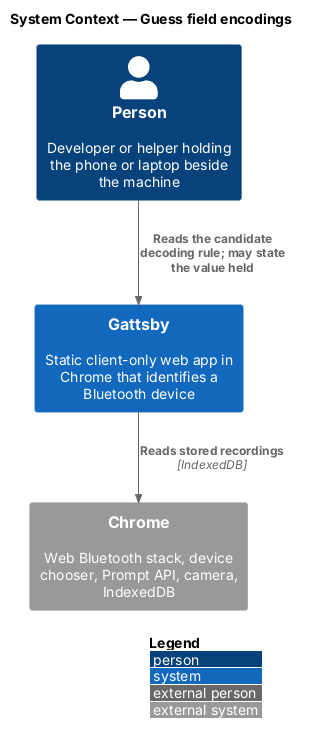
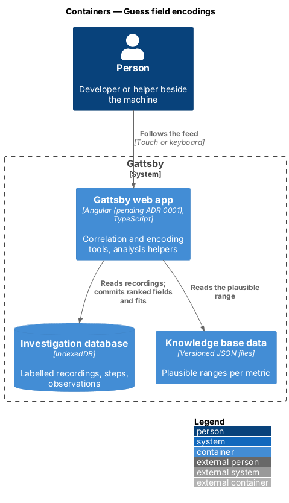
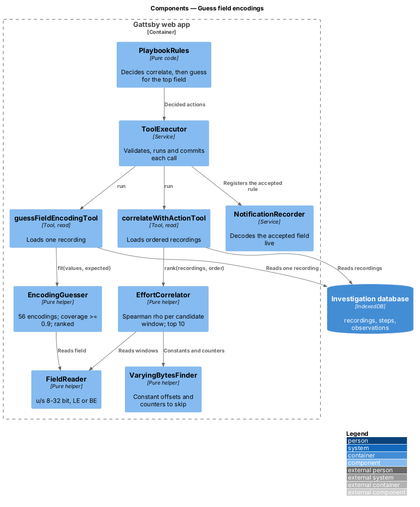
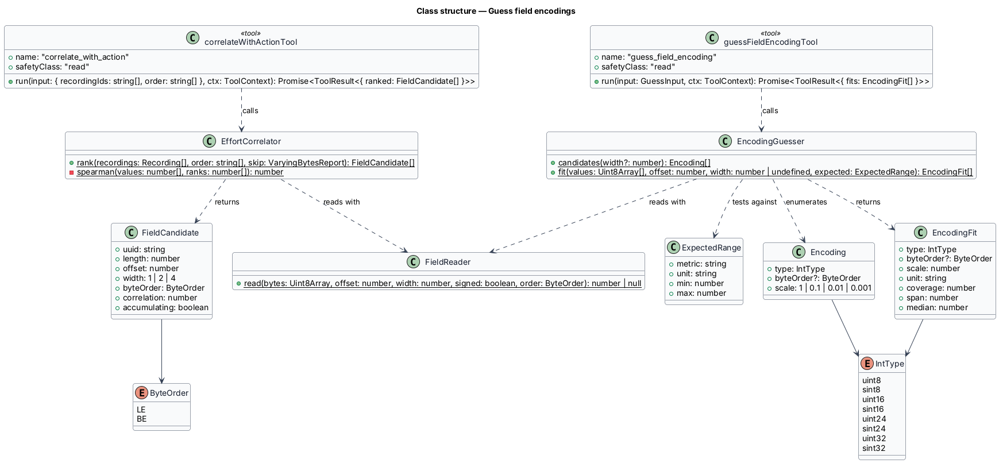
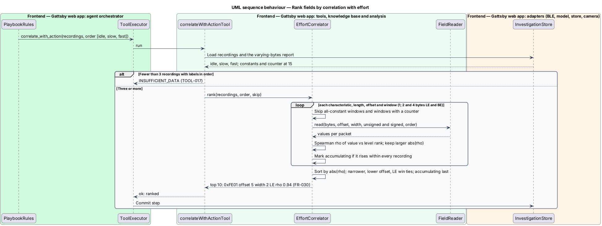
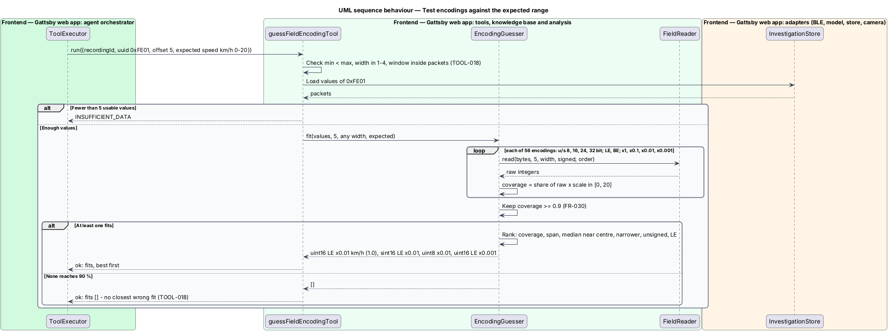

# Guess field encodings

## Overview

Finding that byte 5 changes with effort (see the record-and-find-varying-fields design) says where a
field is, not what it means. This feature takes the next two steps of the Proprietary path of the
playbook. First it ranks candidate fields by how closely they follow the person's ordered effort
levels. Then, for a chosen field, it tests every candidate encoding against the range the metric
should fall in. The result is a decoding rule such as "bytes 5–6, uint16 LE, ×0.01, km/h", stated as
a candidate until a live check confirms it. The feature is P2.

**candidate field** — window of 1, 2 or 4 bytes at one offset of one characteristic and packet
length, read in one byte order

**effort order** — ranking of the labelled recordings from least to most effort, such as idle < slow
< fast

**encoding** — integer type (unsigned or signed, 8, 16, 24 or 32 bits), byte order and scale that
turn a candidate field's bytes into a value in a unit

**coverage** — share of a recording's values that an encoding places inside the expected range

**expected range** — minimum and maximum of the metric, in its unit, given by the person or the
agent; for example 0–20 km/h for walking speed

On screen, the feature shows as steps in the Investigation page's activity feed, state `proprietary`
(`docs/mocks/pages/investigation/proprietary.html`), after the level recordings. The tool names
`correlate_with_action` and `guess_field_encoding` appear as step chips, as for every tool. Its
results reach the Device profile page, state `partial` (`docs/mocks/pages/device-profile/partial.html`),
as rules such as "Calories kcal 0x0035 · bytes 9–10 · uint16 LE per stroke likely", and the Verdict
page, state `partial` (`docs/mocks/pages/verdict/partial.html`), as "Calories bytes 9–10, uint16 LE
likely". No mock draws these two steps' result lines in the feed; their wording is `<TO SUPPLY>`.

Both tools are deterministic analysis code over stored recordings. The model may choose which field
to test and what range to expect, but it never scores a fit (AGENTS.md).

## Description

The design introduces these building blocks in the Angular (pending ADR 0001) workspace under
`frontend/src/app/`:

- **`correlateWithActionTool`** (`tools/analysis/correlate-with-action.tool.ts`) — the
  `correlate_with_action` tool, safety class `read`, group Analysis. It loads the recordings, orders
  them by `order`, and returns `EffortCorrelator`'s top 10.
- **`EffortCorrelator`** (`analysis/effort-correlator.ts`) — pure helper that enumerates candidate
  fields and ranks them by Spearman rank correlation with the effort order.
- **`guessFieldEncodingTool`** (`tools/analysis/guess-field-encoding.tool.ts`) — the
  `guess_field_encoding` tool, safety class `read`, group Analysis. It loads one recording and
  returns `EncodingGuesser`'s fits.
- **`EncodingGuesser`** (`analysis/encoding-guesser.ts`) — pure helper that decodes a field under
  every candidate encoding, keeps those with coverage of at least 90 %, and ranks them.
- **`FieldReader`** (`analysis/field-reader.ts`) — pure helper that reads an unsigned or signed
  integer of 1, 2, 3 or 4 bytes at an offset in either byte order. Both helpers use it.
- **`VaryingBytesFinder`** (`analysis/varying-bytes-finder.ts`) — supplies the constant offsets and
  counters that `EffortCorrelator` skips (see the record-and-find-varying-fields design).
- **`PlaybookRules`** (`agent/playbook-rules.ts`) — after `find_varying_bytes`, decides
  `correlate_with_action` when three or more ordered recordings exist, then `guess_field_encoding`
  for the top-ranked field. In full agent mode the model may pick another field or range; the call is
  validated like any action (FR-043).
- **`NotificationRecorder`** (`tools/listening/notification-recorder.ts`) — once a fit is accepted,
  it decodes that field for the rest of the investigation, so the live tile shows it with status
  *guess* (see the show-live-metrics design) and the confirm-with-a-physical-action check can
  confirm it.

### Ranking fields (`correlate_with_action`)

1. Preconditions: three or more recordings whose labels appear in `order`. Recordings whose label is
   not in `order` are ignored. Fewer than three left returns `INSUFFICIENT_DATA`.
2. Each recording gets the rank of its label in `order` (idle 0, slow 1, fast 2). Each packet takes
   its recording's rank.
3. Candidates are enumerated per characteristic and packet length. Each offset yields a 1-byte
   window, and 2-byte and 4-byte windows in little-endian and big-endian order where they fit in the
   packet (TOOL-017). A window made only of constant offsets, or one that contains a counter, is
   skipped.
4. For each candidate, the correlator reads the window's value in every packet and computes
   Spearman's rank correlation ρ between value and level rank. Tied ranks are averaged. It reads the
   window unsigned and again signed and keeps the reading with the larger |ρ|; signedness itself is
   settled by `guess_field_encoding`. Spearman suits ordinal effort levels, which are ordered but not
   measured. With three equal-sized levels that never overlap, the largest possible ρ is about 0.94,
   because the levels' own ranks are tied.
5. Candidates are ranked by |ρ|, largest first. A falling field, such as pace when speed rises, ranks
   by its magnitude and keeps its negative sign. Ties go to the narrower window, then the lower
   offset, then little-endian. A 4-byte window over a 16-bit field and two constant bytes has the same
   ρ as the 16-bit window, so the 16-bit window ranks first.
6. A candidate whose value rises between consecutive packets within every recording is marked
   *accumulating* (an elapsed time, a distance) and ranked after every other candidate. Recordings
   made in rising effort order are also in time order, so such a field follows time as closely as it
   follows effort.
7. The output is the top 10: `{ uuid, offset, width, byteOrder, correlation }`. A 16-bit
   little-endian field that rises with effort ranks first with ρ above 0.9 (TOOL-017 AC1).

### Testing encodings (`guess_field_encoding`)

1. Input: `{ recordingId, uuid, offset, width?, expected: { metric, unit, min, max } }`. The tool
   returns `INVALID_INPUT` when `min` ≥ `max`, `width` is not 1, 2, 3 or 4, or `offset` + `width` is
   beyond the longest packet.
2. Encodings tested, from TOOL-018: unsigned and signed, 8, 16, 24 and 32 bits, little-endian and
   big-endian (8-bit has one order), scales 1, 0.1, 0.01 and 0.001. That is 8 encodings for a 1-byte
   field and 16 for each wider one, 56 in all when `width` is absent.
3. Values are read from every packet of `uuid` in the recording that is long enough for the window.
   Fewer than 5 such values returns `INSUFFICIENT_DATA`.
4. An encoding fits only when its coverage is at least 0.9: 90 % of the values fall inside `[min,
   max]`. When none fits, `fits` is empty. The tool never returns the closest wrong encoding (FR-030
   AC2, TOOL-018 AC2).
5. Fits are ranked by coverage. Ties go, in order, to:
   - the larger span: (largest − smallest decoded value) ÷ (`max` − `min`);
   - the median nearer the centre of the range;
   - the narrower width;
   - unsigned before signed;
   - little-endian before big-endian.
6. The unit of each fit is the expected unit. The tool does not convert units.

Worked example (TOOL-018 AC1, FR-030 AC1): bytes 5–6 hold 300, 500 and 700 at 3, 5 and 7 km/h, and
the expected range is 0–20 km/h.

| Encoding | Decoded | Coverage | Span | Outcome |
|---|---|---|---|---|
| `uint16` LE, ×0.01 | 3, 5, 7 | 1.0 | 0.20 | Best fit |
| `sint16` LE, ×0.01 | 3, 5, 7 | 1.0 | 0.20 | Fits; ranked after the unsigned reading |
| `uint16` LE, ×0.001 | 0.3, 0.5, 0.7 | 1.0 | 0.02 | Fits; ranked lower |
| `uint8` at byte 5, ×0.01 | 0.44, 2.44, 1.88 | 1.0 | 0.10 | Fits; ranked lower |
| `uint16` LE, ×0.1 | 30, 50, 70 | 0.0 | — | No fit |
| `uint16` BE, ×0.001 | 11.3, 62.5, 48.1 | 0.33 | — | No fit |

When two scales both fit, the expected range decides. A narrow range taken from the speed the person
was asked to hold ("walk slowly — around 3 km/h") separates them better than a wide one. The default
plausible range per metric is knowledge-base data, `<TO SUPPLY>`. So is the margin put around an
instructed value.

### How the rules use the tools

1. After `find_varying_bytes`, `correlate_with_action` runs over the idle, slow and fast recordings
   with `order: ["idle", "slow", "fast"]`.
2. `guess_field_encoding` runs on the top-ranked candidate, once on the lowest active level's
   recording and once on the highest. The rules keep the encodings that fit both, in the order of the
   highest-level call. A right encoding fits at every level.
3. The top fit becomes an observation: a candidate decoding rule, status *likely*, with the
   recordings, the ranking step and the fit step as evidence. `ConfidenceScorer` treats it as weaker
   evidence than a confirmed metric (see the track-the-hypothesis design).
4. An empty `fits`, or no candidate with |ρ| above `<TO SUPPLY>`, leaves the field as varying but
   undecoded. That is evidence for *Partially decoded* or *Needs a missing tool* (FR-029; see the
   issue-the-verdict design).

### Specification note

FR-030 lists 8, 16 and 32-bit encodings; TOOL-018 adds 24-bit. The design follows TOOL-018, the
superset, since standard layouts such as FTMS Total Distance use `uint24`. TOOL-017 ranks 1, 2 and
4-byte windows only, so a 24-bit field is found through its 2-byte or 4-byte window and then tested
at width 3.

### Data shapes

| Type | Fields |
|---|---|
| `FieldCandidate` | `uuid`, `length`, `offset`, `width` (1, 2 or 4), `byteOrder` (`LE`, `BE`), `correlation`, `accumulating` |
| `ExpectedRange` | `metric`, `unit`, `min`, `max` |
| `Encoding` | `type` (`uint8` … `sint32`), `byteOrder?`, `scale` |
| `EncodingFit` | `type`, `byteOrder?`, `scale`, `unit`, `coverage`, `span`, `median` |

### Errors

| Code | Raised by | Meaning to the person |
|---|---|---|
| `INSUFFICIENT_DATA` | Both tools | Never shown; the agent may ask for another level. |
| `INVALID_INPUT` | `guess_field_encoding` | Never shown; the agent sees the reason (FR-043). |

### Tests that prove it

Unit tests build recordings in which bytes 5–6 hold speed as little-endian `uint16` in 0.01 km/h at
3, 5 and 7 km/h, with a counter at byte 15 and noise at byte 9. They expect "bytes 5–6, uint16 LE,
×0.01, km/h" ranked first, and an empty `fits` for a range no encoding meets. The acceptance spec
runs the unknown-services device of `e2e/fixtures/fake-bluetooth.ts` through three levels and reads
the candidate rule on the Verdict page object.

## Requirements

The feature realizes the following level-2 (L2) requirements; each refines the level-1 (L1)
requirement cited beside it.

| L2 ID | Refines (L1) | Requirement |
|-------|--------------|-------------|
| [`FR-030`](../../../specs/L2.md#fr-030-correlate-fields-with-actions-and-guess-encodings) | `L1-008` | Gattsby must rank varying fields by correlation with the person's actions and test candidate encodings (unsigned and signed 8, 16 and 32-bit, both byte orders, scales 1, 0.1, 0.01, 0.001) against the expected range of the metric the person described. |
| [`TOOL-017`](../../../specs/L2.md#tool-017-correlate_with_action) | `L1-008` | Ranks candidate fields (single bytes and 2- and 4-byte windows in both byte orders) by correlation with the ordered effort levels of labelled recordings. |
| [`TOOL-018`](../../../specs/L2.md#tool-018-guess_field_encoding) | `L1-008` | Tests encodings (unsigned and signed 8, 16, 24 and 32-bit, both byte orders, scales 1, 0.1, 0.01, 0.001) for one field against an expected range and unit given by the person or the agent. |

## Diagrams

### System context

The feature runs entirely inside Gattsby on stored recordings. The person's only part is the effort
levels already recorded and, where asked, the value they were told to hold.

### Containers

The web app reads the labelled recordings from the investigation database and the plausible ranges
from the knowledge base, and stores the ranked fields and fits as steps and observations.

### Components

`correlateWithActionTool` ranks candidates with `EffortCorrelator`; `guessFieldEncodingTool` tests
encodings with `EncodingGuesser`; both read bytes through `FieldReader`.

### Class structure

`EffortCorrelator` produces `FieldCandidate`s; `EncodingGuesser` tests `Encoding`s against an
`ExpectedRange` and returns `EncodingFit`s.

### Behaviour — rank fields by correlation with effort

The correlator orders the recordings, enumerates windows, skips constants and counters, and ranks
candidates by |ρ|; with fewer than three ordered recordings it returns `INSUFFICIENT_DATA`.

### Behaviour — test encodings against the expected range

The guesser decodes the field under each encoding, keeps those with at least 90 % coverage and ranks
them; when none reaches 90 % it returns an empty list.

