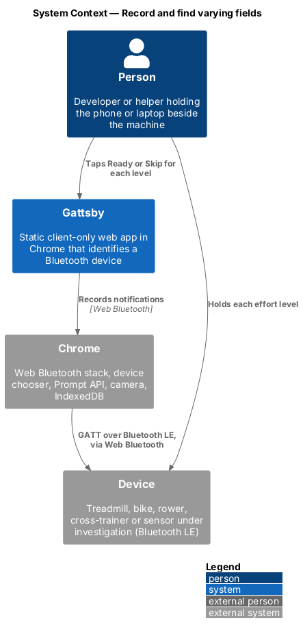
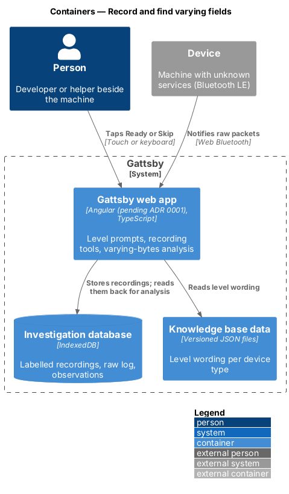
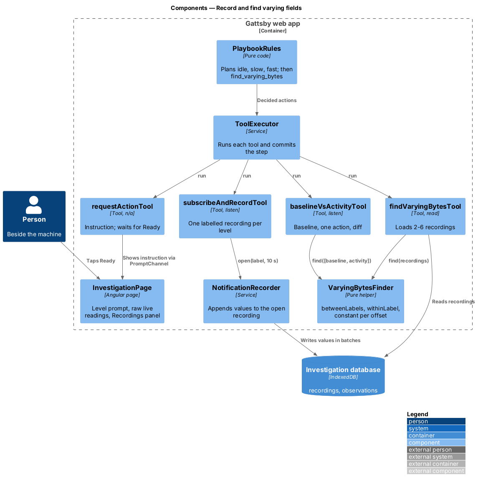
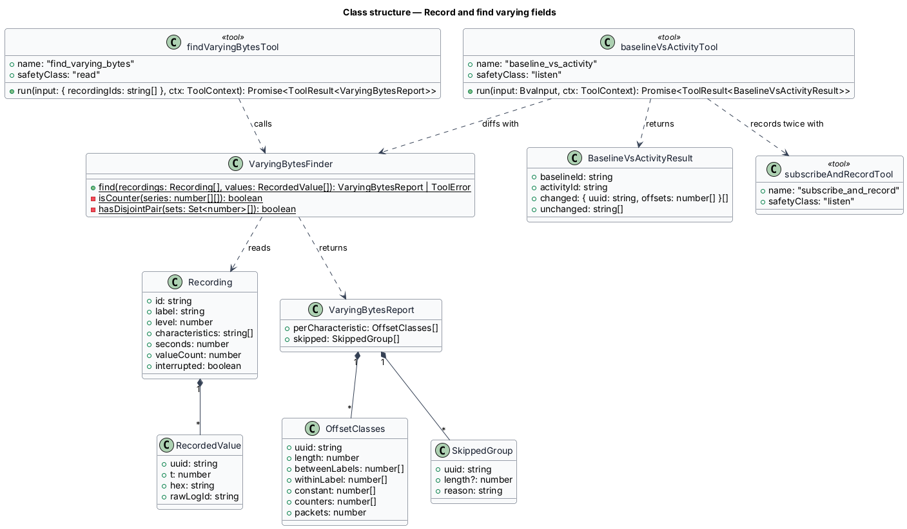
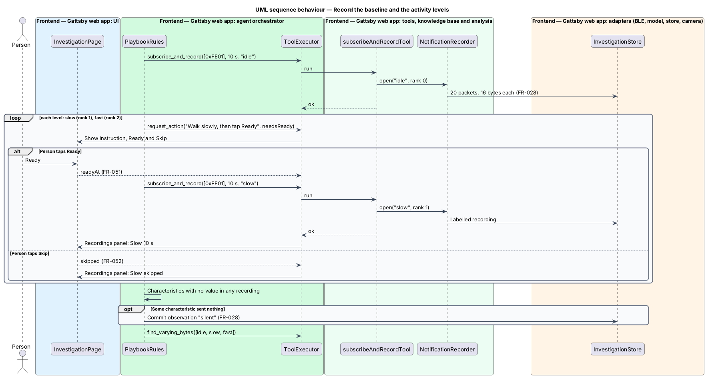
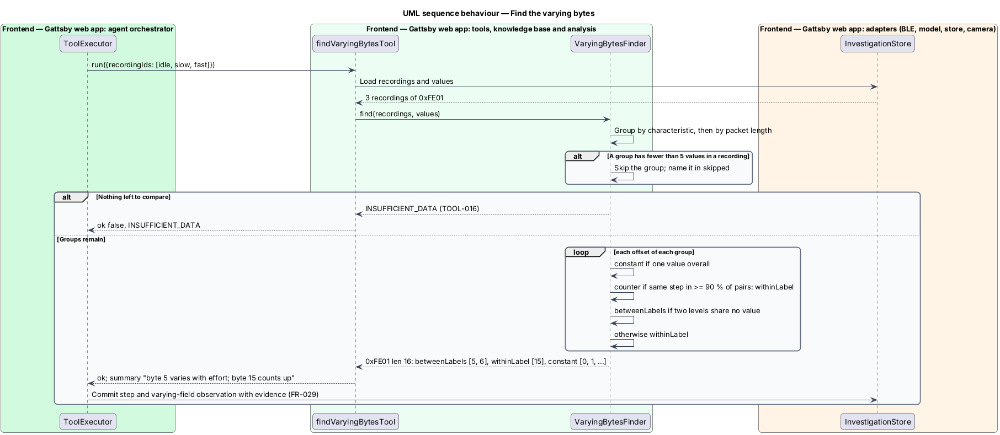
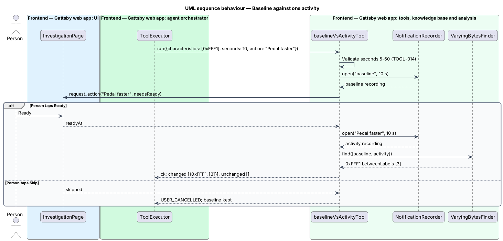

# Record and find varying fields

## Overview

When the Identify stage finds no standard service, the playbook takes the Proprietary path. There is
no decoder to apply, so Gattsby learns from the data: it records every notifying characteristic
while the machine is idle, then at two or three effort levels the person sets, and compares the
recordings byte by byte. The bytes that change with the person's effort are the first evidence of a
readable field. This feature owns those recordings and that comparison. It carries the brief's third
MVP acceptance criterion: for a device with only unknown services, raw data is recorded and at least
one varying field is found.

**activity level** — effort the person holds during one recording (idle, slow, fast), stored as the
recording's label and its rank in the order of effort

**baseline** — recording taken with the machine idle, labelled "idle", against which activity is
compared

**varying field** — byte offset of one characteristic and packet length whose value changes between
activity levels

**silent characteristic** — characteristic that sends nothing during any recording

The feature appears on the Investigation page, state `proprietary`
(`docs/mocks/pages/investigation/proprietary.html`). The agent says "There's no standard protocol,
so I'll learn this one from the data: first standing still, then at two speeds." The step
`subscribe_and_record` "Record 0xFE01 with the belt stopped (idle)", 10 s, reports "20 packets at 2
Hz, 16 bytes each. Bytes 0–1 never change; byte 15 counts up." The prompt "Walk slowly, then tap
Ready" says "Recording starts when you tap Ready and runs for 10 s.", with "Ready" and "Skip". A
"Recordings" panel lists Idle (10 s · 20 packets), Slow (waiting for Ready) and Fast (—). The Verdict
page, states `partial` and `missing-tool` (`docs/mocks/pages/verdict/partial.html`,
`docs/mocks/pages/verdict/missing-tool.html`), lists the varying fields as evidence.

The comparison is deterministic and needs no connection: the Analysis tools are pure functions of
stored recordings. Ranking the varying fields against effort and guessing their encodings is the
guess-field-encodings design.

## Description

The design introduces these building blocks in the Angular (pending ADR 0001) workspace under
`frontend/src/app/`:

- **`PlaybookRules`** (`agent/playbook-rules.ts`) — at the Proprietary stage, decides the recording
  plan: every characteristic with `notify` or `indicate`, then an idle baseline, then the levels, then
  `find_varying_bytes` over all of them. It skips a level the person skips (FR-052).
- **`subscribeAndRecordTool`** and **`NotificationRecorder`**
  (`tools/listening/subscribe-and-record.tool.ts`, `tools/listening/notification-recorder.ts`) —
  record each level as a labelled `Recording` (see the decode-standard-data design). On this path no
  decoder exists, so values are stored raw.
- **`requestActionTool`** (`tools/person/request-action.tool.ts`) — shows each level's instruction
  with `needsReady: true`. Recording does not start before "Ready" (FR-051).
- **`baselineVsActivityTool`** (`tools/listening/baseline-vs-activity.tool.ts`) — the
  `baseline_vs_activity` tool, safety class `listen`. In one call it records a baseline, asks for one
  action, records during it and diffs the two with `VaryingBytesFinder`. The agent uses it for a
  quick single-action check, such as "pedal faster".
- **`findVaryingBytesTool`** (`tools/analysis/find-varying-bytes.tool.ts`) — the
  `find_varying_bytes` tool, safety class `read`, group Analysis. It loads 2–6 recordings from
  `InvestigationStore` and returns `VaryingBytesFinder`'s report.
- **`VaryingBytesFinder`** (`analysis/varying-bytes-finder.ts`) — pure helper that classifies each
  byte offset, per characteristic and packet length, as `betweenLabels`, `withinLabel` or `constant`.
- **`InvestigationStore`** (`store/investigation-store.ts`) — stores the recordings and the
  observations: one *varying field* observation per characteristic and length, and one *silent*
  observation per silent characteristic.
- **`InvestigationPage`** (`pages/investigation/investigation.page.ts`) — shows the prompt, the raw
  live readings (see the show-live-metrics design) and the "Recordings" panel with each level's
  duration and packet count.

### Recording plan (Proprietary stage)

1. Subscribe every characteristic whose properties include `notify` or `indicate`. A
   `subscribe_and_record` call takes at most 8 (TOOL-013). On a device with more, the first 8 in
   GATT order are recorded, unknown services first, and the rest are recorded as an observation "not
   recorded".
2. Record the idle baseline: label `idle`, rank 0, 10 seconds (A-09), with the instruction to keep
   the machine stopped.
3. Record each activity level: by default `slow` (rank 1) and `fast` (rank 2), 10 seconds each. A
   third level, `medium`, between them is added when the agent asks for it. Each level is one
   `request_action` with `needsReady: true`, then one `subscribe_and_record` with that label (FR-028
   AC1). The idle baseline and two levels make the three ordered recordings that
   `correlate_with_action` needs (see the guess-field-encodings design).
4. The idle, slow and fast prompts all wait for Ready. Treadmill, bike and rower prompts name the
   action the person can take at a comfortable pace. Other devices use a general effort prompt.
5. "Skip" on a level records nothing for it. When fewer than two recordings remain, the analysis
   cannot run and the agent is told `INSUFFICIENT_DATA`.
6. After the last level, any characteristic with no value in any recording is recorded as *silent*
   (FR-028 AC2). When every characteristic is silent, the unlock-vendor-data-safely design applies.
7. Recordings longer than 120 seconds are refused (NFR-005); a recording is persisted in batches as
   it runs.
8. The chooser may request a documented vendor service UUID as an optional service. The
   [Concept2 PM5 specification](https://cms.concept2.com/sites/default/files/2026-03/Concept2%20PM%20CSAFE%20Communication%20Definition.pdf)
   supplies the rower service UUID. The simulator supplies synthetic packets for the comparison
   tests. The actual investigation uses the notifications that Chrome grants access to.

### Comparison algorithm (`VaryingBytesFinder`)

1. Values are grouped by characteristic and then by packet length, since packets of different
   lengths are usually different messages.
2. A characteristic is analysed only when at least two recordings hold values of it. A
   characteristic or length group with fewer than 5 values in any recording that holds it is skipped,
   and the summary names it. When nothing remains, the tool returns `INSUFFICIENT_DATA` (TOOL-016
   AC2).
3. For each offset of a group, let *S(r)* be the set of byte values seen at that offset in recording
   *r*. Each offset falls in exactly one class, tested in this order:
   - **`constant`** — one value across every recording.
   - **counter** — the same non-zero step (modulo 256) between consecutive packets in at least 90 %
     of consecutive pairs, in every recording. A counter is reported in `withinLabel`, and the
     summary names it ("byte 15 counts up"). The 90 % tolerance allows for dropped notifications.
   - **`betweenLabels`** — at least two recordings have disjoint sets, *S(r1)* ∩ *S(r2)* = ∅: the
     byte never takes the same value at those two levels.
   - **`withinLabel`** — every other varying offset: it changes, but every pair of levels shares a
     value, as noise or a slow drift does.
4. When only byte 5 differs between baseline and activity, `betweenLabels` is `[5]` (TOOL-016 AC1).
5. The two bytes of a 16-bit field can fall in different classes: a low byte that wraps can share
   values across levels while the high byte does not. The finder reports bytes, not fields.
   `correlate_with_action` tests 2- and 4-byte windows.

### `baseline_vs_activity`

1. Input: `characteristics`, `seconds` 5–60, `action` (the instruction). It records `seconds` labelled
   `baseline`, calls `request_action` with `needsReady: true`, then records `seconds` labelled with
   the action.
2. `changed` lists each characteristic with `betweenLabels` offsets, merged across packet lengths.
   `unchanged` lists the characteristics with values and none. With too few values, a characteristic
   is in neither list, and the summary says why.
3. Given a device whose byte 3 rises with cadence, "pedal faster" yields `changed` with that
   characteristic and offset 3 (TOOL-014 AC1).
4. The person's "Skip" returns `USER_CANCELLED`; the baseline is kept.

### Evidence for the verdict

Each varying field becomes an observation that references its recordings and, for each level, the
raw log entries of a representative packet (FR-056). When the investigation concludes with at least
one varying field and no confident decoding, the verdict is *Partially decoded* or *Needs a missing
tool* with these observations as evidence (FR-029 AC2; see the issue-the-verdict design).

### Data shapes

| Type | Fields |
|---|---|
| `Recording` (as stored) | `id`, `label`, `level` (rank), `characteristics`, `seconds`, `valueCount`, `interrupted` |
| `VaryingBytesReport` | `perCharacteristic: [{ uuid, length, betweenLabels, withinLabel, constant, counters, packets }]`, `skipped: [{ uuid, length?, reason }]` |
| `BaselineVsActivityResult` | `baselineId`, `activityId`, `changed: [{ uuid, offsets }]`, `unchanged: [uuid]` |

### Errors

| Code | Raised by | Meaning to the person |
|---|---|---|
| `INSUFFICIENT_DATA` | `find_varying_bytes` | Never shown; the agent sees it and may record again. |
| `USER_CANCELLED` | `baseline_vs_activity`, `request_action` | The level shows as skipped. |
| `PROPERTY_MISSING`, `AUTH_REQUIRED`, `NOT_CONNECTED`, `STORAGE_FULL` | Recording | As in the decode-standard-data design. |

### Tests that prove it

The acceptance spec drives the unknown-services device of `e2e/fixtures/fake-bluetooth.ts`, scripted
so that byte 5 of `0xFE01` rises with each level and byte 15 counts up. It taps "Ready" through the
Investigation page object, then checks the step summary and the varying-field evidence on the
Verdict page. Unit tests cover `VaryingBytesFinder` for a constant byte, a counter, a byte that
differs between labels, a noisy byte, and a recording with 3 values.

## Requirements

The feature realizes the following level-2 (L2) requirements; each refines the level-1 (L1)
requirement cited beside it.

| L2 ID | Refines (L1) | Requirement |
|-------|--------------|-------------|
| [`FR-028`](../../../specs/L2.md#fr-028-record-a-baseline-and-activity-levels) | `L1-008` | On the proprietary path Gattsby must subscribe to every characteristic that notifies or indicates, record an idle baseline, then ask the person for two or three activity levels (for example slow, medium, fast) and record each, with the level as a label. |
| [`FR-029`](../../../specs/L2.md#fr-029-find-the-fields-that-vary) | `L1-008` | Gattsby must compare the recordings and name the byte positions that change between labels and those that change within a label (counters, noise), per characteristic and per packet length. |
| [`TOOL-014`](../../../specs/L2.md#tool-014-baseline_vs_activity) | `L1-008` | Records an idle baseline, asks the person for an action through `request_action`, records during it, and diffs the two. |
| [`TOOL-016`](../../../specs/L2.md#tool-016-find_varying_bytes) | `L1-008` | Compares two or more recordings and finds, per characteristic and packet length, the byte offsets that change between labels, those that change within a label, and those that never change. |

## Diagrams

### System context

The person sets each effort level on the machine and taps "Ready"; Gattsby records the device's
notifications through Chrome's Web Bluetooth stack.

### Containers

The web app stores each labelled recording in the investigation database and reads them back to
compare them; the knowledge base supplies the level wording.

### Components

`PlaybookRules` plans the levels; the recording tools capture them through `NotificationRecorder`;
`findVaryingBytesTool` and `baselineVsActivityTool` classify the bytes with `VaryingBytesFinder`.

### Class structure

`VaryingBytesFinder` reads `Recording`s and produces a `VaryingBytesReport` of `OffsetClasses` per
characteristic and length; `baselineVsActivityTool` reduces it to changed and unchanged
characteristics.

### Behaviour — record the baseline and the activity levels

The idle baseline is recorded, then each level after the person taps "Ready"; a skipped level records
nothing, and characteristics that never sent are marked silent.

### Behaviour — find the varying bytes

The finder groups values by characteristic and length and classifies each offset; with fewer than 5
values in a recording it returns `INSUFFICIENT_DATA`.

### Behaviour — baseline against one activity

`baseline_vs_activity` records a baseline, asks for one action, records again and reports which
characteristics changed and at which offsets.

