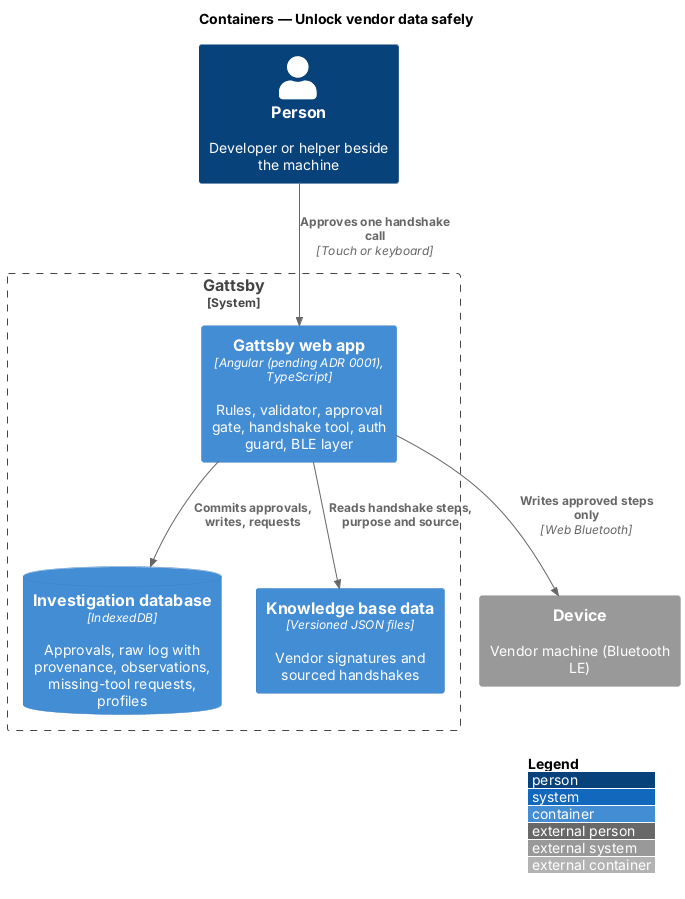
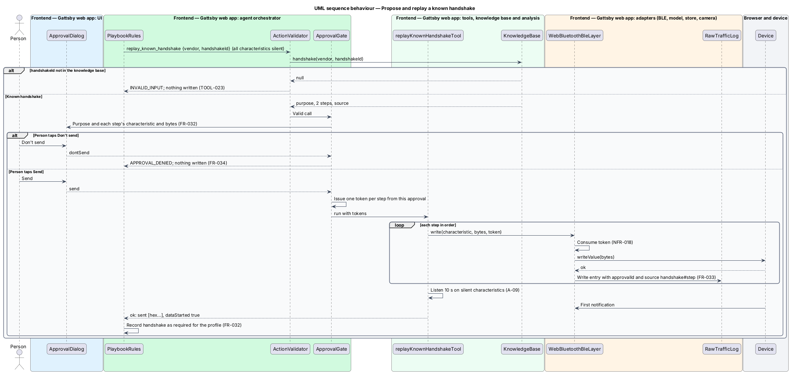
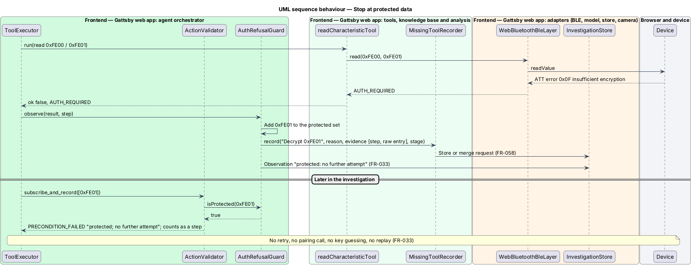

# Unlock vendor data safely

## Overview

Some machines stay silent until an app sends them a vendor's start-up sequence; others protect their
data with pairing, encryption or an authentication exchange. This feature covers both on the
Proprietary path of the playbook, and draws the line between them. When a device matches a vendor
signature whose known handshake is in the knowledge base, and every characteristic stayed silent
during the recordings, Gattsby may propose that handshake. Sending it is a `write` and needs the
person's approval. When a device needs authentication or encryption that Gattsby does not have,
Gattsby records the evidence, raises a missing-tool request and stops that line of investigation.
It never guesses keys, replays captured authentication or forces pairing.

**vendor handshake** — initialisation sequence a vendor's own app sends to start a device's data,
held in the knowledge base with its purpose, its bytes and a public source

**handshake step** — one write of a handshake: a characteristic, the exact bytes and an optional
delay before the next step

**protected characteristic** — characteristic whose read, notification or write failed for
insufficient authentication, authorization or encryption during this investigation

**write provenance** — record, on each raw-log write entry, of the approval that allowed it and the
knowledge-base command or handshake step its bytes came from

The handshake proposal appears on the Investigation page as an approval prompt in the Approve a
command dialog (`docs/mocks/dialogs/approval/default.html`, with busy, confirmed and failed states).
No mock draws a handshake in that dialog yet: a `handshake` state listing each step's purpose and
bytes is `<TO SUPPLY>` before implementation. The protected path ends on the Verdict page, state
`missing-tool` (`docs/mocks/pages/verdict/missing-tool.html`): "Needs a missing tool", "Decrypt
Kingsmith FE00 packets", "I didn't try to get around it." The request is then listed on the Missing
tools page (`docs/mocks/pages/missing-tools/default.html`).

FR-033 is MVP; the handshake (FR-032, TOOL-023) is P2. The approval gate itself is the
approve-a-command design; this design adds what is specific to handshakes and to protected data.

## Description

The design introduces these building blocks in the Angular (pending ADR 0001) workspace under
`frontend/src/app/`:

- **`PlaybookRules`** (`agent/playbook-rules.ts`) — at the Proprietary stage, proposes
  `replay_known_handshake` only when `vendor_signature_lookup` returned a match with `hasHandshake`,
  and every recorded characteristic is *silent* (see the record-and-find-varying-fields design).
- **`ActionValidator`** (`agent/action-validator.ts`) — refuses a `replay_known_handshake` whose
  `handshakeId` is not in the knowledge base for that `vendor` with `INVALID_INPUT`, before any
  approval prompt. It refuses a call when no vendor match exists, or the device is not connected,
  with `PRECONDITION_FAILED`, and after emergency stop with `EMERGENCY_STOPPED`. It refuses any call
  that targets a protected characteristic.
- **`replayKnownHandshakeTool`** (`tools/control/replay-known-handshake.tool.ts`) — the
  `replay_known_handshake` tool, safety class `write`, group Control. Its input schema is `{ vendor,
  handshakeId }` with no other property, so it cannot carry bytes. It looks up the steps in the
  knowledge base, writes them in order with their tokens, then listens for data.
- **`ApprovalGate`**, **`ApprovalDialog`**, **`ApprovalLedger`** (`agent/approval-gate.ts`,
  `dialogs/approval/approval.dialog.ts`, `ble/approval-ledger.ts`) — the approval of the
  approve-a-command design. For a handshake the `ApprovalRequest` lists every step with its
  characteristic and bytes, and the purpose from the knowledge base. On "Send" the gate issues one
  `ApprovalToken` per step from that one approval, each bound to its characteristic and bytes.
- **`WebBluetoothBleLayer`** (`ble/web-bluetooth-ble-layer.ts`) — writes each step after consuming
  its token. It maps an ATT error for insufficient authentication (`0x05`), insufficient authorization
  (`0x08`), insufficient encryption key size (`0x0C`) or insufficient encryption (`0x0F`) to
  `AUTH_REQUIRED`. How Chrome 148 reports each of these as a `DOMException` is `<TO SUPPLY>` and
  shall be checked on each supported platform.
- **`RawTrafficLog`** (`ble/raw-traffic-log.ts`) — stores each write with its `approvalId` and
  `source` (`handshake:{vendor}/{handshakeId}#{step}` or `command:{id}`): the write provenance.
- **`AuthRefusalGuard`** (`agent/auth-refusal-guard.ts`) — watches every result envelope. On
  `AUTH_REQUIRED` it adds the characteristic to the investigation's protected set, records an
  observation, and asks `MissingToolRecorder` to record a request. `ActionValidator` consults it.
- **`MissingToolRecorder`** (`outcome/missing-tool-recorder.ts`) — records and merges the request
  (see the record-missing-tool-requests design).
- **`KnowledgeBase`** (`knowledge-base/knowledge-base.ts`) — `handshakes` from
  `frontend/src/knowledge-base/vendors/*.json`. Each entry holds `id`, `vendor`, `purpose`, `steps`,
  `isMotion` and `source`. Validation at build fails an entry with no source (FR-068 AC2, A-11).
- **`ProfileBuilder`** (`outcome/profile-builder.ts`) — lists the handshake under "required
  handshake" when it started the data (FR-032 AC2).

### Handshake rules

1. Only a handshake from the knowledge base can be sent. No tool input carries bytes, and no code
   path builds write bytes from recorded traffic or model output. A captured or guessed sequence
   cannot be expressed (TOOL-023).
2. An unknown `handshakeId` is refused with `INVALID_INPUT` and nothing is written (TOOL-023 AC1).
3. The prompt shows what the handshake is for and every byte it sends, and nothing is written until
   the person taps "Send" (FR-032 AC1, FR-034). "Don't send" returns `APPROVAL_DENIED`, and the same
   call is refused for the next 3 steps (see the approve-a-command design).
4. A handshake that the knowledge base marks `isMotion` carries the stand-clear check (FR-035).
   Handshakes that only start data do not.
5. Steps are written in order, with each step's `delayMs` from the knowledge base. A write that
   fails returns `GATT_ERROR`. The remaining steps are not sent, their tokens are revoked, and the
   summary lists what was sent.
6. Emergency stop during the sequence revokes every token, so the next step is refused with
   `EMERGENCY_STOPPED` (see the emergency-stop design).
7. After the last step, the tool listens for 10 seconds, the default recording length (A-09). The
   subscriptions stay enabled from the recordings. `dataStarted` is true when any
   previously silent characteristic sends a value in that time.
8. When data starts, the playbook repeats the level recordings, and the profile records the
   handshake as required, with its source and the step as evidence (FR-032 AC2).
9. A handshake is proposed at most once per investigation. A failed or fruitless handshake is
   evidence for the verdict, not a reason to try variations.

### Protected data rules

1. A read, notification or write that fails with `AUTH_REQUIRED` adds the characteristic to the
   protected set. A missing-tool request is raised with the failing step and its raw log entry as
   evidence, and the stage (FR-033 AC1, FR-058).
2. `ActionValidator` refuses every later call that targets a protected characteristic with
   `PRECONDITION_FAILED` and the reason "protected; no further attempt" (FR-033 AC1). The refusal
   counts as a step (FR-043).
3. Gattsby never calls a pairing or bonding API. Web Bluetooth exposes none, and the design adds
   none. The operating system may show its own pairing prompt when a protected characteristic is
   read. That prompt belongs to the operating system: Gattsby records the error the read returns and
   does not retry. Behaviour per platform is `<TO SUPPLY>`.
4. A payload that arrives but looks scrambled, such as data whose packet length tracks the belt
   speed while no field correlates, is judged by the agent from the analysis results. The agent
   raises the request with `request_missing_tool`, and no tool exists that could attempt decryption.
   A deterministic test for scrambled payloads is `<TO SUPPLY>`.
5. The investigation continues on other characteristics. The verdict is *Needs a missing tool* when
   the protected data blocked the investigation's progress (see the issue-the-verdict design).

### Write provenance check (FR-033 AC2)

Every write entry in the raw log carries an `approvalId` and a `source`. The `source` resolves to a
knowledge-base command or handshake step whose bytes equal the entry's `hex`. The acceptance suite
runs this check over each spec's raw log, beside the approve-a-command design's check that each
write follows its approval. Any write without a matching approval and source fails the spec.

### Data shapes

| Type | Fields |
|---|---|
| `VendorHandshake` | `id`, `vendor`, `purpose`, `steps: HandshakeStep[]`, `isMotion`, `source` |
| `HandshakeStep` | `service`, `characteristic`, `bytes` (hex), `withResponse`, `delayMs?` |
| `HandshakeResult` | `sent: string[]` (hex), `dataStarted` |
| `ProtectedCharacteristic` | `uuid`, `code` (`AUTH_REQUIRED`), `attError?`, `stepId`, `rawLogId` |
| `WriteProvenance` | `approvalId`, `source` |

### Errors

| Code | Raised by | Meaning to the person |
|---|---|---|
| `INVALID_INPUT` | `ActionValidator` | Never shown; nothing written. |
| `APPROVAL_DENIED` | `ApprovalGate` | "Not sent." |
| `PRECONDITION_FAILED` | `ActionValidator` | Never shown; the agent sees "protected" or "no vendor match". |
| `GATT_ERROR` | `replay_known_handshake` | The step summary names the step the device refused. |
| `EMERGENCY_STOPPED` | `ApprovalGate`, BLE layer | "Emergency stop was used. Nothing more will be sent." |
| `AUTH_REQUIRED` | BLE layer | "This data is protected. Gattsby won't try to get around it." |

### Tests that prove it

The encrypted device of `e2e/fixtures/fake-bluetooth.ts` fails reads on its data characteristic
with insufficient encryption. The spec expects one missing-tool request on the Missing tools page
object, and no second attempt on that characteristic in the fake's call log. A fake vendor device
that stays silent until a known handshake is written covers approval, "Don't send" with nothing
written, an unknown `handshakeId`, and data starting.

## Requirements

The feature realizes the following level-2 (L2) requirements; each refines the level-1 (L1)
requirement cited beside it.

| L2 ID | Refines (L1) | Requirement |
|-------|--------------|-------------|
| [`FR-032`](../../../specs/L2.md#fr-032-try-a-known-vendor-handshake-when-data-is-silent) | `L1-008` | When a device matches a vendor signature but sends no data, Gattsby may propose the vendor's known initialisation sequence from the knowledge base. Sending it is a `write` and needs approval (FR-034). |
| [`FR-033`](../../../specs/L2.md#fr-033-never-bypass-encryption-or-authentication) | `L1-008` | When a device requires pairing, bonding, encryption or an authentication exchange Gattsby does not know, Gattsby must record the evidence, raise a missing-tool request and stop that line of investigation. It must never try to guess keys, replay captured authentication or force pairing. |
| [`TOOL-023`](../../../specs/L2.md#tool-023-replay_known_handshake) | `L1-008` | Sends a vendor's known initialisation sequence from the knowledge base to unlock data. Never a captured or guessed sequence. |

## Diagrams

### System context

The person approves a known handshake in Gattsby, which writes it through Chrome's Web Bluetooth
stack; a protected device's refusals come back the same way and end that line of investigation.

### Containers

The web app reads handshakes and their sources from the knowledge base, writes only approved steps
to the device, and commits approvals, writes, observations and missing-tool requests to the
investigation database.

### Components

`ActionValidator` and `ApprovalGate` stand before `replayKnownHandshakeTool`; the BLE layer consumes
one token per step and logs its provenance; `AuthRefusalGuard` turns `AUTH_REQUIRED` into a
protected characteristic and a missing-tool request.

### Class structure

A `VendorHandshake` owns its `HandshakeStep`s; `replayKnownHandshakeTool` turns them into approved
writes, and `AuthRefusalGuard` holds the `ProtectedCharacteristic`s.

### Behaviour — propose and replay a known handshake

The rules propose the handshake when every characteristic is silent; the person approves; each step
is written with its own token, and data starting marks the handshake as required. An unknown
handshake or a "Don't send" writes nothing.

### Behaviour — stop at protected data

A read fails with `AUTH_REQUIRED`; the guard marks the characteristic protected and raises a
missing-tool request, and a later call on that characteristic is refused.

