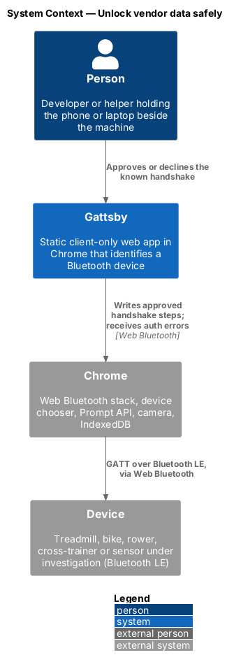
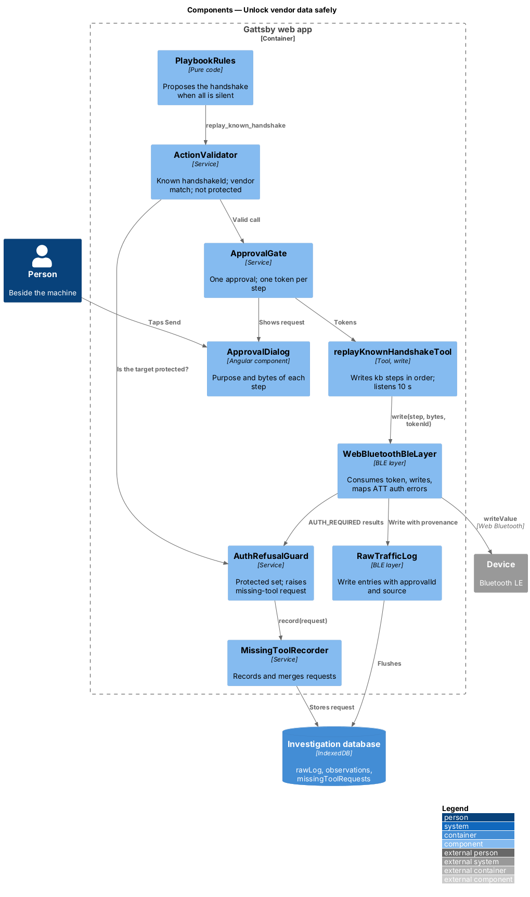
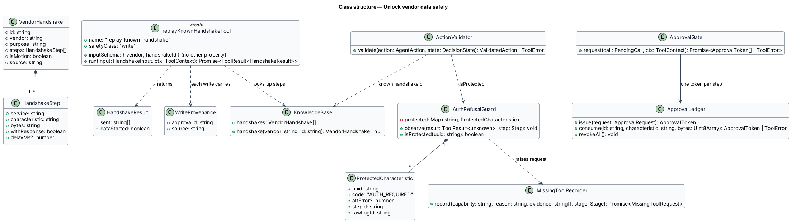

# Unlock vendor data safely

## Overview

Some machines stay silent until an app sends them a vendor's start-up sequence; others protect their
data with pairing, encryption or an authentication exchange. This feature covers both on the
Proprietary path of the playbook, and draws the line between them. When a device matches a vendor
signature whose known handshake is in the knowledge base, and every characteristic stayed silent
during the recordings, Gattsby may propose that handshake. Sending it is a `write` and needs the
person's approval. When a device needs authentication or encryption that Gattsby does not have,
Gattsby records the evidence, raises a missing-tool request and stops that line of investigation.
It never guesses keys, replays captured authentication or forces pairing.

**vendor handshake** — initialisation sequence a vendor's own app sends to start a device's data,
held in the knowledge base with its purpose, its bytes and a public source

**handshake step** — the documented data-subscription write, with its characteristic and exact bytes

**protected characteristic** — characteristic whose read, notification or write failed for
insufficient authentication, authorization or encryption during this investigation

**write provenance** — record, on each raw-log write entry, of the approval that allowed it and the
knowledge-base command or handshake step its bytes came from

The handshake proposal appears on the Investigation page as an approval prompt in the Approve a
command dialog (`docs/mocks/dialogs/approval/default.html`, with busy, confirmed and failed states).
The `handshake` state shows the purpose, exact bytes, expected data and source for the one write.
The protected path ends on the Verdict page, state
`missing-tool` (`docs/mocks/pages/verdict/missing-tool.html`): "Needs a missing tool", "Decrypt
Kingsmith FE00 packets", "I didn't try to get around it." The request is then listed on the Missing
tools page (`docs/mocks/pages/missing-tools/default.html`).

FR-033 is MVP; the handshake (FR-032, TOOL-023) is P2. The approval gate itself is the
approve-a-command design; this design adds what is specific to handshakes and to protected data.

### Vendor choice

The first handshake subscribes to the live accelerometer on a compatible Movesense GATT
SensorData device. It uses the vendor's published subscription example and ends when Gattsby
disconnects. The write target and notification characteristic must both be exposed in the current
connection. A name or company identifier can identify the vendor and cannot authorize a write.
The company identifier is sourced from the Bluetooth SIG. [Movesense GATT SensorData Protocol](https://www.movesense.com/docs/esw/gatt_sensordata_protocol/) · [Bluetooth SIG Assigned Numbers](https://www.bluetooth.com/wp-content/uploads/Files/Specification/HTML/Assigned_Numbers/out/en/Assigned_Numbers.pdf?v=1711447219034)

## Description

A vendor signature compares the advertised name, exposed UUIDs and manufacturer ID with the
sourced knowledge base. The Proprietary path offers one subscription when every recording
characteristic was covered by a silent baseline and exactly one documented subscription
matches the exposed layout. The playbook owns the write.

The tool accepts a vendor and handshake ID. Approval shows the purpose, exact bytes, expected
notification and source. Its token binds the bytes, characteristic, device and connection to
one write. The BLE layer checks the target and bytes against the knowledge base again before
consuming the token. Emergency stop revokes the token and aborts the probe.

The tool subscribes before the write to capture the first data packet. A packet with the
documented prefix and payload within ten seconds establishes that data started. The tool
releases its temporary listener, and the playbook repeats the level recordings. The profile
lists the vendor, characteristic, bytes and source. The investigation links the approved write
and notification to the observation. The playbook offers the subscription once per
investigation.

The BLE layer maps explicit GATT protection errors, including Chromium's not-paired error,
to `AUTH_REQUIRED`. The tools record the refusal with its raw GATT entry, raise a missing-tool
request and exclude the characteristic from further probes. [Chromium Web Bluetooth error mapping](https://chromium.googlesource.com/chromium/src/+/refs/heads/main/third_party/blink/renderer/modules/bluetooth/bluetooth_error.cc)

### Protected data rules

1. A read, notification or write that fails with `AUTH_REQUIRED` adds the characteristic to the
   protected set. A missing-tool request is raised with the failing step and its raw log entry as
   evidence, and the stage (FR-033 AC1, FR-058).
2. `ActionValidator` refuses every later call that targets a protected characteristic with
   `PRECONDITION_FAILED` and the reason "protected; no further attempt" (FR-033 AC1). The refusal
   counts as a step (FR-043).
3. Gattsby never calls a pairing or bonding API. Web Bluetooth exposes none, and the design adds
   none. The operating system may show its own pairing prompt when a protected characteristic is
   read. That prompt belongs to the operating system: Gattsby records the error the read returns and
   does not retry. Hardware verification of platform prompts remains open.
4. A payload that arrives but looks scrambled, such as data whose packet length tracks the belt
   speed while no field correlates, is judged by the agent from the analysis results. The agent
   raises the request with `request_missing_tool`, and no tool exists that could attempt decryption.
   Byte patterns alone do not establish encryption. The acceptance test covers an explicit GATT protection error.
5. The investigation continues on other characteristics. The verdict is *Needs a missing tool* when
   the protected data blocked the investigation's progress (see the issue-the-verdict design).

### Write provenance check (FR-033 AC2)

Every write entry in the raw log carries an `approvalId` and a `source`. The `source` resolves to a
knowledge-base command or handshake step whose bytes equal the entry's `hex`. The acceptance suite checks the vendor write and its export against their approved bytes. The existing Playwright guard checks approval for every write.

### Data shapes

| Type | Fields |
|---|---|
| `VendorHandshake` | `id`, `purpose`, `service`, `command`, `data`, `bytes`, `dataPrefix`, `source` |
| `HandshakeResult` | `sent: string[]` (hex), `dataStarted` |
| `ProtectedCharacteristic` | `uuid`, `code` (`AUTH_REQUIRED`), `attError?`, `stepId`, `rawLogId` |
| `WriteProvenance` | `approvalId`, `source` |

### Errors

| Code | Raised by | Meaning to the person |
|---|---|---|
| `INVALID_INPUT` | `ActionValidator` | Never shown; nothing written. |
| `APPROVAL_DENIED` | `ApprovalGate` | "Not sent." |
| `PRECONDITION_FAILED` | `ActionValidator` | Never shown; the agent sees "protected" or "no vendor match". |
| `GATT_ERROR` | `replay_known_handshake` | The step summary names the step the device refused. |
| `EMERGENCY_STOPPED` | `ApprovalGate`, BLE layer | "Emergency stop was used. Nothing more will be sent." |
| `AUTH_REQUIRED` | BLE layer | "This data is protected. Gattsby won't try to get around it." |

### Tests that prove it

The encrypted device of `e2e/fixtures/fake-bluetooth.ts` fails reads on its data characteristic
with insufficient encryption. The spec expects one missing-tool request on the Missing tools page
object, and no second attempt on that characteristic in the fake's call log. A fake vendor device
that stays silent until a known handshake is written covers approval, "Don't send" with nothing
written, an unknown `handshakeId`, and data starting.

## Requirements

The feature realizes the following level-2 (L2) requirements; each refines the level-1 (L1)
requirement cited beside it.

| L2 ID | Refines (L1) | Requirement |
|-------|--------------|-------------|
| [`FR-032`](../../../specs/L2.md#fr-032-try-a-known-vendor-handshake-when-data-is-silent) | `L1-008` | When a device matches a vendor signature but sends no data, Gattsby may propose the vendor's known initialisation sequence from the knowledge base. Sending it is a `write` and needs approval (FR-034). |
| [`FR-033`](../../../specs/L2.md#fr-033-never-bypass-encryption-or-authentication) | `L1-008` | When a device requires pairing, bonding, encryption or an authentication exchange Gattsby does not know, Gattsby must record the evidence, raise a missing-tool request and stop that line of investigation. It must never try to guess keys, replay captured authentication or force pairing. |
| [`TOOL-023`](../../../specs/L2.md#tool-023-replay_known_handshake) | `L1-008` | Sends a vendor's known initialisation sequence from the knowledge base to unlock data. Never a captured or guessed sequence. |

## Diagrams

### System context

The person approves a known handshake in Gattsby, which writes it through Chrome's Web Bluetooth
stack; a protected device's refusals come back the same way and end that line of investigation.

### Containers

The web app reads handshakes and their sources from the knowledge base, writes only approved steps
to the device, and commits approvals, writes, observations and missing-tool requests to the
investigation database.

### Components

`ActionValidator` and `ApprovalGate` stand before `replayKnownHandshakeTool`; the BLE layer consumes
one token per step and logs its provenance; `AuthRefusalGuard` turns `AUTH_REQUIRED` into a
protected characteristic and a missing-tool request.

### Class structure

A `VendorHandshake` owns its `HandshakeStep`s; `replayKnownHandshakeTool` turns them into approved
writes, and `AuthRefusalGuard` holds the `ProtectedCharacteristic`s.

### Behaviour — propose and replay a known handshake

The rules propose the handshake when every characteristic is silent; the person approves; each step
is written with its own token, and data starting marks the handshake as required. An unknown
handshake or a "Don't send" writes nothing.

### Behaviour — stop at protected data

A read fails with `AUTH_REQUIRED`; the guard marks the characteristic protected and raises a
missing-tool request, and a later call on that characteristic is refused.

