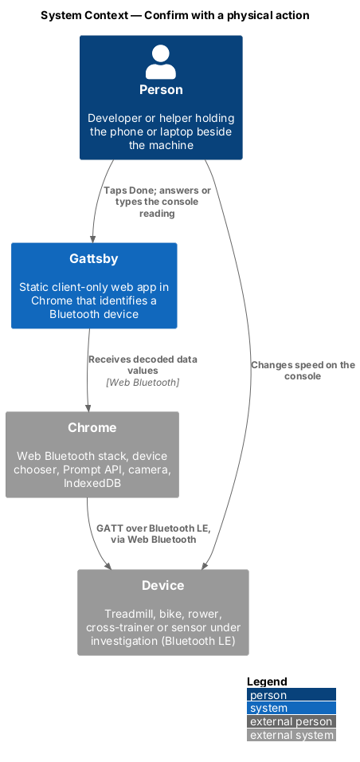
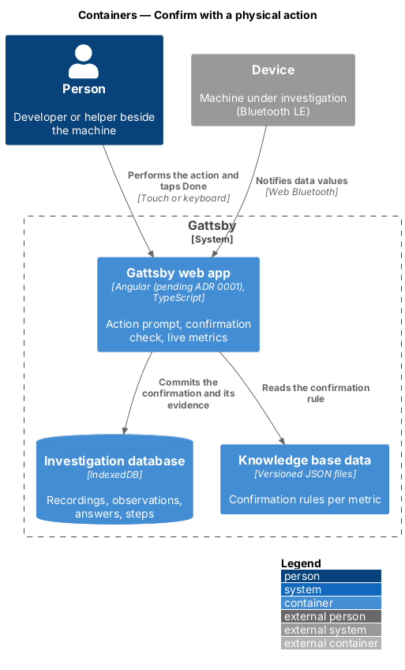
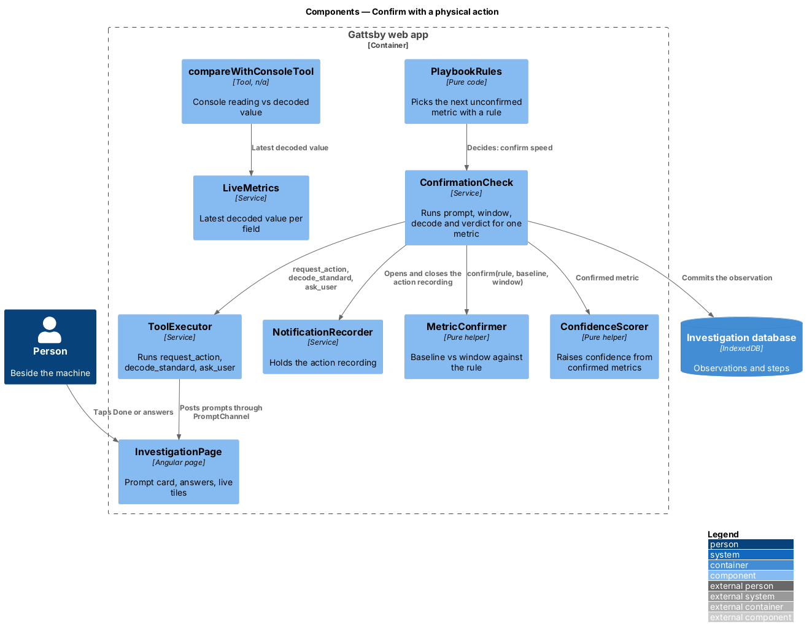
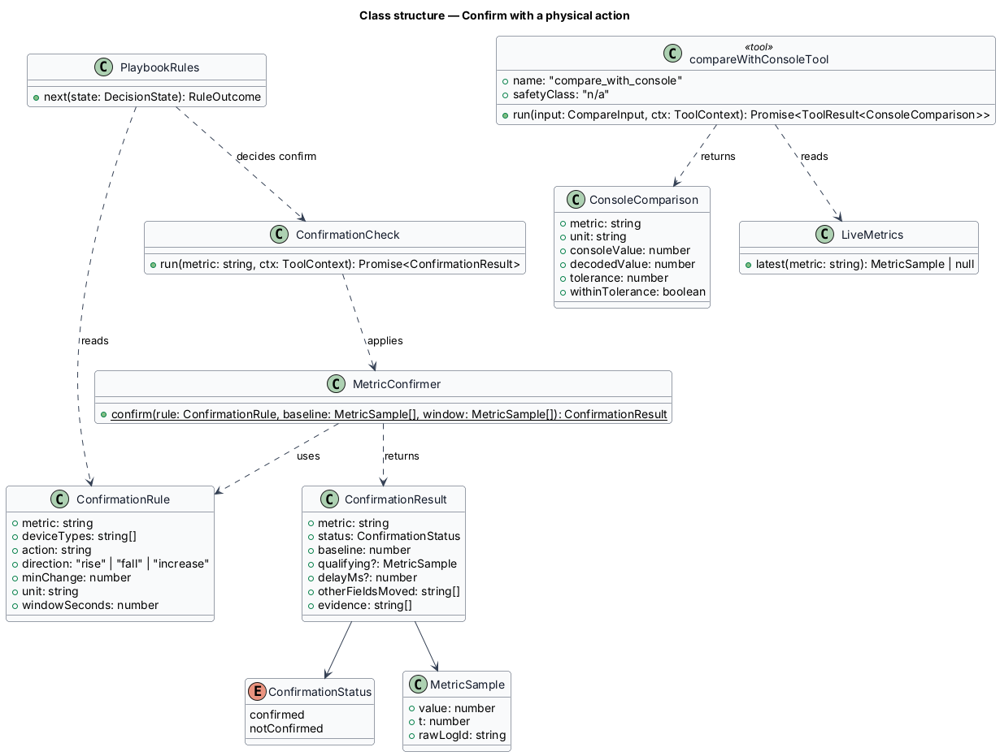
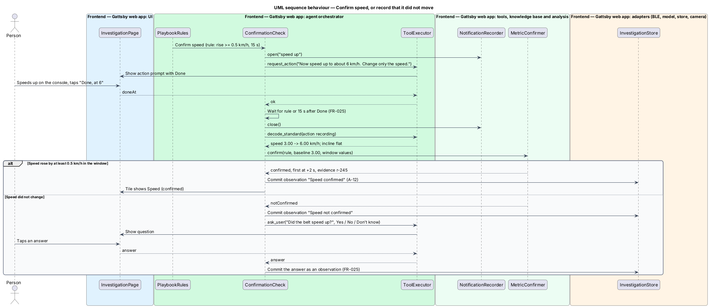
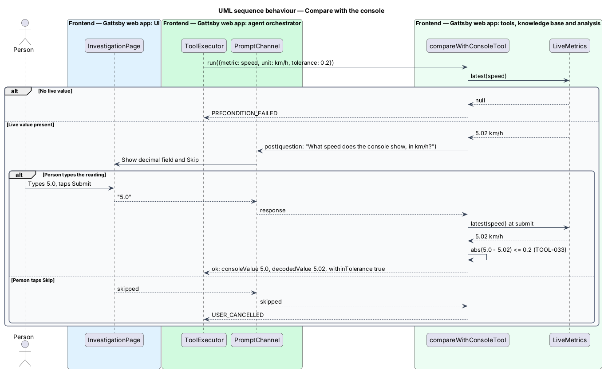

# Confirm with a physical action

## Overview

A decoded value is only a claim until the device shows it tracks the real machine. This feature is
the second half of the Standard path of the playbook: once a standard data characteristic is
subscribed and decoding (see the decode-standard-data design), Gattsby asks the person for a known
action, such as "Now speed up to about 6 km/h. Change only the speed.", and checks that the matching
decoded metric moves the expected way within 15 seconds. Only a metric that passes this check is
*confirmed*, and only a confirmed metric lets the verdict read "Connected — FTMS" (FR-054).

**confirmation rule** — knowledge-base entry that names, for one metric, the action to ask for, the
direction the metric shall move and the smallest change that counts

**confirmation window** — interval that opens when the action prompt is shown and closes 15 seconds
after the person taps "Done"

**confirmed metric** — decoded metric that met its confirmation rule inside the confirmation window

**console comparison** — second check in which the person reads a value from the machine's own
console and Gattsby compares it with the decoded value at that moment

The feature appears on the Investigation page, state `default`
(`docs/mocks/pages/investigation/default.html`). The agent asks "Now speed up to about 6 km/h.
Change only the speed." with the reason "If the speed field doubles and nothing else jumps, the
decoding is right."; the step `decode_standard` "Compare speed before and after your change" reports
"Speed went 3.0 → 6.0 km/h within 2 s. Incline did not move.", followed by "confirmed Speed field is
speed in km/h" and the hypothesis rising from 65 % to 85 %. The next prompt, "Raise the incline to
2%", with the answers "Incline is at 2%" and "It didn't change", is the same check for incline. The
live tiles mark each metric *confirmed*, *likely* ("~") or *not labelled yet* ("?").

The check is deterministic. It runs the same way in full agent mode and in checklist mode, and the
model never judges whether a value moved (AGENTS.md).

## Description

The design introduces these building blocks in the Angular (pending ADR 0001) workspace under
`frontend/src/app/`:

- **`PlaybookRules`** (`agent/playbook-rules.ts`) — at the Standard stage, once a recording has
  decoded values, picks the next unconfirmed metric that has a confirmation rule, in the rule file's
  order (speed first), and decides "confirm metric". With no rule left it moves on.
- **`ConfirmationCheck`** (`agent/confirmation-check.ts`) — orchestrator routine that runs one
  confirmation. It opens an action recording through `NotificationRecorder`, runs `request_action`
  through `ToolExecutor`, waits for the rule to be met or for the window to close, runs
  `decode_standard` on the action recording, applies `MetricConfirmer`, and commits the observation.
  On a miss it runs `ask_user`.
- **`MetricConfirmer`** (`analysis/metric-confirmer.ts`) — pure helper. Input: the
  `ConfirmationRule`, the metric's values in the baseline recording and its values in the window,
  each with `t` and `rawLogId`. Output: a `ConfirmationResult` with `confirmed` or `notConfirmed`,
  the baseline, the first qualifying value and its delay, and the evidence IDs.
- **`ConfirmationRule`** data (`frontend/src/knowledge-base/standard/confirmation-rules.json`) — one
  entry per metric and device type: the action wording, the direction, the minimum change and the
  15-second window.
- **`requestActionTool`** (`tools/person/request-action.tool.ts`) and **`askUserTool`**
  (`tools/person/ask-user.tool.ts`) — the Person tools of the ask-the-person design. The action
  prompt uses `needsReady: false`, since the metric is already streaming.
- **`compareWithConsoleTool`** (`tools/person/compare-with-console.tool.ts`) — the
  `compare_with_console` tool (P2), safety class `n/a`. It asks the person for the console's reading
  and compares it with the latest decoded value in `LiveMetrics`.
- **`LiveMetrics`** (`live/live-metrics.ts`) — the latest decoded value of each field (see the
  show-live-metrics design). It shows each tile's status, and `compare_with_console` reads it.
- **`ConfidenceScorer`** and **`HypothesisTracker`** (`outcome/`) — raise the hypothesis's
  deterministic confidence from confirmed metrics (see the track-the-hypothesis design).

### Confirmation rules

| Metric | Action asked | Confirmed when | Source |
|---|---|---|---|
| Speed (treadmill, bike) | Treadmill: "Now speed up to about 6 km/h. Change only the speed." Bike: "Now pedal faster." | A value in the window is at least 0.5 km/h above the baseline median | FR-025 AC1, A-12 |
| Total distance | Keep the belt moving during the speed check | The counter increases from its last baseline reading during the window while decoded speed is above 0 and the speed change is confirmed | A-12 |
| Elapsed time | None; read while recording | The value increases during the recording | `<TO SUPPLY>` minimum (the mock marks it confirmed from "0:52 → 1:02") |
| Inclination | "Raise the incline to 2%" | `<TO SUPPLY>` minimum change | Mock prompt |
| Heart rate (strap) | "Walk briefly at an easy pace." | A value in the window is at least 5 BPM above the baseline median | FR-025, FR-054 AC2 |
| Cadence, power, resistance level | `<TO SUPPLY>` | `<TO SUPPLY>` | FR-025 names only speed |

The speed action asks for a change of only one value, so the summary can also say which other
fields moved ("Incline did not move"). That note is evidence for the person and the agent; it is not
part of the rule.

### Rules the check enforces

1. The baseline is the median of the metric over the most recent recording before the action prompt
   (normally the "walk slowly" recording of the decode-standard-data design). A median ignores one
   noisy packet.
2. The window opens when the action prompt is shown, because a person often changes the speed before
   tapping "Done". It closes 15 seconds after "Done" (A-12). The 2-minute "Still there?" rule of
   FR-051 applies while "Done" is not tapped.
3. The metric is *confirmed* as soon as one decoded value in the window meets the rule. The
   observation records the delay ("within 2 s") and links the baseline values and the qualifying
   notification by raw log ID (FR-056).
4. When the window closes with no qualifying value, the metric is *not confirmed*. `ConfirmationCheck`
   then asks "Did the belt speed up?" with "Yes", "No" and "Don't know", and records the answer as an
   observation (FR-025 AC2). A "Yes" with an unmoved value is evidence against the decoding; it
   lowers no confirmation already earned elsewhere and raises nothing.
5. The rules may offer the same action again after "No"; the step budget bounds retries (FR-045).
6. Decode errors inside the window are skipped, not counted as values.
7. A dropped connection during the window ends the check as *not confirmed*, with the interruption
   as its reason (see the recover-a-dropped-connection design).
8. A metric is marked *confirmed* only by this check or by `compare_with_console`; neither the model
   nor a person's answer alone can mark it.

### Console comparison (`compare_with_console`, P2)

1. Precondition: the metric has a decoded value in `LiveMetrics` from a live subscription; otherwise
   `PRECONDITION_FAILED`.
2. Input: `{ metric, unit, tolerance }`. The tolerance comes from the agent or the rule; a default
   per metric is `<TO SUPPLY>`.
3. The prompt asks for the console's reading in the given unit, with a decimal text field
   (`inputmode="decimal"`, comma or point accepted) and "Skip". A console in another unit, such as
   mph, is `<TO SUPPLY>`: the design does not convert units.
4. On submit, the tool takes the latest decoded value at that instant and returns
   `{ consoleValue, decodedValue, withinTolerance }`, with `withinTolerance` true when
   `|consoleValue − decodedValue| ≤ tolerance`. With a console reading of 5.0 km/h, a decoded speed
   of 5.02 km/h and a tolerance of 0.2, `withinTolerance` is true (TOOL-033 AC1).
5. "Skip" returns `USER_CANCELLED`. A value that is not a number keeps the prompt open with "Enter
   the number shown on the console."
6. The result is a second confirmation beside the trend check: a match confirms the metric; a
   mismatch is recorded with both values as evidence of a wrong scale or unit.
7. No mock state draws this prompt yet; one is `<TO SUPPLY>` in `docs/mocks/pages/investigation/`
   before the tool is built.

### Data shapes

| Type | Fields |
|---|---|
| `ConfirmationRule` | `metric`, `deviceTypes`, `action`, `direction` (`rise`, `fall`, `increase`), `minChange`, `unit`, `windowSeconds` (15) |
| `ConfirmationResult` | `metric`, `status` (`confirmed`, `notConfirmed`), `baseline`, `qualifying?` (`value`, `t`, `rawLogId`), `delayMs?`, `otherFieldsMoved`, `evidence` |
| `ConsoleComparison` | `metric`, `unit`, `consoleValue`, `decodedValue`, `tolerance`, `withinTolerance` |

### Errors

| Code | Raised by | Meaning to the person |
|---|---|---|
| `USER_CANCELLED` | `compare_with_console`, `request_action` | The step shows as skipped (FR-052). |
| `PRECONDITION_FAILED` | `compare_with_console` | Never shown; the agent sees that no live value exists. |
| `TIMEOUT` | `request_action` | "Still there?" with "Continue" and "Stop" (FR-051). |

### Tests that prove it

Acceptance specs use the fake FTMS treadmill of `e2e/fixtures/fake-bluetooth.ts`, scripted to raise
speed from 3.00 to 6.00 km/h a few seconds after "Done", or to hold it at 3.00. The Investigation
page object reads the tile status and the "Did the belt speed up?" prompt. Unit tests run
`MetricConfirmer` on value lists, and `ConfirmationCheck` advances a fake clock through the
15-second window.

## Requirements

The feature realizes the following level-2 (L2) requirements; each refines the level-1 (L1)
requirement cited beside it.

| L2 ID | Refines (L1) | Requirement |
|-------|--------------|-------------|
| [`FR-025`](../../../specs/L2.md#fr-025-confirm-decoded-values-with-a-physical-action) | `L1-007` | Gattsby must ask the person for a known action (walk faster, pedal harder, increase incline on the console) and must confirm that the matching decoded metric moves the expected way within 15 seconds. A metric counts as *confirmed* only when it does. |
| [`TOOL-033`](../../../specs/L2.md#tool-033-compare_with_console) | `L1-007` | Asks the person to read a value from the machine's own console and compares it with the decoded value at that moment, as a second confirmation beside FR-025's trend check. |

## Diagrams

### System context

The person changes the speed on the machine's console, and Gattsby watches the decoded value move
through Chrome's Web Bluetooth stack.

### Containers

The web app reads the confirmation rules from the knowledge base and commits each confirmation, with
its evidence, to the investigation database.

### Components

`ConfirmationCheck` runs the action prompt and the recording, then hands the values to
`MetricConfirmer`; `compareWithConsoleTool` reads `LiveMetrics` for the console comparison.

### Class structure

`ConfirmationCheck` applies a `ConfirmationRule` through `MetricConfirmer` and produces a
`ConfirmationResult`; `compareWithConsoleTool` produces a `ConsoleComparison`.

### Behaviour — confirm speed, or record that it did not move

Speed rises by at least 0.5 km/h inside the window and is confirmed; when it does not, the metric is
marked not confirmed and the person's answer to "Did the belt speed up?" is recorded.

### Behaviour — compare with the console

The person types the console's reading; the tool compares it with the latest decoded value and
records whether it is within the tolerance.

