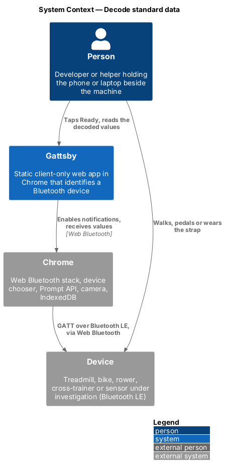
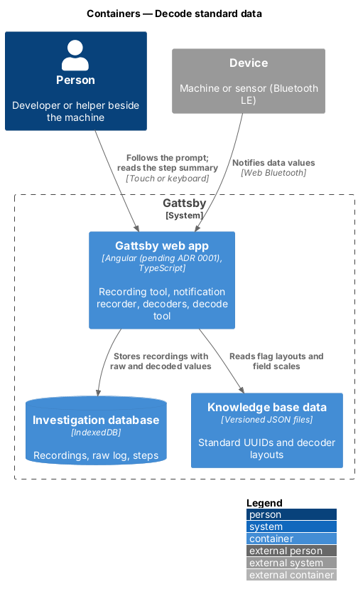
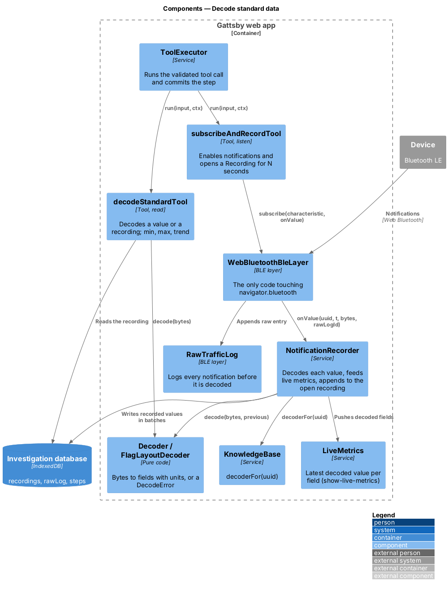
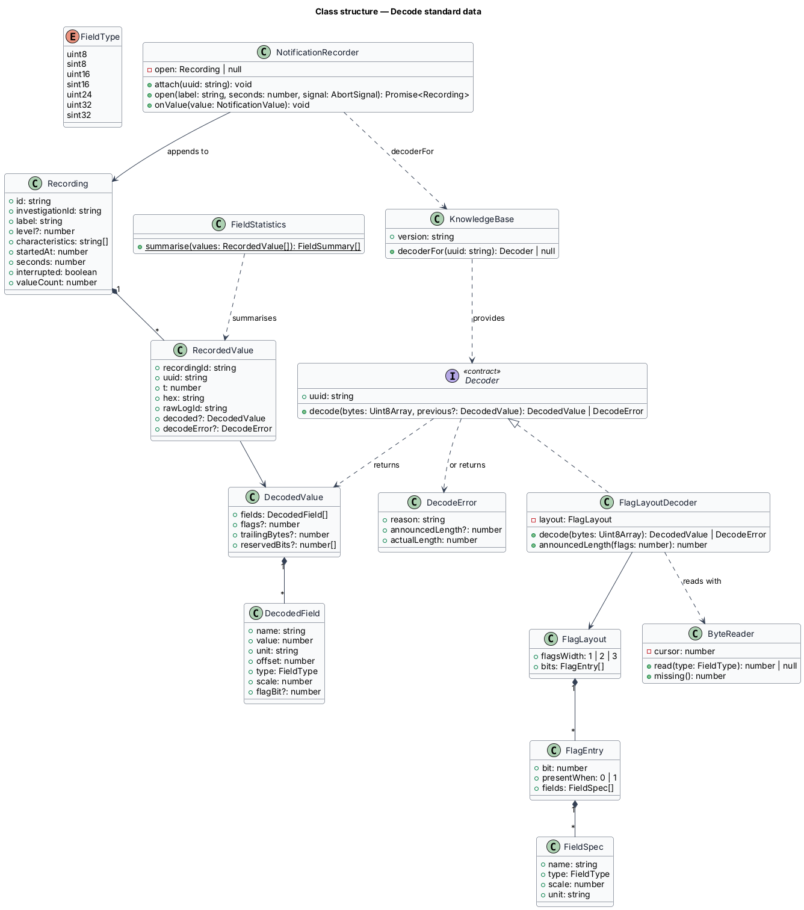
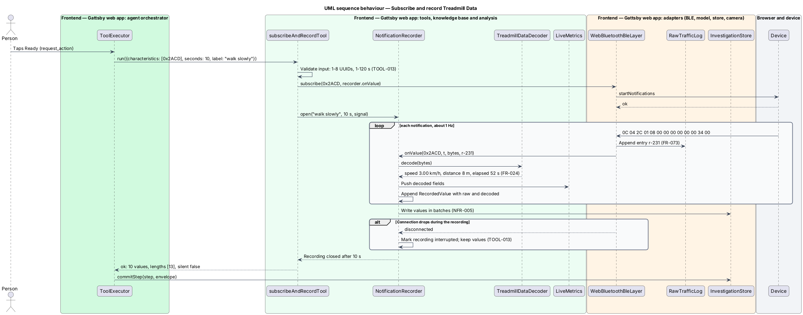
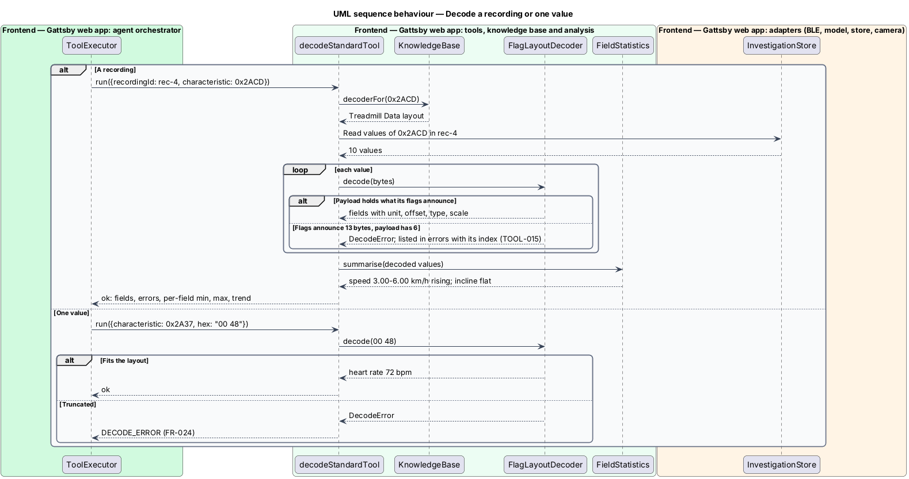

# Decode standard data

## Overview

The Standard path is the fourth stage of the playbook. It runs when the Identify stage has found a
standard service from the knowledge base: Fitness Machine (`0x1826`), Cycling Power (`0x1818`),
Cycling Speed and Cadence (`0x1816`), Heart Rate (`0x180D`), Running Speed and Cadence (`0x1814`)
or Battery (`0x180F`). This feature is its first half: Gattsby subscribes to the service's data
characteristic, records every notification for a set time, and decodes each payload with the
knowledge base's decoder, so the investigation record holds each raw notification beside its decoded
fields and units.

**recording** — labelled, timed capture of every value one or more characteristics sent, each with
its timestamp and raw log entry

**decoder** — deterministic function, keyed by characteristic UUID, that turns one payload into named
fields with values, units, offsets, types and scales, or into a decode error

**flag-driven layout** — payload format whose leading flags field says which optional fields follow,
so a field's byte offset depends on the flags of each packet

The feature appears on the Investigation page in the Standard path, state `default`
(`docs/mocks/pages/investigation/default.html`): the step `subscribe_and_record` "Record Treadmill
Data while you walk", 10 s, summarised as "10 notifications at 1 per second, decoded with the FTMS
layout", and the step `decode_standard` "Compare speed before and after your change". The Evidence
log, state `default` (`docs/mocks/pages/evidence/default.html`), shows the result: each Treadmill
Data notification in hex (`0C 04 2C 01 08 00 00 00 00 00 00 34 00`) with the decoder's reading of
every field.

The model never decodes bytes (AGENTS.md). Decoding is deterministic code driven by knowledge-base
data, so the same payload decodes the same way in full agent mode and in checklist mode. Confirming
that a decoded value moves with a physical action is the next slice (see the
confirm-with-a-physical-action design); showing the values live is the show-live-metrics design.

## Description

The design introduces these building blocks in the Angular (pending ADR 0001) workspace under
`frontend/src/app/`:

- **`subscribeAndRecordTool`** (`tools/listening/subscribe-and-record.tool.ts`) — the
  `subscribe_and_record` tool, safety class `listen`. It validates its input, checks that each
  characteristic has `notify` or `indicate`, enables notifications through `BleLayer.subscribe`,
  opens a `Recording` in `NotificationRecorder` for the requested seconds, and returns the
  per-characteristic counts, packet lengths and the `silent` flag.
- **`NotificationRecorder`** (`tools/listening/notification-recorder.ts`) — the single consumer of
  each subscribed characteristic's values. For each value it looks up `KnowledgeBase.decoderFor(uuid)`,
  decodes known characteristics at once, pushes the result to `LiveMetrics` (see the
  show-live-metrics design) and appends it to the open `Recording`, if any. It writes recorded
  values to `InvestigationStore` in batches, so a 120-second recording never sits whole in memory
  (NFR-005).
- **`decodeStandardTool`** (`tools/analysis/decode-standard.tool.ts`) — the `decode_standard` tool,
  safety class `read`, group Analysis. It decodes one `hex` value, or every value of one
  characteristic in a stored recording, and adds per-field minimum, maximum and trend over the
  recording. It needs no connection.
- **`Decoder`** (`knowledge-base/decoders/decoder.ts`) — the contract every decoder meets:
  `decode(bytes, previous?)` returns a `DecodedValue` or a `DecodeError`. A decoder never throws; a
  defect inside one is caught by `NotificationRecorder` and recorded as a `DecodeError`.
- **`FlagLayoutDecoder`** (`knowledge-base/decoders/flag-layout-decoder.ts`) — generic decoder that
  reads a `FlagLayout` (flags width, then one entry per flag bit with the fields it adds) from the
  knowledge-base data and walks it bit by bit. The FTMS data characteristics use it.
- **Per-characteristic decoders** (`knowledge-base/decoders/*.decoder.ts`) — one file per standard
  characteristic: `treadmill-data`, `indoor-bike-data`, `rower-data`, `cross-trainer-data`,
  `fitness-machine-feature`, `fitness-machine-status`, `control-point-response`, `supported-range`,
  `cycling-power-measurement`, `csc-measurement`, `heart-rate-measurement`, `rsc-measurement` and
  `battery-level`. Flag-driven ones are a `FlagLayoutDecoder` bound to their layout.
- **`ByteReader`** (`knowledge-base/decoders/byte-reader.ts`) — reads `uint8`, `sint8`, `uint16`,
  `sint16`, `uint24`, `uint32` and `sint32` little-endian at a cursor and reports, instead of reading
  past the end, how many bytes were missing.
- **`FieldStatistics`** (`analysis/field-statistics.ts`) — pure helper that computes minimum,
  maximum and trend for each numeric field across a recording's decoded values.
- **`KnowledgeBase`** (`knowledge-base/knowledge-base.ts`) — supplies `decoderFor(uuid)`; the
  layouts live in `frontend/src/knowledge-base/standard/*.json` (FTMS, Heart Rate, Cycling Power,
  CSC, RSC, Battery), validated at build (FR-066, FR-069).
- **`InvestigationStore`** (`store/investigation-store.ts`) — holds the `Recording` in the
  `recordings` object store; `ToolExecutor` commits the step with its result envelope.

### Recording rules (`subscribe_and_record`)

1. Input: `characteristics` 1–8 UUIDs, `seconds` 1–120, optional `label`. Anything else, such as 121
   seconds, is refused with `INVALID_INPUT` before any Bluetooth call (TOOL-013).
2. A characteristic without `notify` or `indicate` is refused with `PROPERTY_MISSING`. A
   `startNotifications` failure for insufficient authentication or encryption returns
   `AUTH_REQUIRED`, and FR-033 applies (see the unlock-vendor-data-safely design).
3. Each value is stamped with `t`, milliseconds since the investigation started, and the `id` of its
   `RawLogEntry`. The BLE layer logs the raw value before the recorder sees it (FR-073).
4. The recording closes after `seconds` on the investigation clock; unit tests advance a fake clock.
   Notifications stay enabled after it closes, so live values keep arriving until the stage ends or
   the connection is released.
5. A characteristic with no value during the recording is reported with `count` 0 and `silent` true.
6. If the connection drops, the recording is marked `interrupted` and keeps what arrived;
   `ConnectionSupervisor` restores the subscription after reconnecting (see the
   recover-a-dropped-connection design). The tool's summary states that the recording was
   interrupted.
7. A stop or emergency stop aborts the recording through `ToolContext.signal`; the tool returns
   `ABORTED` and keeps the values already stored.
8. The recorder keeps up with 50 notifications per second on each of 4 characteristics (NFR-003).
   Decoding is synchronous and allocation-light; persistence is batched.

### Decoding rules

1. A flag-driven payload is read in order: the flags field, then, for each flag bit from 0 upwards
   whose condition holds, that bit's fields in the order the layout lists them.
2. The decoder computes the length the flags announce before it reads a field. When the payload is
   shorter, the whole notification is a `DecodeError` ("flags `0x040C` announce 13 bytes; payload has
   6") and no partial fields are reported, so no value is read from the wrong offset (FR-024 AC3).
3. When the payload is longer than announced, the known fields are decoded and the decoded value
   carries `trailingBytes`, which `ReadableMetricResolver` records as a connection quirk.
4. A set reserved flag bit is noted on the decoded value. Reserved bits follow every defined bit, so
   the fields before them keep their offsets.
5. Each `DecodedField` carries `offset` (byte position in this payload), `type`, `scale` and, for a
   flag-driven field, `flagBit`. The value is the raw integer times the scale, in the field's unit.
6. A decode error never stops a recording, and `decode_standard` over a recording lists each failing
   value in `errors` with its index while decoding the rest (TOOL-015 AC3). For a single `hex` value
   a failure is the tool error `DECODE_ERROR`.
7. Cumulative-count characteristics (CSC Measurement, the wheel and crank data of Cycling Power
   Measurement) are decoded against the previous value of the same recording: speed and cadence come
   from the difference in revolutions over the difference in event time, with event times rolling
   over at 65,536 (1/1024 s, or 1/2048 s for Cycling Power wheel events). The first value yields only
   the cumulative fields.

### FTMS Treadmill Data (`0x2ACD`)

Flags are `uint16` little-endian at bytes 0–1. Fields follow in this order. The knowledge-base data
file is the authority for the layout; the table states what it encodes, and FR-066 AC1 checks it
against the Bluetooth SIG examples.

| Flag bit | Present when | Fields | Type | Scale | Unit |
|---|---|---|---|---|---|
| 0 More Data | bit is **0** | Instantaneous Speed | `uint16` | 0.01 | km/h |
| 1 | bit is 1 | Average Speed | `uint16` | 0.01 | km/h |
| 2 | bit is 1 | Total Distance | `uint24` | 1 | m |
| 3 | bit is 1 | Inclination; Ramp Angle Setting | `sint16`; `sint16` | 0.1; 0.1 | %; degree |
| 4 | bit is 1 | Positive Elevation Gain; Negative Elevation Gain | `uint16`; `uint16` | 0.1 | m |
| 5 | bit is 1 | Instantaneous Pace | `uint8` | 0.1 | km/min |
| 6 | bit is 1 | Average Pace | `uint8` | 0.1 | km/min |
| 7 | bit is 1 | Total Energy; Energy per Hour; Energy per Minute | `uint16`; `uint16`; `uint8` | 1 | kcal |
| 8 | bit is 1 | Heart Rate | `uint8` | 1 | bpm |
| 9 | bit is 1 | Metabolic Equivalent | `uint8` | 0.1 | MET |
| 10 | bit is 1 | Elapsed Time | `uint16` | 1 | s |
| 11 | bit is 1 | Remaining Time | `uint16` | 1 | s |
| 12 | bit is 1 | Force on Belt; Power Output | `sint16`; `sint16` | 1 | N; W |

Worked example from the Evidence log mock: `0C 04 2C 01 08 00 00 00 00 00 00 34 00` has flags
`0x040C` (bits 2, 3 and 10; bit 0 clear). It decodes as speed `0x012C` = 300 → 3.00 km/h at bytes
2–3, total distance `0x000008` → 8 m at bytes 4–6, inclination 0.0 % at bytes 7–8, ramp angle 0.0°
at bytes 9–10 and elapsed time `0x0034` → 52 s at bytes 11–12: 13 bytes in all.

### FTMS Indoor Bike Data (`0x2AD2`)

| Flag bit | Present when | Fields | Type | Scale | Unit |
|---|---|---|---|---|---|
| 0 More Data | bit is **0** | Instantaneous Speed | `uint16` | 0.01 | km/h |
| 1 | bit is 1 | Average Speed | `uint16` | 0.01 | km/h |
| 2 | bit is 1 | Instantaneous Cadence | `uint16` | 0.5 | rpm |
| 3 | bit is 1 | Average Cadence | `uint16` | 0.5 | rpm |
| 4 | bit is 1 | Total Distance | `uint24` | 1 | m |
| 5 | bit is 1 | Resistance Level | `sint16` | 1 | unitless |
| 6 | bit is 1 | Instantaneous Power | `sint16` | 1 | W |
| 7 | bit is 1 | Average Power | `sint16` | 1 | W |
| 8 | bit is 1 | Total Energy; Energy per Hour; Energy per Minute | `uint16`; `uint16`; `uint8` | 1 | kcal |
| 9 | bit is 1 | Heart Rate | `uint8` | 1 | bpm |
| 10 | bit is 1 | Metabolic Equivalent | `uint8` | 0.1 | MET |
| 11 | bit is 1 | Elapsed Time | `uint16` | 1 | s |
| 12 | bit is 1 | Remaining Time | `uint16` | 1 | s |

Rower Data (`0x2AD1`) and Cross Trainer Data (`0x2ACE`) use the same mechanism with their own
layouts; Cross Trainer Data has 24-bit flags (3 bytes). FTMS lets a machine split one record across
more than one notification with More Data set; each notification is decoded on its own, and `LiveMetrics`
keeps the last value of each field.

### Other standard characteristics

| Characteristic | Layout the decoder applies |
|---|---|
| Heart Rate Measurement `0x2A37` | Flags `uint8`. Bit 0 clear: heart rate `uint8` bpm; set: `uint16`. Bits 1–2: sensor contact. Bit 3: Energy Expended `uint16` kJ. Bit 4: RR-intervals, `uint16` each in 1/1024 s, to the end (an odd remainder is a `DecodeError`). `00 48` → 72 bpm (TOOL-015 AC1). |
| Cycling Power Measurement `0x2A63` | Flags `uint16`, then Instantaneous Power `sint16` W, then the optional fields in flag order (pedal power balance, accumulated torque, wheel and crank revolution data, and the rest) from the knowledge-base layout. |
| CSC Measurement `0x2A5B` | Flags `uint8`. Bit 0: cumulative wheel revolutions `uint32` and last wheel event time `uint16` (1/1024 s). Bit 1: cumulative crank revolutions `uint16` and last crank event time `uint16` (1/1024 s). |
| RSC Measurement `0x2A53` | Flags `uint8`; speed `uint16` (1/256 m/s); cadence `uint8` (/min); bit 0: stride length `uint16` (0.01 m); bit 1: total distance `uint32` (0.1 m); bit 2: walking or running. |
| Battery Level `0x2A19` | `uint8` %. |
| Fitness Machine Feature, Supported ranges, Status, Control Point responses | Decoded by this slice's decoders; their use is described in the determine-readable-metrics and test-one-command designs. |

### Data shapes

| Type | Fields |
|---|---|
| `Recording` | `id`, `investigationId`, `label`, `level?`, `characteristics`, `startedAt`, `seconds`, `interrupted`, `valueCount` |
| `RecordedValue` | `recordingId`, `uuid`, `t`, `hex`, `rawLogId`, `decoded?`, `decodeError?` |
| `DecodedValue` | `fields: DecodedField[]`, `flags?`, `trailingBytes?`, `reservedBits?` |
| `DecodedField` | `name`, `value`, `unit`, `offset`, `type`, `scale`, `flagBit?` |
| `DecodeError` | `reason`, `announcedLength?`, `actualLength` |
| `FieldSummary` | `name`, `unit`, `min`, `max`, `trend` (`rising`, `falling` or `flat`) |

Trend is the sign of the least-squares slope of the field's value over time. It is `flat` when the
slope times the recording's duration is under one step of the field's scale.

### Errors

| Code | Raised by | Meaning to the person |
|---|---|---|
| `INVALID_INPUT` | Both tools | Never shown; the agent sees the reason in its next state (FR-043). |
| `PROPERTY_MISSING` | `subscribe_and_record` | The activity feed records that the characteristic does not notify. |
| `AUTH_REQUIRED` | `subscribe_and_record` | "This data is protected. Gattsby won't try to get around it." (see the unlock-vendor-data-safely design) |
| `NOT_CONNECTED` | `subscribe_and_record` | The connection banner handles it (see the recover-a-dropped-connection design). |
| `STORAGE_FULL` | `subscribe_and_record` | The storage toast (see the save-as-the-investigation-runs design). |
| `DECODE_ERROR` | `decode_standard`, one value | The step summary says the payload did not fit the decoder. |

### Tests that prove it

The acceptance specs drive the fake FTMS treadmill, FTMS bike and heart-rate strap of
`e2e/fixtures/fake-bluetooth.ts` and read the Evidence log page object. Unit tests feed each decoder
the Bluetooth SIG example payloads (FR-066), truncated payloads and payloads with reserved bits, and
advance a fake clock for the recording window.

## Requirements

The feature realizes the following level-2 (L2) requirements; each refines the level-1 (L1)
requirement cited beside it.

| L2 ID | Refines (L1) | Requirement |
|-------|--------------|-------------|
| [`FR-024`](../../../specs/L2.md#fr-024-subscribe-to-and-decode-standard-data) | `L1-007` | When a standard service is present, Gattsby must subscribe to its data characteristic, decode it with the knowledge base's decoder, and record the decoded fields with the raw bytes. |
| [`TOOL-013`](../../../specs/L2.md#tool-013-subscribe_and_record) | `L1-007` | Enables notifications or indications on the given characteristics and records every value with a timestamp for N seconds, with an optional label. |
| [`TOOL-015`](../../../specs/L2.md#tool-015-decode_standard) | `L1-007` | Decodes payloads of the standard profiles with the knowledge base's decoders: FTMS (Treadmill, Indoor Bike, Rower, Cross Trainer Data; Feature; Status; Control Point responses; supported ranges), Cycling Power Measurement, CSC Measurement, Heart Rate Measurement, RSC Measurement, Battery Level. |

## Diagrams

### System context

The person walks or pedals on the device while Gattsby records its notifications through Chrome's
Web Bluetooth stack.

### Containers

The web app reads the decoder layouts from the knowledge base data and stores each recording, with
raw and decoded values, in the investigation database.

### Components

`subscribeAndRecordTool` enables notifications through the BLE layer; `NotificationRecorder` decodes
each value with the knowledge base's `Decoder`, feeds `LiveMetrics` and appends to the recording;
`decodeStandardTool` re-reads a stored recording and summarises it.

### Class structure

Every decoder implements `Decoder`; the FTMS data decoders are `FlagLayoutDecoder`s bound to a
`FlagLayout` from the knowledge base. A `Recording` owns its `RecordedValue`s, each holding a
`DecodedValue` or a `DecodeError`.

### Behaviour — subscribe and record Treadmill Data

The tool enables notifications on `0x2ACD`, and each notification is logged raw, decoded and stored
beside its raw entry until 10 seconds pass; a dropped connection marks the recording interrupted.

### Behaviour — decode a recording or one value

`decode_standard` decodes every stored value, lists truncated payloads in `errors`, and returns the
per-field minimum, maximum and trend; a single truncated value returns `DECODE_ERROR`.

