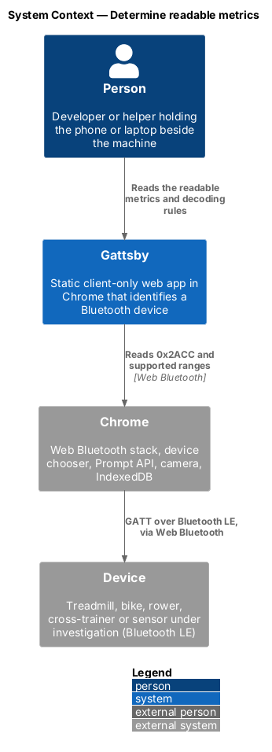
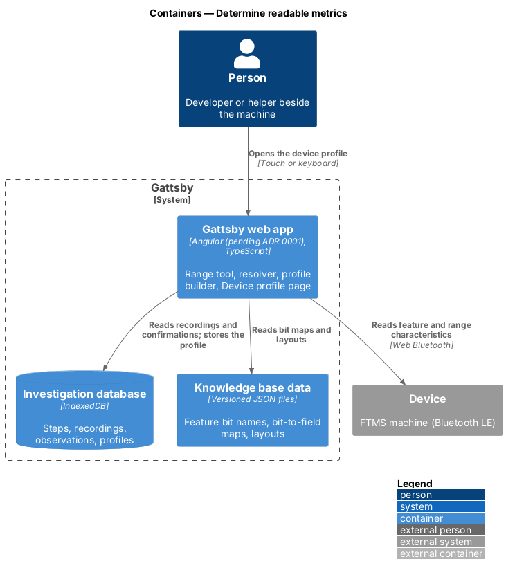
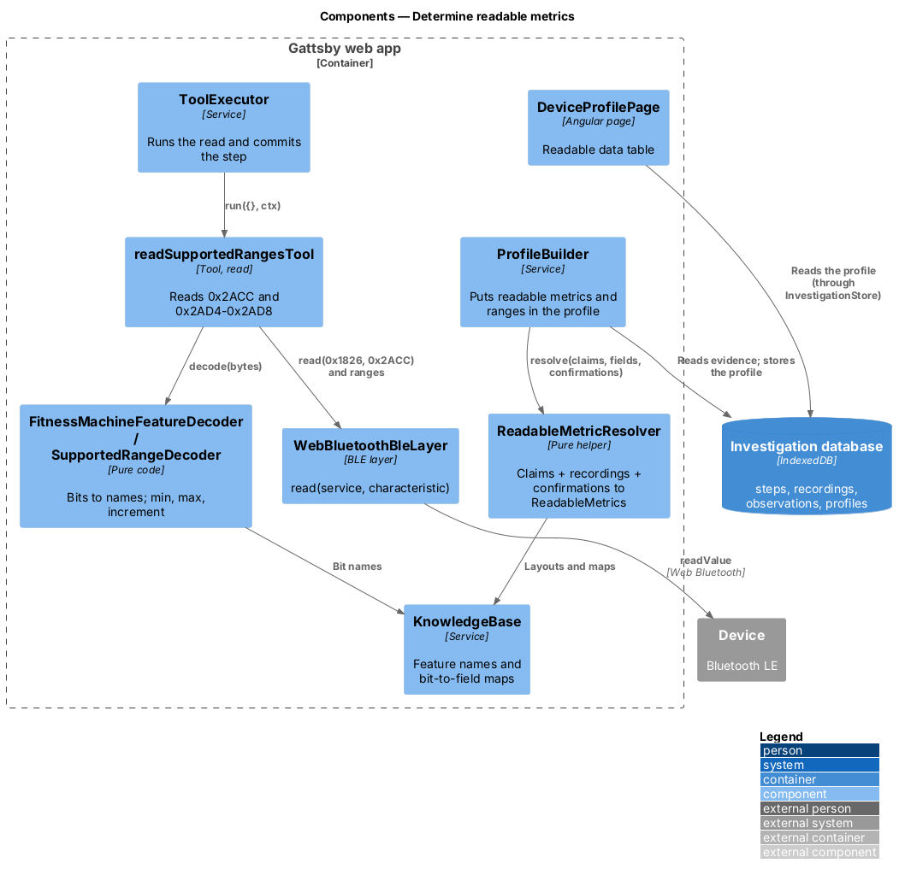
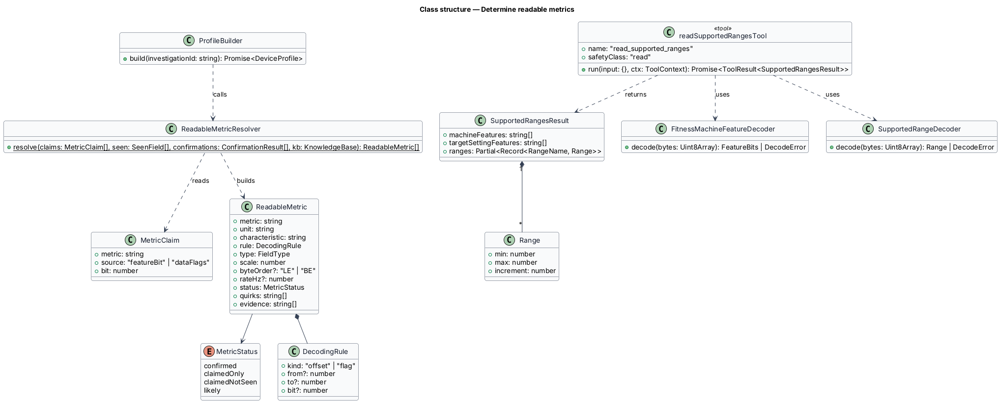
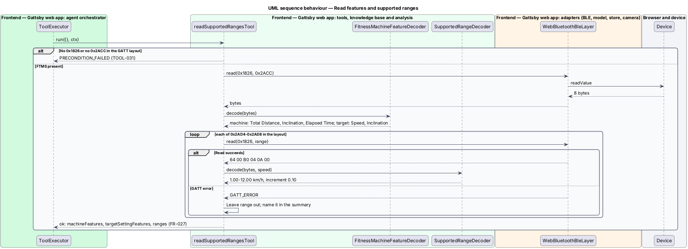
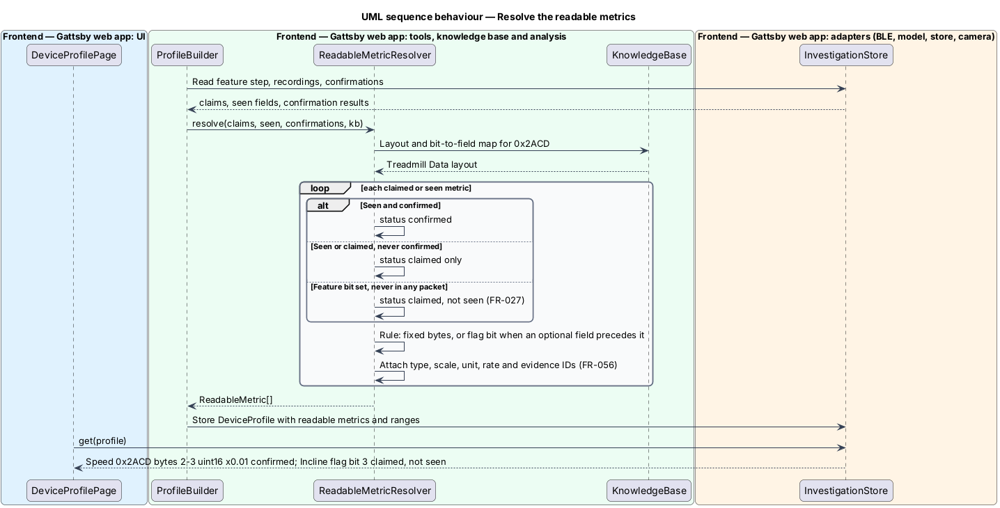

# Determine readable metrics

## Overview

A developer who reads a device profile needs more than "it speaks FTMS": for each metric the device
reports, they need the exact decoding rule and how much of it was proven. This feature produces that
list. It reads what an FTMS machine claims in Fitness Machine Feature (`0x2ACC`) and its supported
ranges, merges the claims with what the recordings actually carried and what the person's actions
confirmed, and hands the result to the device profile. It runs at the start of the Standard path of
the playbook, where the read is quick and read-only, and again at Conclude, where the list is built.

**readable metric** — metric the device reports, listed in the profile with its characteristic, byte
offset or flag rule, type, scale, unit, rate and status

**decoding rule** — the part of a readable metric that tells a developer how to read it: the
characteristic, then either a fixed byte offset or the flag bit that sets the offset, then the type
and the scale

**claim** — statement by the device that it supports a metric, from a Fitness Machine Feature bit or
from the flags of its own data

**supported range** — minimum, maximum and increment the device reports for a target it accepts
(speed, inclination, resistance, heart rate, power)

The result appears on the Device profile page, state `default`
(`docs/mocks/pages/device-profile/default.html`), under "Readable data": "Speed km/h 0x2ACD · bytes
2–3 · uint16 · ×0.01 1 Hz confirmed", "Incline % 0x2ACD · flag bit 3 · sint16 · ×0.1 1 Hz
confirmed", "Distance m 0x2ACD · flag bit 2 · uint24 1 Hz confirmed", "Elapsed time s 0x2ACD · flag
bit 10 · uint16 1 Hz confirmed" and "Heart rate bpm 0x2A37 · relays a paired strap 1 Hz claimed
only". The Verdict page, state `default` (`docs/mocks/pages/verdict/default.html`), lists the same
metrics under "Can read". The state `partial` (`docs/mocks/pages/device-profile/partial.html`) shows
a proprietary device's list, including "Drive length … layout unknown … claimed, not seen".

The supported ranges are also the device's own limits for commands; the keep-commands-conservative
and test-one-command designs use them.

## Description

The design introduces these building blocks in the Angular (pending ADR 0001) workspace under
`frontend/src/app/`:

- **`readSupportedRangesTool`** (`tools/inspection/read-supported-ranges.tool.ts`) — the
  `read_supported_ranges` tool, safety class `read`, group Inspection. It reads `0x2ACC`, then each
  of `0x2AD4`–`0x2AD8` that the recorded GATT layout holds, through `BleLayer.read`. It decodes them
  and returns `machineFeatures`, `targetSettingFeatures` and `ranges`.
- **`FitnessMachineFeatureDecoder`** (`knowledge-base/decoders/fitness-machine-feature.decoder.ts`)
  and **`SupportedRangeDecoder`** (`knowledge-base/decoders/supported-range.decoder.ts`) — decoders
  for the 8-byte feature value and the five range characteristics (see the decode-standard-data
  design for the `Decoder` contract).
- **`ReadableMetricResolver`** (`outcome/readable-metric-resolver.ts`) — pure helper. Input: the
  claims, the decoded fields seen in each recording, the confirmation results and the knowledge
  base's layouts. Output: one `ReadableMetric` per metric with its decoding rule, rate, status and
  evidence IDs.
- **`ProfileBuilder`** (`outcome/profile-builder.ts`) — puts the `ReadableMetric`s and the ranges
  into the `DeviceProfile` (see the build-the-device-profile design).
- **`KnowledgeBase`** (`knowledge-base/knowledge-base.ts`) — holds, in
  `frontend/src/knowledge-base/standard/ftms.json`, the feature bit names and the map from each
  feature bit to the data field and flag bit that carry it.
- **`DeviceProfilePage`** (`pages/device-profile/device-profile.page.ts`) — renders the "Readable
  data" table from the stored profile.

### Fitness Machine Feature (`0x2ACC`)

The value is 8 bytes: Fitness Machine Features `uint32` little-endian at bytes 0–3, then Target
Setting Features `uint32` at bytes 4–7.

| Bit | Fitness Machine Features | Target Setting Features |
|---|---|---|
| 0 | Average Speed | Speed Target Setting |
| 1 | Cadence | Inclination Target Setting |
| 2 | Total Distance | Resistance Target Setting |
| 3 | Inclination | Power Target Setting |
| 4 | Elevation Gain | Heart Rate Target Setting |
| 5 | Pace | Targeted Expended Energy Configuration |
| 6 | Step Count | Targeted Step Number Configuration |
| 7 | Resistance Level | Targeted Stride Number Configuration |
| 8 | Stride Count | Targeted Distance Configuration |
| 9 | Expended Energy | Targeted Training Time Configuration |
| 10 | Heart Rate Measurement | Targeted Time in Two Heart Rate Zones |
| 11 | Metabolic Equivalent | Targeted Time in Three Heart Rate Zones |
| 12 | Elapsed Time | Targeted Time in Five Heart Rate Zones |
| 13 | Remaining Time | Indoor Bike Simulation Parameters |
| 14 | Power Measurement | Wheel Circumference Configuration |
| 15 | Force on Belt and Power Output | Spin Down Control |
| 16 | User Data Retention | Targeted Cadence Configuration |
| 17–31 | Reserved | Reserved |

Instantaneous speed has no feature bit. A machine claims it through its data flags (bit 0, More
Data, clear).

For a treadmill, the knowledge base maps the feature bits to Treadmill Data flag bits:
Average Speed → 1, Total Distance → 2, Inclination → 3, Elevation Gain → 4, Pace → 5 and 6, Expended
Energy → 7, Heart Rate Measurement → 8, Metabolic Equivalent → 9, Elapsed Time → 10, Remaining Time
→ 11, Force on Belt and Power Output → 12. Indoor Bike Data, Rower Data and Cross Trainer Data have
their own maps in the same file.

### Supported ranges

| Characteristic | Minimum, maximum | Increment | Unit |
|---|---|---|---|
| Supported Speed Range `0x2AD4` | `uint16`, `uint16` | `uint16` | 0.01 km/h |
| Supported Inclination Range `0x2AD5` | `sint16`, `sint16` | `uint16` | 0.1 % |
| Supported Resistance Level Range `0x2AD6` | `sint16`, `sint16` | `uint16` | 0.1 (unitless) |
| Supported Heart Rate Range `0x2AD7` | `uint8`, `uint8` | `uint8` | 1 bpm |
| Supported Power Range `0x2AD8` | `sint16`, `sint16` | `uint16` | 1 W |

`64 00 B0 04 0A 00` read from `0x2AD4` gives 100, 1200 and 10, so the speed range is 1.00–12.00 km/h
with an increment of 0.10 km/h (TOOL-031 AC1).

### Tool rules (`read_supported_ranges`)

1. Preconditions: connected, and the GATT layout holds service `0x1826` with characteristic `0x2ACC`.
   Otherwise the tool returns `PRECONDITION_FAILED` with no read. Disconnected returns
   `NOT_CONNECTED`.
2. A failed read of `0x2ACC` returns `GATT_ERROR` with the ATT error code. A failed or absent range
   characteristic is left out of `ranges`, and the summary names it; the tool still succeeds.
3. A read refused for insufficient authentication or encryption is handled as FR-033 requires (see
   the unlock-vendor-data-safely design). It is never retried.
4. Reserved bits that are set are kept, by number, in the step's data and noted in the summary.
5. The tool reads each characteristic once per investigation. Identify calls it after deciding on
   FTMS, while it has the GATT layout and before asking the person to start moving. The result stays
   in the investigation record even if the person skips live confirmation.

### Status rules (`ReadableMetricResolver`)

| Status | When |
|---|---|
| *confirmed* | The field appeared in recorded data and its confirmation passed, by the trend check or the console comparison (see the confirm-with-a-physical-action design) |
| *claimed only* | The device claims the metric (a feature bit, or the flags of its data), but no confirmation passed |
| *claimed, not seen* | A feature bit claims the metric, and no recorded packet carried the field (FR-027 AC2) |

A metric that appears in the data but has no feature bit is still listed, with the quirk "not
claimed in Fitness Machine Feature". On the Proprietary path a candidate decoding that is ranked but
not yet confirmed is listed as *likely*, as the `partial` profile mock draws. Whether the profile
keeps that fourth word is the mocks' open question 4 (`docs/mocks/README.md`).

### Decoding rule

1. The characteristic is the UUID of the data characteristic that carried the field.
2. The rule is a fixed offset ("bytes 2–3") when no optional field comes before the field in the
   layout. Otherwise it is the flag bit that makes the field present ("flag bit 3"), since the offset
   then depends on each packet's flags. Instantaneous Speed is at bytes 2–3 whenever it is present.
   Total Distance follows the optional Average Speed, so it is recorded as "flag bit 2".
3. Type, scale and unit come from the knowledge-base layout; for a proprietary field, from the
   encoding fit (see the guess-field-encodings design).
4. The rate is the median notification rate of the characteristic across the recordings ("1 Hz").
5. Every readable metric carries at least one evidence ID: the feature read, the recording and, when
   confirmed, the confirmation observation (FR-055 AC2, FR-056).

Journey 3 saves these rules and statuses in the investigation record. Journey 4 uses the saved
facts when it builds the device profile and adds export.

### Data shapes

| Type | Fields |
|---|---|
| `SupportedRangesResult` | `machineFeatures: string[]`, `targetSettingFeatures: string[]`, `ranges: { speed?, incline?, resistance?, heartRate?, power? }`, each `{ min, max, increment }` |
| `ReadableMetric` | `metric`, `unit`, `characteristic`, `rule` (`{ kind: 'offset', from, to }` or `{ kind: 'flag', bit }`), `type`, `scale`, `byteOrder?`, `rateHz?`, `status`, `quirks`, `evidence` |
| `MetricClaim` | `metric`, `source` (`featureBit` or `dataFlags`), `bit` |

### Errors

| Code | Raised by | Meaning to the person |
|---|---|---|
| `NOT_CONNECTED` | `read_supported_ranges` | The connection banner handles it. |
| `PRECONDITION_FAILED` | `read_supported_ranges` | Never shown; the agent sees that FTMS is absent. |
| `GATT_ERROR` | `read_supported_ranges` | The step summary gives the ATT error code. |

### Tests that prove it

The fake FTMS treadmill of `e2e/fixtures/fake-bluetooth.ts` is scripted with feature bits for total
distance and inclination, `64 00 B0 04 0A 00` on `0x2AD4`, and Treadmill Data that never carries
inclination. The acceptance spec reads the Device profile page object's "Readable data" rows and
expects inclination as *claimed, not seen*. Unit tests cover both decoders and the resolver's status
and rule choices.

## Requirements

The feature realizes the following level-2 (L2) requirements; each refines the level-1 (L1)
requirement cited beside it.

| L2 ID | Refines (L1) | Requirement |
|-------|--------------|-------------|
| [`FR-027`](../../../specs/L2.md#fr-027-determine-readable-metrics-and-their-decoding-rules) | `L1-007` | For each readable metric Gattsby must record, in the profile, the characteristic, the byte offset (or the flag rule that sets it), the type, the scale, the unit, and whether it was confirmed by live data. For FTMS it must read Fitness Machine Feature (`0x2ACC`) to know which metrics the device claims. |
| [`TOOL-031`](../../../specs/L2.md#tool-031-read_supported_ranges) | `L1-009` | Reads FTMS Fitness Machine Feature (`0x2ACC`) and the supported speed (`0x2AD4`), incline (`0x2AD5`), resistance (`0x2AD6`), heart rate (`0x2AD7`) and power (`0x2AD8`) ranges. Needed for FR-027, FR-036 and FR-040: safe command values depend on the device's own minimum and increment. |

## Diagrams

### System context

Gattsby reads the device's feature and range characteristics through Chrome's Web Bluetooth stack
and shows the person the readable metrics in the profile.

### Containers

The web app reads the feature bit maps and layouts from the knowledge base data, and stores the
readings and the resulting profile in the investigation database.

### Components

`readSupportedRangesTool` reads and decodes the claims; at Conclude, `ReadableMetricResolver` merges
the claims, the recordings and the confirmations, and `ProfileBuilder` stores the result for
`DeviceProfilePage`.

### Class structure

`ReadableMetricResolver` turns `MetricClaim`s, recorded fields and `ConfirmationResult`s into
`ReadableMetric`s, each with a `DecodingRule`.

### Behaviour — read features and supported ranges

The tool reads `0x2ACC` and each range characteristic present, decodes them, and returns the claimed
features and ranges; without FTMS it refuses with `PRECONDITION_FAILED`.

### Behaviour — resolve the readable metrics

At Conclude the resolver marks each metric *confirmed*, *claimed only* or *claimed, not seen*,
attaches its decoding rule and evidence, and the profile stores the list.

