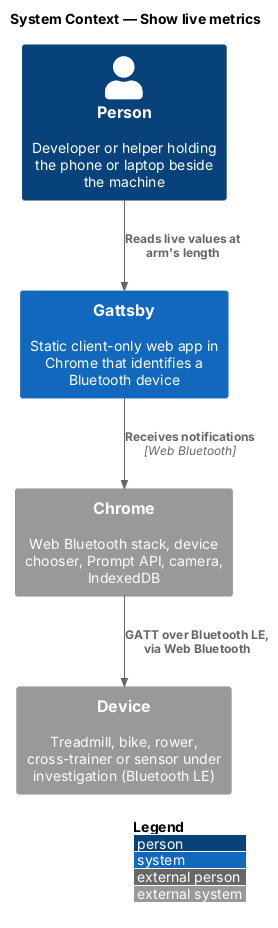
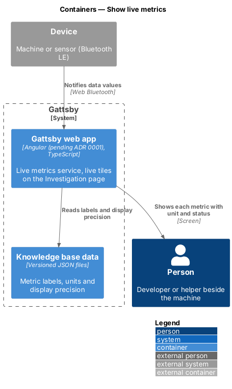
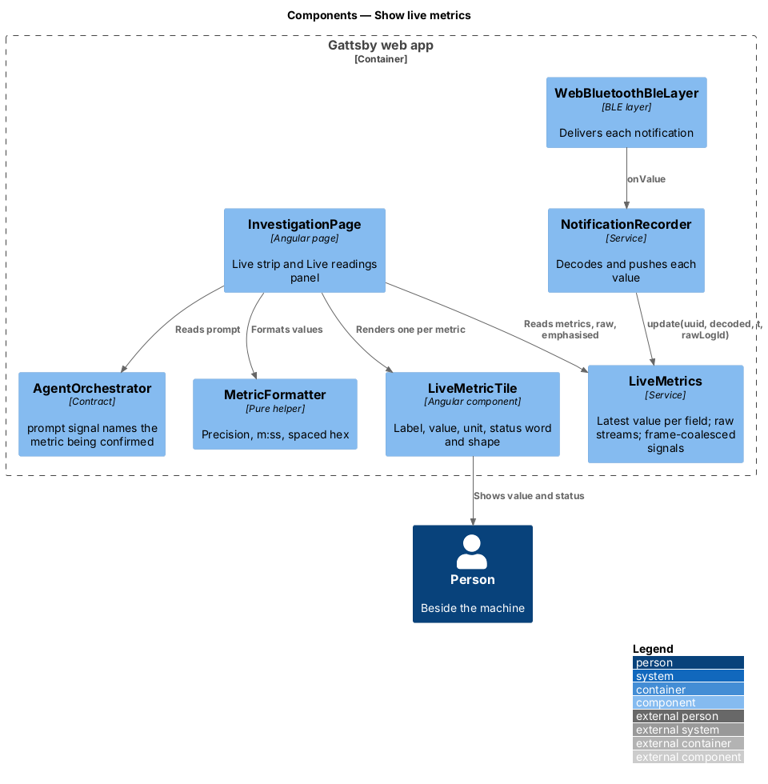
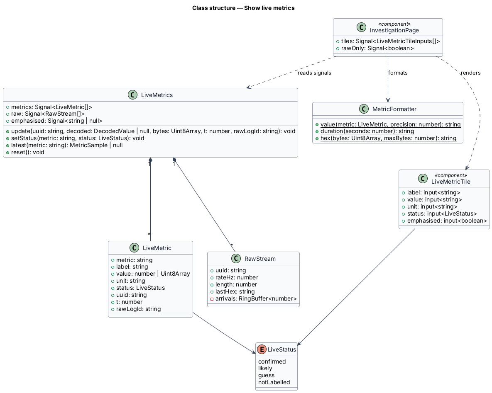
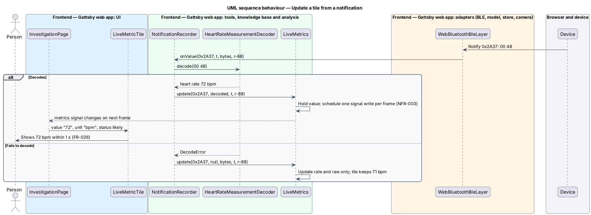
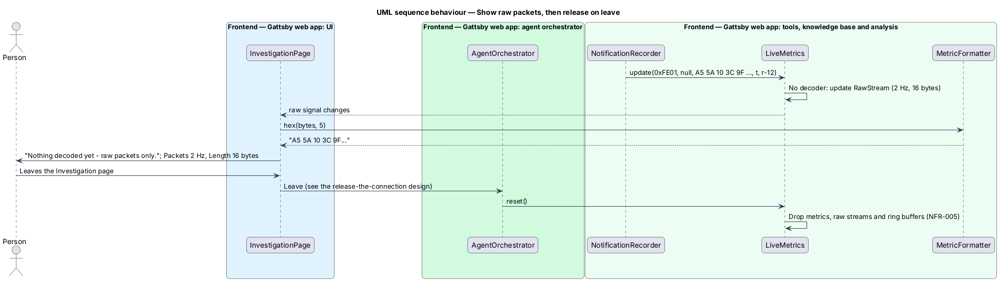

# Show live metrics

## Overview

While a device is subscribed, the person needs to see what it sends: the speed under their feet, the
heart rate from the strap on their chest. This feature shows each decoded metric with its unit,
updated as notifications arrive, in type large enough to read at arm's length. It serves the Standard
path of the playbook, where the person checks that the numbers follow the machine, and the
Proprietary path, where nothing is decoded yet and the live view shows raw packets instead.

**live metric** — latest decoded value of one field of a subscribed characteristic, with its unit,
status and arrival time

**live tile** — presentation component that shows one live metric: its label, value, unit and status
as a word and a shape

**emphasised metric** — live metric that the current prompt is confirming; its tile is placed first
and drawn larger

The feature appears on the Investigation page. In state `default`
(`docs/mocks/pages/investigation/default.html`) a "Live" strip above the prompt shows Speed 6.0 km/h
(confirmed), Incline 0.0 % ("~", likely), Distance 214 m (likely), Elapsed 2:41 (confirmed) and
Field 7 `0x00 0x3C` ("?", not labelled yet). From 992 px a "Live readings" panel at 1 Hz sits beside
the activity feed. In state `proprietary` (`docs/mocks/pages/investigation/proprietary.html`) the
panel reads "Nothing decoded yet — raw packets only." and the strip shows Packets 2 Hz, Length 16
bytes and Last packet `A5 5A 10 3C 9F…`. In state `checklist`
(`docs/mocks/pages/investigation/checklist.html`) the empty panel reads "Appear here once the machine
is moving."

The feature only displays values. Decoding belongs to the decode-standard-data design, and the
*confirmed* status comes from the confirm-with-a-physical-action design.

## Description

The design introduces these building blocks in the Angular (pending ADR 0001) workspace under
`frontend/src/app/`:

- **`LiveMetrics`** (`live/live-metrics.ts`) — root service. `NotificationRecorder` pushes each
  decoded value to it (see the decode-standard-data design). It keeps one `LiveMetric` per field and
  one `RawStream` per characteristic, and exposes them as read-only signals: `metrics`, `raw` and
  `emphasised`. It writes the signals at most once per animation frame. `latest(metric)` serves
  `compare_with_console`.
- **`MetricFormatter`** (`live/metric-formatter.ts`) — pure helper. It formats a value with the
  metric's display precision from the knowledge base, formats elapsed and remaining time as `m:ss`
  ("2:41"), and formats raw bytes as spaced hex, cut to the first 5 bytes followed by "…".
- **`LiveMetricTile`** (`ui/live-metric-tile/live-metric-tile.component.ts`) — presentation
  component. Inputs: `label`, `value`, `unit`, `status`, `emphasised`. It injects no service and
  renders every string as text.
- **`InvestigationPage`** (`pages/investigation/investigation.page.ts`) — reads the `LiveMetrics`
  signals and lays out the tiles: the "Live" strip above the prompt card, and from 992 px the "Live
  readings" panel beside the feed (NFR-010). It marks the tile named by the current prompt as
  emphasised.
- **`AgentOrchestrator`** (`agent/agent-orchestrator.ts`) — its `prompt` signal carries the metric
  the prompt confirms, if any.

### Rules the view follows

1. A notification's value reaches its tile within 1 second (FR-026 AC1). `LiveMetrics` updates its
   signals on the next animation frame. At 50 notifications per second on 4 characteristics the UI
   is never more than one frame behind (NFR-003).
2. A value that fails to decode leaves the tile on its last good value. The decode error is in the
   recording, not on the tile.
3. With FTMS More Data, one notification can carry only some fields. Each tile keeps its own last
   value.
4. Every tile is at least 48 px tall. Below 576 px the emphasised tile comes first, with a 32 px
   value, so the metric being confirmed stays readable at arm's length (FR-026 AC2, NFR-009).
5. Status is a word and a shape, never colour alone (NFR-011): *confirmed* (filled), *likely* ("~",
   half), *guess* (ring), *not labelled yet* ("?"). A field from a standard decoder shows *likely*
   until it is confirmed; a field guessed on the Proprietary path shows *guess*; bytes with no name
   show *not labelled yet* and their hex.
6. With no decoded field, the panel says "Nothing decoded yet — raw packets only." and shows each
   notifying characteristic's rate, packet length and last packet. Before any notification it says
   "Appear here once the machine is moving."
7. The rate ("1 Hz", "2 Hz") is computed from a ring buffer of the last 10 arrival times per
   characteristic.
8. Value changes are not animated, so `prefers-reduced-motion` needs no special case. The tile
   region is not an ARIA live region: a screen reader would otherwise read every value each second.
   A status change, such as "Speed confirmed", is announced once through the activity feed's polite
   live region (see the follow-the-investigation design).
9. Values, units, labels and hex are rendered as text, never as HTML (NFR-013).
10. Memory is bounded: one value per field and 10 timestamps per characteristic. `LiveMetrics.reset()`
    runs when the investigation ends or the person leaves the Investigation page (NFR-005).
11. A tile whose characteristic has sent nothing for some time, and the tiles after a disconnect,
    need a drawn state. Both are `<TO SUPPLY>` in the mocks; until then the tiles keep their last
    values and the connection banner reports the disconnect (see the recover-a-dropped-connection
    design).

### Data shapes

| Type | Fields |
|---|---|
| `LiveMetric` | `metric`, `label`, `value`, `unit`, `status` (`confirmed`, `likely`, `guess`, `notLabelled`), `uuid`, `t`, `rawLogId` |
| `RawStream` | `uuid`, `rateHz`, `length`, `lastHex`, `arrivals` (ring buffer of 10) |
| `LiveMetricTileInputs` | `label`, `value` (formatted string), `unit`, `status`, `emphasised` |

### Tests that prove it

The acceptance spec subscribes the fake heart-rate strap, changes the simulated effort and checks
that the Investigation page object's BPM tile updates. The same spec checks that the tile is at
least 48 px tall at a 390 px viewport.

Journey 3 tests the three scripted standard devices. The desktop panel gives the rate estimated
from the ten most recent decoded notifications on the active characteristic. A decoded field
starts as *likely*. The confirmation observation changes its status to *confirmed*. A missed
confirmation has its own prompt explaining what the data showed. The Proprietary path supplies
the raw-only readings and unknown-field states when that path is implemented.

The recorder integration test advances a fake clock over four simultaneous 50 Hz streams and
checks all 12,000 decoded rows, their order, and the 2,000-row in-memory log window. Run the separate
`npm run e2e:memory` check against a production build to sample Chromium heap once a minute
during an investigation with 36,000 simulated notifications.

## Requirements

The feature realizes the following level-2 (L2) requirements; each refines the level-1 (L1)
requirement cited beside it.

| L2 ID | Refines (L1) | Requirement |
|-------|--------------|-------------|
| [`FR-026`](../../../specs/L2.md#fr-026-show-live-metrics) | `L1-007` | While a device is subscribed, Gattsby must show each decoded metric with its unit, updated as notifications arrive, readable at arm's length. |

## Diagrams

### System context

The device notifies through Chrome's Web Bluetooth stack, and Gattsby shows the person each decoded
value as it arrives.

### Containers

Inside Gattsby only the web app takes part: it reads display precision from the knowledge base data
and keeps live values in memory, not in the database.

### Components

`NotificationRecorder` pushes decoded values to `LiveMetrics`; `InvestigationPage` reads its signals,
formats them with `MetricFormatter` and renders one `LiveMetricTile` per metric.

### Class structure

`LiveMetrics` owns the `LiveMetric`s and `RawStream`s and exposes them as signals;
`LiveMetricTile` takes only formatted inputs.

### Behaviour — update a tile from a notification

A heart-rate notification is decoded, `LiveMetrics` takes it, and on the next frame the BPM tile
shows 72 bpm; a payload that fails to decode leaves the tile on its last value.

### Behaviour — show raw packets, then release on leave

On the Proprietary path the panel shows rate, length and the last packet; leaving the Investigation
page resets `LiveMetrics` and releases its memory.

